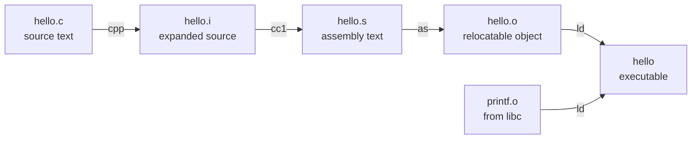
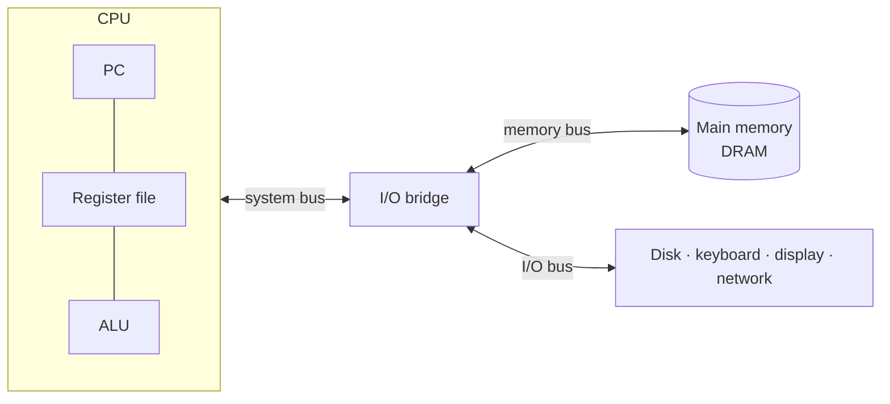

# A tour of the system

> One tiny program, followed from the editor to the screen, touches every
> layer this book covers. The chapter is a map. Every later chapter is one
> region of it, drawn in detail.

## Bits plus context

`hello.c` on disk is a run of bytes. The first byte holds 35, which the
editor shows as `#`. The newline at the end of each line is the byte 10.
Nothing in those bytes says "this is text." The same eight bits could be part
of an integer, a float, a pointer or a machine instruction.

That is the first idea of the book, and every later chapter returns to it:
**all information is bits, and only the context decides what they mean.**
Numbers in a machine are finite approximations of the integers and reals you
learned at school, and they misbehave in specific, predictable ways. Chapter 2
is about exactly those ways.

## The compilation system

`gcc -o hello hello.c` looks like one step. It is four programs in a row:

- The **preprocessor** pastes in `#include` files and expands macros. The
  output is still C.
- The **compiler** turns C into assembly, one line per machine instruction,
  still human-readable.
- The **assembler** encodes those instructions as bytes in a *relocatable
  object file*. The addresses inside it are not fixed yet.
- The **linker** merges your object file with the ones you call into, such as
  `printf.o`, and fixes every address. The result is an *executable*.

The authors give three reasons a working programmer should care what happens
inside this pipeline:

1. **Performance.** Is a `switch` faster than a chain of `if`s? What does a
   function call cost? Why does summing into a local beat summing through a
   pointer? You can only answer these questions by reading the machine code
   (chapter 3) and knowing how the processor runs it (chapter 5).
2. **Link-time errors.** These are the most baffling errors in large builds:
   "unresolved reference", two globals with the same name, library order on
   the command line, failures that only appear at run time. Chapter 7 explains
   all of them.
3. **Security.** Buffer overflows were, for years, the majority of holes in
   network servers. To understand them you have to see how data and control
   information sit side by side on the stack (chapter 3).

## What the hardware is

- **Buses** move fixed-size chunks called *words*. The word size is a basic
  property of the machine: 4 bytes on a 32-bit machine, 8 bytes on a 64-bit one.
- **Main memory** is DRAM. Logically it is one long array of bytes, each with
  an address that starts at zero.
- **The processor** has a *program counter* (PC) that holds the address of the
  next instruction. Forever it loops: read the instruction at the PC, do it,
  update the PC. Instructions are only a few kinds of thing: **load** (memory to
  register), **store** (register to memory), **operate** (two registers through
  the ALU), and **jump** (write a new value into the PC).

The book draws a line here that it uses for the rest of the text. The
**instruction set architecture** (ISA) is the contract: what each instruction
does, as if they ran one at a time in order. The **microarchitecture** is how
the chip actually keeps that contract while doing far more clever things.
Chapter 3 programs against the ISA. Chapters 4 and 5 look underneath it.

Running `./hello` is mostly copying. The shell reads the characters you type
into registers and then into memory. The loader copies the program from disk
into memory, using *DMA* so the bytes skip the CPU. The CPU copies the string
`"hello, world\n"` from memory to registers and out to the display.

## Caches matter, and they form a hierarchy

If a system spends its life copying, the speed of copying is the speed of the
system. Physics makes larger storage slower, and faster storage costs more per
byte. In the book's example, a disk might be 1,000× bigger than memory but
take 10,000,000× longer to read a word from. The register file holds a few
hundred bytes but is about 100× faster than memory. That gap between processor
speed and memory speed grows every year.

The fix is a small, fast store between each pair of levels, and the whole
arrangement is the **memory hierarchy**. Each level is a cache for the level
below it: registers for L1, L1 for L2, L2 for L3, L3 for DRAM, DRAM for local
disk, local disk for disks on other machines. It works because programs have
**locality**: they keep touching the same data, and data near it.

The book makes a promise here: a programmer who understands caches can make
code run **an order of magnitude** faster. Chapter 6 delivers on it.

## The operating system: three abstractions

Neither the shell nor `hello` touches a device directly. Everything goes
through the operating system. The OS has two jobs: protect the hardware from
runaway programs, and give programs one simple interface over very different
devices. It does both with three abstractions:

| Abstraction | Stands in for | Chapter |
| --- | --- | --- |
| **Files** | I/O devices: disks, terminals, *even the network* | 10, 11 |
| **Virtual memory** | Main memory and disk | 9 |
| **Processes** | The processor, main memory and I/O devices together | 8 |

A **process** is a running program that believes it has the machine to itself.
The OS keeps that belief true by *context switching*: it saves one process's
PC, registers and memory state, restores another's, and jumps. A **thread** is
an extra flow of control inside one process. Threads share code and globals,
which makes sharing data easy and makes them cheaper than processes
(chapter 12).

**Virtual memory** gives every process the same picture of memory. From low
addresses to high: program code and data, a heap that grows with `malloc`,
shared libraries in the middle, the user stack at the top, and above that the
kernel's region, which user code may not touch. The process's memory really
lives on disk, and DRAM is used as a cache for it.

A **file** is a sequence of bytes, nothing more. That one idea is why the same
`read` and `write` calls work on a disk, a keyboard and a socket.

## Networks are just another device

To your machine, the network is one more I/O device: copy bytes to the network
adapter and they land on another machine instead of on a disk. Running `hello`
on a remote host over telnet follows the pattern every network program
follows: the client sends a request, the server does the work, and the reply
comes back (chapter 11).

## Two themes that run through everything

**Concurrency and parallelism.** *Concurrency* means several activities are in
progress at once. *Parallelism* means using concurrency to finish sooner. The
book finds it at three levels:

- **Thread level.** Multicore chips and *hyperthreading*. Their example is an
  Intel Core i7 with four cores, each running two threads, so eight threads
  run truly in parallel. A conventional CPU needs about 20,000 cycles to switch
  threads. A hyperthreaded one picks which thread to run each cycle.
- **Instruction level.** A modern processor keeps many instructions in flight
  and finishes 2–4 per cycle. Processors that finish more than one instruction
  per cycle are called *superscalar*.
- **SIMD.** A single instruction does the same operation on several values at
  once, for example four `float` additions together.

**Abstraction.** The ISA abstracts the processor. Files, virtual memory and
processes abstract the OS's resources. A *virtual machine* abstracts the whole
computer. Most of the book's advice comes from looking one layer below the
abstraction you normally use.

## What to take away

- The same bytes mean different things in different contexts. Most surprising
  bugs are a disagreement about context.
- "Compiling" is preprocess, compile, assemble, link. Errors from the last step
  are their own category, with their own rules.
- Most of a computer's time goes to moving data. Caches, and code that respects
  locality, are where performance lives.
- The OS gives you three illusions: processes, virtual memory and files. You
  will debug better once you know how each one is built.

---

Previous: [Overview](./README.md) ·
Next: [Part I — Program structure and execution](./1-program-structure/README.md)
