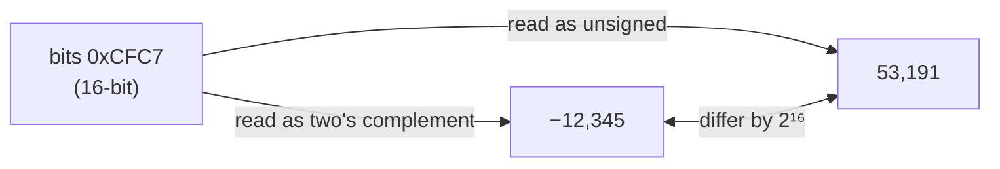

# Representing and manipulating information

> Machine numbers are not the integers and reals you learned at school. They
> are finite bit patterns with exact rules, and almost every numeric bug is one
> of those rules showing through.

## Memory is a byte array, and types live only in the compiler

To a machine-level program, memory is one huge array of bytes, the *virtual
address space*. A pointer's value is the address of the first byte of
something. Its type exists only in the compiler, which uses it to choose which
instructions to emit. The machine code that comes out carries no types at all.
It moves blocks of bytes.

**Hexadecimal** is how you read those bytes. One hex digit is four bits, so
converting between hex and binary is a lookup, one digit at a time. Converting
between decimal and hex needs real arithmetic, and the book's advice is to let
a tool do it.

**Word size** is the nominal size of an integer and of a pointer, and it caps
the address space. A w-bit machine can address 2^w bytes, so 32 bits gives
4 GB. The book was written while 32-bit was the norm and predicted the move to
64 bits, which has since happened. Its warning still applies to any code that
assumes sizes: storing a pointer in an `int` works on a 32-bit machine and
breaks on a 64-bit one.

| C type | Typical 32-bit | Typical 64-bit |
| --- | --- | --- |
| `char` | 1 | 1 |
| `short` | 2 | 2 |
| `int` | 4 | 4 |
| `long` | 4 | **8** |
| `char *` (any pointer) | 4 | **8** |
| `float` / `double` | 4 / 8 | 4 / 8 |

The C standard sets only *minimum* ranges. When the exact width matters, as
in wire formats and file formats, use `int32_t`, `uint16_t` and the other
types from `<stdint.h>`.

## Byte order

A multi-byte object is stored in consecutive bytes, and its address is the
lowest one. The order of the bytes inside it is a convention:

- **Little endian** puts the least significant byte first. Intel-compatible
  machines do this.
- **Big endian** puts the most significant byte first. Older IBM and Sun
  machines did this.

The names come from *Gulliver's Travels*, and the book's view is that the
choice is just as arbitrary as which end of the egg you break. Byte order
stays invisible until one of three things happens:

1. **Binary data crosses a network** between machines with different orders,
   which is why network code converts to a standard order (chapter 11).
2. **You read a disassembly**, where a little-endian address appears with its
   bytes reversed.
3. **You get around the type system** with a cast, for example by reading an
   `int` through an `unsigned char *` to see its bytes.

Text is the portable case. The string `"12345"` is the bytes
`31 32 33 34 35 00` on every ASCII machine, whatever its word size or byte
order. Machine code is the least portable: the same tiny function compiles to
different bytes on Linux, Windows, SPARC and x86-64.

## Bit-level operations

C's `&`, `|`, `^` and `~` work on every bit at once. Their main use is
**masking**: `x & 0xFF` keeps the low byte, and `~0` is all ones on any word
size. A bit vector can also stand for a set. That is how signal masks work in
chapter 8: bit *i* set means signal *i* is enabled.

Don't confuse them with `&&`, `||` and `!`. Those treat any nonzero value as
true, always return 0 or 1, and **short-circuit**, so `p && *p` never
dereferences a null pointer.

**Shifts.** `x << k` fills with zeros on the right. Right shift comes in two
kinds: *logical* fills with zeros, and *arithmetic* fills with copies of the
sign bit. C requires a logical shift for unsigned values but leaves signed
values to the implementation. In practice it is almost always arithmetic.
Shifting by the word size or more is undefined in C. Many machines take the
amount mod w, but you can't rely on that. And check precedence:
`1<<2 + 3<<4` means `1 << (2+3) << 4`.

## Unsigned and two's complement

With *w* bits:

- **Unsigned** gives every bit a positive weight. Range: 0 to 2^w − 1 (*UMax*).
- **Two's complement** gives the top bit a *negative* weight of −2^(w−1).
  Range: −2^(w−1) (*TMin*) to 2^(w−1) − 1 (*TMax*).

The two's-complement range is **lopsided**: |TMin| = TMax + 1, so TMin has no
positive partner. And −1 is all ones, the same bit pattern as UMax.

The rule that matters most: **casting between signed and unsigned keeps the
bits and changes the reading.** A negative value becomes a large positive one
(add 2^w). A large unsigned value becomes negative (subtract 2^w).

C applies this **silently**. If either operand of a comparison is unsigned, the
signed one is converted to unsigned first. So `-1 < 0U` is *false*, because
it becomes `4294967295U < 0U`.

Resizing has its own rules:

- **Widening** uses *zero extension* for unsigned values and *sign extension*
  for signed values (copy the sign bit). Both keep the value.
- **Truncating** drops the high bits. That is value mod 2^k, reread as signed if
  the type is signed. It is overflow without a warning.

The book gives two real security holes that came from these rules:

- **FreeBSD `getpeername` (2002).** A signed length was passed as the `size_t`
  argument of `memcpy`. A negative value became a huge positive count, which
  could leak kernel memory to the caller.
- **Sun's XDR library (2002).** An allocation size computed as
  `ele_cnt * ele_size` overflowed. With 2^20 + 1 elements of 4,096 bytes each,
  the program allocated 4,096 bytes and then copied about 4 GB into them.

The authors weigh up unsigned types fairly. Java leaves them out entirely, and
they are a common source of these bugs. But they are the right tool when a
word is a set of flags rather than a number, for addresses, and for
multi-precision arithmetic.

## Integer arithmetic is modular arithmetic

Every add, subtract and multiply keeps only the low *w* bits.

- **Unsigned addition** is addition mod 2^w. It overflowed exactly when the
  sum is *smaller* than one of the operands.
- **Two's-complement addition** gives *the same bits* as unsigned addition, so
  the hardware uses one instruction for both. Adding two positives can give a
  negative result (positive overflow), and adding two negatives can give a
  positive result (negative overflow).
- **Negation:** −TMin is TMin. The bit trick for −x is `~x + 1`.
- **Multiplication** also keeps the low *w* bits, and the truncated bits are the
  same for signed and unsigned. That is why `x * x` can be negative.

Speed explains a common compiler trick. In the book's era, a multiply took 10
or more cycles and a divide 30 or more, while add, shift and bitwise operations
took 1. So compilers rewrite `x * 14` as `(x<<4) - (x<<1)`. Division by 2^k
becomes a right shift. Unsigned values need a logical shift. Signed values need
an arithmetic shift, but that rounds *down*, and C division rounds *toward
zero*. For negative x the fix is to add a bias of 2^k − 1 before shifting. You
will see exactly that sequence in compiled code.

> **Since this edition (2011):** the book treats signed overflow as
> wrapping around, because that is what the hardware does. In the C standard,
> though, signed overflow is *undefined behaviour*, and modern optimising
> compilers rely on it not happening, for example by deleting an overflow
> check like `x + 1 < x`. Write overflow checks using unsigned arithmetic or
> the compiler's checked-arithmetic builtins. Also, C23 now *requires* two's
> complement, which the book could only call near-universal.

## Floating point

IEEE 754 (about 1985, built on William Kahan's design for Intel's 8087) stores
a value as (−1)^s × M × 2^E, in three fields:

| Format | sign | exp | frac | Bias |
| --- | --- | --- | --- | --- |
| `float` (single) | 1 | 8 | 23 | 127 |
| `double` (double) | 1 | 11 | 52 | 1023 |

The value of the `exp` field decides which of three cases you are in:

- **Normalized** (exp is neither all 0s nor all 1s): E = exp − Bias, and
  M = 1.frac. The leading 1 is implied, which gives one bit of precision for
  free.
- **Denormalized** (exp all 0s): E = 1 − Bias, and M = 0.frac. This case
  gives you zero, including a distinct **−0.0**, and it gives *gradual
  underflow*: evenly spaced values near zero. The "1 − Bias" makes the step
  from the largest denormal to the smallest normal smooth.
- **Special** (exp all 1s): ±∞ if frac is 0, otherwise **NaN**.

A nice property of the design: read non-negative floats as unsigned integers
and they sort in the same order.

**Rounding.** The default mode is *round-to-even*: values exactly halfway go to
whichever neighbour has an even last digit. The point is that it doesn't drift
up or down on average. There are three other modes (toward zero, down, up) for
computing bounds.

**What floating point doesn't promise:**

- **Addition is not associative.** `(3.14 + 1e10) - 1e10` is 0.0, but
  `3.14 + (1e10 - 1e10)` is 3.14.
- **Multiplication is neither associative nor distributive.**
  `(1e20*1e20)*1e-20` is +∞, but `1e20*(1e20*1e-20)` is 1e20.
- Because of this, compilers are *conservative*: they won't reorder floating
  point, even where reordering would be faster. Chapter 5 comes back to this.
- What it *does* keep is **monotonicity**: if a ≥ b, then x + a ≥ x + b.
  Integer arithmetic doesn't have that property.
- **Converting to `int` rounds toward zero**, and the result is undefined if it
  overflows. On x86 the result is TMin, so `(int) 1e10` comes out negative.

The book's two cautionary tales:

- **Patriot missile, 1991.** A 0.1-second tick was stored as a truncated
  binary fraction. Part of the code used an upgraded, more accurate time
  routine and part did not, so after about 100 hours of running the two time
  readings disagreed and the tracking failed. 28 soldiers died.
- **Ariane 5, 1996.** A 64-bit float was converted to a 16-bit integer in code
  reused from Ariane 4, where the value always fit. On the faster rocket it
  overflowed, and the rocket broke up 37 seconds after launch.

## What to take away

- The type is how you choose to read the bits. Casting between signed and
  unsigned changes the reading, not the bits.
- Never mix signed and unsigned values in a comparison or a length. That mix
  causes real security holes.
- Integer arithmetic wraps. Floating-point arithmetic rounds, and neither
  follows the algebra you learned at school.
- Use exact-width types for anything that crosses a boundary: a file, a socket
  or another machine.

---

Previous: [Part I](./README.md) ·
Next: [Machine-level representation of programs](./02-machine-level-programs.md)
