# Machine-level representation of programs

> You will rarely write assembly. You will often need to read it: in a
> profiler, a crash dump or a security report. This chapter teaches you to map
> compiled code back to the C it came from, and to see what C never shows you.

> **Era note.** The book's main text uses 32-bit **IA32**. A late section
> (3.13) then covers **x86-64**, which is what you will actually meet today.
> This chapter keeps the book's ideas and uses the x86-64 conventions where
> the book gives them. The 3rd edition (2015) was rewritten around x86-64
> throughout.

## Two forms of machine code, and what they show you

`gcc -O1 -S` stops at assembly text. `gcc -c` goes on to a relocatable object
file, and `objdump -d` disassembles that back into text. The book's key point:
**what runs is just a sequence of bytes.** The machine knows almost nothing
about the source that produced them. Variable names and types are gone.
Signed and unsigned look the same, pointers and integers look the same.
Arrays and structs are just runs of bytes.

What C hides and machine code shows:

- **The program counter**: `%eip` on IA32, `%rip` on x86-64.
- **The integer registers.** IA32 has 8 registers of 32 bits. x86-64 has 16
  of 64 bits (`%rax` … `%r15`), and their low 32, 16 and 8 bits can each be
  used by name (`%eax`, `%ax`, `%al`).
- **Condition codes** set by the last arithmetic operation.
- **Floating-point / vector registers.**

Two smaller things matter when you read real listings:

- GCC and objdump print **AT&T syntax**: `%` before registers, the source
  operand *first*, and size suffixes (`movl`, `movq`). Intel's and Microsoft's
  documentation use **Intel syntax**, which lists the operands in the *opposite*
  order. Mixing the two up is the classic way to misread a listing.
- x86 instructions are **1 to 15 bytes long**, and from any starting point
  there is exactly one way to decode them.

## Operands and data movement

An operand can be an **immediate** (`$-577`), a **register** (`%eax`), or a
**memory reference**. The general memory form is `Imm(base, index, scale)`,
which means the address *Imm + base + index × scale*, with scale 1, 2, 4 or 8.
That one form covers array indexing (`a[i]` with 4-byte ints is `(%rdx,%rcx,4)`)
and struct fields (`8(%rdi)`).

- `mov` copies a value. Its two operands can't **both** be memory.
- `movs` and `movz` widen a value with sign extension or zero extension.
- On x86-64, **writing a 32-bit register clears the upper 32 bits**. Writing an
  8- or 16-bit register leaves the rest alone.
- `push` and `pop` work on the stack. The stack **grows downward**, and `%esp`
  (or `%rsp`) points at the top.
- `lea` *looks* like a load but only does the address calculation. Compilers
  use it for arithmetic: `leal 7(%edx,%edx,4), %eax` computes 5x + 7.

Pointers in C become plain addresses in registers. A dereference is a memory
operand. Local variables live in registers whenever they can, because
registers are far faster than memory.

## Arithmetic

`add`, `sub`, `imul`, `and`, `or`, `xor`, `neg`, `not` and the shifts. Almost
all of them behave the same for signed and unsigned values, which is the
two's-complement payoff from chapter 2. The exceptions are **right shift**
(`sar` vs `shr`), **division**, and the **full-width multiply**, each of which
comes in signed and unsigned versions. Division uses the `%edx:%eax` (or
`%rdx:%rax`) pair as the dividend, and needs a sign extension first
(`cltd`, `cqto`).

## Control: condition codes, jumps and conditional moves

Every arithmetic instruction sets four flags: **CF** (unsigned carry), **ZF**
(zero), **SF** (sign) and **OF** (signed overflow). `lea` sets none of them.
`cmp` (a subtraction) and `test` (an AND) set the flags and throw the result
away. The flags are then used in one of three ways:

- `setX` writes 0 or 1 into a byte register.
- `jX` jumps.
- `cmovX` moves a value conditionally.

The suffix names the *condition*: `l`/`g` for signed less/greater, `b`/`a` for
unsigned below/above. So `setl` means "set if less", not "set long".

**Branches.** An `if` becomes a test and a conditional jump around one of the
blocks. **Loops** usually become the *do-while* shape: test at the bottom,
plus one jump to skip the first run if needed. Jump targets are mostly stored
**relative to the PC**, as offsets from the next instruction, so the code
works wherever the linker puts it.

**Switch** with several cases (the book says four or more) over a small range
becomes a **jump table**: an array of code addresses, indexed by the switch
value. The cost is the same however many cases there are. The compiler
subtracts the lowest case value and does *one unsigned compare* to rule out
both too-small and too-large values (negative numbers become huge when read as
unsigned). Gaps and duplicate cases are just repeated table entries.

**Conditional moves and why branches are expensive.** A pipelined processor
has to *guess* which way each branch goes. If it guesses wrong, it throws away
the work it started. The book's measurement for `absdiff` on a Core i7:

| Version | Predictable data | Random data |
| --- | --- | --- |
| Branch | ~13 cycles | ~35 cycles (misprediction penalty ~44) |
| `cmov` | ~14 cycles | ~14 cycles |

A conditional move computes **both** results and keeps one, so there is
nothing to mispredict. It is only safe when both sides are cheap and **have no
side effects**. `xp ? *xp : 0` *can't* use it, because it would dereference
NULL. The authors add that GCC uses conditional moves conservatively, even in
cases where a misprediction would cost more.

## Procedures and the stack frame

A call passes control and data, and it needs space for the callee's locals.
`call` pushes the return address and jumps. `ret` pops the address and jumps
back. Everything else is **convention**, and every function, including the
ones in libraries, has to follow it.

A function keeps a local on the stack instead of in a register when there are
too few registers, when the local is an array or struct, or when **its address
is taken with `&`**.

**Saving registers.** Registers are shared, so the convention divides them.
**Caller-saved** registers can be overwritten by the callee, so the caller
saves anything it needs. **Callee-saved** registers must come back unchanged,
so a callee that wants one saves it first and restores it before returning.
On IA32 the caller-saved registers are `%eax`, `%ecx` and `%edx`, and the
callee-saved ones are `%ebx`, `%esi` and `%edi`.

**On x86-64 the convention moved into registers**, which is the biggest change
in section 3.13:

- Up to **six integer or pointer arguments** go in registers. Only the
  seventh and later go on the stack.
- The return value is in `%rax`.
- The callee-saved registers are `%rbx`, `%rbp` and `%r12`–`%r15`.
- There is usually **no frame pointer**. The frame has a fixed size, and
  everything is addressed from `%rsp`.
- A *leaf* function often uses no stack at all. A function may also use the
  128-byte **red zone** below `%rsp` without moving the pointer.

The book's small example makes the difference concrete. The IA32 version was
8 instructions with 7 memory references. The x86-64 version was 4 instructions
with 3.

**Recursion needs nothing special.** Each call gets its own frame, so its own
locals and saved state. The stack's last-in, first-out order matches the order
of calls and returns.

## Arrays, structs, unions and alignment

- **Arrays.** `T A[N]` is N × sizeof(T) contiguous bytes, and `A[i]` is
  `*(A + i)` at address A + i × sizeof(T). Pointer arithmetic **scales by the
  type**: `(int *)p + 7` adds 28 bytes, and `(int *)(p + 7)` adds 7.
- **Nested arrays** are stored **row-major**: `D[i][j]` is at
  D + (i × C + j) × sizeof(T). For fixed sizes, the compiler replaces the
  indexing with pointers that step through the data. Variable-size arrays
  (C99) need a real multiply.
- **Structs** are fields at fixed offsets. Field access compiles to
  "base + constant", and the field names are gone from the machine code.
- **Unions** put every field at offset 0. They save space when fields are
  mutually exclusive, and they let you read the same bits as another type.
  They are also an easy way to defeat the type system by accident.
- **Alignment.** A K-byte value should sit at an address that is a multiple of
  K. The compiler **pads between fields** so each one is aligned, and **pads at
  the end** so every element of an array of the struct is aligned too.
  `struct { int i; char c; int j; }` takes 12 bytes, not 9. Linux on IA32 was
  more relaxed than this. x86-64 requires the full rule. Some SSE instructions
  *fault* on data that isn't 16-byte aligned.

Ordering fields from largest to smallest is the cheap way to cut the padding.

## Buffer overflow

C does no bounds checking, and **local buffers sit right next to the saved
registers and the return address.** The book's `echo` example reads a line
into an 8-byte buffer with `gets`. Longer input overwrites, in order: the saved
`%ebx`, then the saved `%ebp`, then **the return address**. At that point
`ret` jumps wherever the input told it to.

The attack puts **exploit code** in the input and points the overwritten
return address at it. The 1988 Internet worm used this against `fingerd`.
`gets` has no length argument at all, and `strcpy`, `strcat` and `sprintf`
write without knowing the destination's size. Use the bounded versions.

The book covers three defences, and the combination is stronger than any one
of them:

| Defence | What it does | How it is beaten |
| --- | --- | --- |
| **Stack randomization / ASLR** | The stack, heap, libraries and code move on every run | Brute force with a **nop sled**: 32-bit gives only about 2^15 guesses to try |
| **Stack protector (canary)** | A random value between the buffer and the saved state, checked before `ret` | Leaking the canary, or overwriting something that isn't protected |
| **NX (no-execute) bit** | The stack can be written but not executed | Reusing code that is already executable |

> **Since this edition:** the last row of that table became the main attack
> technique. *Return-oriented programming* chains together small pieces of
> existing code that end in `ret`, so NX doesn't stop it. Today's defences add control-flow integrity and shadow stacks.
> The underlying fix is still the same: use bounded copies, and don't let
> outside input control lengths.

## Higher optimization levels

The book reads `-O1` code because it maps cleanly back to the source. Real
builds use `-O2`, where functions are **inlined** (so a breakpoint may never
fire), recursion becomes **iteration**, and control flow is merged across
statements. When a listing looks "wrong", that is usually why.

## What to take away

- Types, names and structure are gone at the machine level. What is left is
  addresses, offsets and conventions.
- Unpredictable branches are expensive. A `cmov`, or branch-free code, makes
  the cost predictable.
- On x86-64 the first six arguments are in registers. Locals go to the stack
  when their address is taken, when they are aggregates, or when registers run
  out.
- A stack buffer overflow can overwrite the return address. Use bounded copies,
  and rely on the canary, ASLR and NX together. None of them is enough alone.

---

Previous: [Representing information](./01-representing-information.md) ·
Next: [Processor architecture](./03-processor-architecture.md)
