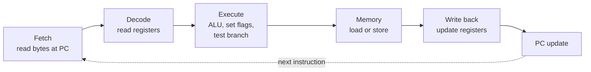

# Processor architecture

> The book builds a working processor for a toy instruction set, Y86, out of
> logic gates. You don't need the gates. You do need what they reveal: the ISA
> promises one instruction at a time, the hardware does many at once, and the
> places where that promise is hard to keep are where your code gets slow.

## Y86: IA32 cut down to the bone

Y86 keeps IA32's eight registers, condition codes, stack and little-endian
encoding. It removes most of the rest:

- The single `mov` is split into four instructions, `irmovl`, `rrmovl`,
  `mrmovl` and `rmmovl`. The letters spell the source and destination:
  immediate, register, memory.
- Arithmetic (`addl`, `subl`, `andl`, `xorl`) works **on registers only**.
- Memory operands use base + displacement only, with no index and no scale.
- Instructions are 1–6 bytes long. The first byte says the instruction and the
  operation. Given that byte, the length is known, so the bytes decode in only
  one way.
- A status code reports whether the machine is running normally (`AOK`) or
  stopped on `HLT`, a bad address (`ADR`) or a bad instruction (`INS`).

**RISC versus CISC**, which the book covers in a side note:

| CISC (IA32) | Early RISC |
| --- | --- |
| Many instructions. Intel's manual runs past 1,200 pages | Typically under 100 |
| Variable length, 1–15 bytes | Fixed length, usually 4 bytes |
| Arithmetic works on memory operands | **Load/store**: only loads and stores touch memory |
| Condition codes | Test results go into ordinary registers |
| Arguments passed on the stack | Arguments in registers, up to 32 registers |

The authors' verdict: by the early 1990s *neither pure form won*. RISC chips
gained instructions. CISC chips started translating their instructions on the
fly into simple RISC-like operations and running those on pipelines. x86 took
the desktop, and RISC (ARM above all) took embedded devices, where cost and
power matter more than backward compatibility.

> **Since this edition:** ARM has moved well beyond embedded devices, into
> laptops and servers (Apple's M-series chips, AWS Graviton). That supports the
> book's point that the ISA matters less than how it is implemented.

## Hardware in three ideas

- **Combinational logic** computes outputs from inputs with no memory, and it
  responds continuously. Words are just bundles of bits. A **multiplexer**
  selects one input. The **ALU** does the arithmetic.
- **Clocked registers** hold state, and they change only on the clock edge.
  The *register file* (your program's `%eax` and the rest) is a small memory
  addressed by register number, with two read ports and one write port.
- **Clocking** gives you sequencing. In each cycle, signals travel through the
  logic. When the clock rises, the results are stored.

## SEQ: one instruction per (long) cycle

Every instruction goes through the same **six stages**. Instructions that don't
need a stage pass through it doing nothing:

Using the same shape for every instruction keeps the hardware small. For
example, there is **one ALU**, and it adds `valC` to compute an address,
subtracts 4 for a push, and does the arithmetic for `addl`. In hardware, a
duplicated block costs much more than duplicated code does in software. SEQ is
correct but slow: the clock period has to be as long as the slowest
instruction's path through every stage.

## Pipelining: throughput at the cost of latency

Think of a cafeteria line: every station is busy with a different customer.
The book's numbers:

| Design | Cycle | Throughput | Latency per instruction |
| --- | --- | --- | --- |
| Unpipelined: 300 ps logic + 20 ps register | 320 ps | 3.12 GIPS | 320 ps |
| Three 100 ps stages, each + 20 ps register | 120 ps | **8.33 GIPS** | 360 ps |

That is 2.67× the throughput, and each instruction takes 12% longer. Pipelines
fall short of the ideal for two reasons. **Uneven stages** limit the clock to
the slowest stage. **Register overhead** means that once the stages are very
short, the fixed cost of the pipeline registers dominates. Modern processors
still use deep pipelines, 15 stages or more, to run at high clock rates.

## Hazards: where "one at a time" gets hard

A pipeline overlaps instructions that *depend on each other*. When a dependency
could produce a wrong answer, it is a **hazard**.

**Data hazards.** An instruction reads a register in Decode. The instruction
before it may not have written that register yet, because writing happens
three stages later. There are three fixes, each better than the last:

1. **Stall.** Hold the instruction in Decode and send a *bubble* (an empty
   instruction) down the pipeline instead. It is correct, but a stall of up to
   three cycles is common.
2. **Forward (bypass).** Take the value straight from a later stage, before it
   reaches the register file. PIPE has five forwarding sources. With them,
   most dependencies cost nothing.
3. **Load interlock.** A value loaded from memory isn't ready until the Memory
   stage, which is too late to forward to the very next instruction without
   going "backward in time". So stall *once*, then forward.

**Control hazards.** After fetching a branch, the next fetch can't wait for
the branch to be resolved. PIPE **predicts "taken"**, which the book says is
right about 60% of the time. "Backward taken, forward not taken" is right
about 65%, because loops branch backward. On a wrong guess, the instructions
already fetched are *cancelled*. For `ret`, real processors keep a hardware
**return-address stack**. PIPE simply waits.

**Exceptions** have to look *precise*: everything before the faulting
instruction has finished, and nothing after it has had any effect. The
technique is to carry a status code along with each instruction and act on it
only when the instruction reaches Write-back. That way, an exception in an
instruction that is later cancelled never happens.

## What it costs: CPI

Cycles per instruction = 1.0 + bubbles per instruction. The book uses typical
instruction frequencies:

| Cause | Frequency | Bubbles | Penalty |
| --- | --- | --- | --- |
| Load/use | 25% loads × 20% dependent | 1 | 0.05 |
| Mispredicted branch | 20% branches × 40% wrong | 2 | **0.16** |
| Return | 2% | 3 | 0.06 |
| **CPI** | | | **1.27** |

**Branch misprediction is the largest cost**, and that is the link to
chapters 3 and 5: branch-free code and predictable branches really do matter.

Two things a five-stage pipeline doesn't model, both covered in the book's
closing section:

- **Multi-cycle operations.** Floating point and integer division take from 3
  to about 32 cycles, so they run in separate functional units alongside the
  pipeline.
- **The memory system.** A cache miss costs 3–20 cycles of stall. A page fault
  traps to the OS and costs *millions* of cycles, because the disk is that slow.

The five-stage design was state of the art in the mid-1980s (the first SPARC
and MIPS chips). A five-stage pipeline can never get CPI below 1.0. Modern
**superscalar, out-of-order** processors finish several instructions per cycle,
which is chapter 5's model.

## What to take away

- The ISA is a promise that instructions run one at a time. The hardware keeps
  that promise while overlapping instructions as much as it can.
- Dependencies are cheap when the hardware can forward them, and costly when it
  has to stall, for example a load followed immediately by its use.
- Wrong branch predictions are the biggest pipeline cost. Write code whose
  branches are predictable, or that has no branches.
- Pipelining improves throughput, not latency. The same trade-off shows up in
  every queue and batch system you will ever build.

---

Previous: [Machine-level programs](./02-machine-level-programs.md) ·
Next: [Optimizing program performance](./04-optimizing-performance.md)
