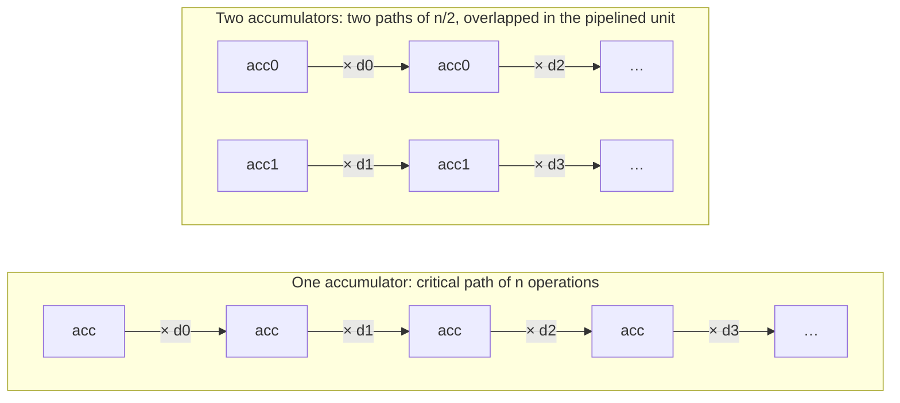
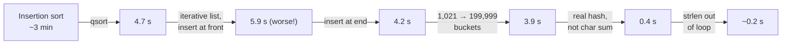

# Optimizing program performance

> First pick the right algorithm. Then remove what stops the compiler from
> optimizing. Then, and only for the hot loop, shape the code to fit the
> processor. The chapter takes one loop from about 29 cycles per element to
> under 1, and shows the reason behind each step.

## What a compiler can't do for you

A compiler only applies **safe** optimizations: changes that behave the same
for *every* possible input. Two things block it most often:

- **Memory aliasing.** If two pointers might refer to the same location, the
  compiler must assume they do. `*xp += *yp; *xp += *yp;` can't be merged into
  `*xp += 2 * *yp`, because if `xp == yp` the first gives 4× and the second 3×.
- **Function calls.** The compiler can't tell whether a function has side
  effects, so it won't move a call out of a loop or merge two calls. *Inlining*
  (at `-O2` and above) helps, but only when the function body is visible.

The book uses GCC at `-O1` on purpose, to show that well-written C at a low
optimization level can beat sloppy C at the highest one. Its measure is
**cycles per element (CPE)**: the slope of run time against input size, which
ignores fixed overhead.

## The running example: step by step

The example is a function that sums or multiplies all the elements of a
vector, written behind a small abstract data type:

| Step | Change | Why it helps |
| --- | --- | --- |
| `combine1` | Plain code, unoptimized: CPE about 29 | — |
| (`-O1`) | Just turn on the optimizer | More than 2× faster, for free |
| `combine2` | Call `vec_length` **once**, before the loop | *Code motion*: the compiler wouldn't, because of possible side effects |
| `combine3` | Index the array directly instead of calling `get_vec_element` | Removes a call per element. The gain is small, because the bounds checks are well predicted |
| `combine4` | Keep the running total in a **local**, store it once at the end | Removes a memory read and write per element. At least 2.4× faster in every case |

That last step is the one to remember. `*dest = *dest OP data[i]` makes the
compiler read and write memory on every iteration, **because `dest` might
point into `data`**. Copying it to a local tells the compiler there is no
aliasing.

**A quadratic trap the profiler won't show on small inputs.** The book's
`lower1` calls `strlen(s)` in its loop condition. `strlen` is O(n), so the
loop is O(n²). On a 1,048,576-character string it took **over 13 minutes**.
With the call moved out of the loop, it took **1.5 ms**. The compiler can't do
this move itself, because the loop changes the very string `strlen` reads.

## How a modern processor runs your loop

The machine behind the ISA (based on the Core i7):

- **Instruction control.** It fetches far ahead, **predicts branches** and
  executes **speculatively**. It splits each x86 instruction into
  micro-operations, so `addl %eax, 4(%edx)` becomes load, add and store.
- **Execution units.** Several *functional units* run those operations in
  parallel: arithmetic units, a load unit and a store unit. **Register
  renaming** passes each result directly to the operations waiting for it.
- **Retirement.** Results become visible in program order, and only after the
  branches before them are confirmed. A misprediction throws away everything
  after the branch.

Every operation has a **latency** (cycles from start to result) and an **issue
time** (cycles before the unit can start another one). Most adders and
multipliers are *fully pipelined*, with an issue time of 1. Division isn't
pipelined and is slow. Together these give two **lower bounds** on CPE:

- **Latency bound.** When each step needs the previous result, CPE ≥ L.
- **Throughput bound.** CPE ≥ (number of operations) × (issue time) ÷ (number
  of units). For this loop, the single load unit also limits it to CPE ≥ 1.00.

`combine4` sits exactly at the latency bound, for example 4.00 for single-
precision multiply. Drawing the loop as a **data-flow graph** shows why: the
`acc` values form a single chain of n multiplications. That chain is the
**critical path**, and nothing that happens elsewhere in the loop can shorten it.

## Getting past the latency bound

**Loop unrolling** on its own (two elements per iteration) reduces loop
overhead. It does *not* shorten the chain, because there are still n
multiplies in a row. It helped integer add only.

What actually helps is **breaking the chain**:

- **Multiple accumulators.** Combine the even-indexed elements into `acc0` and
  the odd-indexed ones into `acc1`, then combine the two at the end. CPE falls
  to L/2. Using *k* accumulators gets close to the throughput bound of 1.00.
- **Reassociation.** `acc = acc * (x * y)` instead of `(acc * x) * y`. The
  `x * y` doesn't depend on `acc`, so it runs off the critical path, which
  halves the path length. Moving one pair of parentheses doubled the speed.

**The catch is floating point.** These changes alter the order of operations,
and floating-point arithmetic isn't associative (chapter 2), so **the compiler
won't apply them to `float` or `double`.** The authors' view: for real-world
data, which tends to be smooth, the different rounding almost never matters,
and a 2× gain is worth checking with your users. GCC *will* reassociate integer
arithmetic, but not reliably for speed.

**SIMD** goes further. One SSE instruction works on four floats or two doubles,
giving CPE of 0.25 and 0.50. That is over 6 gigaflops on a laptop chip, where
the 1976 Cray-1S peaked at 0.25 gigaflops for about $8 million and 115 kW.

## What else limits you

- **Register spilling.** Use more accumulators than there are registers and the
  extras move to the stack, which wipes out the gain. On IA32 the best was 4
  accumulators. On x86-64, 12 fit with no spilling.
- **Branches.** Predictable branches, such as loop exits and bounds checks
  that always pass, cost almost nothing. *Unpredictable* ones cost around 44
  cycles each time they are mispredicted. Write the code so the compiler can use
  conditional moves: **compute the values, then assign them**, rather than
  updating state inside an `if`. The book's min/max swap went from about 14.5
  CPE on random data to about 5.0 on any data.
- **Load latency.** Walking a linked list is limited by load latency (4 cycles
  on the reference machine), because each address comes from the previous load.
- **Store-to-load dependencies.** A load from an address that was just stored to
  has to wait for the store. In the book's example, this raised CPE from 2 to 6.

## Finding the hot spot, and Amdahl's limit

The book's real-program example is a profiler run on a bigram counter over all
of Shakespeare (965,028 words, 363,039 unique bigrams). Each fix came from the
profile, and several surprised the authors:

Two lessons that apply to any language:

- **Measure. Don't assume.** "Make it iterative" was slower, because the
  iterative version inserted new entries at the *front* of each list, which
  undid the frequency ordering. More buckets barely helped either, because a
  hash that sums character codes gives only a few thousand distinct values,
  and `rat` and `tar` collide.
- **A profiler only sees the data you give it.** Short words hid `lower1`'s
  quadratic cost. Make sure the code holds up on *all* inputs, not just on the
  benchmark.

**Amdahl's law.** If a fraction α of the run time gets k× faster, the overall
speedup is 1 / ((1 − α) + α/k). Make 60% of a program 3× faster and the whole
program is only 1.67× faster. Even making that 60% take *no time at all* gives
2.5×. Big wins come only from making **most** of the run time faster.

## The checklist (5.13)

1. **High-level design.** Use the right algorithm and data structure, and avoid
   anything with poor asymptotic behaviour.
2. **Basic coding.** Remove optimization blockers. Move calls out of loops,
   accumulate in locals, and accept a little less modularity in hot code
   (and write down why).
3. **Low-level tuning.** Unroll, use multiple accumulators or reassociate,
   write conditionals in the compute-then-assign style, and check the result
   against the slow version on many input sizes.

## What to take away

- In practice, aliasing and opaque calls block more optimizations than anything
  else. A local accumulator fixes the most common case.
- The critical path through a loop sets its speed. Split dependency chains so
  the pipelined units have independent work.
- Mispredicted branches are expensive and predictable ones are close to free.
  Know which kind you have.
- Profile with realistic data, and still think about the worst case. Amdahl
  says to go after the largest share of the run time.

---

Previous: [Processor architecture](./03-processor-architecture.md) ·
Next: [The memory hierarchy](./05-memory-hierarchy.md)
