# The memory hierarchy

> Memory isn't one speed. It is a stack of stores, each smaller and faster than
> the one below. Programs with locality run near the speed of the top of the
> stack, and programs without it run at the speed of the bottom. Choosing
> between the two is up to you.

## The storage technologies, and why they set the rules

| Technology | Mechanism | Cost and speed (book's era) |
| --- | --- | --- |
| **SRAM** | 6 transistors per bit, bistable, no refresh | Fast and expensive. Used for caches |
| **DRAM** | 1 capacitor + 1 transistor per bit, refreshed every 10–100 ms | Dense and cheap. Main memory. A read selects a row, then a column (RAS/CAS) |
| **Rotating disk** | Magnetic platters at 5,400–15,000 RPM | Milliseconds per access. About 2,500× DRAM and 40,000× SRAM for a sector |
| **SSD** | Flash: pages inside erase blocks | Fast random reads. Random writes are much slower, and blocks wear out after about 100,000 writes |

The disk numbers tell you how to think about I/O. Access time is
**seek + rotation + transfer**. Seek and rotation take about the same time, so
**"twice the seek time" is a good rule of thumb**, and transfer is close to
free. The first byte costs about 10 ms. The rest of the 512-byte sector costs
almost nothing. That is why every lower level moves data in **blocks**.

An **SSD** can only write a page after erasing its whole block, and an erase
takes about 1 ms. So random writes may have to copy live pages elsewhere first.
The *flash translation layer* spreads writes across blocks (*wear leveling*) to
make the device last.

**The trend that matters.** Since 1980, DRAM has become about 130,000× cheaper
per megabyte but only about 10× faster. Disk has become more than 1,000,000×
cheaper and about 30× faster. It is much easier to make storage *denser* than
*faster*. Over the same period, CPUs gained about 2,500× in cycle time, or
10,000× counting cores. So the gap between the processor and memory keeps
growing, and caches are what bridge it.

The **"power wall"** that stopped clock-speed growth around 2003 is why we
have multicore chips. For the memory system it means the problem is now as
much about *throughput*, with many cores sending requests at once, as about
latency.

## Locality

**Temporal locality**: data used recently will be used again soon.
**Spatial locality**: data near something recently used will be used soon.

- Reading an array in the order it is stored (**stride-1**) has the best
  spatial locality. Larger strides have less. Scanning a C 2-D array **by
  column** is stride-N, and it ran *half as fast* as the by-row version on the
  book's machine.
- Loops have good locality for instructions: the same small body runs again
  and again.

## The hierarchy

**Each level k is a cache for level k + 1.** Data moves between levels in
blocks, and the blocks get larger further down: a word between registers and
L1, tens of bytes between caches, kilobytes between disk and memory, so the
cost of a slow access is spread over more data.

There are three ways to miss:

- **Cold (compulsory) miss.** The cache is empty, as at startup.
- **Conflict miss.** There is room, but your blocks map to the same slot and
  keep evicting each other.
- **Capacity miss.** The **working set** is bigger than the cache.

Who manages each level: the compiler manages registers, hardware manages
L1–L3, and the OS together with the MMU manages DRAM as a cache for disk
(chapter 9). The book lists many more caches, including the TLB, the buffer
cache, browser caches and web proxies. They all work the same way.

## How a hardware cache finds a word

A cache is described by **(S, E, B, m)**: S = 2^s *sets*, E *lines* per set,
B = 2^b bytes per *block*, and m address bits. Capacity is C = S × E × B. The
address itself says where to look:

| Bits | Field | Used for |
| --- | --- | --- |
| high *t* | **tag** | Which block this is. It must match a valid line's tag |
| middle *s* | **set index** | Which set to look in |
| low *b* | **block offset** | Which byte inside the block |

A lookup is three steps: **select the set, match the line, extract the word.**
It works like a hash table whose hash function is just "take the middle bits".
The middle bits are used, not the top ones, so that *neighbouring* blocks land
in *different* sets and a sequential scan can fill the whole cache.

| Organization | E | Trade-off |
| --- | --- | --- |
| **Direct-mapped** | 1 | Simplest and fastest, but prone to **conflict misses** |
| **E-way set associative** | 1 < E < C/B | Fewer conflicts, but needs more tag comparison and a replacement policy (LRU) |
| **Fully associative** | C/B (one set) | No conflicts, but expensive. Only for small caches such as the TLB |

**The conflict-miss trap.** The book's dot-product example puts `x` and `y`
exactly one cache size apart, so `x[i]` and `y[i]` keep evicting each other
(**thrashing**), even though there is enough room in the cache. Slowdowns of
2–3× are typical. The fix is to **pad** one array by a block's worth of bytes.
Array sizes that are powers of two are the usual cause.

**Writes.** A cache is either *write-through* (update the level below
immediately) or *write-back* (update it when the line is evicted, using a
**dirty bit**). On a write miss it either *allocates* a line or doesn't.
The book's advice: write your code assuming **write-back, write-allocate**,
which treats writes the same as reads.

**The Core i7** (four cores): each core has its own L1 i-cache, L1 d-cache
(32 KB each) and a unified L2 (256 KB). All four share an L3 (8 MB). L1 and L2
are 8-way set associative, L3 is 16-way, and blocks are 64 bytes. A hit costs
2–4 cycles in L1 and about 10 in L2. L3 costs 30–40 cycles, and main memory
about 100. Larger blocks help spatial locality but raise the miss penalty, so
designs settle on 32–64 bytes.

## The memory mountain

The authors measured read throughput while varying the **working set size**
(temporal locality) and the **stride** (spatial locality). The result is a 3-D
surface they call the *memory mountain*:

- There are **four ridges**, one each where the working set fits in L1, L2, L3
  and main memory. The top of L1 (about 6 GB/s) is **10× higher** than the
  floor of main memory (about 600 MB/s).
- Even in main memory, **stride matters 7×**. Spatial locality helps even when
  temporal locality is poor.
- At strides 1 and 2 there is a flat high ridge of about 4.5 GB/s. That is the
  **hardware prefetcher**, which detects sequential access and loads ahead of
  you.

The lesson: **memory performance isn't one number.** It depends on your
access pattern and can vary by more than an order of magnitude.

## Cache-friendly code in practice

The book compares all six loop orders of n × n matrix multiply. They do the
same arithmetic, but they have very different miss rates:

| Class (loop orders) | Inner loop reads | Misses per iteration |
| --- | --- | --- |
| AC (`jki`, `kji`) | Columns of A and C (stride-n) | **2.0** |
| AB (`ijk`, `jik`) | Row of A, column of B | 1.25 |
| BC (`kij`, `ikj`) | Rows of B and C (stride-1) | **0.5** |

On large n, **the fastest order was almost 20× faster than the slowest.** The
BC versions win *despite making more memory references*. The **miss rate
predicts performance better than the number of accesses does**. Beyond
reordering loops, *blocking* (working on tiles that fit in L1) improves
temporal locality. It is mostly worth the readability cost in libraries.

The book's advice comes down to three rules:

1. Focus on the **inner loops**. That is where the accesses are.
2. Maximize **spatial locality**: read data with stride 1, in the order it is
   stored.
3. Maximize **temporal locality**: once you have loaded something, use it as
   much as you can.

## What to take away

- Each level of storage caches the one below it. Locality decides which level
  you mostly run at.
- Scan memory in the order it is laid out. Column-order scans of row-major
  arrays, pointer chasing and large strides waste most of each cache line.
- Watch for working sets that just exceed a cache size, and for arrays spaced a
  power of two apart.
- Count misses, not instructions. A loop with more loads but fewer misses wins.

---

Previous: [Optimizing program performance](./04-optimizing-performance.md) ·
Next: [Part II — Running programs on a system](../2-running-programs/README.md)
