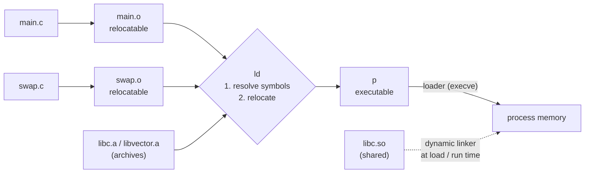

# Linking

> The linker is the least understood stage of the build, which is why its
> errors are so confusing. It does two things: it decides which definition
> each name refers to, and it decides where everything sits in memory. Almost
> every link error is one of those two going wrong.

## The pipeline, once more

`gcc -O2 -g -o p main.c swap.c` runs `cpp`, `cc1` and `as` on each file
separately, producing `main.o` and `swap.o`. Then it runs `ld` on all of them.
Each compile step **sees only one file.** The linker is the first tool that
sees the whole program, and it knows very little about the machine. It works
on blocks of bytes plus the tables the compiler left for it.



## Object files

There are three kinds, all in **ELF** on Linux (Windows uses PE, a COFF
variant):

- **Relocatable** (`.o`): code and data with addresses starting at 0, to be
  combined with others.
- **Executable**: ready to copy into memory and run.
- **Shared** (`.so`): relocatable code that can be loaded and linked at load
  time *or* at run time.

The sections you will see in tools and error messages:

| Section | Holds |
| --- | --- |
| `.text` | Machine code |
| `.rodata` | Read-only data: format strings, `switch` jump tables |
| `.data` | *Initialized* globals |
| `.bss` | *Uninitialized* globals. Takes no space in the file ("Better Save Space") |
| `.symtab` | Symbol table. **Always present**, `-g` or not. No local variables |
| `.rel.text` / `.rel.data` | Places the linker must patch |
| `.debug`, `.line` | Only with `-g` |

## Symbols

To the linker, a module has three kinds of names:

- **Globals it defines**: non-`static` functions and globals.
- **Externals it references**: defined in some other module.
- **Locals**: `static` functions and `static` globals. They are visible only
  inside the module. This is C's version of `private`, and the book recommends
  using it wherever you can.

Local *variables* on the stack aren't linker symbols at all. A `static`
variable *inside* a function lives in `.data` or `.bss`, under a unique name
such as `x.1`.

## Symbol resolution, and the bug it can hide

Every reference must match **exactly one** definition. If none is found, you get
`undefined reference to 'foo'`. The compiler assumed `foo` was defined
somewhere else, and the linker couldn't find it.

**Duplicate definitions** follow rules that are much less obvious. Functions and
*initialized* globals are **strong**. *Uninitialized* globals are **weak**.

1. Two strong definitions → **link error**.
2. One strong and some weak → the strong one wins, **silently**.
3. Only weak ones → **any of them**, silently.

The book's example of how bad this gets: one file has `int x; int y;`, and
another declares `double x;` and assigns to it. On IA32 that write covers both
`x` *and* `y`. The program misbehaves far away from the cause, and nothing
warns you. The book's fix is to build with **`-fno-common`**, which turns
duplicate definitions into errors.

> **Since this edition:** GCC 10 (2020) made `-fno-common` the default, so
> rule 3 now gives an error. The underlying problem is still there: a global
> defined in more than one translation unit, especially through a header.
> Declare it `extern` in the header and define it in exactly one `.c` file.

C++ (and Java) overloading works because the compiler **mangles** the
parameter types into the symbol name. The book shows an older scheme. Today's
Itanium-ABI names look like `_ZN3Foo3barEil`, and `c++filt` decodes them.

## Static libraries and why argument order matters

A **static library** (`.a`, an *archive*) is a bundle of `.o` files. The linker
copies **only the members that resolve a reference it still needs.** So a
program that calls `printf` doesn't pull in all of `libc.a` (about 8 MB).

The order problem comes from how the linker scans. It goes **left to right
once**, keeping a set of symbols still unresolved:

- An object file is always included.
- An archive contributes a member only if that member defines something
  *already* unresolved. Members that aren't needed *at that point* are dropped.

```
gcc -static ./libvector.a main2.c   # fails: nothing was unresolved yet
gcc -static main2.c ./libvector.a   # works
```

**Rule:** put libraries *after* the files that use them, and put a library after
any library that depends on it. If two libraries depend on each other, list one
twice (`libx.a liby.a libx.a`), or merge them.

## Relocation

Once every reference has one definition, the linker:

1. **Merges** sections of the same type (all `.text` into one, and so on) and
   gives every section and symbol its final run-time address.
2. **Patches** every place listed in the relocation entries. The book's two
   basic types: **PC-relative** (`call swap`: target minus address of the next
   instruction) and **absolute** (`int *bufp0 = &buf[0]`: the address itself).

The assembler leaves the placeholder at −4 for PC-relative calls. That bias
accounts for the PC pointing past the 4-byte field, which means the linker can
patch the value without understanding the instruction encoding.

## Executables and loading

An ELF executable has a **segment header table** that maps chunks of the file
to memory: a read-execute code segment and a read-write data segment, both
4 KB-aligned. `.bss` is just extra memory size, filled with zeros. The entry
point is `_start` (from `crt1.o`), which runs initialization, then `main`, then
`exit`.

The book promises a more accurate picture of loading for chapters 8–9: the
shell **forks**, the child calls **`execve`**, and the loader **maps** the file
into the new address space. Nothing is copied from disk until a page is first
touched and causes a page fault.

## Shared libraries and dynamic linking

Static libraries have two costs. **Updates** mean relinking every program, and
there is **duplication**: every running process has its own copy of `printf`.
**Shared libraries** (`.so`, or DLLs on Windows) fix both. There is one file
on disk, and one copy of its code in physical memory, shared by every process
that uses it.

- **At load time.** `gcc -shared -fPIC -o libvector.so …`, then link against it.
  Only symbol and relocation information is copied into the executable. Its
  `.interp` section names the **dynamic linker** (`ld-linux.so`), which runs
  first, maps the libraries, fixes up references, then jumps to the program.
- **At run time.** `dlopen`, `dlsym`, `dlclose` and `dlerror`. The book's
  examples: shipping updated libraries, and web servers that load
  content-generating functions into the running process instead of fork/exec
  for each request (CGI). This is also how Java's JNI calls C.

**Position-independent code (`-fPIC`)** lets the same code work at *any*
address. It relies on one fact: **the distance from the code to the data
segment is fixed**, wherever the library is loaded.

- **Global data** is reached through the **Global Offset Table (GOT)**, which
  the dynamic linker fills with absolute addresses. On IA32 that costs extra
  instructions and a register, which hurts on a machine with so few registers.
- **Calls** go through the **Procedure Linkage Table (PLT)** using **lazy
  binding**. The first call to `addvec` goes to the dynamic linker, which looks
  up the real address and writes it into the GOT. Every later call is a single
  indirect jump.

## Tools

| Tool | Use |
| --- | --- |
| `ar` | Create or inspect static libraries |
| `nm` | List the symbols in an object file |
| `size` | Section sizes |
| `readelf` | Everything in the ELF headers. Covers `size` and `nm` |
| `objdump -d` | Disassemble. "The mother of all binary tools" |
| `strings`, `strip` | Printable strings, remove symbols |
| `ldd` | Which shared libraries an executable needs |

## What to take away

- "Undefined reference" means no definition was found in the files *in the
  order the linker saw them*. Check the library order before anything else.
- Never define the same global in two files. Use `static` for everything that
  doesn't need to be public, and `extern` declarations in headers.
- Shared libraries trade a little indirection (GOT and PLT) for one copy on
  disk and in memory, and for updates without relinking.
- `nm`, `readelf`, `objdump -d` and `ldd` answer most "what's actually in this
  binary?" questions.

---

Previous: [Part II](./README.md) ·
Next: [Exceptional control flow](./02-exceptional-control-flow.md)
