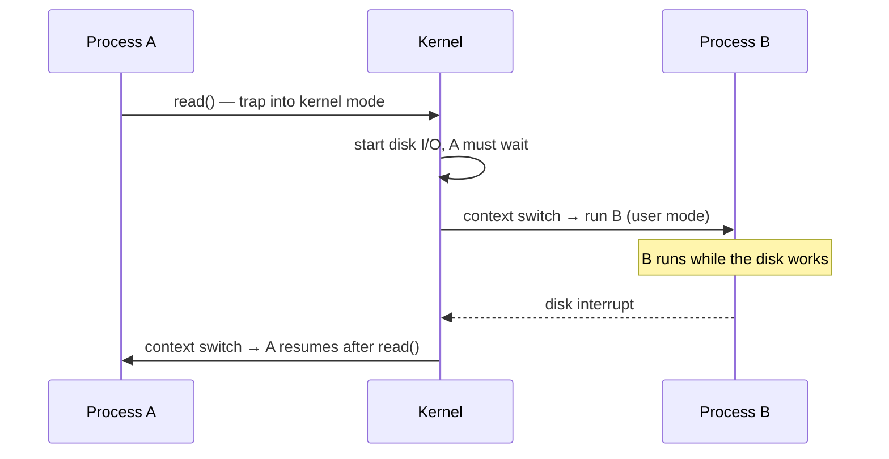
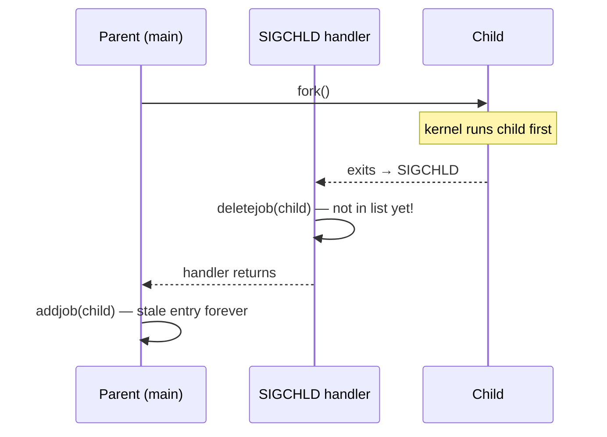

# Exceptional control flow

> Normal control flow is one instruction after another, plus jumps and calls.
> Everything else is *exceptional* control flow: a disk finishing, a page
> fault, Ctrl-C, a child process exiting. The same idea appears at every level,
> and it is how the OS builds processes, system calls and signals.

## Exceptions: the hardware level

An **exception** is a sudden transfer of control caused by an *event* inside
the processor. The processor looks up the event's **exception number** in an
**exception table**, which the OS fills in at boot, and calls the handler it
finds there. Unlike an ordinary call, it pushes extra state such as the
condition flags, it uses the **kernel's stack**, and the handler runs in
**kernel mode**. When the handler finishes, it does one of three things:
re-run the current instruction, continue with the next one, or abort.

| Class | Cause | Sync? | Returns to |
| --- | --- | --- | --- |
| **Interrupt** | An I/O device: timer, disk, network | Async | Next instruction |
| **Trap** | Deliberate: **system call** | Sync | Next instruction |
| **Fault** | A possibly fixable error: **page fault** | Sync | *Same* instruction (or abort) |
| **Abort** | An unrecoverable hardware error | Sync | Never. The program is terminated |

On IA32 Linux the book's examples are: exception 0, *divide error* (the shell
reports "Floating exception"); 13, *general protection fault* ("Segmentation
fault"); 14, *page fault* (fixed and retried); and 18, *machine check*.
**System calls** look like function calls to you. On IA32 they went through
`int $0x80`, with the call number in `%eax` and up to six arguments in
registers. The C library wraps them as `read`, `fork`, `execve` and so on.

> The term "exception" here is the hardware one. C++ and Java exceptions are a
> much higher-level relative. The book compares `try`/`catch` to
> `setjmp`/`longjmp`, which this chapter ends with.

## Processes: the illusion built on exceptions

A **process** is a running instance of a program, and it gives the program two
illusions:

- **Its own logical control flow**, so it seems to have the CPU to itself.
- **Its own private address space**, so it seems to have memory to itself.

Two flows are **concurrent** if they overlap in time, whether or not they run
on separate cores. They are **parallel** only if they actually run at the same
moment on different cores. Taking turns is *multitasking*, and each turn is a
*time slice*.

**User mode and kernel mode.** A mode bit restricts user code: no privileged
instructions, no I/O, and no access to the kernel's part of the address space.
**The only way into kernel mode is an exception** (an interrupt, a fault or a
system call). `/proc` exposes kernel data structures as readable text files.

**Context switches.** The kernel saves one process's context (registers, PC,
stacks, page table, open files) and restores another's. This happens when a
system call **blocks**, for example a `read` waiting tens of milliseconds for
the disk, or on a **timer interrupt** every 1 or 10 ms. Every switch also
leaves the cache **cold** for the process that resumes.

## Process control from C

**Errors.** System calls usually return −1 and set `errno`. The book wraps each
call (`Fork` for `fork`, and so on) so that errors are always checked without
making the examples longer. Use the same pattern, or your language's
equivalent, rather than ignoring return codes.

- **`fork()` is called once and returns twice.** It returns the child's PID in
  the parent and **0 in the child**. The child gets a *copy* of the address
  space, so later changes aren't shared, and it inherits the open file
  descriptors, so output goes to the same place. **You can't assume which one
  runs first.** Draw a *process graph*: n forks in a row give 2^n processes.
- **`exit` and zombies.** A process that has terminated stays in the system as
  a **zombie** until its parent **reaps** it. If the parent dies first, `init`
  (PID 1) reaps it. A long-running shell or server **must** reap its children,
  or zombies pile up and use resources.
- **`waitpid(pid, &status, options)`.** `pid = -1` waits for any child.
  `WNOHANG` returns at once instead of waiting, and `WUNTRACED` also reports
  stopped children. `WIFEXITED`/`WEXITSTATUS` and `WIFSIGNALED`/`WTERMSIG`
  decode the status. When there are no children left, it returns `ECHILD`.
- **`execve(file, argv, envp)` is called once and never returns** unless it
  fails. It *replaces* the current program but keeps the **same PID and open
  files**. That is the difference between a *program* (code and data) and a
  *process* (a running instance).
- `sleep`, `pause`, `getpid`, `getppid`, `getenv`, `setenv`.

A **shell** is a loop of `fork` + `execve`, with `waitpid` for foreground
jobs. Background jobs (`&`) are *not* waited for, so a basic shell leaks
zombies. Fixing that needs signals.

## Signals: exceptions for processes

A **signal** is a small message from the kernel saying that something
happened. It lets user processes see events that would otherwise stay inside
the kernel:

| Signal | Number | Meaning (default action) |
| --- | --- | --- |
| `SIGINT` | 2 | Ctrl-C (terminate) |
| `SIGKILL` | 9 | Kill. **Can't be caught or ignored** |
| `SIGSEGV` | 11 | Invalid memory reference (terminate + core dump) |
| `SIGFPE` / `SIGILL` | 8 / 4 | Divide error / illegal instruction |
| `SIGCHLD` | 17 | A child stopped or terminated (ignore) |
| `SIGTSTP` / `SIGCONT` | — | Ctrl-Z stop / resume |
| `SIGALRM` | — | Timer set with `alarm` |

**Sending a signal** is the kernel setting a bit in the target's **pending**
bit vector. **Receiving** happens when the kernel next returns that process to
user mode: it checks `pending & ~blocked` and runs the action. The action is
the default (terminate, dump core, stop or ignore) or a **handler** you install.
Signals go to processes or to **process groups**. The shell gives each *job* its
own group, so Ctrl-C reaches every process in a pipeline like `ls | sort`.

**The three rules that cause signal bugs:**

1. **A handler blocks its own signal type** while it runs.
2. **Pending signals don't queue.** There is *one* pending bit per type, so a
   second signal arriving while one is pending is **lost**.
3. **Slow system calls may be interrupted.** `read`, `wait` and `accept` may
   return early with `EINTR` instead of restarting. Linux restarts them, but
   the book's older Solaris example didn't.

The book's example shows rule 2 in action. Three children exit, the `SIGCHLD`
handler reaps one child per signal, and only two get reaped, leaving a zombie.
**A signal means "at least one event happened", not "exactly one".** The fix is
for the handler to reap in a loop (`while (waitpid(-1, …) > 0)`) every time it
runs.

**Portable handling.** Use `sigaction`. The book wraps it in a `Signal()`
function with clear semantics: block only the current signal type, restart
system calls, and keep the handler installed.

**Races between the handler and the main program.** The book's shell adds a
job to its list after `fork`, and its `SIGCHLD` handler removes the job. If the
child exits *before* the parent returns from `fork`, the handler deletes a job
that hasn't been added yet, and the parent then adds a job that will never be
removed.

The fix is to **block `SIGCHLD` with `sigprocmask` before `fork`**, and unblock
it only after `addjob`. The general lesson: **a handler runs concurrently with
your code**, and you can't test every interleaving. The book's trick for finding
these bugs: wrap `fork` so that a random one of parent and child sleeps first,
to try both orders.

> **Since this edition:** the 3rd edition adds what experience has shown since.
> **Only call async-signal-safe functions in a handler.** `printf` and `malloc`
> aren't safe. Save and restore `errno`. Use `volatile sig_atomic_t` for flags.
> A common pattern is for the handler to set a flag or write to a pipe, and for
> the main loop to do the actual work.

## Nonlocal jumps

`setjmp` saves the current registers, stack pointer and PC, and returns 0.
A later `longjmp` jumps back to it, and `setjmp` *returns again* with a
non-zero value. So `setjmp` is called once and returns several times, and
`longjmp` never returns. They are used to jump out of deeply nested error paths,
and, with the `sig` versions, to restart from inside a signal handler.

## Tools

`strace` (every system call a program makes), `ps` (zombies show as `Z` /
`<defunct>`), `top`, `pmap` (a process's memory map), and `/proc`.

## What to take away

- System calls, page faults, interrupts and signals are all the same mechanism:
  an exception that passes control to a handler.
- `fork` returns twice, `execve` never returns, and every child must be reaped.
- A signal means at least one event, not one per event. Handle it in a loop,
  keep handlers minimal, and block signals around shared data.
- Any code that runs asynchronously (a handler, a child process, a thread) can
  race with your main path. Block the race, don't hope it won't happen.

---

Previous: [Linking](./01-linking.md) ·
Next: [Virtual memory](./03-virtual-memory.md)
