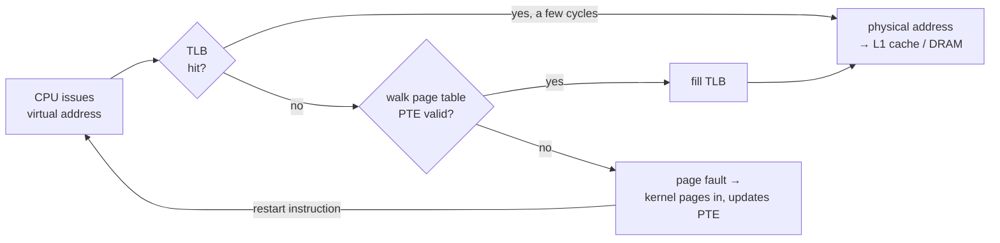

# Virtual memory

> Every address your program uses is a fiction that hardware and the OS
> translate on every access. That one level of indirection gives you caching,
> isolation, sharing, protection, cheap `fork`, lazy loading and `mmap`. It is
> also where the scariest C bugs come from.

## The idea: one more level of indirection

With **physical addressing**, the CPU sends addresses straight to DRAM. Early
PCs did this, and so do embedded controllers. With **virtual addressing**, the
CPU produces a *virtual address* (VA), and the **MMU** translates it to a
*physical address* (PA) using a **page table** in memory that the OS maintains.

Think of virtual memory as **an array of N bytes on disk, cached in DRAM**.
The cache blocks are **pages**, usually 4 KB (large pages go up to 2 MB). Any
virtual page is in one of three states: *unallocated* (it doesn't exist and
uses nothing), *cached* (in DRAM), or *uncached* (on disk only).

This "DRAM cache" is designed differently from the SRAM caches, and the reason
is cost: **a miss means a disk read**, about 100,000× slower than DRAM. So:

- Pages are **large**, so the expensive first byte brings a lot with it.
- Placement is **fully associative**: any virtual page can go in any physical page.
- The OS uses **clever replacement policies** in software.
- Writes are always **write-back**.

## Page tables, hits and faults

A **page table** is an array of PTEs, one per virtual page. Each PTE has a
*valid* bit plus either a physical page number or a disk location.

- **Page hit.** The PTE is valid, so the MMU builds the PA. This happens
  entirely in hardware.
- **Page fault.** The PTE is invalid, so the MMU raises an exception
  (chapter 8). The kernel's handler picks a **victim** page, writes it to disk
  if it is **dirty**, reads the needed page in, updates the PTE and **restarts
  the instruction**, which now hits.

All modern systems use **demand paging**: a page is brought in only when it is
first used. It works because of **locality**. At any moment a program touches
a small **working set**, and after it is loaded, accesses hit. When the working
set is bigger than physical memory, you get **thrashing**: constant paging, and
the program crawls. If something is mysteriously slow, check for thrashing
first (`getrusage` counts page faults).

## What one level of indirection buys you

Each process gets **its own page table**, and with it its own address space.

- **Simpler linking.** Every process has the same memory layout. On 64-bit
  Linux, code starts at `0x400000`, so the linker can fix addresses ahead of
  time.
- **Simpler loading.** The loader just *maps* the file and marks the pages
  invalid. **Nothing is copied** until a page is first touched.
- **Simpler sharing.** Map the same physical pages (the kernel, `libc`'s code)
  into many processes.
- **Simpler allocation.** k contiguous *virtual* pages can be k scattered
  physical pages.
- **Protection.** PTEs carry **SUP** (kernel only), **READ** and **WRITE**
  bits, and later an execute-disable (**XD**) bit. A violation is a
  *general protection fault*, which you see as **"Segmentation fault"**.

## Address translation, and keeping it fast

The VA is split into a **virtual page number** (VPN) and a **virtual page
offset** (VPO). Translation replaces the VPN with a **physical page number**
(PPN). The offset is unchanged.

- **Caches use physical addresses**, so translation comes first. PTEs are cached
  in L1 like any other data.
- The **TLB** is a small, highly associative cache of PTEs *inside the MMU*. In
  the usual case, a TLB hit, translation needs no memory access at all.
- **Multi-level page tables** solve the size problem. A flat table for a 32-bit
  space with 4 KB pages is 4 MB *per process*, even when it's mostly empty. In
  a hierarchy, an empty top-level entry means no lower table exists, and only
  the top level has to stay in memory. The TLB caches entries from every level,
  so a k-level walk is rarely slower in practice.

**The Core i7 case study:** 48-bit virtual addresses (256 TB) and **four-level**
page tables, each level indexed by 9 bits of the 36-bit VPN. Each PTE has A
(referenced) and D (dirty) bits that the kernel's replacement policy uses. One
neat trick: with 4 KB pages, the 12 offset bits are *exactly* the L1's 6 set
index bits plus 6 block-offset bits. So the cache can select the set *while*
the TLB translates the page number, and the two overlap.

## How Linux organizes it

The kernel keeps, per process, a `task_struct` → `mm_struct`. That holds `pgd`,
the top-level page table, which goes into the `CR3` register on a context
switch. It also holds a list (with a tree on top) of **areas**: contiguous
ranges such as text, data, heap, libraries and stack, each with permissions and
a shared/private flag. Pages outside any area don't exist, so **gaps cost
nothing**.

On a page fault, Linux checks three things in order:

1. **Is the address in some area?** If not → *segmentation fault*.
2. **Is the access allowed?** (A write to a read-only page, user code touching
   the kernel.) If not → *protection fault*.
3. Otherwise it's a legitimate miss → page in, update, restart.

## Memory mapping

Every area is backed by an object:

- **A regular file**, such as an executable's text, paged in on demand.
- **An anonymous object**, all zeros. These are *demand-zero* pages, and no
  disk read is needed (heap, stack, `.bss`).

Pages can be mapped **shared** (writes visible to everyone and written back to
the file) or **private copy-on-write**. COW pages start out shared and
read-only. The first write faults, and the kernel gives the writer its own
copy. That makes two familiar calls clear:

- **`fork`** copies the page tables, not the memory, and marks everything
  private COW. Memory is copied only when either process writes.
- **`execve`** discards the old areas, maps the new program's text and data
  (private COW), maps `.bss`, heap and stack as demand-zero, maps the shared
  libraries, and sets the PC.

`mmap(start, len, prot, flags, fd, off)` lets you do this yourself:
`PROT_READ`/`WRITE`/`EXEC`/`NONE`, and `MAP_SHARED`, `MAP_PRIVATE`,
`MAP_ANON`. Note that **swap space limits** how much virtual memory all
processes together can allocate.

## Dynamic memory allocation

`malloc` manages the **heap**, a demand-zero area just above `.bss`, whose top
the kernel calls `brk`. It grows the heap with `sbrk` or uses `mmap` directly.
Blocks are aligned to 8 bytes in the book's era (16 on x86-64 today).
`malloc` doesn't zero memory (`calloc` does), and `free` of anything that
didn't come from `malloc` is undefined behaviour, with no error reported.

An allocator has to handle any order of requests, answer immediately, keep its
own data inside the heap, and **never move allocated blocks**. Within those
limits it balances two goals that pull against each other:
**throughput** (operations per second) and **peak utilization** (payload ÷ heap
size).

**Fragmentation** is what wastes memory:

- **Internal fragmentation**: a block is bigger than its payload (alignment,
  minimum block size).
- **External fragmentation**: there is enough free memory in total, but no
  single free block is big enough. It depends on *future* requests, so
  allocators try to keep a few large free blocks rather than many small ones.

**The design decisions:**

| Decision | Options | Trade-off |
| --- | --- | --- |
| Track free blocks | **Implicit list** (walk every block via size headers) · **explicit list** (pointers stored inside free blocks) · **segregated lists** (one per size class) | Implicit is simplest but O(all blocks). Segregated fits approximates best-fit quickly, which is why **GNU malloc** uses it |
| Placement | First fit · next fit · best fit | Next fit is fastest but wastes the most. Best fit wastes the least but searches the most |
| Splitting | Split the leftover off as a new free block | Avoids internal waste |
| Coalescing | Immediate or deferred merging of neighbours | Prevents "false fragmentation". **Boundary tags** (a footer that copies the header) make merging with the *previous* block O(1) |

Other variants: **simple segregated storage** (equal-sized blocks per class, no
splitting or merging, very fast but prone to fragmentation), and **buddy
systems** (power-of-two sizes, where a block's buddy differs by exactly one
address bit, so merging is trivial but internal waste is high).

## Garbage collection

An implicit allocator frees whatever the program can no longer **reach**. Treat
memory as a graph: the *roots* are registers, the stack and globals, and the
*nodes* are heap blocks. **Mark & sweep** (McCarthy, early 1960s) marks
everything reachable, then frees everything unmarked. For C, a collector has to
be **conservative**. Memory carries no types, so an `int` that happens to look
like an address keeps a block alive. That is always safe, but it may leak.

## The C memory bugs to watch for

The book's list. Each one usually crashes *far* from where it happened:

1. **Dereferencing a bad pointer.** `scanf("%d", val)` instead of `&val`.
2. **Reading uninitialized heap memory.** `malloc` doesn't zero.
3. **Stack buffer overflows.** `gets`.
4. **Assuming a pointer is the size of what it points to.**
   `malloc(n * sizeof(int))` for an array of `int *` writes past the end on
   64-bit, corrupts the allocator's footer, and crashes later in `free`.
5. **Off-by-one** writes past the end.
6. **Changing the pointer instead of the value.** `*size--` decrements the
   pointer. Write `(*size)--`.
7. **Misunderstanding pointer arithmetic.** `p += sizeof(int)` skips four
   elements.
8. **Returning the address of a local variable.**
9. **Using memory after `free`.**
10. **Leaks.** Fatal for servers and daemons, which never exit.

> **Since this edition:** use the tools rather than relying on care alone.
> **AddressSanitizer** (`-fsanitize=address`) and **Valgrind** catch most of
> this list at the point where it happens. Memory-safe languages remove most of
> it entirely, which is the main argument for them.

## What to take away

- Virtual memory is a cache of disk in DRAM, plus a page table per process.
  Isolation, sharing, protection and lazy loading all come from that.
- A TLB miss costs a page-table walk. A page fault costs a disk read. Thrashing
  means the working set doesn't fit in memory.
- `fork` is cheap because of copy-on-write, and `execve` and `mmap` just map
  files. "Loading" mostly happens later, through page faults.
- Allocators trade throughput against fragmentation. Most C memory bugs show up
  far from their cause, so run the sanitizers.

---

Previous: [Exceptional control flow](./02-exceptional-control-flow.md) ·
Next: [Part III — Interaction and communication](../3-interaction/README.md)
