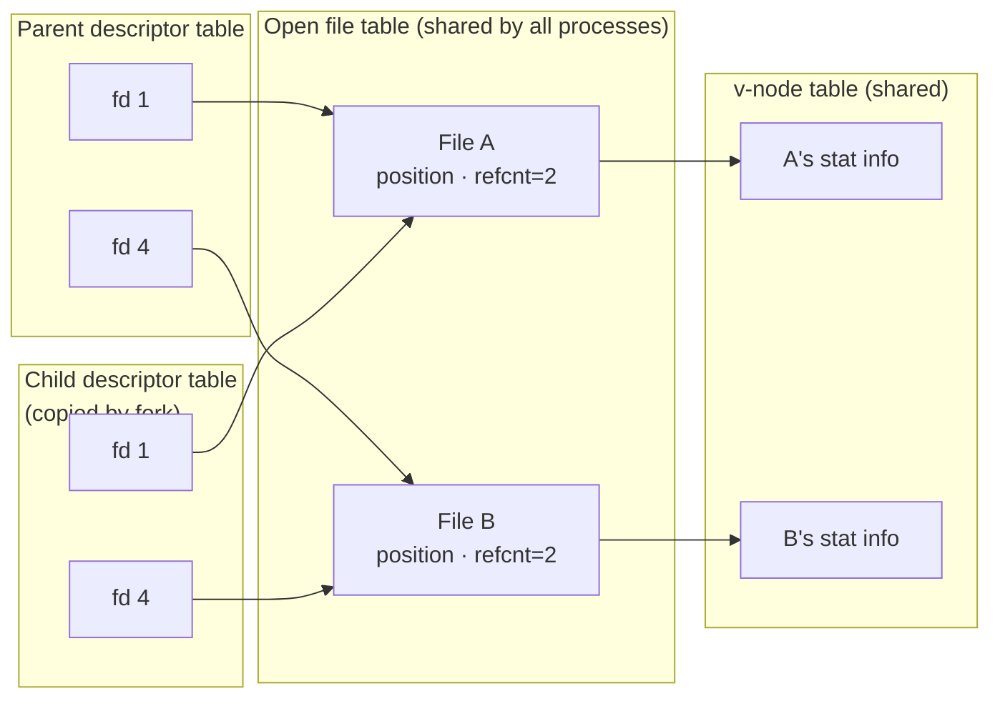
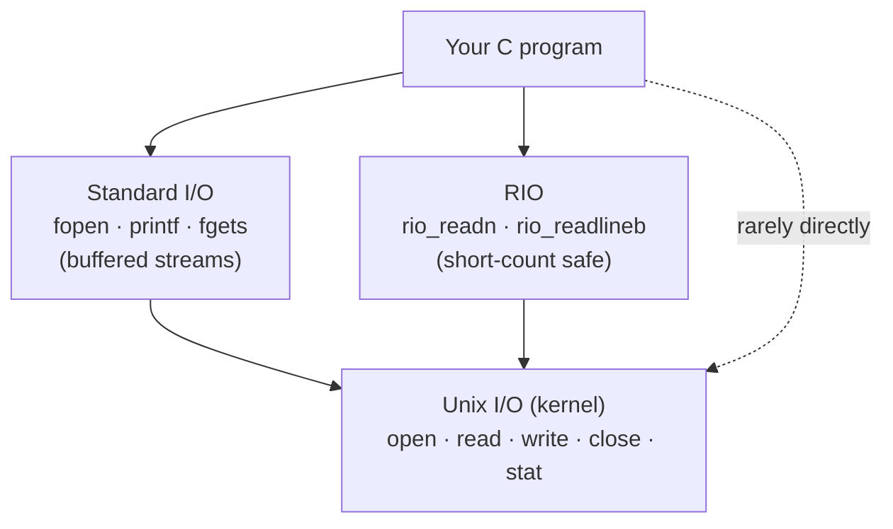

# System-level I/O

> Everything is a file: disks, terminals, pipes and network connections all
> share one small interface. Using that interface well comes down to two
> things: expecting short counts, and knowing how the kernel represents files
> you have open.

## Unix I/O in five operations

A **file** is a sequence of bytes. The kernel gives you a **descriptor**, a
small integer, and tracks everything else itself:

- **Open.** `open(name, flags, mode)` returns the **lowest unused descriptor**.
  The flags are `O_RDONLY`, `O_WRONLY` or `O_RDWR`, optionally combined with
  `O_CREAT`, `O_TRUNC` or `O_APPEND`. A new file's permissions are
  `mode & ~umask`.
- **Every process starts with three**: 0 for stdin, 1 for stdout, 2 for stderr.
- **Position.** Each open file has a current offset, which `lseek` can move.
- **Read and write.** `read` returns the number of bytes transferred, **0 at
  EOF**, or −1 on error. There is **no EOF character**. EOF is simply "the
  position is at or past the size".
- **Close.** It frees kernel resources. Exiting closes everything. Closing a
  descriptor twice is an error.

## Short counts aren't errors

`read` and `write` may transfer **fewer bytes than you asked for**:

- **at EOF** (20 bytes left, you asked for 50);
- **from a terminal**, which returns one line at a time;
- **on sockets and pipes**, because of buffering and network delay.

Disk files never give a short count except at EOF. **Network code always has
to loop.** The book's **RIO** package (Robust I/O, after Stevens' `readn` and
`writen`) does the looping for you:

- `rio_readn` / `rio_writen` are **unbuffered**. They loop until all n bytes
  are transferred (or EOF), and they **restart after `EINTR`** when a signal
  interrupts them. They are suited to binary data on sockets.
- `rio_readlineb` / `rio_readnb` are **buffered**. One `read` fills an internal
  buffer, and lines or byte runs are served from it. That avoids a kernel trap
  per byte. Unlike Stevens' `readline`, they are **thread-safe** and can be
  mixed on the same descriptor.

## Metadata

`stat(name)` and `fstat(fd)` fill a `struct stat`. The fields you'll use most
are `st_size` and `st_mode`, which holds the permission bits plus the file
type, tested with `S_ISREG`, `S_ISDIR` or `S_ISSOCK`. To the kernel, "text" and
"binary" files are the same thing.

## How the kernel represents open files

Three tables explain how files are shared, how `fork` behaves and how
redirection works:

- **Descriptor table**: one per process. Each entry points to an open-file
  entry.
- **Open file table**: shared by all processes. It holds the **file position**
  and a **reference count**. The entry is freed when the count reaches 0.
- **v-node table**: shared. It holds the `stat` information.

What follows from that:

- **Opening the same file twice** gives two open-file entries, so each
  descriptor has its own position.
- **After `fork`**, the child's descriptor table is a copy, so parent and child
  **share open-file entries, and therefore the file position**. Both have to
  close a file before it is really closed.
- **Redirection.** `dup2(oldfd, newfd)` copies `oldfd`'s entry over `newfd`,
  closing `newfd` first if it was open. `ls > foo.txt` means the shell opens
  `foo.txt`, then `dup2(fd, 1)`, then `exec`s `ls`.

## Standard I/O, and when not to use it

The C library's `fopen`, `printf`, `fgets` and the rest wrap a descriptor in a
**stream** (`FILE *`) with a **buffer**, so repeated `getc` calls cost one
`read`. **For disks and terminals, use standard I/O.** It is what nearly all C
programmers use.

**For sockets, don't.** Streams have two lesser-known restrictions:

1. An input call can't follow an output call without `fflush`, `fseek`,
   `fsetpos` or `rewind` in between.
2. An output call can't follow an input call without `fseek`, `fsetpos` or
   `rewind` in between (unless the input hit EOF).

`lseek` isn't allowed on a socket, so the only workaround is two streams on one
descriptor. Then closing both closes the descriptor twice, which is dangerous
in a threaded program. The book's rule: **use RIO on sockets.** Format output
with `sprintf` and send it with `rio_writen`. Read a whole line with
`rio_readlineb` and parse it with `sscanf`.

## What to take away

- A descriptor is an index into a per-process table, and the file position
  lives in a shared table. That explains `fork` sharing, `dup2` redirection and
  reference-counted closing.
- Short counts are normal on sockets, pipes and terminals. Always loop, and
  restart on `EINTR`.
- Use buffered standard I/O for files. Use a robust read/write layer, not
  `FILE *`, for sockets.
- EOF isn't a character. It is `read` returning 0.

---

Previous: [Part III](./README.md) ·
Next: [Network programming](./02-network-programming.md)
