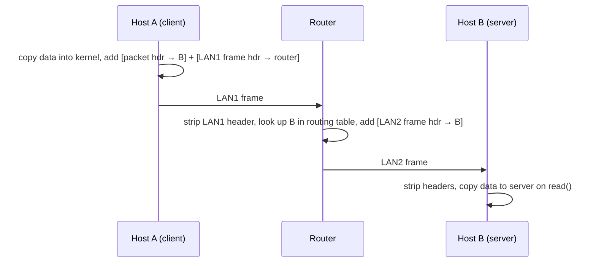
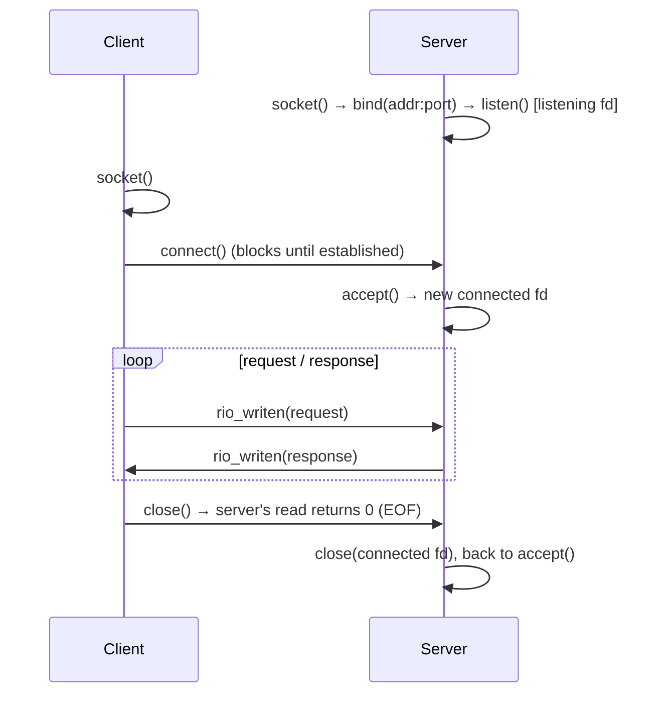

# Network programming

> A network is just another I/O device, and a connection is just another file
> descriptor. With the client-server model, sockets and a little HTTP, the book
> builds a working web server in about 250 lines of C.

## Client and server

Every network application is a **client** and a **server**. These are
**processes**, not machines, and both can run on the same host. The basic
operation is the **transaction**: the client sends a request, the server works
on some resource, the server replies, and the client uses the reply. It has
nothing to do with database transactions and makes no promise of atomicity.

## The network, from a programmer's seat

To a host, the network adapter is an I/O device that DMAs data into and out of
memory. The book builds up the picture in layers:

- **Ethernet segment.** Hosts connect to a hub, which copies every frame to
  every port. Each adapter has a globally unique 48-bit address.
- **Bridged Ethernet.** Bridges *learn* which hosts are on which port and
  forward only where needed.
- **An internet.** Routers join different, incompatible LANs and WANs. That
  works because a protocol layer on every host and router gives everyone a
  shared **naming scheme** (internet addresses) and **delivery mechanism**
  (packets).

The key idea is **encapsulation**. User data goes inside an internet packet,
and the packet goes inside a LAN-specific frame:



The book's **global IP Internet** is TCP/IP:

- **IP** carries *datagrams* from host to host, *unreliably*.
- **UDP** extends IP from host to process, still unreliably.
- **TCP** builds reliable, two-way **connections** between processes.

The programmer sees three things:

1. **Hosts have 32-bit IP addresses**, written in dotted decimal
   (`128.2.194.242`) and always stored in **network byte order, which is big
   endian**. You convert with `htonl`, `htons`, `ntohl` and `ntohs`. This is
   where chapter 2's byte order matters in practice.
2. **IP addresses map to domain names** through **DNS**, a distributed database
   that replaced a single `HOSTS.TXT` file in 1988. The mapping is many-to-many:
   one name can have several addresses (google.com had three), several names
   can share an address, and some names have no address at all. `localhost` is
   always `127.0.0.1`.
3. **Processes talk over connections**: point-to-point, full-duplex, and
   reliable byte streams. A connection is identified by its **socket pair**
   `(client addr:port, server addr:port)`. The server uses a **well-known port**
   (80 for the web, 25 for email, listed in `/etc/services`). The client's
   kernel assigns an **ephemeral** port.

> **Since this edition:** the book is IPv4-only and uses `gethostbyname`,
> `inet_aton` and `inet_ntoa`. Those are obsolete and not thread-safe. Use
> **`getaddrinfo`/`getnameinfo`** and `inet_pton`/`inet_ntop`, which handle
> IPv6 as well. The 3rd edition (2015) was rewritten around them. The overall
> sequence of socket calls is the same.

## The sockets interface

To the kernel, a socket is an endpoint. **To your program, it is a file
descriptor**, so everything from chapter 10, including RIO and short counts,
applies.



- **`socket(AF_INET, SOCK_STREAM, 0)`** gives a half-opened descriptor.
- **Client:** `connect` to the server's address. The book wraps
  socket + DNS + connect in **`open_clientfd(host, port)`**.
- **Server:** `bind` to an address and port (`INADDR_ANY` means every interface
  on the host), then `listen` with a backlog of about 1024. The book wraps this
  in **`open_listenfd(port)`**. It also sets `SO_REUSEADDR` so a restarted
  server doesn't refuse connections for about 30 seconds.
- **`accept`** blocks until a client connects, then returns a **new connected
  descriptor**.

**Listening and connected descriptors are different things.** The listening
descriptor lives as long as the server. A connected descriptor lives for one
client. Keeping them separate is what lets a server hand each connection to
its own process or thread (chapter 12).

**EOF on a connection** means the other side **closed** its end. Your `read`
returns 0 once you have read past the last byte.

The book's **echo server** loops on `accept` → echo lines → `close`. It
handles **one client at a time**, which makes it an *iterative* server.

## HTTP and the web

The web is a text protocol on top of TCP. Each line ends in **`\r\n`**, so you
can test a server by hand with `telnet`.

```
GET /index.html HTTP/1.1        ← request line: method URI version
Host: www.example.com           ← headers (Host is required in 1.1)
                                ← blank line ends the headers

HTTP/1.1 200 OK                 ← response line: version status message
Content-Type: text/html         ← MIME type of the body
Content-Length: 42              ← size of the body
                                ← blank line
<html>…                         ← body
```

- **Content** is bytes with a **MIME type**. A server either returns a file
  (**static**) or runs a program and returns its output (**dynamic**).
- **URLs.** The client uses the `http://host:port` prefix. The server uses the
  `/path?arg1&arg2` suffix. The leading `/` means the server's content root,
  not the filesystem root. `/` on its own maps to a default page.
- **GET** was over 99% of requests in a study the book cites. POST arguments go
  in the body rather than the URI.

**CGI** is how dynamic content worked:

1. For `GET /cgi-bin/adder?15000&213`, the server **forks**.
2. The child sets **`QUERY_STRING=15000&213`** (plus other CGI variables).
3. The child **`dup2`s the connected socket onto stdout** (chapter 10).
4. The child **`execve`s** the program, which writes its own `Content-type`,
   `Content-length` and body straight to the client.

That combines chapters 8, 9 and 10 in one request. Chapter 7 mentioned the
faster alternative: load content-generating code as a shared library and call
it directly, with no fork per request.

## TINY: a real web server in about 250 lines

The book's capstone puts it all together: an **iterative** server that supports
only **GET**, serves static HTML, text, GIF and JPEG, and runs CGI programs from
`./cgi-bin`.

- `parse_uri` decides static or dynamic (any URI containing `cgi-bin`), turns
  the URI into a relative path, and adds `home.html` for `/`.
- `serve_static` sends the headers, then **`mmap`s the file and sends it with
  `rio_writen`**. It then closes the descriptor and calls `munmap`, because
  skipping either leaks.
- `serve_dynamic` sends `200 OK`, then fork → `setenv QUERY_STRING` → `dup2` →
  `execve`, and the parent calls `wait`.
- Errors produce a small HTML page via `clienterror`.

The authors are clear that TINY lacks the robustness and security of a real
server. Their example of what's missing is **`SIGPIPE`**. If the client
disconnects, for instance when the user presses Stop, the server's *second*
write raises `SIGPIPE`, which kills the process by default. A real server
ignores or catches `SIGPIPE` and checks every write for `EPIPE` ("Broken pipe").

## What to take away

- A connection is a file descriptor with a socket pair. Use the chapter 10
  rules: loop on short counts, and treat a read of 0 as "the other side closed".
- Convert to network byte order at the edge. Every multi-byte integer on the
  wire is big-endian.
- A server has one listening descriptor and one connected descriptor per
  client. Iterative servers serve one client at a time, and chapter 12 removes
  that limit.
- CGI is fork + environment + `dup2` + `exec`, which shows how much of a web
  server is just the system calls from earlier chapters.

---

Previous: [System-level I/O](./01-system-level-io.md) ·
Next: [Concurrent programming](./03-concurrent-programming.md)
