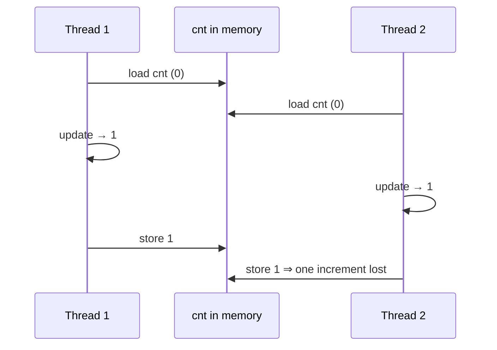
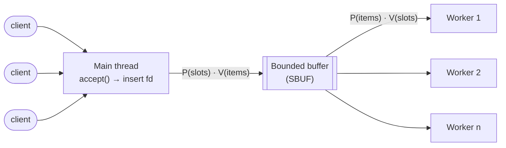
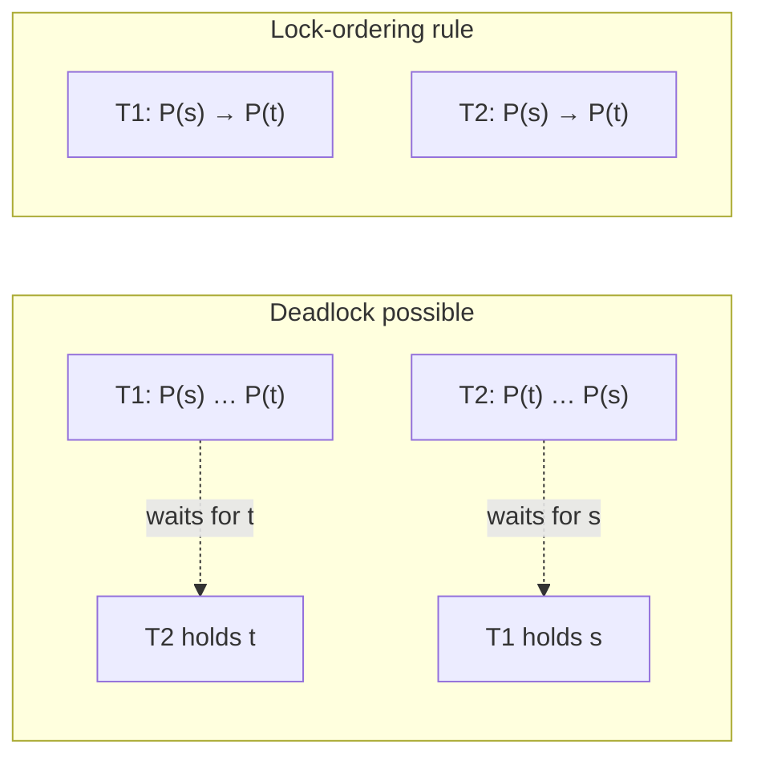

# Concurrent programming

> Chapter 11's echo server handles one client at a time. This chapter fixes
> that three ways (processes, event-driven I/O and threads), then spends most
> of its pages on the real difficulty: shared data, races and deadlocks, which
> follow you into every language.

## Three ways to be concurrent

| | **Processes** | **I/O multiplexing** (event-driven) | **Threads** |
| --- | --- | --- | --- |
| Who schedules | The kernel | **You** (`select` + state machines) | The kernel |
| Address space | Separate | One, shared | One, shared |
| Sharing data | Hard. Needs IPC | Easy | Easy, and easy to get wrong |
| Cost | Highest: process creation, context switches, IPC | Lowest: no context switches | In between: a thread's context is much smaller |
| Main risk | Leaked descriptors and zombies | Code complexity. A slow client blocks everyone | **Races and deadlocks** |
| Multicore | Yes | **No** (one process) | Yes |

**Process-based server.** `accept`, then `fork` a child per client. Three rules
follow from chapters 8 and 10:

- A **`SIGCHLD` handler that reaps in a loop**, because signals don't queue.
- The **parent must close its copy of the connected descriptor**. Otherwise the
  open-file entry never reaches a reference count of 0, and memory leaks until
  the system fails.
- The connection only closes when **both** copies are closed.

Separate address spaces mean no accidental sharing, but also that sharing
needs explicit IPC (pipes, FIFOs, shared memory) and is slower.

**Event-driven server.** `select(n, &read_set, …)` blocks until at least one
descriptor in a set (a *bit vector* again) is ready, and overwrites the set
with the ready ones, so you rebuild it on every loop. Each client is a small
**state machine**: one state ("waiting for d_k"), one event ("d_k readable"),
one transition ("echo a line"). The advantages: total control (you could
prioritize clients), one address space, it runs under an ordinary debugger,
and there are no context switches. The disadvantages: about **3× the code** of
the process version, and the **granularity problem**. A client that sends half
a line ties up the whole server unless you handle partial input. It also can't
use multiple cores.

**Thread-based server.** A **thread** has its own TID, stack, PC and registers,
and shares *everything else* in the process with other threads: code, heap,
globals and open files. Threads are **peers** rather than a parent-child tree,
so any thread can join or cancel any other.

- `pthread_create(&tid, NULL, f, arg)` / `pthread_join(tid, &ret)` (only for a
  *specific* thread; Stevens calls this a design flaw) / `pthread_exit` /
  `pthread_cancel` / `pthread_once`.
- Every thread must be **joined or detached**, or its resources leak. A server
  calls **`pthread_detach(pthread_self())`** in each connection thread.
- **The classic bug:** passing `&connfd` (one stack variable shared by all)
  to each new thread. The next `accept` can overwrite it before the thread
  reads it. **Malloc a separate copy per thread**, and free it in the thread.

## What is actually shared

A variable is **shared** if *more than one thread references the same
instance* of it:

- **Globals** and **`static` locals**: exactly one instance, so potentially
  shared.
- **Automatic locals**: one instance *per thread's stack*. They are normally
  private, **but stacks aren't protected from each other**, so a pointer to
  another thread's local makes it shared.
- **Registers** are never shared. **Memory** always can be.

## Why `cnt++` is wrong

Two threads each increment a global counter a million times. The result is
wrong, and different on every run. `cnt++` is really **load, update, store**
(*L*, *U*, *S*). If one thread loads between the other's load and store, one
increment is lost:

The book's tool for reasoning about this is the **progress graph**: one axis
per thread, with execution as a path that moves only right or up. The
*critical sections* (L, U, S) of the two threads overlap in an **unsafe
region**. A correct program has to make every possible path go around it.
(The book adds that multiprocessors can do even stranger things than a
progress graph shows. The rule doesn't change: synchronize.)

## Semaphores

Dijkstra's **semaphore** is a non-negative integer with two atomic operations:

- **P(s)** (*proberen*, to test): wait until s > 0, then decrement it.
- **V(s)** (*verhogen*, to increment): increment it, and wake one waiter (which
  one is unspecified).

Since s can never go negative, P and V create a **forbidden region** around
each critical section, and no path can enter it. Two uses:

1. **Mutual exclusion.** A binary semaphore (a **mutex**) set to 1, with
   `P(&mutex); cnt++; V(&mutex);`. Correct every time.
2. **Scheduling shared resources.** Counting semaphores signal conditions:
   - **Producer-consumer** (the book's SBUF package): a bounded buffer with
     `mutex = 1`, `slots = n` and `items = 0`. The producer does
     `P(slots) P(mutex) insert V(mutex) V(items)`, and the consumer does the
     mirror image.
   - **Readers-writers**: any number of readers or one writer. The "favor
     readers" version can **starve** writers.

Pthreads mutexes and condition variables, and Java monitors, offer the same
capabilities at a higher level.

**The prethreaded server** applies all of this. Instead of creating a thread
per client, the main thread **produces** connected descriptors into an SBUF,
and a fixed pool of worker threads **consumes** them. That is the thread-pool
pattern behind almost every production server.

## Threads for parallelism

On a multicore machine, threads also run **in parallel**. The book's example
sums 0…n−1 (2³¹ elements) on four cores. Each of t threads sums its own
region into its own partial result, and the main thread adds up the t partial
sums at the end. **No shared variable is updated in the loop**, which is
chapter 5's private-accumulator idea again. It reached efficiencies above
90%. The authors warn not to be fooled by that: the problem is *trivially*
easy to parallelize, and real ones usually aren't.

**Measuring it.** **Speedup** S_p = T_1 / T_p, and **efficiency** E_p = S_p / p.
*Absolute* speedup (against the best sequential version) is more honest than
*relative* speedup (the parallel version on one core). **Strong scaling** keeps
the problem fixed, while **weak scaling** grows it with the cores. Weak scaling
is often the better measure when bigger problems are the goal.

## The other hazards

**Thread safety.** A function is thread-safe if it is always correct when
called from several threads at once. The book lists four kinds of thread-unsafe
function:

| Class | Example | Fix |
| --- | --- | --- |
| 1. Doesn't protect shared variables | the `cnt++` loop | Add a mutex. Callers don't need to change |
| 2. Keeps state across calls | `rand`, `strtok` | **Rewrite it** so the caller passes the state (`rand_r`) |
| 3. Returns a pointer to static data | `ctime`, `gethostbyname`, `inet_ntoa` | Use the `_r` version, or **lock-and-copy** in a wrapper |
| 4. Calls a thread-unsafe function | — | Depends on which class it calls |

**Reentrant** functions touch *no* shared data at all, so they are thread-safe
with no locks and usually faster. Most of libc, including `malloc` and
`printf`, is thread-safe. Use the `_r` variants of the rest.

**Races.** A race is when correctness depends on one thread reaching a point
before another does. The book's example passes `&i` (the loop counter) to each
new thread, and the output was IDs 1, 3, 2, 3. It may work on one machine and
fail on another. The fix is the same as before: give each thread its own
malloc'd copy.

**Deadlock.** Threads wait forever for each other. On the progress graph, two
mutexes acquired in **opposite orders** produce overlapping forbidden regions
and a **deadlock region**: a path that enters it can never leave, and whether
you enter depends on scheduling, so it may not reproduce. The **lock-ordering
rule**: *if every thread acquires each pair of mutexes in the same order, the
program can't deadlock.*

## What to take away

- Choose the concurrency model on purpose. Processes isolate, event loops give
  control, and threads give sharing and multiple cores, along with the bugs that
  come with sharing.
- A shared counter or structure needs a lock or an atomic. "It's just `++`" is
  three instructions.
- Give each thread its own copy of anything you pass to it by address, and
  detach or join every thread.
- Always take locks in one global order. Prefer reentrant functions, and keep
  shared state, and so synchronization, to a minimum.

---

Previous: [Network programming](./02-network-programming.md) ·
Next: [Overview](../README.md)
