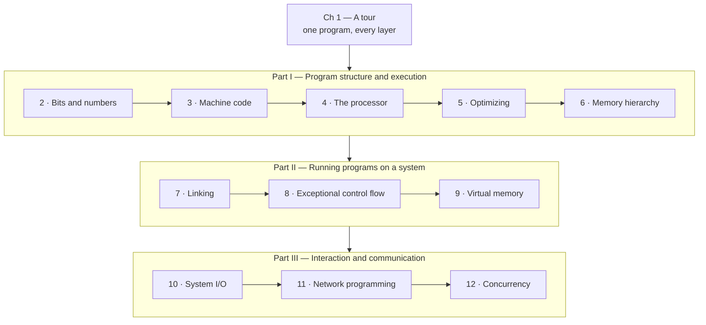

# Computer Systems: A Programmer's Perspective — Distilled

> Randal E. Bryant & David R. O'Hallaron, *Computer Systems: A Programmer's
> Perspective* (2nd ed., Prentice Hall, 2011), rewritten as a short book: every
> chapter's core ideas, in order, with diagrams, for an engineer who ships
> software and has never looked underneath it.

## What this is

The original grew out of Carnegie Mellon's 15-213 course, *Introduction to
Computer Systems*, which the authors first taught in 1998. It is a long
textbook: 12 chapters, each with practice and homework problems and their
solutions. This is the same 12 chapters in the same order, at a small fraction
of the length. It keeps the mechanisms, the numbers that make them
matter, and the advice. It drops the practice problems, most of the code
listings, and the hardware-design detail of chapter 4.

It is a **distillation written in our own words**, not a copy. No passage of the
book is reproduced. The source was read to check that the definitions, lists
and figures quoted here are the authors'. The book's own terms (memory
mountain, critical path, CPE, progress graph, short count, RIO) are kept,
because they are the words you'll meet in talks and code reviews.

Buy the book for the exercises. Much of CS:APP's value is in working the
problems and the course labs that go with it. This text tells you what they
teach. It can't replace doing them.

## Who it is for

Someone who writes application code in a high-level language and wants to know
what is happening underneath: why one loop order is 20× faster than another,
what "undefined reference" actually means, why `fork` is cheap, why a server
leaks zombies, why `cnt++` loses updates. You need to be able to read basic C.
You don't need any hardware or assembly background.

## Which edition, and what has changed since

This is the **2nd edition (2011)**. Its examples are mostly **32-bit IA32**,
with x86-64 in a late section of chapter 3. The **3rd edition (2015)** rewrote
everything around **x86-64** and updated networking (`getaddrinfo`, IPv6) and
signal-handling guidance. The ideas haven't changed. Where something has
moved on, the chapter says so in a short **"Since this edition"** note:
signed overflow as undefined behaviour, `-fno-common` as GCC's default,
async-signal-safe handlers, return-oriented programming, sanitizers.

## The book's single idea

> Every abstraction you program against — data types, the ISA, a process, a
> file, virtual memory, a connection — is implemented by the layer beneath it,
> and its costs and failure modes come from that layer. Knowing one layer down
> is how you write programs that are faster, more reliable and more secure.

## The shape of it

| | What it answers |
| --- | --- |
| [A tour of the system](./01-a-tour.md) | What happens, layer by layer, when you compile and run `hello`? |
| [Part I — Program structure and execution](./1-program-structure/README.md) | How are data and code represented, and how do you make them fast? |
| [Part II — Running programs on a system](./2-running-programs/README.md) | How does a program become a process, and what does the OS do for it? |
| [Part III — Interaction and communication](./3-interaction/README.md) | How do programs do I/O, talk over networks and run concurrently? |

## How to read it

Straight through takes two or three evenings. If you have one hour, read these
four. They change how you write everyday code most:

1. [The memory hierarchy](./1-program-structure/05-memory-hierarchy.md): locality, and the 20× loop.
2. [Optimizing program performance](./1-program-structure/04-optimizing-performance.md): aliasing, critical paths, Amdahl.
3. [Exceptional control flow](./2-running-programs/02-exceptional-control-flow.md): `fork`, `exec`, signals.
4. [Concurrent programming](./3-interaction/03-concurrent-programming.md): races, semaphores, deadlock.

## Where it sits in this knowledge base

- [Operating Systems](../operating-systems/README.md): processes, scheduling,
  virtual memory and file systems as reference docs.
- [Computer Networks](../computer-networks/README.md): the TCP/IP stack that
  chapter 11 treats as a black box.
- [Languages & Frameworks](../languages-frameworks/README.md): where these
  mechanisms show up in the runtimes you actually use.
