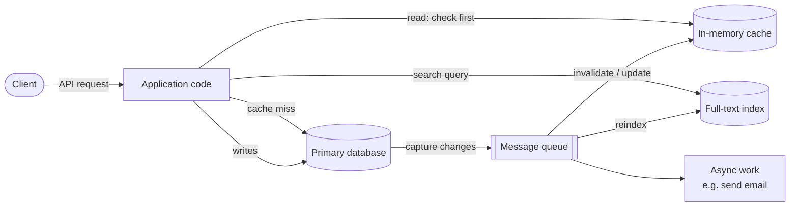
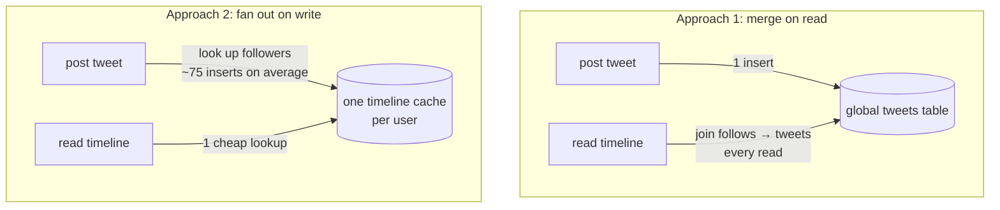
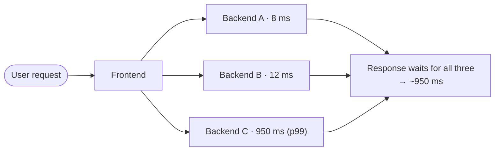

# Reliable, scalable and maintainable applications

> Most applications today are limited by their data (how much there is, how
> tangled it is, how fast it changes), not by CPU. This chapter defines the
> three words the whole book is about, so that "scalable" stops being a
> compliment and becomes a question you can answer.

## You are already a data-system designer

A typical application isn't "a database". It is a database, a cache, a search
index, a message queue and some batch jobs, stitched together by your code.
The categories also blur: Redis is a datastore people use as a queue, and Kafka
is a queue with database-grade durability.

Once your code keeps the cache and the index in sync with the database, you
have built a new, special-purpose data system. Its guarantees ("the cache is
never stale for longer than X") are now yours to design. The book focuses on
three concerns that matter in almost every such system: **reliability**,
**scalability** and **maintainability**.

## Reliability

Reliable roughly means *continuing to work correctly, even when things go
wrong*. Two words need separating:

- A **fault** is one component deviating from its spec.
- A **failure** is the whole system no longer providing its service.

You can't drive faults to zero, so you design **fault-tolerance** mechanisms
that stop faults becoming failures. Counter-intuitively, that can mean causing
faults on purpose. Netflix's **Chaos Monkey** kills processes at random so the
recovery code is exercised every day rather than discovered broken during a
real outage. Prevention still wins where there is no cure, as with security: a
leak can't be undone.

The book sorts faults into three kinds, and they behave very differently:

| Kind | Example | Character | What helps |
| --- | --- | --- | --- |
| **Hardware** | Disks with a 10–50 year MTTF, so a 10,000-disk cluster loses about one disk a day. Cloud VMs vanish without warning | Random, mostly **uncorrelated** | Redundancy (RAID, dual power) and, increasingly, software that survives losing a whole machine. That also allows **rolling upgrades** |
| **Software** | The June 2012 leap second hung many Linux machines at once. A runaway process, a slow dependency, cascading failures | **Systematic and correlated**: every node has the same bug | Question your assumptions, test, isolate processes, let them crash and restart, monitor, and have the system check its own invariants |
| **Human** | Operator configuration errors were the leading cause of outages in one study. Hardware played a part in only 10–25% | Inevitable | Good APIs that make the right thing easy, sandboxes with real data, tests, fast rollback and gradual rollouts, tools to recompute data, **telemetry** |

Reliability isn't only for air-traffic control. A parent who stores every photo
of their children in your app is trusting you with something irreplaceable.
Cutting corners is sometimes right (a prototype for an unproven market), but
cut them knowingly.

## Scalability

"X is scalable" means nothing. The useful question is: *if load grows in this
particular way, what are our options?* To ask it you need two things: a way to
describe load and a way to describe performance.

### Describing load: Twitter's fan-out

**Load parameters** are the few numbers that describe your load: requests per
second, the read/write ratio, active users, cache hit rate. Which ones matter
depends on the architecture.

The book's example is Twitter in November 2012. Posting a tweet averaged
**4.6k requests/s** (over 12k at peak). Reading the home timeline ran at
**300k requests/s**. The writes themselves were easy. The hard part was
**fan-out**: each user follows many people and is followed by many.

Twitter started with approach 1, fell behind on reads, and switched to approach
2. Because timeline reads outnumbered tweets by almost two orders of magnitude,
doing more work at write time paid off. It has a cost: at about 75 followers
per tweet, 4.6k tweets/s becomes **345k timeline writes/s**, and an account
with **30 million followers** turns one tweet into 30 million writes, all
inside Twitter's target of about five seconds. So the final design is a
**hybrid**: fan out most users' tweets, but fetch celebrities' tweets at read
time and merge them in.

The lesson isn't about Twitter. The **distribution of followers per user**
(weighted by how much they tweet) was the load parameter that decided the
architecture. Find yours.

### Describing performance: percentiles, not averages

Batch systems care about **throughput**. Online systems care about **response
time**: what the client sees, including network and queueing delays. (The book
keeps **latency** for the time a request spends waiting to be served.)

Response time is a **distribution**, not a number. Even identical requests vary,
because of context switches, a lost packet and a TCP retransmit, a GC pause,
a page fault, even vibration in the rack. So:

- The **mean** hides how many users actually waited. Use the **median (p50)**
  for "typical".
- Use **p95, p99, p999** (the **tail latencies**) to find out how bad the
  outliers are. Amazon set internal targets at p999 because its slowest
  requests came from the customers with the most data, who were usually its
  most valuable. It also decided p9999 was too expensive to chase.
- **Queueing** dominates the tail. A few slow requests block the fast ones
  behind them (**head-of-line blocking**). So measure on the **client side**,
  and make load generators send requests on a schedule rather than waiting
  for each reply, or you'll measure artificially short queues.
- **Tail latency amplification.** If one user request fans out to many backend
  calls, it is as slow as the slowest of them. A 1% slow-call rate becomes a
  much larger slow-*request* rate.

**Computing percentiles in practice:** keep a rolling window, or use a
streaming approximation (**forward decay**, **t-digest**, **HdrHistogram**).
**Never average percentiles** across machines or time buckets. That's
mathematically meaningless. Add the histograms instead.

Percentiles are also the language of **SLOs and SLAs**. The book's example SLA
counts the service as up when p50 < 200 ms and p99 < 1 s, and requires it to be
up 99.9% of the time.

### Coping with load

- **Scale up** (vertical: a bigger machine) or **scale out** (horizontal:
  more machines, also called **shared-nothing**). Real systems mix the two. A
  few powerful machines are often simpler and cheaper than many small VMs.
- **Elastic** systems add capacity automatically, which suits unpredictable
  load. **Manual** scaling is simpler and has fewer surprises.
- Spreading **stateless** services is easy. **Stateful** data systems are where
  distribution gets hard, which is why the conventional advice (in 2017) was to
  scale the database up until cost or availability forced you to distribute it.
- There is no **magic scaling sauce**. 100,000 requests/s of 1 kB and 3
  requests/minute of 2 GB have the same throughput and need completely
  different designs. A scalable architecture bets on which operations are
  common, and if the bet is wrong the scaling work is wasted. For an early
  startup, iterating quickly usually matters more than scaling for a load you
  may never see.

## Maintainability

Most of the cost of software comes after it ships. To avoid writing tomorrow's
legacy system, the book asks for three properties:

- **Operability.** Make life easy for operations: visibility through
  monitoring, support for automation, no dependence on any single machine,
  good documentation and a clear operational model ("if I do X, Y happens"),
  sensible defaults that can be overridden, self-healing with a manual
  override, and predictable behaviour. As the saying the book quotes goes, good
  operations can work around bad software, but good software can't run
  reliably with bad operations.
- **Simplicity.** Manage complexity. Symptoms of a **big ball of mud**: an
  exploding state space, tight coupling, tangled dependencies, inconsistent
  names, performance hacks and special cases. Moseley and Marks call
  complexity **accidental** when it comes from the implementation rather than
  the problem. The main tool against it is **abstraction**. SQL, for example,
  hides on-disk structures, concurrency and crash recovery. Good abstractions
  for *distributed* systems are much harder to find, and the book keeps looking
  for them.
- **Evolvability.** Make change easy. This is agility at the scale of a whole
  data system rather than a few source files: how would you "refactor" Twitter
  from approach 1 to approach 2? Simple systems with good abstractions are the
  ones you can change.

> **Since this edition:** this is the 1st edition (2017). Its "until recently"
> advice (keep the database on one node) has shifted. Managed distributed
> databases are now an ordinary default, and cloud services make elasticity
> cheap. The Twitter numbers are from 2012. The framework itself (load
> parameters, percentiles, faults versus failures) hasn't aged at all. A second
> edition, co-written with Chris Riccomini, reframes this opening around
> trade-offs and cloud-native systems.

## What to take away

- Name your load parameters before you argue about scale. The architecture
  follows the distribution (like followers per user), not the average.
- Track p50, p99 and p999 from the client side. Never average percentiles. Merge
  histograms instead.
- Expect software faults to be correlated across every node. Test recovery paths
  by triggering faults deliberately.
- Design for humans: fast rollback, gradual rollout, the ability to recompute,
  and monitoring.
- Treat simplicity as a feature. Most maintenance cost is accidental
  complexity.

---

Previous: [Part I — Foundations of data systems](./README.md) ·
Next: [Data models and query languages](./02-data-models.md)
