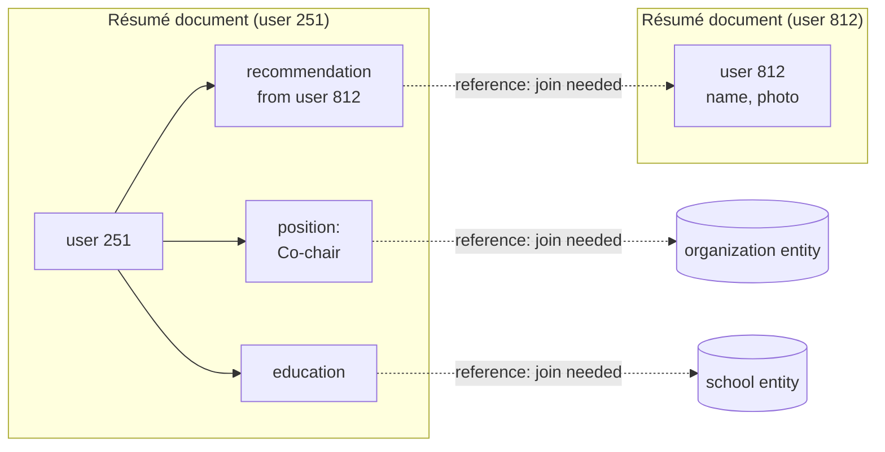
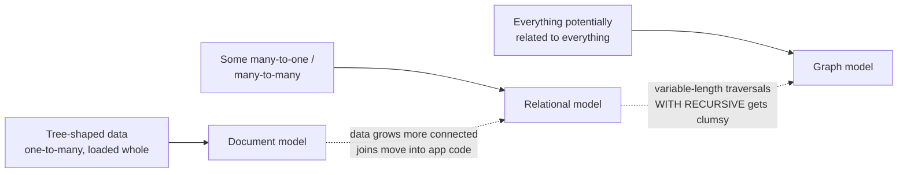

# Data models and query languages

> A data model decides what is easy to express and what is awkward, so it
> shapes how you think about the problem. This chapter compares the three that
> matter (relational, document and graph) by one question: how does each
> handle relationships between records?

## Layers of models

Every application stacks one data model on another. You model the world as
objects, store them as tables, documents or a graph, the database stores
*those* as bytes, and the hardware stores bytes as charge and magnetism. Each
layer hides the one below behind a cleaner model. This chapter is about the
second layer: the general-purpose model you store your objects in.

## Relational versus document

**The relational model** (Codd, 1970) organizes data into *relations*
(tables), each an unordered collection of *tuples* (rows). Many people doubted
it could be implemented efficiently. By the mid-1980s it had won anyway, and it
has dominated for 25–30 years, outlasting the network and hierarchical models,
object databases and XML databases.

**NoSQL** began as a Twitter hashtag for a 2009 meetup and was later
reinterpreted as "Not Only SQL". The book gives four reasons people adopted it:
scale beyond what relational databases easily reach, a preference for open
source, specialized query operations, and frustration with rigid schemas. The
likely future is **polyglot persistence**: relational and non-relational stores
used side by side.

### The impedance mismatch, and where documents win

Objects in application code don't map neatly onto rows. ORMs reduce the
boilerplate, but they can't hide the mismatch. The book's example is a résumé
(a LinkedIn profile): one user, with many positions, many schools and many
contact details.

- **Relational:** a `users` table, plus `positions`, `education` and `contact`
  tables with foreign keys. Fetching a profile takes several queries or a
  multi-way join.
- **Document:** one JSON document. The one-to-many relationships form a
  **tree**, the document makes the tree explicit, and one query fetches it
  all. That **locality** is the document model's main performance argument.

### Many-to-one and many-to-many: where documents struggle

Why store `region_id: "us:91"` rather than `"Greater Seattle Area"`? Because an
ID gives you consistent spelling, no ambiguity, one place to update, the
ability to localize, and better search (the region list knows Seattle is in
Washington). An ID never has to change, because it means nothing to humans.
Removing that duplication is the core idea of **normalization**.

But normalizing needs **many-to-one** references, and document databases had
weak joins. (At the time of writing, MongoDB had none and CouchDB only had
predeclared views.) Without database joins, you emulate them in application
code with extra queries. And data gets more connected as features arrive:
make companies and schools into entities with their own pages, or let one user
recommend another, and the résumé tree grows **many-to-many** edges.



Solid edges fit inside one document. Dashed edges are references that need a
join, whichever model you use.

### Repeating history

The book's sharpest point is that this debate is fifty years old.

| | **Hierarchical** (IBM IMS, 1968) | **Network** (CODASYL) | **Relational** |
| --- | --- | --- | --- |
| Shape | A tree of nested records, much like JSON | Records can have several parents | Flat tables of rows |
| Many-to-many | Hard. Denormalize, or resolve references by hand | Possible, through pointer-like links | Foreign keys, joined at query time |
| How you query | Imperative code | Follow an **access path** from a root, moving a cursor ("navigating an n-dimensional data space") | Declarative. The **query optimizer** chooses the access path |
| To query in a new way | Rewrite the code | Rewrite hand-written access-path code | Add an index. Queries pick it up unchanged |

The relational insight was that you build a query optimizer **once**, and
every application benefits. Document databases went back to the hierarchical
model in one respect (nesting one-to-many data in the parent), but for
many-to-one and many-to-many they use **document references**, resolved at
read time just like foreign keys. They haven't gone the way of CODASYL.

### Choosing between them

- **Simpler code.** If your data is document-shaped (a tree of one-to-many
  relationships, usually loaded whole), use documents. **Shredding** it into
  tables makes schemas and code clumsy. If it has many-to-many relationships,
  documents push joins and denormalization into your code. For highly
  interconnected data, graphs are the natural fit.
- **Schema.** "Schemaless" is misleading. The reading code still assumes a
  structure. The accurate terms are **schema-on-read** (like dynamic typing)
  and **schema-on-write** (like static typing). To split `name` into
  `first_name`, a document store just handles old documents in code when they
  are read. A relational store runs `ALTER TABLE`, which takes milliseconds in
  most databases. MySQL was the exception, copying the whole table. The
  `UPDATE` that backfills every row is slow everywhere. Schema-on-read helps
  when data is **heterogeneous**: many object types, or a structure dictated by
  external systems.
- **Locality** only pays off if you need most of the document. Reading a small
  field still loads the whole document, and growing a document usually rewrites
  it, so keep documents small. Locality also isn't unique to documents:
  Spanner interleaves child rows in their parent, Oracle has multi-table index
  cluster tables, and Bigtable has column families.
- **Convergence.** PostgreSQL (9.3+), MySQL (5.7+) and DB2 added JSON.
  RethinkDB added joins. Codd's original paper even allowed nested relations
  ("nonsimple domains"). The book sees a hybrid of the two models as the right
  direction.

> **Since this edition:** the convergence happened. MongoDB added `$lookup`
> joins and multi-document ACID transactions. PostgreSQL's `jsonb` with GIN
> indexes is a mainstream document store. MongoDB has since deprecated the
> map-reduce command the book uses below in favour of the aggregation
> pipeline. RethinkDB's company shut down in 2016, and Titan lives on as
> JanusGraph.

## Query languages: declarative wins

**Imperative** code says *how*: loop, test, push. **Declarative** code (SQL,
relational algebra) says *what*: which rows, sorted and grouped how. Three
reasons declarative wins:

1. It is **more concise**.
2. It **hides the engine**, so the database can reorganize storage, add indexes
   or change algorithms without breaking queries. Imperative code might depend
   on record order. SQL promises none.
3. It **parallelizes**. CPUs now get faster by adding cores, and a query that
   states only the result pattern can be spread across them.

The book's analogy is the browser. CSS `li.selected > p { background: blue }`
updates itself when the class moves. The equivalent DOM-walking JavaScript is
longer, doesn't undo itself, and has to be rewritten to use faster APIs.

**MapReduce** sits in between: you write pure `map` and `reduce` functions and
the framework calls them, anywhere, in any order, and again on failure. Writing
two coordinated functions is harder than one query, and it leaves an optimizer
less room. So MongoDB 2.2 added the declarative **aggregation pipeline**,
which the book sums up as a NoSQL system *accidentally reinventing SQL*.

## Graph-like data models

When many-to-many relationships dominate, model the data as a **graph** of
**vertices** and **edges**: social graphs, the web graph (PageRank), road
networks (shortest path). Graphs can also store **different** kinds of thing
in one store. Facebook keeps people, places, events, check-ins and comments in
a single graph.

The running example is Lucy, born in Idaho, and Alain, born in Beaune, who are
married and live in London. The graph handles things a fixed relational schema
finds awkward: different regional structures per country (French
*départements* and *régions*, US counties and states), and different
granularity (one person's birthplace is a state, another's residence is a
city).

### Property graphs and Cypher

A **property graph** (Neo4j, Titan, InfiniteGraph) has:

- **vertices**, each with an ID, incoming and outgoing edges, and key-value
  properties;
- **edges**, each with an ID, a tail vertex, a head vertex, a **label** and
  properties.

You could store this as two relational tables, with indexes on both ends of
each edge so you can traverse forwards and backwards. Any vertex can connect to
any other, and labels keep different relationships apart. That makes graphs
good for **evolvability**.

**Cypher** (from Neo4j) matches patterns with arrows. To find people who
emigrated from the US to Europe:

```
MATCH (p)-[:BORN_IN]->()-[:WITHIN*0..]->(:Location {name:'United States'}),
      (p)-[:LIVES_IN]->()-[:WITHIN*0..]->(:Location {name:'Europe'})
RETURN p.name
```

`:WITHIN*0..` means "follow WITHIN edges zero or more times", like `*` in a
regular expression. That is the hard part for SQL: the number of joins isn't
known in advance. SQL:1999's `WITH RECURSIVE` can do it, but in the book the
same query takes **29 lines of SQL against 4 of Cypher**. Different models suit
different problems.

### Triple-stores, SPARQL and Datalog

A **triple-store** (Datomic, AllegroGraph) stores everything as
*(subject, predicate, object)*. If the object is a value, the triple is a
property, like `(lucy, age, 33)`. If the object is another vertex, it's an
edge, like `(lucy, marriedTo, alain)`. It is the same idea as a property graph
in different words.

- **RDF and the semantic web.** RDF was meant to let websites publish
  machine-readable data that could be merged into a web-wide database. It was
  overhyped in the early 2000s and never took off. Triples are still a good
  *internal* model even if you never publish RDF.
- **SPARQL** predates Cypher, which borrowed its pattern matching. The
  emigration query is even shorter in SPARQL:
  `?person :bornIn / :within* / :name "United States"`.
- **Datalog** (studied in the 1980s, used by Datomic and Cascalog) is the
  foundation the others build on. You write **rules** that derive new
  predicates, such as `within_recursive` and `migrated`, and combine them.
  It's awkward for one-off queries and powerful for complex data, because rules
  can be reused.

**Graph databases aren't CODASYL again.** Any vertex can link to any other,
with no schema restricting which record type nests where. You can reach any
vertex by ID or index, not only by an access path. Edges are unordered. And
queries can be declarative.



> **Since this edition:** graph querying was standardized. ISO **GQL** (2024)
> is a standard graph query language descended from Cypher, and SQL:2023 added
> **SQL/PGQ** for property-graph queries over relational tables.

## What to take away

- Choose the data model by the *relationships*. Trees suit documents,
  references suit relational, and densely connected data suits graphs.
- "Schemaless" means schema-on-read. Your code still has a schema, and you
  just enforce it later.
- Document locality helps only if you read most of the document and keep it
  small.
- Prefer declarative queries. They let the engine get faster underneath you,
  and they are the only kind that parallelize easily.
- Expect data to get more connected over time. A model that fits version 1
  can push joins into your code by version 3.

---

Previous: [Reliable, scalable and maintainable applications](./01-reliable-scalable-maintainable.md) ·
Next: [Storage and retrieval](./03-storage-and-retrieval.md)
