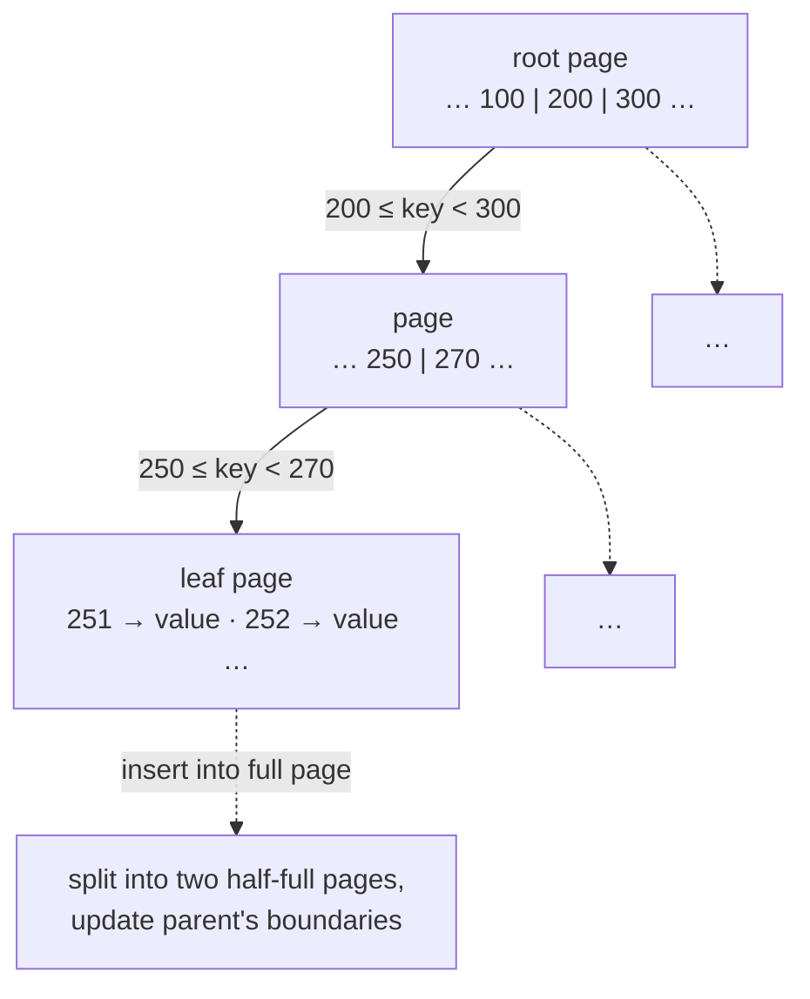
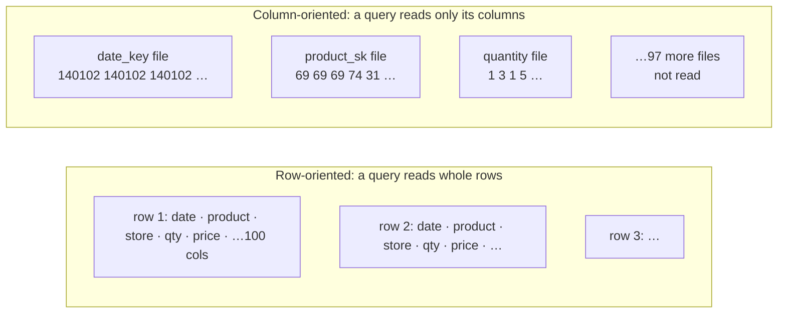

# Storage and retrieval

> You won't write a storage engine, but you will pick one and tune it, and
> both need a rough picture of what it does with your bytes. This chapter
> builds the two main families from scratch (log-structured and B-tree), then
> shows why analytics needs a different design altogether: column storage.

## The simplest database, and why indexes cost writes

Imagine a key-value store made of two shell functions. `db_set` appends
`key,value` to a file. `db_get` greps the file and takes the *last* match.

- **Writes are excellent.** Appending to a file is about the cheapest write
  there is. Many real databases are built around exactly this **log**, an
  append-only sequence of records (not necessarily human-readable).
- **Reads are terrible.** Every lookup scans the whole file, which is O(n).

The fix is an **index**: extra metadata derived from the primary data that
acts as a signpost. That brings in the trade-off the rest of the chapter
explores: **well-chosen indexes speed up reads, and every index slows down
writes.** That's why databases make you choose your indexes instead of
indexing everything.

## Log-structured storage

### Hash indexes (Bitcask)

Keep an **in-memory hash map from each key to its byte offset** in the log.
A write appends to the log and updates the map. A read does one seek. That's
essentially **Bitcask**, Riak's default engine. It is fast as long as **every
key fits in RAM**, and it suits workloads with many updates per key, like a
play counter per cat-video URL.

To stop the log growing forever:

- Split it into **segments**, and **compact** closed segments in the
  background, keeping only the latest value per key and merging segments as
  you go.
- **Deletes** append a **tombstone** that tells the merge to drop the key.
- **Crash recovery**: Bitcask snapshots each segment's hash map to disk, so
  restarts don't have to rescan everything.
- **Partial writes** are caught by checksums.
- **Concurrency**: one writer thread, and immutable segments that any number
  of readers can share.

Why append rather than overwrite in place? Sequential writes are much faster
(especially on spinning disks, and somewhat on SSDs), crash recovery is simple
because no value is ever half-overwritten, and merging prevents fragmentation.
The limits: **the keys must fit in memory**, and **range queries** are
hopeless.

### SSTables and LSM-trees

Make one change: **keep each segment sorted by key**. That's a **Sorted String
Table (SSTable)**, and it fixes both limits:

1. **Merging is a mergesort**, so it works even when files are bigger than
   memory. When a key appears in several segments, the newest wins.
2. **The in-memory index can be sparse**: one key every few kilobytes. To find
   `handiwork`, jump to `handbag` and scan forward.
3. Records between index entries can be **compressed as a block**.

But writes arrive in any order. How does the data get sorted? In memory:

- Writes go into an in-memory balanced tree, the **memtable**, and also to an
  unsorted **write-ahead log** on disk, which exists only to rebuild the
  memtable after a crash.
- When the memtable reaches a few megabytes, flush it as a new SSTable.
- A read checks the memtable, then the newest SSTable, then older ones.
- Background **compaction** merges SSTables and drops overwritten or deleted
  values.

This is the **Log-Structured Merge-Tree** (O'Neil et al.). It is the engine in
**LevelDB** and **RocksDB**, and something similar runs in **Cassandra** and
**HBase** (both after Google's **Bigtable** paper, which coined *SSTable* and
*memtable*). **Lucene**, the engine under Elasticsearch and Solr, keeps its
term → postings-list dictionary in SSTable-like files.

Two refinements:

- **Bloom filters** answer "this key is definitely not here", so a lookup for a
  missing key doesn't have to touch every segment.
- **Compaction strategy.** *Size-tiered* (HBase) merges newer, smaller tables
  into older, larger ones. *Leveled* (LevelDB, RocksDB) splits the key range
  into small tables arranged in levels, which compacts more incrementally and
  uses less disk. Cassandra supports both.

## B-trees: update in place

The B-tree (1970, "ubiquitous" within a decade) is still **the standard index
in almost every relational database**. Like an SSTable it keeps keys sorted,
but the philosophy is opposite: it splits the database into **fixed-size
pages** (traditionally 4 KB), reads and writes a page at a time, and
**overwrites pages in place**.

- Each page holds keys and references to child pages, each child covering a
  key range. The **branching factor** is typically several hundred.
- An insert into a full page **splits** it, so the tree stays **balanced** at
  O(log n) depth. Three or four levels is usually enough: a four-level tree of
  4 KB pages with a branching factor of 500 holds up to **256 TB**.
- **Crash safety.** A split overwrites several pages, and a crash halfway
  through leaves orphan pages. So every change goes to a **write-ahead log
  (WAL, or redo log)** first.
- **Concurrency** needs **latches** (lightweight locks) on the tree's pages.
  Log-structured engines avoid this by merging in the background and swapping
  segments atomically.
- **Optimizations:** copy-on-write pages instead of a WAL (LMDB), abbreviated
  keys in interior pages (the B+ tree idea), sibling pointers between leaves
  for range scans, and **fractal trees**, which borrow log-structured ideas.

### B-tree or LSM-tree?

The rule of thumb is that **LSM-trees are faster for writes and B-trees are
faster for reads**, but benchmarks are sensitive to the workload, so **test
with yours**.

| | **LSM-tree** | **B-tree** |
| --- | --- | --- |
| Write throughput | Higher: sequential writes, often lower **write amplification** | Every write goes at least twice (WAL plus page), whole pages at a time, sometimes twice more for torn-page safety |
| Disk footprint | Smaller: compresses better, no page fragmentation (especially with leveled compaction) | Pages are left partly empty after splits |
| Read cost | Has to check several structures at different stages of compaction | One path from root to leaf |
| Tail latency | **Compaction can stall requests**, so p99+ is less predictable | More predictable |
| Failure mode | At high write rates **compaction can fall behind**: segments pile up, reads slow, disk fills. Engines usually don't throttle writes, **so monitor it** | — |
| Transactions | A key can live in several segments | **Each key exists in exactly one place**, so range locks attach directly to the tree |

**Write amplification** (one logical write becoming many physical ones over the
data's lifetime) matters twice over: it uses up limited disk bandwidth, and SSD
cells wear out.

## Other indexes

- **Secondary indexes** have non-unique keys. Either the value is a list of row
  IDs (like a postings list), or you make each key unique by appending the row
  ID.
- **Where the row lives.** Either in a **heap file** that every index points
  into (no duplication, and updates in place are cheap until a row grows and
  has to move), or in a **clustered index** that stores the row in the index
  itself. InnoDB's primary key is clustered, and its secondary indexes point
  at the primary key. A **covering index** (an *index with included columns*)
  stores just enough columns to answer some queries alone. Duplicating data
  makes reads faster and writes, and transactional guarantees, more expensive.
- **Concatenated indexes** work like a phone book on (last name, first name):
  they're useful for a last name, or both names, and useless for a first name
  alone.
- **Multi-dimensional indexes.** "Restaurants in this map rectangle" needs a
  range on latitude *and* longitude at once, which a B-tree can't do. Use a
  **space-filling curve** or, more commonly, an **R-tree** (PostGIS). The
  same idea works for (red, green, blue) colour search or (date, temperature).
- **Fuzzy search.** Lucene finds words within an **edit distance** using an
  in-memory automaton over the keys that can be turned into a **Levenshtein
  automaton**.
- **In-memory databases** (VoltDB, MemSQL, TimesTen, RAMCloud; Redis and
  Couchbase with weak durability) can still be durable through logs,
  snapshots or replication. The surprise is that their speed **doesn't come
  from skipping disk reads**, because the OS page cache would serve those
  anyway. It comes from **not having to encode data structures for disk**.
  They also allow data models that are hard to build on disk, like Redis's
  priority queues and sets. **Anti-caching** evicts cold records to disk to
  handle datasets larger than memory.

## Transaction processing versus analytics

|  | **OLTP** | **OLAP** |
| --- | --- | --- |
| Main read pattern | A few records per query, fetched by key | Aggregates over a huge number of records |
| Main write pattern | Random-access, low-latency writes from user input | Bulk import (**ETL**) or event stream |
| Used by | End users, through the app | Internal analysts (**business intelligence**) |
| What the data represents | The latest state | A history of events |
| Size | Gigabytes to terabytes | Terabytes to petabytes |
| Bottleneck | Disk **seek** time | Disk **bandwidth** |

Analysts' ad hoc scans would hurt production OLTP databases, so companies
copied everything into a separate **data warehouse** via **ETL**
(extract-transform-load). A small company with one database and little data
rarely needs one. The interfaces converged on SQL while the internals split
apart: Teradata, Vertica, SAP HANA, ParAccel/Redshift, and SQL-on-Hadoop
engines like Hive, Spark SQL, Impala and Presto.

**Star schema.** A central **fact table** has one row per event (a sale, a
click), with attributes and foreign keys to **dimension tables** for the who,
what, where, when, how and why, even the date, so holidays can be encoded. A
**snowflake schema** normalizes dimensions further. Analysts usually prefer
the simpler star. Fact tables reach **tens of petabytes** at companies like
Apple, Walmart and eBay, and are often **100+ columns wide**.

## Column-oriented storage

A typical analytic query touches **4 or 5** of those 100+ columns across
billions of rows. A row store would still load every column of every row. A
**column store** keeps each column in its own file, *with rows in the same
order in every file*, so the 23rd entry of each file makes up row 23.

- **Compression.** Columns are repetitive. **Bitmap encoding** gives each
  distinct value (say 100,000 products among billions of sales, or about 200
  countries) a bitmap of rows, **run-length encoded** when it's sparse.
  `WHERE product_sk IN (30, 68, 69)` becomes a bitwise OR of three bitmaps,
  and `AND` across columns lines up because the rows are in the same order.
- **Vectorized processing.** Compressed chunks fit in L1 cache and run through
  tight loops, using SIMD instructions and avoiding branch mispredictions.
  Memory-to-CPU bandwidth is the next bottleneck after disk.
- **Sort order.** Sort *whole rows* (not columns independently) by chosen keys,
  date first for example. Range queries can then skip data, and the first sort
  column compresses to almost nothing. **C-Store/Vertica** stores **several
  sort orders** across its replicas and uses the best one per query.
- **Writes** are hard: you can't insert into the middle of compressed, sorted
  columns. The answer is the LSM idea again. Buffer writes in memory, merge
  them into new column files in bulk, and have queries combine the two.
- **Column families aren't column storage.** Cassandra and HBase store all of a
  row's columns within a family together and don't compress columns, so the
  Bigtable model is mostly row-oriented.

**Materialized aggregates.** A **materialized view** stores a query's result on
disk (a virtual view is just shorthand for the query). A **data cube** (OLAP
cube) precomputes aggregates across dimensions, for example sales by date ×
product, summed along either axis. Queries become instant, but you lose
flexibility: you can't ask about items over $100 if price isn't a dimension.
Warehouses keep the raw data and use cubes only to speed things up.

> **Since this edition:** the analytics side changed most. Cloud warehouses
> (Snowflake, BigQuery, Redshift) separate storage from compute, and open
> columnar formats (**Parquet**, which the book mentions, plus table formats
> such as Iceberg and Delta Lake) on object storage turned the warehouse into
> a "lakehouse". Embedded column engines such as DuckDB put OLAP on a laptop.
> RocksDB has become the default embedded LSM engine inside many other
> systems. The B-tree/LSM trade-offs are unchanged.

## What to take away

- Every index is a write tax. Add the indexes your query patterns need, and no
  more.
- Pick LSM engines for write-heavy workloads, and watch compaction backlog and
  p99. Pick B-trees for predictable reads and range locking. Benchmark *your*
  workload.
- Clustered and covering indexes trade write cost and space for faster reads.
- Don't run analytics on your OLTP database. Analytics wants columns,
  compression and sort order, not row indexes.
- In-memory databases are fast because they skip disk *encoding*, not disk
  *reads*.

---

Previous: [Data models and query languages](./02-data-models.md) ·
Next: [Encoding and evolution](./04-encoding-and-evolution.md)
