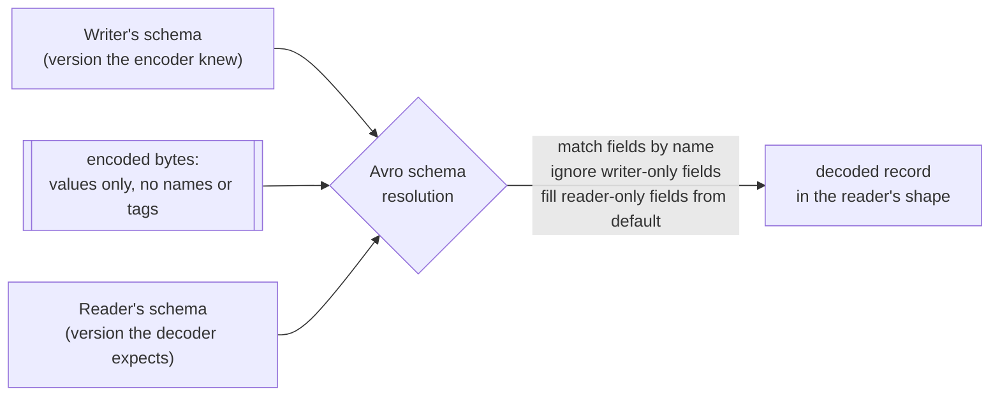
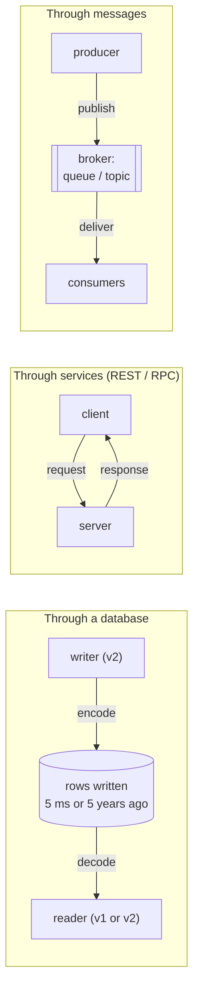

# Encoding and evolution

> Old code and new code always run side by side: during a rolling deploy,
> on users' phones that haven't updated, and in five-year-old rows in your
> database. This chapter is about the formats that let them understand each
> other, and the three ways data flows between them.

## Two directions of compatibility

You change a schema, the code changes with it, and the code can't change
everywhere at once. Servers roll out a few nodes at a time (**rolling
upgrade**). Clients update when their users get round to it. So you need:

- **Backward compatibility**: *new code reads old data*. This is usually
  easy, because you know the old format.
- **Forward compatibility**: *old code reads new data*. This is harder: old
  code has to **ignore** what it doesn't understand.

**Encoding** (also called serialization or marshalling) turns in-memory
structures full of pointers into a self-contained byte sequence. **Decoding**
reverses it. The book avoids the word "serialization" because chapter 7 needs
it for something else.

## The formats

### Language-specific formats: don't

Java's `Serializable`, Ruby's `Marshal` and Python's `pickle` are convenient
and almost always a mistake for anything that lasts:

- They lock you into one language.
- Decoding can **instantiate arbitrary classes**, a well-known route to remote
  code execution.
- Versioning is an afterthought.
- They are often slow and bloated. Java's built-in serialization is notorious.

### JSON, XML, CSV: good enough, with sharp edges

They are widely supported and human-readable, which makes them ideal for
**exchange between organizations**, where agreeing on *anything* is the hard
part. Their subtle problems:

- **Numbers are ambiguous.** XML and CSV can't tell a number from a string of
  digits. JSON doesn't separate integers from floats, so integers above
  **2⁵³** lose precision in JavaScript. Twitter's API sends tweet IDs twice,
  as a number and as a string, for exactly this reason.
- **No binary strings**, so people use Base64, which is hacky and **33%
  bigger**.
- **Optional schemas** (XML Schema, JSON Schema) are powerful but complicated,
  and many JSON tools skip them, so the decoding rules end up hard-coded in
  apps.
- **CSV has no schema**, and its escaping rules are implemented
  inconsistently.

Binary JSON variants (MessagePack, BSON, Smile and others) still carry every
field name in every record. The book's example record is 81 bytes as compact
JSON and **66 bytes** in MessagePack, which is hardly worth losing readability.

### Thrift and Protocol Buffers: field tags

Both (Facebook and Google respectively, open-sourced in 2007–08) need a
**schema**, written in an IDL, and generate code from it. The key move is
that the encoded data uses **field tags** (small numbers) instead of field
names.

| Encoding of the same record | Bytes |
| --- | --- |
| JSON, whitespace removed | 81 |
| MessagePack | 66 |
| Thrift BinaryProtocol | 59 |
| Thrift CompactProtocol (type + tag in one byte, variable-length ints) | 34 |
| Protocol Buffers | 33 |
| Avro | **32** |

**Evolution rules come from the tags:**

- You can **rename** a field, because names aren't in the data.
- You can **never change a tag**.
- **Add** a field with a new tag. Old code skips tags it doesn't know (the
  type annotation tells it how many bytes), which gives forward
  compatibility. A new field **can't be `required`**, or new code reading old
  data fails, so it must be optional or have a default.
- **Remove** only optional fields, and **never reuse the tag**.
- **Changing a type** risks truncation. Old 32-bit code reading a new 64-bit
  value cuts it short.
- Protobuf has no list type, only `repeated`, so an optional field can become
  repeated. (Old readers see the last element.) Thrift's list type can't do
  that, but it supports nested lists.

### Avro: no tags, two schemas

Avro (2009, a Hadoop subproject) has no tag numbers and no type markers. The
encoding is just values concatenated in schema order, so the data can only be
decoded **with the schema it was written with**. Evolution works by putting
two schemas side by side:

- Writer's and reader's schemas only need to be **compatible**. Fields are
  matched **by name**, in any order.
- **You may only add or remove fields that have a default.** Adding one
  without a default breaks backward compatibility. Removing one without a
  default breaks forward compatibility.
- Null isn't a free default. A field that can be null must be a **union**,
  like `union { null, long }`, which makes nullability explicit.
- Renaming uses **aliases** in the reader, which is backward compatible but not
  forward compatible. Adding a branch to a union is the same.

**How does the reader get the writer's schema?** It depends on where the data
lives:

- In a **large file**, write it once in the header (Avro *object container
  files*).
- In a **database**, put a version number on each record and keep a table of
  schema versions. LinkedIn's Espresso works this way.
- Over a **network connection**, negotiate it when the connection is set up.

Either way, a **schema registry** doubles as documentation and lets you check
compatibility before you deploy.

The reason to have no tags is **dynamically generated schemas**. Dump a
relational database to Avro by generating one record schema per table, and
regenerate after every migration. Names match by themselves. With protobuf,
someone would have to assign tags by hand and never reuse one. Code generation
is optional, which suits dynamic languages, and container files describe
themselves (handy in Pig).

### Why schemas are worth it

Binary schema formats are simpler than XML Schema or JSON Schema, and the idea
is old: **ASN.1** (1984) still encodes X.509 certificates. You get compact data,
documentation that **can't go stale** (you need it to decode), compatibility
checks before deployment, and generated types in static languages. That's the
flexibility of schema-on-read with better guarantees.

> **Since this edition:** proto3 removed `required` altogether, because the
> lesson above was learned the hard way. Protobuf with **gRPC** became the
> default for internal services. Thrift faded outside its original users.
> Schema registries (Confluent's and similar) with enforced compatibility
> modes are now standard practice on Kafka.

## Three modes of dataflow

Compatibility is a relationship between whoever encodes and whoever decodes. In
practice data flows in one of three ways:

### Through databases

Writing to a database is *sending a message to your future self*, so backward
compatibility is required. During a rolling upgrade, old code also reads rows
written by new code, so you need forward compatibility too.

- **The preservation trap.** New code adds a field. Old code reads the row,
  decodes it into a model object (dropping the unknown field), and writes it
  back, so the field is **silently lost**. The formats can preserve unknown
  fields, but your app layer has to as well.
- **Data outlives code.** You can replace every server in minutes, but a
  five-year-old row keeps its original encoding until something rewrites it.
  Databases avoid full migrations where they can. Adding a nullable column
  doesn't rewrite rows (except in MySQL); the database fills in nulls when
  reading. Schema evolution makes the whole database *look* as if it has one
  schema.
- **Archives and snapshots** are written in one go and never change, so
  re-encode them consistently with the latest schema, in Avro container files
  or columnar **Parquet**.

### Through services: REST and RPC

**Services** look like databases with a restricted, application-specific API,
which gives **encapsulation**. The point of SOA and **microservices** is
**independent deployability**: one team ships without coordinating with the
others, so old and new clients and servers *will* coexist.

- **REST** is a design philosophy built on HTTP: URLs for resources, plus
  HTTP's caching, auth and content negotiation. It's documented with
  **OpenAPI/Swagger**.
- **SOAP** is XML and the sprawling **WS-\*** standards, described in WSDL and
  usable only with heavy tooling. Interoperability between vendors is poor,
  and it's out of favour outside large enterprises.

**The problem with RPC.** EJB, RMI, DCOM and CORBA all chase **location
transparency**, making a network call look like a local one. The book argues
that's fundamentally flawed, because a network call:

1. is **unpredictable**: requests and responses get lost, and the remote side
   can be slow or down;
2. can **time out**, leaving you *not knowing* whether the request happened;
3. may **run twice** when retried, unless you build in **idempotence**;
4. has **wildly variable latency**, from under a millisecond to seconds;
5. has to **encode every parameter**, so there are no cheap pointers;
6. crosses **language type systems** (that 2⁵³ problem again).

The newer frameworks (gRPC, Finagle, Rest.li, Thrift and Avro RPC) stop
pretending. They use **futures/promises**, **streams** and **service
discovery**. Custom binary RPC is faster, but REST wins for **public** APIs:
you can debug with `curl` and use the huge HTTP tooling ecosystem.

**Evolution rule for services:** assume **servers are upgraded first, then
clients**. That means you need *backward* compatibility on **requests** and
*forward* compatibility on **responses**. Across organizations you can't force
upgrades, so old API versions live for a very long time. There's no agreed way
to version APIs: a URL path, an `Accept` header, or a per-API-key setting on
the server.

### Through asynchronous messages

**Message brokers** (RabbitMQ, ActiveMQ, NATS, Kafka; formerly TIBCO and
WebSphere) sit between RPC and databases: delivery is low-latency, but goes
through an intermediary that stores messages. Compared with RPC, a broker:

- **buffers** when the consumer is down or overloaded;
- **redelivers** to crashed consumers;
- removes the need to know the recipient's address;
- **fans out** one message to many consumers;
- **decouples** the sender from whoever consumes.

Messaging is usually **one-way and asynchronous**: fire and forget, with
replies, if any, on a separate queue. Messages are just bytes, so use a
compatible encoding, and **preserve unknown fields when republishing**.

**Distributed actor frameworks** extend the actor model (single-threaded actors
with private state, talking by messages that may be lost) across nodes.
Location transparency fits actors better than RPC, because actors already
assume messages can be lost. Rolling upgrades still need compatible encodings,
and the book found the defaults weak: **Akka** used Java serialization (swap
in protobuf), **Orleans** needed a blue/green cluster switch, and **Erlang
OTP** found record-schema changes surprisingly hard.

## What to take away

- Plan for old and new code reading each other's data, in both directions, on
  every deploy.
- Never use language-native serialization for anything stored or sent between
  services. It's a lock-in and a security hole.
- With protobuf or Thrift, never reuse or change a tag, and make every new
  field optional or give it a default. With Avro, every field you add or
  remove needs a default.
- When old code rewrites a record, make sure it keeps the fields it doesn't
  understand.
- Don't treat a remote call like a local function. Plan for timeouts, retries
  and idempotence. Upgrade servers first, then clients.

---

Previous: [Storage and retrieval](./03-storage-and-retrieval.md) ·
Next: [Part II — Distributed data](../2-distributed-data/README.md)
