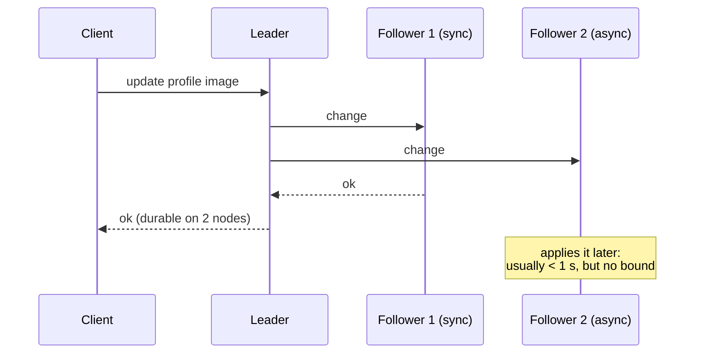
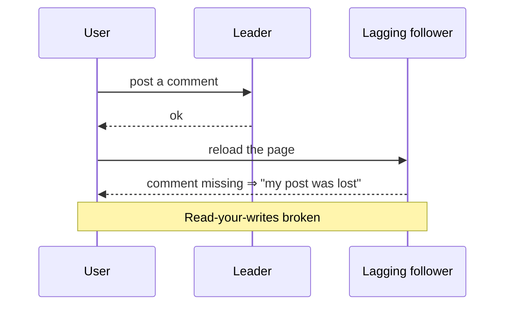
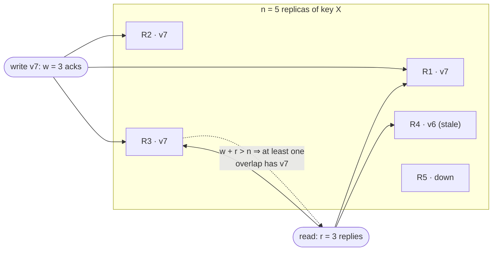

# Replication

> Copying data that never changes is trivial. All the difficulty is in
> copying *changes*. This chapter covers the three ways to do it (single
> leader, multi-leader and leaderless) and the strange things users see when
> copies lag behind.

Replication keeps a copy of the same data on several machines, for three
reasons: to keep data **close to users** (latency), to keep working when parts
fail (**availability**), and to serve more reads (**read throughput**). This
chapter assumes every node can hold the whole dataset. Chapter 6 removes that
assumption.

The principles date from the 1970s, because networks haven't fundamentally
changed. What's newer is that ordinary developers now use distributed
databases, which is why ideas like "eventual consistency" get misunderstood.

## Single-leader replication

Also called *leader-based*, *active/passive* or *primary/replica* (the book's
era also said master/slave):

1. One replica is the **leader**. All writes go to it, and it writes them
   locally first.
2. It sends each change to the **followers** in a **replication log**, and
   they apply the changes **in the same order**.
3. Reads can go to the leader or to any follower.

This is built into PostgreSQL (9.0+), MySQL, Oracle Data Guard, SQL Server
AlwaysOn, MongoDB, RethinkDB and Espresso, and even into Kafka and RabbitMQ's
highly available queues.

### Synchronous or asynchronous

- A **synchronous** follower is guaranteed to be up to date, but if it stops
  responding, **all writes block**. So "synchronous" in practice means **one**
  synchronous follower and the rest asynchronous, which some call
  **semi-synchronous**: the data is on at least two nodes.
- **Fully asynchronous** is common, especially with many or far-away
  followers. The leader keeps accepting writes even if every follower falls
  behind, but **a confirmed write can be lost** if the leader dies. Durability
  is traded for availability.
- Research such as **chain replication** (used in Azure Storage) aims for no
  data loss with good performance. The deep link between replication and
  consensus is the subject of chapter 9.

### Adding a follower without downtime

Copying the data files isn't enough, because they change while you copy.

1. Take a **consistent snapshot** without locking the whole database.
2. Copy it to the new node.
3. Request every change since the snapshot's exact **log position**
   (PostgreSQL's *log sequence number*, MySQL's *binlog coordinates*).
4. Once it has **caught up**, keep streaming.

### Node outages

- **Follower failure: catch-up recovery.** A follower knows the last
  transaction it applied, so after a restart it asks for everything since.
- **Leader failure: failover.** Detect that the leader is dead (usually with a
  **timeout**, around 30 s), choose a new leader (ideally the most up-to-date
  follower, which is a consensus problem), and reconfigure clients and other
  followers to use it. Each step can go wrong:
  - **Lost writes.** An asynchronous follower may be missing the old leader's
    last writes, and these are usually just **discarded**, breaking clients'
    durability expectations.
  - **Coordination with other systems.** In the book's **GitHub incident**, an
    out-of-date MySQL follower was promoted and **reused auto-increment
    primary keys** that were also used as keys in Redis, so some private data
    was shown to the wrong users.
  - **Split brain.** Two nodes both believe they're leader. The safety net
    (**fencing**, or *STONITH*: shoot the other node in the head) can, if badly
    designed, shut down *both*.
  - **The right timeout.** Too long means slow recovery. Too short means
    needless failovers during a load spike, which make the overload worse.

  Because of this, some operations teams **fail over by hand** even when the
  software can do it automatically.

### What the replication log contains

| Method | How it works | Problem |
| --- | --- | --- |
| **Statement-based** | Send the SQL itself | `NOW()`, `RAND()`, auto-increment, `UPDATE … WHERE` order and triggers can all differ per replica. MySQL before 5.1 used it. VoltDB makes it safe by requiring deterministic transactions |
| **WAL shipping** | Send the storage engine's own write-ahead log (PostgreSQL, Oracle) | It describes **bytes in disk blocks**, which ties replication to the storage format. Leader and followers usually can't run different versions, so **upgrades need downtime** |
| **Logical (row-based)** | Per row: new values for inserts, a key for deletes, a key plus new values for updates, then a commit record (MySQL's row-based binlog) | Decoupled from storage, so it allows mixed versions and **zero-downtime upgrades**, and external systems can parse it. This is **change data capture** (chapter 11) |
| **Trigger-based** | Triggers write changes to a table, and an external process replicates them (Databus, Bucardo; GoldenGate reads the log) | Flexible (subsets, different databases, custom conflict logic), but slower and buggier |

## The problems with replication lag

**Read scaling** (many followers, reads spread across them) only works with
**asynchronous** replication. A fully synchronous system with many nodes would
almost always have one down. Asynchronous followers serve **stale** data, but
if writes stop they catch up eventually, so this is **eventual consistency**.
"Eventually" has no bound. Lag is normally under a second, but near capacity
or during network trouble it can grow to seconds or minutes, and then users
notice three anomalies:

| Guarantee | The anomaly it prevents | How to provide it |
| --- | --- | --- |
| **Read-after-write** (read-your-writes) | You don't see your own write | Read data the user might have changed from the leader (such as their own profile). Read from the leader for a minute after an update. Or have the client remember its last write's timestamp (ideally a **logical** one, like a log position) and only read from replicas that have caught up to it. **Cross-device** versions need that metadata centralized and all of a user's devices routed to one datacenter |
| **Monotonic reads** | Time goes **backwards**: a comment appears, then disappears on refresh because the second read hit a staler replica | Pin each user to one replica, for example by hashing the user ID |
| **Consistent prefix reads** | **Causality** breaks: you see the answer before the question (the book's Mr. Poons and Mrs. Cake), usually because partitions replicate independently | Write causally related data to the same partition, or track causal dependencies explicitly |

The book's advice: ask how your app behaves if lag reaches **minutes or
hours**. If the answer is bad, design for a stronger guarantee. **Pretending
replication is synchronous when it isn't is a recipe for problems.** Handling
this in application code is hard, which is exactly why **transactions** exist.
"Eventual consistency is inevitable at scale" is, in the book's words, overly
simplistic.

## Multi-leader replication

Let **more than one node accept writes**, with each leader also acting as a
follower of the others (*active/active*). Within one datacenter it is rarely
worth the complexity. There are three real use cases:

1. **Multiple datacenters**, with a leader in each. Compared with a single
   leader, writes stay local (lower latency), each datacenter keeps running
   when another fails, and temporary internet problems between datacenters
   don't block writes. It's often added with external tools (Tungsten for
   MySQL, BDR for PostgreSQL, GoldenGate). Because it's often **retrofitted**,
   it interacts badly with auto-increment keys, triggers and constraints,
   and the book calls it **dangerous territory** to avoid where possible.
2. **Clients that work offline.** Every phone and laptop calendar is a "leader"
   with a local database, syncing when it can, with lag measured in hours or
   days. CouchDB is designed for this.
3. **Collaborative editing** (Etherpad, Google Docs). Locking the document
   amounts to single-leader replication. Keystroke-sized changes without locks
   amount to multi-leader, with conflict resolution.

### Write conflicts

Two users change a wiki title from A to B and from A to C on different leaders.
Both succeed locally, and the conflict only shows up **later,
asynchronously**, when it's too late to ask anyone. (Making conflict detection
synchronous throws away the point of multi-leader.)

- **Avoid them.** Route all writes for a record to one "home" leader, such as a
  user's home datacenter. This is the most common recommendation. It breaks
  down when the home has to change (failover, a user who moves).
- **Converge.** Every replica must end up with the **same** value. Options:
  - Highest unique ID wins. With timestamps this is **last write wins (LWW)**,
    which is popular and **dangerously prone to data loss**.
  - Higher-numbered replica wins. This also loses data.
  - Merge the values ("B/C").
  - Keep all versions in an explicit structure and resolve later, possibly by
    asking the user.
- **Custom logic** runs **on write** (Bucardo's Perl handlers, which have to be
  fast and can't ask the user) or **on read** (CouchDB stores every version and
  hands them to the app). It works **per row or document, not per
  transaction**. It is also easy to get wrong: **Amazon's shopping cart**
  merge kept added items but not removals, so **deleted items came back**.
- **Automatic resolution** was a research topic: **CRDTs** (sets, maps, lists
  and counters that merge sensibly, some in Riak 2.0), **mergeable persistent
  data structures** (Git-style three-way merge), and **operational
  transformation** (Etherpad, Google Docs).
- **Subtle conflicts.** Two leaders each accept a booking for the same meeting
  room at the same time, even if both checked availability first. The book
  comes back to this in chapters 7 and 12.

### Topologies

**Circular** (MySQL's default) and **star** topologies forward writes through
intermediate nodes, tagging each write with the IDs of nodes it has passed
through to avoid loops, and **one failed node breaks the chain**. **All-to-all**
tolerates failures better, but messages can **overtake** each other: an update
can arrive before the insert it depends on. Timestamps can't fix that, because
clocks drift. **Version vectors** can. In the book's day, many systems didn't
handle this at all (BDR provided no causal ordering, and Tungsten didn't detect
conflicts), so **test your database's actual guarantees**.

## Leaderless replication

Any replica accepts writes, either directly from the client or through a
coordinator that **doesn't impose an order**. Amazon's in-house **Dynamo**
revived the idea, and **Riak, Cassandra and Voldemort** copied it
(*Dynamo-style*). (Confusingly, AWS **DynamoDB** used single-leader
replication.)

### Quorums

There's no failover. A write goes to all *n* replicas and succeeds when *w*
acknowledge. A read asks *r* replicas and takes the newest version.

- **The quorum condition: w + r > n.** The read set and the write set must
  overlap. A common choice is an odd *n* (3 or 5) with *w* = *r* = ⌈(n+1)/2⌉.
  For example, n = 3, w = r = 2 tolerates one node down, and n = 5,
  w = r = 3 tolerates two. Read-heavy workloads might use w = n and r = 1,
  but then one dead node blocks all writes.
- **Catching up.** **Read repair** writes the newer value back to stale
  replicas the client noticed, which works for data that is read often. An
  **anti-entropy** background process copies differences in no particular
  order. Without it (Voldemort had none), **rarely read values lose
  durability**.

### Why quorums are weaker than they look

Even with w + r > n, stale reads happen:

- with **sloppy quorums** (below), the write and read sets may not overlap;
- **concurrent writes** have no order, and LWW loses one to clock skew;
- a write concurrent with a read may be visible on only some replicas;
- a write that succeeded on fewer than *w* replicas is reported as failed but
  **isn't rolled back**, so later reads may or may not see it;
- restoring a failed node from a stale replica can drop the new value below
  *w* copies;
- and there are timing edge cases even when nothing fails (chapter 9).

So Dynamo-style databases are for workloads that **tolerate eventual
consistency**. Don't treat *w* and *r* as absolute guarantees, and don't expect
read-your-writes, monotonic reads or consistent prefix. **Measure staleness.**
With a leader, lag is just leader position minus follower position. Leaderless
systems have no fixed order and are harder to measure, which is why the book
asks for staleness metrics to become standard.

### Sloppy quorums and hinted handoff

During a network partition, a client may reach plenty of nodes, just not the
*n* "home" nodes for a key. A **sloppy quorum** accepts the write on any *w*
reachable nodes. When the partition heals, **hinted handoff** sends it home.
(The book's analogy: you're locked out, so you sleep on the neighbour's couch
until you find your keys.) This raises write availability, but it's **only a
durability promise**, not a quorum: reads of *r* nodes may miss the value
until handoff completes. It's on by default in Riak and off by default in
Cassandra and Voldemort.

**Across datacenters**, Cassandra and Voldemort count replicas in every
datacenter within *n*, but usually wait only for a **local** quorum. Riak keeps
clients within one datacenter and replicates between clusters asynchronously.

### Detecting concurrent writes

Writes reach nodes in different orders. If every node simply overwrites, they
**diverge permanently**.

- **Last write wins** forces an arbitrary order by timestamp and silently drops
  every other "successful" write. It's the **only** option in Cassandra.
  The only safe way to use it is to **write each key once** (for example, a
  UUID key per write).
- **Happens-before.** A happens before B if B knew about, depended on or built
  on A. Two operations are **concurrent** if neither knows about the other,
  however far apart in time they were. There are exactly three possibilities:
  A before B, B before A, or concurrent.
- **Version numbers per key**, the book's shopping-cart algorithm: the server
  keeps a version per key, a read returns *all* values not yet overwritten plus
  the version, a write sends back the version it read and the **merge** of all
  values it saw, and the server overwrites values at or below that version and
  keeps newer ones as **siblings**. No write is lost. Merging is the client's
  job: a union works for adding items, but **removals need tombstones**, or
  deleted items reappear. CRDTs (Riak's datatypes) automate this.
- **Version vectors** extend this to many replicas, with one counter per
  replica per key. Riak 2.0 uses **dotted version vectors** and calls the
  encoded form the *causal context*. They aren't quite the same as vector
  clocks: for comparing replica states, version vectors are the right
  structure.

> **Since this edition:** "primary/replica" has largely replaced
> "master/slave" in docs and APIs. PostgreSQL added built-in logical
> replication (version 10). Of the Dynamo-style systems, Cassandra is the one
> still widely run. Riak's company folded in 2017, and Voldemort is no longer actively
> developed. CRDTs left
> the lab: libraries such as Automerge and Yjs power collaborative and
> "local-first" apps, the offline-client case above.

## What to take away

- Single-leader replication is the sane default. Most of its risk is in
  failover: lost asynchronous writes, split brain, and timeouts that are too
  short.
- An asynchronous follower can be arbitrarily stale. Decide which of
  read-your-writes, monotonic reads and consistent prefix your users need,
  and design for them explicitly.
- Prefer logical (row-based) replication logs. They allow zero-downtime
  upgrades and give you change data capture.
- Multi-leader means conflicts. Avoid them by routing each record to a home
  leader, and never rely on last write wins for data you can't lose.
- Quorums (w + r > n) tune the odds of reading stale data. They don't
  guarantee anything, so measure staleness.

---

Previous: [Part II — Distributed data](./README.md) ·
Next: [Partitioning](./02-partitioning.md)
