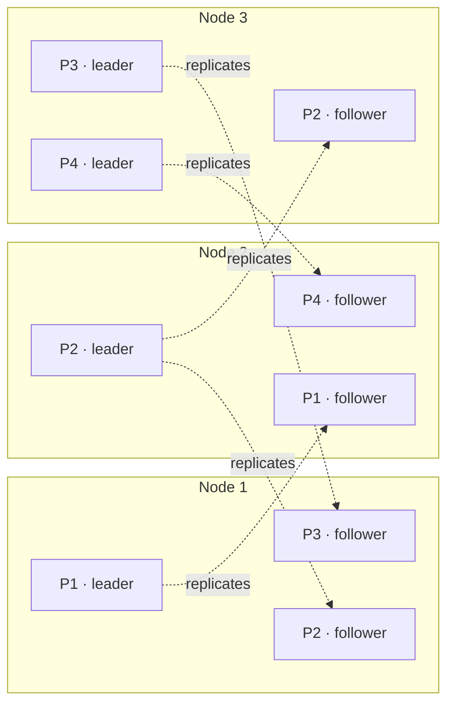
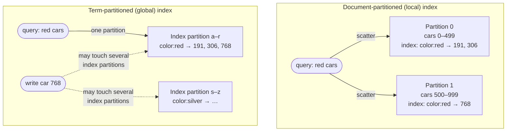
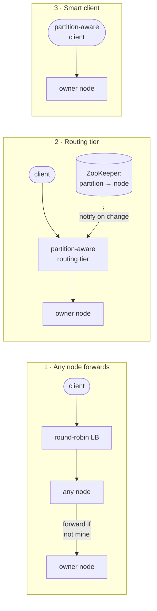

# Partitioning

> When the data or the load outgrows one machine, you split the dataset so
> each piece lives on a different node. The hard parts are how you split it
> (so there are no hot spots), what happens to secondary indexes, how pieces
> move when nodes come and go, and how a request finds the right node.

A **partition** is a small database of its own, with each record in exactly
one. The industry can't agree on a name: a *shard* in MongoDB and
Elasticsearch, a *region* in HBase, a *tablet* in Bigtable, a *vnode* in
Cassandra and Riak, a *vBucket* in Couchbase. (It's unrelated to a *network*
partition, which is a fault and the subject of chapter 8.) The point is
**scalability**: spread the data over many disks and the queries over many
CPUs. Teradata and Tandem NonStop SQL did this in the 1980s, and NoSQL
rediscovered it.

Partitioning is usually **combined with replication**. Each partition has a
leader and followers on different nodes, and each node leads some partitions
and follows others. The two choices are mostly independent, so this chapter
leaves replication aside.

## How to split key-value data

The goal is to spread data and load **evenly**. Uneven partitioning is
**skew**, and a partition with disproportionate load is a **hot spot**. In
the worst case, 9 of 10 nodes sit idle. Assigning records randomly would
balance load, but then a read would have to ask every node.

### By key range

Give each partition a continuous range of keys, like the volumes of a printed
encyclopedia. The boundaries have to **adapt to the data**: one volume can hold
A–B and another T–Z. Bigtable, HBase, RethinkDB and MongoDB before 2.4 did
this.

- **Upside:** keys are sorted within each partition, so **range scans** are
  cheap ("all sensor readings for March").
- **Downside:** some access patterns create hot spots. If the key is a
  **timestamp**, every write goes to *today's* partition. The fix is to put
  something else first, like `sensor_name + timestamp`, at the cost of one
  range query per sensor.

### By hash of key

Hash the key with a good, *stable* function (Cassandra and MongoDB use MD5,
Voldemort uses Fowler–Noll–Vo) and give each partition a range of hashes.
Beware of language built-ins: Java's `Object.hashCode()` and Ruby's
`Object#hash` can differ **between processes**.

- **Upside:** keys spread evenly.
- **Downside:** **no efficient range queries**. Adjacent keys scatter across
  partitions. MongoDB's hash sharding sends range queries to every partition,
  and Riak, Couchbase and Voldemort don't support them on the primary key.

**The compromise: compound keys.** Cassandra hashes only the *first* column of
the primary key to pick the partition, and sorts by the remaining columns
within it. With a key of `(user_id, update_timestamp)`, each user's updates
sit together, sorted by time, and one partition answers "this user's posts
this week".

**"Consistent hashing"** originally meant something specific (Karger et al.'s
random boundaries for CDN caches) and, as a rebalancing method, works poorly
for databases. Database docs often use the term loosely, and it has nothing to
do with replica or ACID consistency, so the book suggests simply saying
**hash partitioning**.

### Hot keys that hashing can't fix

If every read and write goes to *one* key (a celebrity's post getting
millions of comments), all of it lands on one partition however you hash. In
2017 most databases couldn't compensate automatically, so **it was up to the
application**: add a random two-digit number to the hot key to spread its
writes over **100 keys**, then read all 100 and combine them. Only do this for
the few known hot keys, and keep track of which keys are split.

## Partitioning secondary indexes

Secondary indexes ("all red cars", "all actions by user 123") don't map onto
partitions. HBase and Voldemort avoided them, Riak added them, and they are
the whole point of Solr and Elasticsearch. There are two approaches:

| | **Document-partitioned (local)** | **Term-partitioned (global)** |
| --- | --- | --- |
| Index covers | Only that partition's documents | All documents, partitioned by the **term** (`color:red`). Partition by the term itself for range scans, or by its hash for even load |
| Writes | Touch **one** partition | May touch **several** index partitions. Keeping them in sync needs a distributed transaction, so in practice updates are often **asynchronous** (DynamoDB: usually within a fraction of a second, longer during faults) |
| Reads | **Scatter/gather** to every partition, with **tail-latency amplification** | One partition per term |
| Used by | MongoDB, Riak, Cassandra, Elasticsearch, SolrCloud, VoltDB | DynamoDB global indexes, Riak search, Oracle data warehouse (either) |

Vendors recommend designing partitioning so secondary-index queries hit one
partition, which is often impossible when you filter by two indexes at once
(colour *and* make). If you build your own index in a key-value store,
remember that races and partial failures will make it drift from the data.

## Rebalancing

Load grows, data grows and machines fail, so partitions have to move. The
minimum requirements: the load is **fair** afterwards, the database **keeps
serving** reads and writes during the move, and it moves **no more data than
necessary**.

**Don't use `hash mod N`.** If the hash is 123456, the key lives on node 6 of
10. Add a node and it moves to node 3 (mod 11). Add another and it moves to
node 0 (mod 12). Changing *N* moves almost every key.

| Strategy | How | Used by | Watch out for |
| --- | --- | --- | --- |
| **Fixed number of partitions** | Create far more partitions than nodes (say 1,000 for 10 nodes). A new node **steals whole partitions**. Keys never change partition, only partitions change node. More powerful nodes can take more partitions | Riak, Elasticsearch, Couchbase, Voldemort | The count is fixed at setup and is your **maximum node count**. Too few means huge partitions that are slow to move and recover. Too many means overhead. Hard to choose when data volume is unpredictable |
| **Dynamic partitioning** | **Split** a partition when it grows too large (HBase defaults to 10 GB) and **merge** it when it shrinks, much like a B-tree. The number of partitions follows data volume | HBase, RethinkDB, MongoDB (2.4+, range or hash) | An empty database starts as **one partition on one node**. **Pre-splitting** helps, if you know the key distribution |
| **Proportional to nodes** | A fixed number of partitions **per node** (Cassandra used 256). A new node splits randomly chosen partitions and takes half of each | Cassandra, Ketama | Random splits can be unfair (Cassandra 3.0 added a better algorithm). Requires hash partitioning, and is closest to the original consistent hashing |

**Automatic or manual?** Fully automatic rebalancing is convenient and
**dangerous**: an overloaded node responds slowly, the others decide it's dead
and move load *away* from it, which loads it (and the network) further, and
the failure **cascades**. Couchbase, Riak and Voldemort *propose* an assignment
and wait for a human to commit it. The book's advice is to keep a **human in
the loop**.

## Request routing

"Which IP and port has key `foo`?" changes as partitions move. It's a case of
**service discovery**, and there are three places to answer it:

The hard part in every case is that **all participants must agree** on the
assignment, which is a consensus problem. Common answers:

- **A coordination service.** Nodes register in **ZooKeeper**, which holds the
  authoritative partition → node map and notifies subscribers. Used by
  LinkedIn's Espresso (via Helix), HBase, SolrCloud and Kafka. MongoDB has its
  own config servers, with `mongos` as the routing tier.
- **Gossip.** Cassandra and Riak spread cluster state between nodes, and any
  node forwards requests (approach 1). It's more complex inside the database,
  but there's no external dependency.
- Couchbase avoided the problem by **not rebalancing automatically**, with
  `moxi` as the routing tier.
- The routing tier's own IP addresses change rarely, so **DNS** is enough to
  find it.

**Parallel query execution.** NoSQL stores mostly support single-key reads and
writes plus scatter/gather. **MPP** analytic databases go much further: they
split a query with joins, filters and aggregates into stages spread across the
cluster (more in chapter 10).

> **Since this edition:** Kafka replaced ZooKeeper with its own Raft-based
> controller (**KRaft**), part of a wider move to build consensus into the
> database instead of running ZooKeeper beside it. Cassandra 4.0 lowered its
> default tokens per node from 256 to 16. Distributed SQL databases
> (CockroachDB, Spanner, YugabyteDB, TiDB) split and move key ranges
> automatically, and some detect and split hot ranges by load, which the book
> hoped for.

## What to take away

- Choose the partition key for **even load**, not just even data. Timestamps
  and celebrity IDs make hot spots.
- Key ranges give range scans, and hashing gives balance. A compound key
  (hashed prefix, sorted suffix) gets you both.
- Local secondary indexes make reads scatter. Global ones make writes
  asynchronous. Know which kind your database has.
- Never use `hash mod N`. Use many fixed partitions or dynamic splitting, and
  keep a human approving rebalances.
- Routing needs agreed cluster metadata, which means ZooKeeper, gossip or
  built-in consensus.

---

Previous: [Replication](./01-replication.md) ·
Next: [Transactions](./03-transactions.md)
