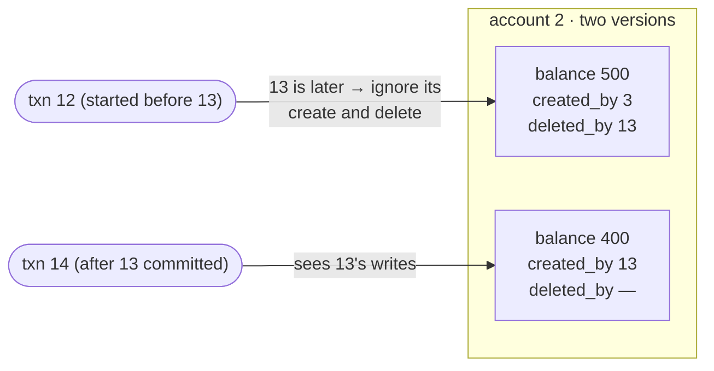
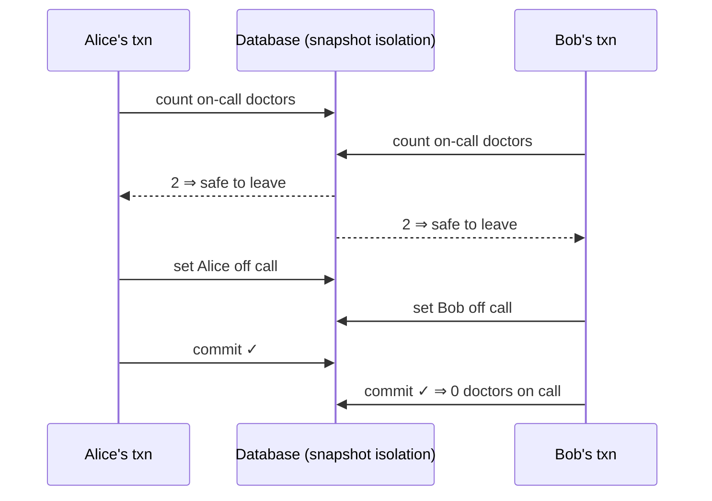
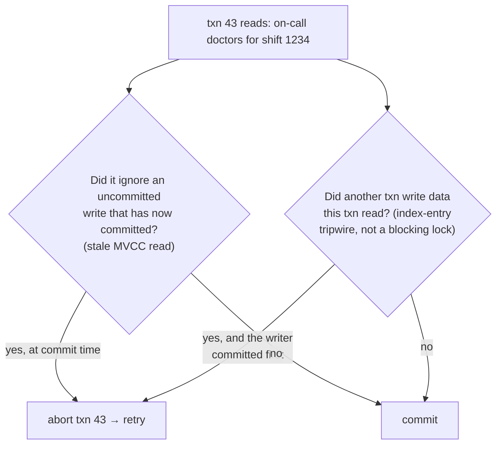

# Transactions

> Transactions exist so your application can ignore whole classes of failure
> and concurrency bugs. But "ACID" promises far less than it sounds, and most
> databases run by default at isolation levels that let real bugs through.
> This chapter names each race condition and shows which level stops it.

## What a transaction is for

Databases crash mid-write, applications crash mid-sequence, networks drop,
clients overwrite each other, and readers see half-finished updates. A
**transaction** groups reads and writes into one logical unit that either
**commits** or **aborts**, and an aborted transaction is **safe to retry**.
Transactions aren't a law of nature. They were designed (in IBM's **System R**,
1975, which MySQL, PostgreSQL, Oracle and SQL Server still closely resemble)
to simplify the programming model by moving error handling and concurrency
into the database.

NoSQL largely dropped them, and two kinds of hype followed: "transactions don't
scale" and "serious data needs ACID". The book calls both **pure hyperbole**.
Transactions have costs and benefits like any design choice.

## What ACID actually means

The term was coined in 1983 by Härder and Reuter. In practice, one database's
ACID isn't another's, so the book considers it **mostly a marketing term**.
(*BASE*, "basically available, soft state, eventual consistency", is even
vaguer, and in practice just means "not ACID".)

- **Atomicity** isn't about concurrency. It means that if a fault happens
  partway through several writes, **all of them are discarded**, so a retry
  can't apply anything twice. The book suggests **abortability** would have
  been a better name.
- **Consistency** means your **invariants** hold, like credits and debits
  balancing. That's a property of *your application's* transactions, not
  something the database can guarantee (apart from specific constraints such
  as foreign keys and uniqueness). Joe Hellerstein has said the C was "tossed
  in to make the acronym work". Note that "consistency" means **four
  different things** in this book: replica consistency, consistent hashing,
  CAP's linearizability, and this one.
- **Isolation**: concurrent transactions don't step on each other. Textbooks
  define it as **serializability**, the same result as running transactions
  one at a time. Real databases rarely run that way by default. Oracle 11g's
  "serializable" is really snapshot isolation.
- **Durability**: committed data isn't forgotten. That has meant tape, then
  disk with a WAL, and now replication. **None of these is perfect**:
  - a dead machine's disk is safe but unreachable;
  - **correlated faults** (a power cut, a bug) can take out every replica at
    once;
  - asynchronous replication loses recent writes on failover;
  - SSDs can violate `fsync` on power loss, and firmware has bugs;
  - storage engines and filesystems interact in ways that corrupt data;
  - data rots silently, sometimes in the backups too;
  - **30–80% of SSDs develop at least one bad block in their first four
    years**;
  - an unpowered SSD can start losing data **within weeks**.

  Use disk, replication *and* backups together, and take theoretical
  guarantees with a grain of salt.

## Single-object and multi-object operations

**Multi-object** transactions keep separate pieces of data in sync. The book's
example is an email inbox with a denormalized unread counter. Without
isolation, a user sees the new email but a counter of zero. Without atomicity,
a failed counter update leaves the two out of sync. Relational databases
group a transaction by the TCP connection (`BEGIN` … `COMMIT`). Many NoSQL
"multi-put" operations can **partly succeed**.

**Single-object** atomicity and isolation (no half-written 20 KB JSON
document, no torn overwrite) are provided almost everywhere, using a log and
per-object locks. **Atomic increment** and **compare-and-set** are useful, but
calling them "lightweight transactions" or "ACID" is misleading.

**Do you need multi-object transactions?** Usually yes, for **foreign keys**
and graph edges that must stay valid, **denormalized** documents that have to
be updated together, and **secondary indexes**, which are separate objects
from the transaction's point of view.

**Retrying aborts** is the whole point, yet ORMs like Rails ActiveRecord and
Django don't do it. Retry carefully:

- the commit might have succeeded and only the acknowledgment been lost, so
  you need **deduplication**;
- retrying under **overload** makes it worse, so use limits and **exponential
  backoff**;
- only retry **transient** errors (deadlock, isolation conflict, failover),
  never constraint violations;
- **side effects** outside the database (sending an email) need two-phase
  commit or idempotence;
- if the client itself dies while retrying, the write is lost.

## Weak isolation levels

Concurrency bugs are timing-dependent, hard to test for and hard to reason
about. They have caused **financial losses, auditor investigations and
corrupted customer data**. "Use an ACID database" doesn't help, because many of
them default to weak isolation. You have to understand the anomalies.

### Read committed

This was the default in Oracle 11g, PostgreSQL, SQL Server 2012 and MemSQL. It
makes two guarantees:

- **No dirty reads.** You only see committed data. Otherwise you'd see half a
  transaction, or data that is later rolled back.
- **No dirty writes.** You only overwrite committed data. Otherwise, in the
  book's example, Bob is recorded as the car's buyer while the invoice goes to
  Alice.

It's implemented with **row write locks** held until commit. For reads, the
database keeps **the old committed value** and serves that rather than taking
read locks, because one long write would stall every reader. Read committed
does **not** prevent the lost-update counter race.

### Snapshot isolation (and "repeatable read")

Under read committed, Alice has $500 in each of two accounts, and a $100
transfer runs while she checks her balances. She sees $500 and $400: **$100
has vanished**. That's **read skew** (a *nonrepeatable read*). It's tolerable
on a web page but not for **backups**, where the inconsistency becomes
permanent on restore, or for **analytic queries and integrity checks**.

**Snapshot isolation** gives each transaction a **consistent snapshot** of
everything committed when it started. **Readers never block writers, and
writers never block readers.** It's implemented with **MVCC** (multi-version
concurrency control):

- Each transaction gets an increasing **txid**. Each row has `created_by`
  and `deleted_by`. An update is a delete plus a create. Garbage collection
  removes versions nobody can see any more.
- **Visibility rules.** Ignore writes by transactions that were still in
  progress when you started, writes by aborted transactions, and writes by
  transactions with a *later* txid. Everything else is visible.
- **Indexes** can point at every version and filter them, or use
  **append-only copy-on-write B-trees** (CouchDB, Datomic, LMDB), where each
  commit creates a new root that *is* a snapshot.
- **The naming mess.** The SQL standard predates snapshot isolation, so
  Oracle calls it *serializable*, and PostgreSQL and MySQL call it
  *repeatable read*. DB2 uses *repeatable read* for serializability. The
  standard's definitions are ambiguous. In the book's words, **nobody really
  knows what repeatable read means.**

### Lost updates

Two **read-modify-write** cycles run concurrently and one **clobbers** the
other: counters, balances, editing a JSON list, two people saving a wiki page.
Options:

1. **Atomic operations**: `UPDATE counters SET value = value + 1`, MongoDB's
   in-document operators, Redis data-structure commands. They're the best
   choice when they fit. **ORMs make it easy to accidentally write an unsafe
   read-modify-write instead.**
2. **Explicit locks**: `SELECT … FOR UPDATE` when there's application logic
   between the read and the write (the book's example is a game move).
   They're easy to forget.
3. **Automatic detection**: let the transactions run, then abort one.
   PostgreSQL's repeatable read, Oracle's serializable and SQL Server's
   snapshot isolation do this. **MySQL/InnoDB's repeatable read doesn't**
   (so by some definitions it isn't snapshot isolation at all). It's the
   least error-prone option because you can't forget it.
4. **Compare-and-set**: `UPDATE … WHERE content = 'old content'`. It's
   unsafe if the `WHERE` clause reads from an old snapshot, so check your
   database.
5. **With replication**, locks and compare-and-set don't work, because there's
   no single up-to-date copy. Use **siblings** plus merging, or
   **commutative** operations (Riak's datatypes). LWW, the default in many
   systems, loses updates.

### Write skew and phantoms

Alice and Bob are the two doctors on call. Both feel ill and click "go off
call" at the same moment. Each transaction checks that "≥ 2 on call" (both see
2), and each updates its **own** row. Both commit, and **nobody is on call**.

This is **write skew**: two transactions read the same data and then update
*different* objects based on what they read. It's a generalization of lost
updates. Single-object atomic operations don't help, and the automatic
lost-update detection in PostgreSQL, MySQL, Oracle and SQL Server doesn't
catch it. **Only serializable isolation prevents it automatically.** As a
fallback, lock the rows the decision depends on with `FOR UPDATE`.

It's everywhere once you see the pattern:

- **meeting-room double booking**;
- **two pieces moved to the same square** in a game;
- **claiming a username** (a unique constraint fixes this one);
- **double spending** points or money.

They all follow the same steps: (1) a `SELECT` checks a condition, (2) the app
decides, (3) a write changes the condition. When step 1 checks for the
**absence** of rows, `FOR UPDATE` has nothing to lock. A write that changes
another transaction's search result is a **phantom**.

**Materializing conflicts**, such as pre-creating a row for every room and
15-minute slot just so there's something to lock, works, but it's ugly,
error-prone and leaks concurrency control into your data model. Use it as a
last resort and prefer serializable isolation.

## Serializability

Researchers have said "just use serializable" since the 1970s. Weak levels are
inconsistently implemented, you can't tell from code whether it's safe, and no
tool detects races. Serializability means the **result equals some serial
order**, so every race is prevented. There are three ways to implement it:

### 1. Actually run transactions one at a time

Single-threaded execution became feasible **around 2007**, for two reasons:
RAM got big enough to hold the active dataset, and OLTP transactions turned out
to be short (analytics can run on a snapshot elsewhere). VoltDB/H-Store, Redis
and Datomic do this.

- **No interactive transactions.** Network round-trips would leave the single
  thread idle, so the whole transaction is submitted as a **stored
  procedure**. Stored procedures had a bad reputation (vendor languages like
  PL/SQL and T-SQL, hard to debug, version, test and monitor, and a bad one
  hurts a shared database), but modern ones use Java, Groovy, Clojure or Lua.
  VoltDB even **replicates by re-running the procedure**, so procedures must be
  deterministic.
- **Partition to scale.** Give each core its own partition. **Cross-partition**
  transactions need lock-step coordination: VoltDB reported about **1,000
  cross-partition writes/s**, orders of magnitude below single-partition
  throughput, and adding machines doesn't help.
- **Constraints:** every transaction must be small and fast (one slow one
  stalls everything), the active data must fit in memory, and write throughput
  has to fit on one core per partition.

### 2. Two-phase locking (2PL)

For **about 30 years** it was *the* algorithm. (**2PL is not 2PC.**) Writers
block readers *and* readers block writers:

- **shared** locks to read, **exclusive** locks to write, upgraded from shared
  when a transaction reads then writes;
- locks are **held until commit or abort**: the first phase acquires them, the
  second releases them;
- **deadlocks** are detected, and one transaction is aborted and must be
  retried.

It's used by serializable in MySQL/InnoDB and SQL Server, and by repeatable
read in DB2. The cost is **throughput and especially tail latency**: no limit
on waits, queues on contended objects, and one slow transaction holding many
locks can stall everything. Deadlocks are more frequent too, and each one
wastes the work done so far.

**Phantoms need predicate locks**, which lock everything matching a condition,
including rows that don't exist yet. Those are slow to check, so real systems
use **index-range (next-key) locks**: a coarser approximation (all of room 123,
or all rooms from noon to 1 p.m.) attached to an index entry. With no suitable
index, they fall back to locking the whole table.

### 3. Serializable snapshot isolation (SSI)

First described in **2008** (Cahill's PhD thesis), SSI is used by **PostgreSQL's
serializable level since 9.1** and, in a similar form, by FoundationDB. It gives
full serializability at a small cost over snapshot isolation.

2PL and serial execution are **pessimistic**: wait until it's safe. SSI is
**optimistic**: run on a snapshot, check at commit, and abort if the result
wasn't serializable. Optimism suffers under **high contention** (many aborts and
retries) and does well with spare capacity. Commutative operations reduce
conflicts.

SSI watches for **decisions based on an outdated premise**:

- It **checks at commit time, not when reading**, because a read-only
  transaction never needs aborting and the other transaction might still
  abort.
- Read tracking is per index entry (or per table) and is kept only until
  concurrent transactions finish. Tracking more finely means fewer
  unnecessary aborts but more bookkeeping.
- **The win:** no blocking. Readers and writers don't wait on each other, so
  latency is predictable. It isn't limited to one core (FoundationDB
  distributes conflict detection). Long **read-write** transactions abort more
  often, so keep them short. Long read-only ones are fine.

> **Since this edition:** SSI did spread. CockroachDB defaulted to
> serializable for years, and FoundationDB and others build on optimistic
> serializable designs. Most deployments still run PostgreSQL and MySQL at
> their defaults (read committed and repeatable read), so write skew remains a
> live bug class. Tools such as **Jepsen**'s Elle checker now test databases'
> isolation claims and routinely find gaps.

## What to take away

- Know your database's *default* isolation level and what it actually allows,
  whatever the level is called.
- Use atomic `UPDATE … SET x = x + 1` rather than reading into the ORM,
  modifying and saving.
- Look for check-then-act logic, like booking, claiming, spending or "at least
  one". That's write skew. Use serializable, `FOR UPDATE` or a unique
  constraint.
- Retry aborted transactions, but only for transient errors, with backoff,
  deduplication and no external side effects.
- If you need serializability, prefer SSI where it's available. 2PL hurts tail
  latency, and serial execution needs small in-memory partitions.

---

Previous: [Partitioning](./02-partitioning.md) ·
Next: [The trouble with distributed systems](./04-trouble-with-distributed-systems.md)
