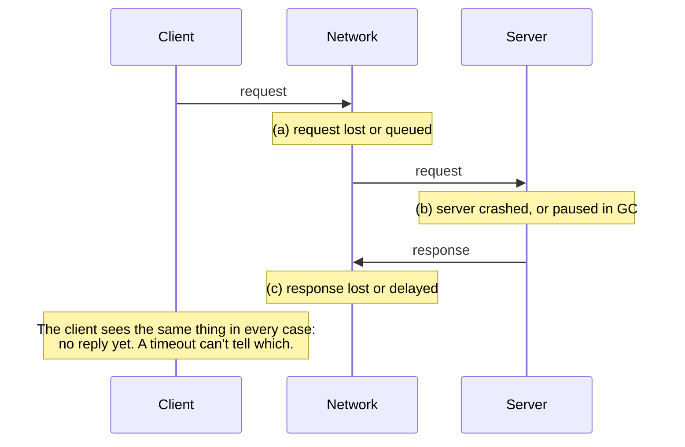
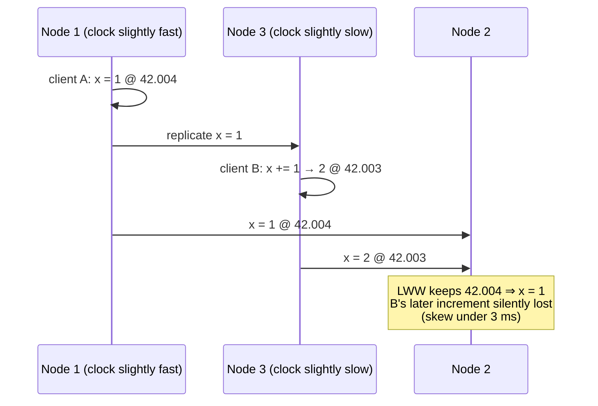
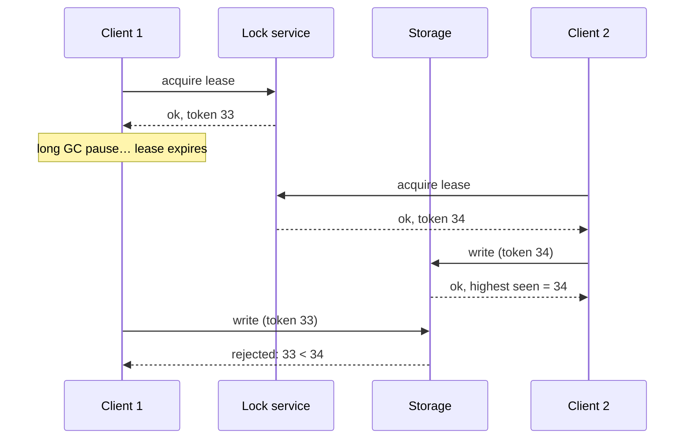

# The trouble with distributed systems

> On one machine, code either works or crashes. Across a network, it can half
> work, silently. This chapter is a deliberately pessimistic tour of what goes
> wrong (networks, clocks and paused processes) and of the tools for
> reasoning when you can't know for sure what's true.

## Partial failure

A single computer is designed to be **deterministic**. A hardware fault usually
means a total crash (a kernel panic) rather than a wrong answer, because wrong
answers are worse. Distributed systems lose that. Some parts break while
others work, which is **partial failure**, and it is **nondeterministic**: the
same operation sometimes works and sometimes doesn't, and you may not even know
which happened. The book quotes an operator's list of real incidents in a
single datacenter: long-lived network partitions, PDU failures, switch
failures, whole racks accidentally power-cycled, whole-datacenter power and
backbone failures, and a driver who crashed his pickup into the HVAC.

**Supercomputers** handle faults by checkpointing and restarting the whole job,
turning partial failure into total failure. **Internet services** can't: they
must stay online, they run on cheaper commodity hardware that fails more
often, and they use rolling upgrades. In a system of thousands of nodes,
*something is always broken*.

So we build **reliable systems from unreliable parts**, like error-correcting
codes over a noisy channel or TCP over IP. There's always a limit, though: TCP
hides loss and reordering, but it can't remove **delay**. In distributed
systems, **suspicion, pessimism and paranoia pay off**.

## Unreliable networks

Shared-nothing systems talk only over **asynchronous packet networks**, which
promise neither *when* a message arrives nor *whether* it does. Send a request
and get no reply, and any of these could have happened:

**It happens a lot.** One medium-sized datacenter saw about **12 network
faults a month**, half disconnecting a single machine and half a whole rack.
Redundant network gear helps less than you'd hope, because **human
misconfiguration** is a major cause. EC2 was known for transient glitches. A
switch software upgrade delayed packets by **over a minute**. Sharks have
bitten undersea cables. One network interface dropped all *inbound* packets
while sending outbound ones fine. Untested handling of network faults has
deadlocked clusters permanently and even **deleted data**. "Handling" a
network fault can just mean showing an error, but you must know what your
software *does* and that it recovers. Test it, Chaos Monkey style.

### Detecting faults

Sometimes you get explicit feedback: a TCP RST or FIN when nothing listens on
the port, a script announcing that a process died (HBase does this), switch
management interfaces, or ICMP Destination Unreachable. You can't count on
any of these. Even a TCP ACK doesn't mean the *application* handled the
request. **Only a positive response from the application proves success.**
Usually you're left with retries and a **timeout**.

### Timeouts and unbounded delay

| | Short timeout | Long timeout |
| --- | --- | --- |
| Benefit | Detects faults quickly | Few false alarms |
| Cost | A slow node is declared dead, its action may run **twice**, and moving its load to overloaded peers can **cascade** until every node declares every other dead | Users wait or see errors for longer |

If the network guaranteed delivery within *d* and nodes answered within *r*,
then **2d + r** would be the perfect timeout. Real networks and servers
guarantee neither. Most variability comes from **queueing**:

- **switch queues** when several senders target one port (congestion, and
  drops when the queue overflows);
- the **OS run queue** when all CPU cores are busy;
- the **hypervisor** pausing a VM for tens of milliseconds;
- **TCP flow control** holding data back at the sender, and **retransmission
  timeouts**;
- **noisy neighbours** in multi-tenant clouds, and batch jobs saturating links.

(This is why VoIP and video calls use **UDP**: late data is worthless, so it's
better to skip it than wait. "Could you repeat that?" is a retry at the human
layer.)

So **choose timeouts experimentally**: measure the round-trip distribution
across many machines over a long period. Better still, adapt automatically
with a **Phi Accrual failure detector** (used in Akka and Cassandra), which
works much like TCP's retransmission timer.

### Why not just build a reliable network?

The **telephone network** is synchronous. A call reserves a fixed slot along the
whole route (an ISDN call gets **16 bits every 250 µs**), so there's no queueing
and the delay is **bounded**. Ethernet and IP are **packet-switched** because
data traffic is **bursty**: a file transfer has no natural bandwidth, so a
circuit would waste capacity or slow the transfer down. ATM tried to combine
the two. InfiniBand and QoS can approximate bounded delay.

The deeper point is **static versus dynamic resource partitioning**. Reserving
capacity buys predictable latency and costs utilization. Sharing dynamically is
cheaper and brings queues. The same trade-off applies to CPUs and VMs.
**Variable delay isn't a law of nature, it's a cost decision**, and since
clouds and the internet don't offer QoS, you must assume congestion and
unbounded delay.

## Unreliable clocks

Clocks answer two kinds of question: **durations** (has this timed out, what's
p99, how long was the session) and **points in time** (when was this published,
when does the cache entry expire). Each machine has its own quartz clock,
usually synchronized by **NTP** against servers that get their time from GPS.

| | **Time-of-day clock** | **Monotonic clock** |
| --- | --- | --- |
| API | `clock_gettime(CLOCK_REALTIME)`, `System.currentTimeMillis()` | `clock_gettime(CLOCK_MONOTONIC)`, `System.nanoTime()` |
| Meaning | Seconds since the 1970 epoch, **ignoring leap seconds** | Arbitrary origin. **Only differences are meaningful**, and never across machines |
| Can jump backward? | **Yes**, when NTP forcibly resets it | No. NTP can only *slew* it, by up to 0.05% |
| Use for | Points in time (comparable across machines, roughly) | **Timeouts and elapsed time** |

**Synchronization is worse than you'd think:**

- **Drift.** Google assumes **200 ppm**, which is **6 ms** if you resync every
  30 s and **17 s** if once a day.
- Too large a difference makes NTP **refuse to sync or force a reset**.
- A node **firewalled off from NTP** can drift unnoticed.
- NTP is only as good as the network: a minimum of **35 ms** error over the
  internet, with spikes around a second.
- Some NTP servers are **wrong by hours**. You're trusting a stranger on the
  internet.
- **Leap seconds** have crashed large systems. **Smearing** the adjustment
  over a day is probably the best fix.
- **VMs** see the clock jump forward when they're paused.
- **User devices** may have deliberately wrong clocks, for example to cheat
  at games.

You *can* get very good accuracy if you pay for it. The draft **MiFID II**
regulation requires high-frequency traders to stay **within 100 µs of UTC**,
using GPS, **PTP** and careful monitoring.

### The danger: clocks fail silently

A bad CPU or network gets noticed. A drifting clock just causes **subtle data
loss**. If you depend on synchronized clocks, **monitor clock offsets and evict
nodes that drift too far.**

**Timestamps for ordering** are the classic trap:

With **last write wins** (Cassandra, Riak), a node with a slow clock **can't
overwrite** values from a fast-clocked node until the skew has passed, so
writes vanish with no error. LWW can't tell sequential writes from concurrent
ones, and identical timestamps need a tiebreaker that can also break
causality. NTP can never be precise enough to fix this, because its accuracy is
bounded by the very network delays you'd be trying to order. Use **logical
clocks**, which count events instead of seconds, for ordering.

**A clock reading is a confidence interval.** Nanosecond resolution is not
nanosecond accuracy. Over public NTP, expect **tens of milliseconds**, spiking
past **100 ms**. Almost no API tells you the error, with one exception:
Google's **TrueTime** returns `[earliest, latest]`.

**Spanner uses this for global snapshots.** Distributed snapshot isolation needs
transaction IDs that reflect causality, and a global counter is a bottleneck.
(Generators like Twitter's Snowflake hand out ID blocks but can't guarantee
causal order.) If two intervals don't overlap, their order is certain. So
Spanner **waits out its confidence interval before committing**, and keeps
that wait short with **GPS receivers and atomic clocks in every datacenter**
(about **7 ms** of uncertainty). In 2017 this hadn't reached mainstream
databases outside Google.

## Process pauses

A leader holds a **lease** (a lock with a timeout) and renews it before it
expires. Its loop checks "does the lease have more than 10 s left?" and then
processes the request. Two bugs:

1. The expiry was set by **another machine's clock** and compared against the
   local one.
2. Even with a monotonic clock, **the thread can stop between the check and the
   write**. Stop it for 15 s and the lease has expired, another node is leader,
   and this thread carries on regardless.

Threads really do stop for that long:

- **Stop-the-world GC.** Pauses of **several minutes** have been seen, and
  even "concurrent" collectors stop the world sometimes.
- **VM suspend and live migration.**
- A laptop lid closing.
- **Context switches and hypervisor steal time** under load.
- **Synchronous disk I/O**, including the JVM lazily loading classes and
  network block devices like EBS.
- **Swapping**, up to thrashing.
- A stray **SIGSTOP** (Ctrl-Z).

On one machine we'd reach for mutexes and atomics. A distributed system has no
shared memory, so **a node must assume it can be paused at any point, declared
dead, and resume without noticing.**

**Hard real-time** systems (airbags, aircraft) do bound response times, using
an RTOS, documented worst-case execution times, and restricted or no dynamic
allocation. That is very expensive and often *lower* throughput. Real-time
isn't the same as fast, and it isn't economical for servers. Cheaper ways to
limit GC damage: **treat GC as a planned mini-outage** (the runtime warns, and
traffic drains away from the node first), or only collect short-lived objects
and **restart processes periodically**, like a rolling upgrade.

## Knowledge, truth and lies

A node can't *know* anything about other nodes for certain, only infer it from
the messages it gets. So we state a **system model** (what we assume) and
prove algorithms correct within it.

### The truth is defined by the majority

A node whose outbound messages are dropped is declared dead while it shouts
"I'm not dead!". A node that comes back from a one-minute GC pause doesn't
know a minute has passed. **A node can't trust its own judgement.** Decisions,
including declaring nodes dead, need a **quorum**, usually a **majority**: 3
nodes tolerate 1 failure, 5 tolerate 2, and there can never be two conflicting
majorities.

### Fencing tokens

Many things must be **unique**: the leader, a lock holder, a username. A node
that *believes* it's the chosen one may have been demoted while it was paused.
HBase once had exactly this bug: a paused client's lease expired, another
client took the lock, and the first client woke up and **corrupted the file**.

The lock service hands out a **monotonically increasing token** with every
grant, and **the resource rejects writes with an older token** (ZooKeeper's
`zxid` or `cversion` can serve as the token). The check has to live in the
**server**, not in the client's own belief. That's healthy anyway: a service
shouldn't trust its clients to behave.

### Byzantine faults

Everything so far assumes nodes are **unreliable but honest**. If nodes may
**lie** (send corrupted or malicious messages), that's a **Byzantine fault**,
after Lamport's *Byzantine Generals Problem*. (He avoided "Albanian
Generals", and nothing suggests Byzantium's generals were especially
treacherous.) Byzantine fault tolerance matters in **aerospace**, where
radiation flips bits, and among **mutually distrusting organizations** (Bitcoin
and blockchains). It usually needs **more than two-thirds** of nodes healthy.
It's rarely worth it inside your own datacenter, and it **doesn't protect
against bugs or attackers** when every node runs the same software. Do guard
against **weak lying**: application-level checksums (TCP's sometimes miss
corruption), validating and size-limiting inputs, and multiple NTP servers so
outliers are outvoted.

### System models

| Timing | Node faults |
| --- | --- |
| **Synchronous**: bounded delay, pauses and clock error. Unrealistic | **Crash-stop**: a node fails by crashing, forever |
| **Partially synchronous**: usually bounded, occasionally not. **Realistic** | **Crash-recovery**: crashes and comes back, with stable storage surviving and memory lost |
| **Asynchronous**: no timing assumptions, not even clocks. Very restrictive | **Byzantine**: anything at all |

The useful model for real systems is **partially synchronous with
crash-recovery**.

**Correctness** is a set of properties, split into two kinds:

- **Safety**: *nothing bad happens*. For a fencing-token service that means
  uniqueness and monotonic order. A violation happens at a specific moment
  and **can't be undone**. Safety must hold **always**, even if every node
  crashes.
- **Liveness**: *something good eventually happens*, like availability.
  ("Eventually" is the tell, and **eventual consistency is a liveness
  property**.) It's allowed caveats, such as "if a majority is up and the
  network recovers."

Models are simplifications. Real disks forget data, firmware fails to see
drives, and a node with "amnesia" breaks quorum logic. Real code still needs a
handler for the "impossible" case, even if that just tells an operator. The
book jokes that this is the difference between computer science and software
engineering. **Proofs and empirical testing are both necessary.**

> **Since this edition:** cloud providers now offer microsecond-level time
> sync, and AWS's open-source ClockBound exposes TrueTime-style error bounds,
> so interval-aware clocks are no longer Google-only. Leap seconds are to be
> abandoned by 2035. Low-pause JVM collectors (ZGC, Shenandoah) shrink, but
> don't remove, GC pauses. The fencing-token argument is the core of
> Kleppmann's well-known 2016 critique of using Redis's Redlock for
> correctness-critical locks.

## What to take away

- A timeout tells you nothing about *what* failed. Design every remote action
  to be safe if it ran, didn't run, or runs twice.
- Use monotonic clocks for durations. Never use wall-clock timestamps to order
  writes across machines. Use logical clocks or version vectors.
- If you rely on synchronized clocks, monitor offsets and evict drifting
  nodes.
- Any lock or lease can be held by a paused zombie. Protect resources with
  fencing tokens that the server checks.
- Let a majority make decisions about leaders, liveness and uniqueness, never
  a single node's opinion of itself.

---

Previous: [Transactions](./03-transactions.md) ·
Next: [Consistency and consensus](./05-consistency-and-consensus.md)
