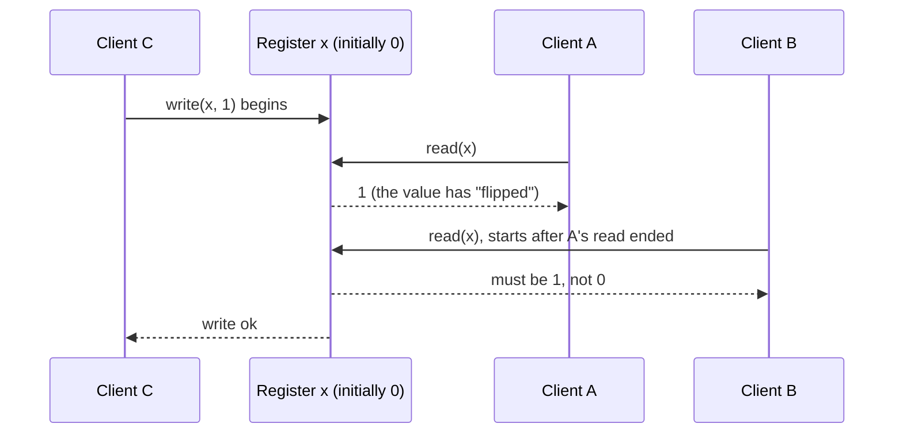
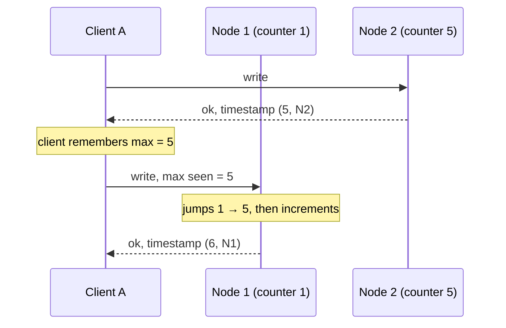
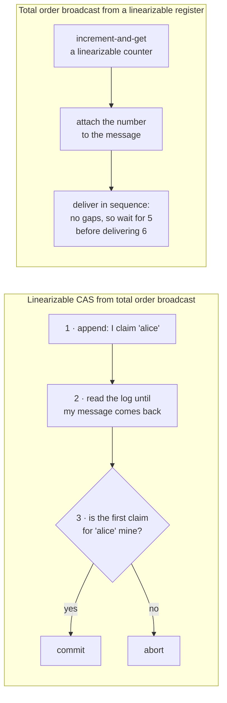
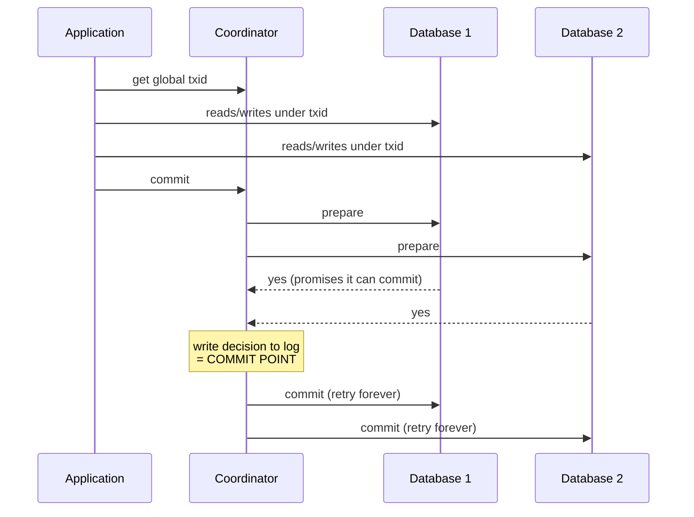
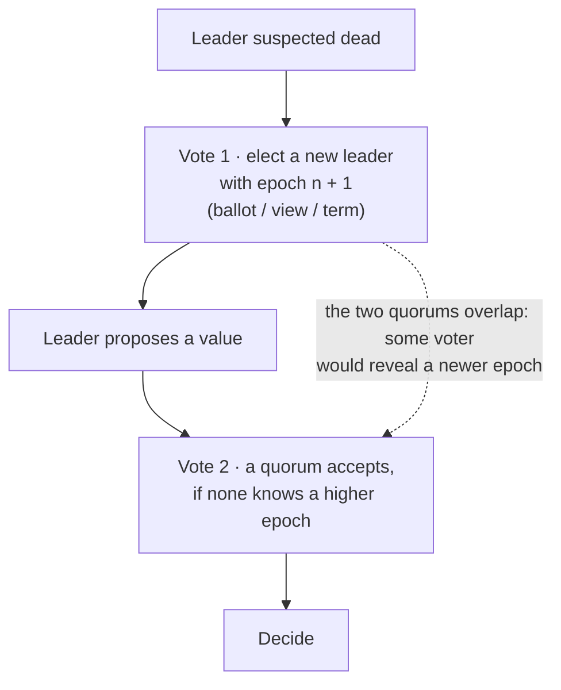
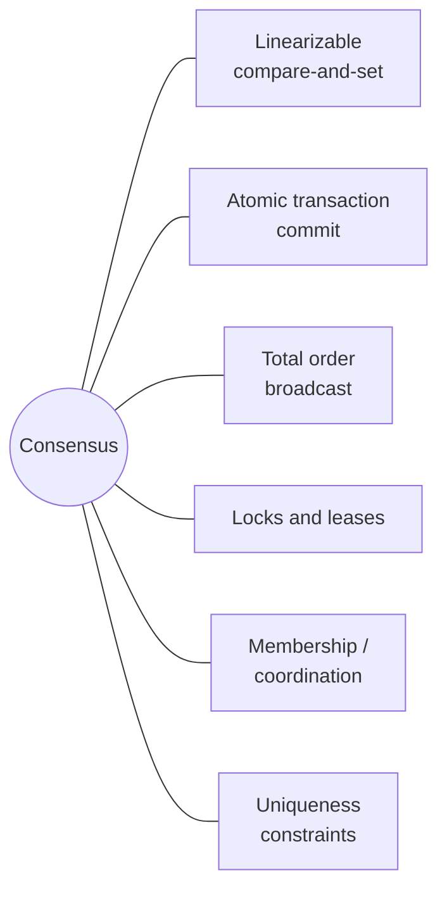

# Consistency and consensus

> The way out of chapter 8's mess is the same as with transactions: find
> general-purpose abstractions, implement them once, and let applications rely
> on them. This chapter builds that ladder: linearizability, then ordering and
> causality, then total order broadcast, and finally consensus. It shows that
> many problems are secretly the same problem.

## Eventual consistency is weak

Almost every replicated database promises at least **eventual consistency**,
which the book suggests would be better named **convergence**: stop writing,
wait an unspecified time, and replicas agree. Until then a read can return
anything, including not your own write. A database looks like a variable, but
it doesn't behave like one, and the bugs only show up under faults or high
concurrency. Stronger models are easier to program against and cost
performance or fault tolerance. (Distributed consistency is related to
transaction isolation but mostly separate: isolation is about concurrent
transactions racing, and consistency is about replicas under delay and
faults.)

## Linearizability

Also called *atomic*, *strong*, *immediate* or *external* consistency.
**Make the system look as if there were only one copy of the data, with every
operation atomic.** It's a **recency guarantee**: once any read returns the new
value, every later read (by anyone) must too.

The book's example: Alice and Bob are in the same room, watching the 2014
World Cup final on their phones. Alice sees the final score and tells Bob. Bob
reloads, hits a lagging replica, and sees the match still in progress. Because
his request started **after** Alice's had finished, getting an older result
violates linearizability.

- A read **concurrent** with a write may return the old or the new value. But
  there's one **point in time** when the value flips, and after any client has
  seen the new value, nobody may see the old one.
- You can check a recorded history by finding a valid sequential order whose
  points only move **forward in real time**. That's expensive, but possible.

**Linearizability isn't serializability:**

| | Serializability | Linearizability |
| --- | --- | --- |
| About | **Transactions** over many objects (isolation) | **Single objects** (registers): recency |
| Promise | The result equals *some* serial order | Every operation takes effect atomically at a point in real time |
| Prevents write skew? | Yes | No |

Having both is **strict serializability** (*strong one-copy serializability*).
2PL and actual serial execution are usually linearizable. **SSI isn't**, by
design, because it reads from snapshots.

### Where you actually need it

1. **Locks and leader election.** Every node must agree who holds the lock.
   **ZooKeeper** and **etcd** provide this through consensus. (Their *reads*
   can be stale by default. Linearizable reads need etcd's *quorum read* or
   ZooKeeper's `sync()`.) Curator builds recipes on top. Oracle RAC even
   takes a linearizable lock per disk page.
2. **Uniqueness and constraints enforced at write time**: usernames, file
   paths, a balance that must never go negative, stock, seat bookings. These
   need a single up-to-date value. (Foreign keys and attribute constraints
   don't. Constraints you can enforce loosely, like overbooking with
   compensation, are covered in chapter 12.)
3. **Cross-channel timing dependencies.** A web server stores a photo, then
   queues a resize job. If the queue is faster than the storage's internal
   replication, the resizer reads an old image or nothing, and the full-size
   and thumbnail images are **permanently inconsistent**. Two channels, no
   recency guarantee. (If you control the second channel, read-your-writes
   tricks also work.)

### Which replication methods can be linearizable

| Replication | Linearizable? |
| --- | --- |
| **Single-leader** | *Potentially*: read from the leader or a synchronous follower, if you truly know who the leader is (delusional leaders and failover data loss break it, as does snapshot isolation) |
| **Consensus algorithms** | **Yes.** They prevent split brain and stale replicas (ZooKeeper, etcd) |
| **Multi-leader** | **No.** Concurrent writes and conflicts are the opposite of a single copy |
| **Leaderless (Dynamo)** | **Probably not.** LWW with clocks rules it out, as do sloppy quorums. Even strict quorums (w + r > n) allow a reader to see the new value while a later reader sees the old one |

Strict quorums *can* be made linearizable with **synchronous read repair** plus
writers reading a quorum before writing. Riak doesn't do the former. Cassandra
does, but LWW breaks it again under concurrent writes. And **compare-and-set
can't be built this way at all**, because it needs consensus. Assume
Dynamo-style systems aren't linearizable.

### The cost: CAP, and something more important

Two datacenters lose their link. With multi-leader replication, both keep
working. With single-leader replication, clients that can only reach the
follower datacenter **can't write or read linearizably**, so they're down.
That's the **CAP theorem** in practice: if replicas are cut off, a
linearizable system must make some of them **unavailable**, and a system that
stays available isn't linearizable.

The book's view of CAP:

- **It deserves credit for a culture shift.** Brewer's 2000 rule of thumb
  pushed engineers toward shared-nothing designs and helped launch NoSQL.
- **"Pick 2 of 3" is misleading.** Network partitions aren't optional, so it
  really means **"consistent *or* available, *when partitioned*."**
- **The formal theorem is very narrow**: one consistency model
  (linearizability), one fault (partitions), and an idiosyncratic definition of
  availability that many "highly available" systems don't meet. It says
  nothing about delays or dead nodes. **Best avoided**, and of mostly
  historical interest. (The book also discourages the CP/AP labels.)

The more important cost is **latency, all the time**. Even multi-core RAM
isn't linearizable without memory barriers, and the reason is **performance,
not fault tolerance**. **Attiya and Welch proved** that linearizable reads
and writes take time **at least proportional to the uncertainty in network
delay**. No faster algorithm exists, and most systems that drop
linearizability do it to be fast.

## Ordering guarantees

Ordering keeps coming back: the leader's job is to order writes,
serializability is an order, and timestamps try to impose one. The reason is
**causality**: question before answer, insert before update, happens-before,
snapshots that include the question if they include the answer, the on-call
decision depending on what was read, Bob hearing Alice.

- **Linearizability gives a total order.** Any two operations can be compared,
  along one timeline with no concurrency.
- **Causality gives a partial order.** Causally related operations are ordered,
  and concurrent ones are incomparable. Think of **Git history**: branches and
  merges.
- **Linearizability implies causal consistency**, which is why it's simple to
  use, including across multiple channels. But **causal consistency is the
  strongest model that doesn't slow down with network delay and stays
  available during partitions** (CAP doesn't apply). Many systems that
  "need linearizability" only need causality. In 2017, causal databases were
  still a research direction.

**Capturing causality** means tracking what each node *knew* when it wrote:
version vectors generalized to the whole database, or the version from the
prior read sent back with the write, as in SSI's checks. Tracking every read
gets expensive, which leads to sequence numbers.

### Sequence numbers and Lamport timestamps

A **logical clock** (counters, not quartz) gives compact, totally ordered
sequence numbers. You want a total order **consistent with causality**. A
single leader's replication log gives one for free. Without a leader, the
usual tricks aren't causal:

- odd and even numbers per node (counters drift apart);
- physical timestamps (clock skew);
- preallocated blocks of numbers (a later operation can get a lower block).

**Lamport timestamps** (1978, one of the most-cited papers in the field) fix
this:

- A timestamp is a pair **(counter, node ID)**. Compare counters, and break
  ties by node ID.
- **Everyone carries the maximum counter they've seen on every request.** A
  node that receives a higher maximum jumps its counter forward. So every
  causal dependency produces a higher timestamp.
- Compared with **version vectors**: Lamport timestamps are more compact and
  always give a total order, but they **can't tell you whether two operations
  were concurrent**.

**Total order isn't enough.** Two users claim the same username at once. After
the fact, the lower timestamp wins. But a node that has to answer *now* can't
know whether another node is about to assign a lower timestamp to a competing
claim without asking **every** node, and one unreachable node stops the
system. You also need to know **when the order is final**.

### Total order broadcast

Also called **atomic broadcast**, a confusing name since it has nothing to do
with ACID atomicity. It's a protocol with two safety properties:

- **Reliable delivery**: if one node gets a message, all of them do.
- **Totally ordered delivery**: every node gets messages in the same order.

Messages are retried through outages and still delivered in order. Crucially,
**the order is fixed at delivery**: nothing can be inserted earlier
afterwards. That's what makes it stronger than timestamp ordering.

It's **a log** that everyone reads identically, which gives you:

- **State machine replication**: same writes, same order, same state.
- **Serializable transactions**: deterministic stored procedures applied in
  log order.
- **Fencing tokens**: the log position (ZooKeeper's `zxid`).

**Total order broadcast and linearizable storage can each be built from the
other:**

- Built that way, writes are linearizable but reads may be stale (that's
  **sequential consistency**). For linearizable reads, sequence the read
  through the log (etcd's quorum reads), wait for the latest log position
  (ZooKeeper's `sync()`), or read from a synchronously updated replica (chain
  replication).
- The gap-free sequence is the key difference from Lamport timestamps.
- Making that counter survive failures **inevitably turns into a consensus
  algorithm**. It's provable that **linearizable compare-and-set,
  increment-and-get and total order broadcast are all equivalent to
  consensus.**

## Distributed transactions and consensus

**Consensus** means getting nodes to agree, and *many broken systems were built
on the belief that it's easy*. You need it for **leader election** (to avoid
split brain) and **atomic commit** (all nodes commit or all abort).

**The FLP result** (Fischer, Lynch and Paterson) says no algorithm can always
reach consensus if a node may crash. That's true in the **asynchronous model**,
which allows no clocks or timeouts. Allow timeouts (even unreliable ones) or
randomness, and consensus is solvable. In practice, systems do reach
consensus.

### Two-phase commit (2PC)

On one node, the commit point is a single disk writing the **commit record**.
Across nodes, you can't just send "commit" to everyone: some nodes may hit
constraint violations, requests get lost, and some crash before the record is
durable. And **a commit can't be taken back**, because other transactions may
already have read it (a later *compensating* transaction is a different
thing).

**A system of promises** with two points of no return:

1. **A participant's "yes"** means it has made the data durable and checked
   constraints, so it **gives up the right to abort**.
2. **The coordinator's logged decision** is irrevocable, and it will retry
   until every participant obeys.

(The book's analogy is a wedding. After "I do" you can't back out, even if you
faint before the announcement.) *Don't confuse 2PC (atomic commit) with 2PL
(isolation).* Coordinators include Narayana, JOTM, BTM and MSDTC.

**When the coordinator dies after the votes**, participants are **in doubt**.
They can't abort (others may have committed) and can't commit (others may have
aborted), so they **wait**. The only way out is for the coordinator to recover
and read its log, where anything without a commit record is aborted. That's
why 2PC is a **blocking** protocol. **Three-phase commit** avoids blocking only
by assuming bounded delays. Non-blocking atomic commit needs a **perfect
failure detector**, which timeouts aren't.

### Distributed transactions in practice

They have a mixed reputation: important safety on one side, operational pain
and lost performance on the other. **MySQL's distributed transactions were
reported over 10× slower** than single-node ones, mostly from extra `fsync`s
and round-trips. Distinguish two kinds:

- **Database-internal** (VoltDB, MySQL Cluster NDB): one piece of software, free
  to optimize. These often work well.
- **Heterogeneous** (two vendors' databases, or a database plus a message
  broker). These are much harder. Their attraction is **exactly-once message
  processing**: commit the message ack and the database writes atomically.
  That only works if *every* side effect takes part. An email server that
  doesn't speak 2PC still sends twice.

**XA** (X/Open, 1991) is a **C API**, not a network protocol. It's supported by
PostgreSQL, MySQL, DB2, SQL Server and Oracle, and by ActiveMQ, HornetQ, MSMQ
and IBM MQ, and in Java through JTA/JDBC/JMS. The coordinator is usually a
**library inside the application process**, logging to local disk. Problems:

- **In-doubt transactions hold locks**: row locks for writes, plus read locks
  under 2PL. A 20-minute coordinator restart means 20 minutes of blocked rows.
  A lost coordinator log means **forever**, and rebooting the database doesn't
  help, because correct 2PC must keep those locks.
- **Orphaned in-doubt transactions** do happen, and an administrator has to
  resolve them by hand mid-outage. **"Heuristic decisions"** let a
  participant decide alone, which the book calls a euphemism for *probably
  breaking atomicity*.
- **The coordinator is a database.** If it isn't replicated, it's a single
  point of failure, and many weren't highly available by default. It also
  makes "stateless" app servers stateful.
- **Lowest common denominator.** No cross-system deadlock detection, and no
  SSI.
- **It amplifies failures.** *Every* participant must respond, so one broken
  part fails the whole transaction.

Chapters 11 and 12 show alternatives that keep systems consistent without
heterogeneous 2PC.

### Fault-tolerant consensus

Formally, nodes propose values and decide one, with four properties:

- **Uniform agreement**: no two nodes decide differently.
- **Integrity**: no node decides twice.
- **Validity**: the decided value was actually proposed.
- **Termination**: every node that doesn't crash eventually decides.

The first three are **safety** properties. **Termination** is **liveness**,
and it's what rules out a "dictator" node, and therefore 2PC: a node buried
under 30 feet of mud never comes back. Termination needs **a majority** of
nodes working. Safety must hold **even if a majority fails**. Byzantine
tolerance would require fewer than a third of nodes to be faulty, and the
book doesn't cover it.

**The algorithms:** Viewstamped Replication, **Paxos** (Multi-Paxos), **Raft**
and **Zab**. They're similar but not identical, and the book advises against
implementing your own. They actually implement **total order broadcast**,
which is repeated consensus: agreement means same order, integrity means no
duplicates, validity means no fabricated messages, termination means no lost
messages.

**Breaking the circle** (electing a leader needs consensus, and consensus
needs a leader):

- Leaders are unique **per epoch**, not globally. The higher epoch wins.
- Before deciding anything, a leader gets a **quorum** (usually a majority) to
  accept its proposal. Because the election quorum and the proposal quorum
  overlap, a successful proposal proves that no newer leader exists.
- Compared with 2PC: the coordinator is **elected**, only a **majority**
  must vote yes (not everyone), and there's a defined **recovery** process.

**What consensus costs:**

- Voting is **synchronous replication**, which many deployments avoid for
  speed.
- It needs a **strict majority**: 3 nodes to survive 1 failure, 5 to survive
  2, and the minority side of a partition is blocked.
- Membership is usually **fixed**. Dynamic membership is less well understood.
- It relies on **timeouts**. Across regions, false suspicions cause constant
  elections.
- Edge cases: one consistently flaky link can make **Raft** bounce leadership
  forever.

### Membership and coordination services

**ZooKeeper** (modelled on Google's **Chubby**) and **etcd** look like small
key-value stores. You rarely use them directly. They sit underneath HBase,
YARN, OpenStack Nova and Kafka. They hold **small, slow-changing, in-memory**
data, replicated by fault-tolerant total order broadcast, and they provide:

- **linearizable atomic operations**, for locks as **leases**;
- **total ordering**, so `zxid` and `cversion` work as fencing tokens;
- **failure detection** through session heartbeats, with **ephemeral nodes**
  that disappear when a session dies;
- **change notifications** (watches) instead of polling.

Only the first needs consensus. The combination is what makes them useful. Use
them for **leader election** and **assigning partitions to nodes**
(rebalancing), with Curator recipes. They run on **3 or 5 nodes** and serve
many clients, so they **outsource** coordination. Keep runtime state that
changes thousands of times a second elsewhere (Apache BookKeeper, for
example).

**Service discovery** (ZooKeeper, etcd, Consul) doesn't really need consensus:
DNS reads aren't linearizable and nobody minds. Read-only **caching replicas**
of the consensus log suit it. A **membership service** combines failure
detection with consensus so that nodes at least *agree* on who is alive, even
if that agreement is sometimes wrong.

## Many problems, one problem

All of these are easy with a **single leader**, and that leader is how
single-leader databases provide linearizable operations and constraints. When
the leader fails, there are three options:

1. **Wait** for it to recover (many XA/JTA coordinators). This doesn't
   terminate.
2. **Fail over manually**, consensus "by act of God", as many relational
   databases do. It runs at human speed.
3. **Elect a new leader automatically** with a proven consensus algorithm.

A leader just "**kicks the can down the road**": consensus is still needed, only
less often. If you need any of the problems above to be fault-tolerant, **use
ZooKeeper or something like it**. Leaderless and multi-leader systems skip
global consensus and live with conflicts and branching histories, and that may
be fine.

> **Since this edition:** Raft won in practice: etcd, Consul, CockroachDB,
> TiKV, Kafka's KRaft and many others use it. Distributed SQL databases
> (Spanner, CockroachDB, YugabyteDB) give linearizable, serializable
> transactions by running consensus **per range** and 2PC across ranges, the
> "database-internal" kind of distributed transaction that works well. XA
> remains rare in new systems. The outbox pattern and change data capture
> (chapter 11) became the standard way around heterogeneous 2PC.

## What to take away

- Ask whether you need linearizability (locks, uniqueness, cross-channel
  timing) or only causality. The first is slow even when nothing is failing.
- Treat CAP as "consistent *or* available, during a partition". Latency is the
  cost you pay every day.
- Lamport timestamps order events causally, but you can't enforce uniqueness
  with them. That needs total order broadcast, which is consensus.
- 2PC blocks on a dead coordinator while holding locks. Prefer
  database-internal transactions, or the log-based approaches in Part III.
- Don't build your own consensus. Use ZooKeeper, etcd or a Raft library for
  leader election, locks and membership.

---

Previous: [The trouble with distributed systems](./04-trouble-with-distributed-systems.md) ·
Next: [Part III — Derived data](../3-derived-data/README.md)
