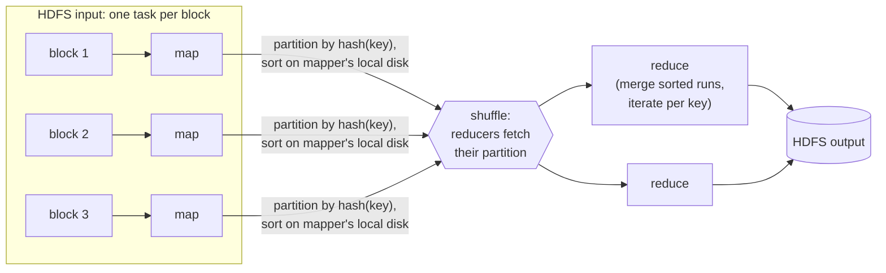
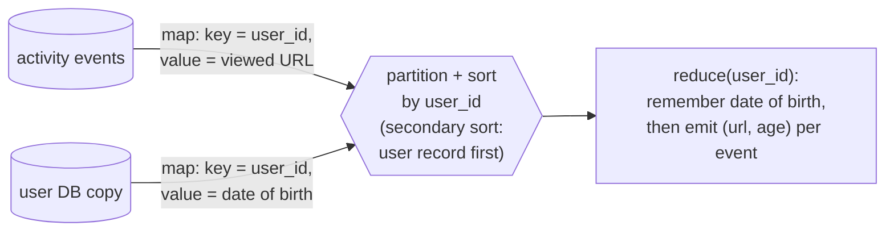
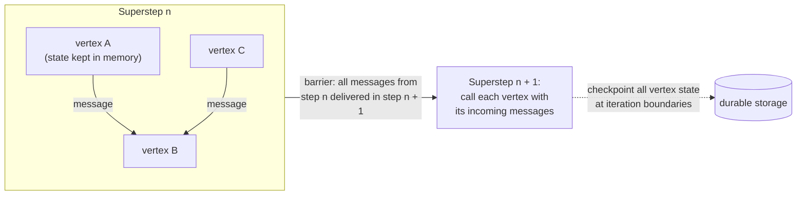

# Batch processing

> Not everything is request and response. A batch job takes a large, fixed
> input, runs, and produces derived output, with nobody waiting for it. This
> chapter goes from Unix pipes to MapReduce to dataflow engines, and shows
> that the ideas behind them (immutable inputs, no side effects, composable
> stages) make big data jobs safe to rerun.

## Three kinds of system

| | **Services** (online) | **Batch** (offline) | **Stream** (near-real-time) |
| --- | --- | --- | --- |
| Trigger | A request, with a user waiting | A schedule, over a fixed input | Events, shortly after they happen |
| Measure | Response time, availability | **Throughput** | Latency, between the other two |

**MapReduce** (2004) was hyped as "the algorithm that makes Google so
massively scalable", and was copied in Hadoop, CouchDB and MongoDB. By 2017 its
importance was **declining**, but it shows clearly *why* batch processing
works. The idea is old: Hollerith tabulating machines in the 1890 US Census,
and IBM card sorters in the 1940s–50s.

## Start with Unix

The five most-requested pages in an nginx log:

```bash
awk '{print $7}' access.log | sort | uniq -c | sort -rn | head -5
```

That handles gigabytes in seconds, and changing it takes moments: filter out
CSS, or count IPs instead of URLs. `awk`, `sed`, `grep`, `sort`, `uniq` and
`xargs` cover a surprising amount of data analysis.

**Sorting versus an in-memory hash table.** A Ruby script with a hash of URL →
count works if the **working set** (the number of *distinct* URLs) fits in
memory. `sort` doesn't need that: GNU sort **spills to disk** and uses all
cores, using the sorted-segment merge of chapter 3 (mergesort's sequential
I/O suits disks). The pipeline scales to inputs bigger than RAM.

### The Unix philosophy

Doug McIlroy described pipes in 1964 as connecting programs like a garden
hose. The 1978 principles were: do one thing well, expect your output to be
someone else's input, try things early and throw the clumsy parts away, and
build tools. (The book notes how much this sounds like Agile and DevOps.)
What makes it compose:

- **A uniform interface.** Everything is a **file descriptor**, an ordered
  sequence of bytes, usually newline-separated ASCII records. That's not
  elegant (`$7` instead of `$request_url`), but it's universal. Most software
  today doesn't compose this well, and data ends up **Balkanized**. (URLs and
  HTTP are the web's version of this interface. Bulletin-board systems never
  had one.)
- **Logic separated from wiring.** Programs read stdin and write stdout, and
  the shell decides what connects to what. That's loose coupling, or
  inversion of control. The limits: multiple inputs or outputs are awkward,
  and you can't pipe into a network connection.
- **Transparency and experimentation.** Inputs are treated as **immutable**,
  you can stop the pipeline anywhere and look at it with `less`, and you can
  save a stage's output to resume from.

The biggest limit is that it **runs on one machine**.

## MapReduce and distributed filesystems

MapReduce is Unix spread over thousands of machines: a job is like a process,
doesn't modify its inputs, has no side effects, and writes its output once,
sequentially. Instead of stdin and stdout it uses a **distributed filesystem**:
**HDFS** (an open-source GFS), GlusterFS, QFS, or object stores like S3.

- HDFS is **shared-nothing**: a daemon on every machine, and a **NameNode**
  tracking which blocks live where. Blocks are replicated, or
  **erasure-coded** (Reed–Solomon) for less overhead, RAID-like but over an
  ordinary network.
- The biggest deployments had **tens of thousands of machines and hundreds of
  petabytes**, cheaper than dedicated storage appliances.

### How a job runs



1. Break input files into records (the input format parser).
2. **Map**: extract a key and value from each record. It's stateless,
   emitting any number of pairs, like `awk '{print $7}'`.
3. **Sort** by key. This is implicit, and the framework does it.
4. **Reduce**: iterate over all values for one key, like `uniq -c`.

**Distributed execution:**

- Map tasks run **near the data**, on a machine holding a replica of the block,
  to save network transfer. The framework ships your code (JARs) there.
- The number of reducers is configured. **Hash partitioning** sends each key to
  one reducer.
- The **shuffle** (partition, sort, fetch) isn't random despite the name.
  Reducers merge the sorted files, and the output goes back to HDFS.

**Workflows** chain jobs by **directory name**: job 2 reads job 1's output
directory and starts only when job 1 *succeeds*, since partial output is
discarded. Schedulers like **Oozie, Azkaban, Luigi, Airflow and Pinball**
manage the dependencies. Recommendation pipelines of **50–100 jobs** were
common. **Pig, Hive, Cascading, Crunch and FlumeJava** generate multi-stage
workflows for you.

## Joins and grouping in batch

MapReduce has **no indexes**: every job is a **full scan**. That's terrible for
looking up one user and fine for analytics over all users.

**The example:** join a **clickstream** of activity events (the fact table) with
a **user database** (a dimension) to find which pages each age group likes.
Querying the live user database per event would be slow, could overwhelm it,
and would make the job **nondeterministic**. Instead, **copy the user database
into HDFS** (via ETL from a backup) and join the files.

### Reduce-side joins



- **Sort-merge join.** All records for one key arrive **adjacent**, at one
  reducer call. A **secondary sort** puts the user record first and the
  events in time order. The reducer keeps **one user in memory** and makes
  **no network requests**.
- The mental model: **mappers "send messages" to reducers**, and the key is
  the destination address. Network transfer is separate from application
  logic, and the framework handles partial failures by retrying tasks.
- **GROUP BY** works the same way: COUNT, SUM, top-k. **Sessionization**
  groups a user's events from scattered servers, useful for A/B testing.
- **Skew (hot keys, linchpin objects).** A celebrity's key overloads one
  reducer, and the whole job waits for the slowest. Fixes:
  - **Pig's skewed join** samples to find hot keys, sends their records to
    random reducers, and replicates the other side of the join to each;
  - **Crunch's sharded join** does the same with hot keys you specify;
  - **Hive** stores hot keys separately and map-joins them;
  - **two-stage aggregation** spreads a hot key across random reducers first,
    then combines.

### Map-side joins

When you can assume something about the inputs, skip the sort and the
reducers entirely:

| Join | Precondition | How |
| --- | --- | --- |
| **Broadcast hash join** | One input is **small** enough for memory | Each mapper over the big input loads the small one into a hash table (Pig's "replicated join", Hive's "MapJoin", Impala). A read-only on-disk index plus the page cache also works |
| **Partitioned hash join** | Both inputs **partitioned the same way** (same key, hash and count) | Mapper *n* hashes only partition *n* of each side (Hive's "bucketed map join") |
| **Map-side merge join** | Both inputs partitioned **and sorted** the same way | Merge them like a reducer would, with no memory limit |

Output layout differs: reduce-side output is partitioned by the join key, and
map-side output follows the big input. So **partitioning metadata matters**
(HCatalog, the Hive metastore).

## What batch jobs produce

Not reports (that's analytics) and not single-record lookups (that's OLTP).
Usually some other **data structure**:

- **Search indexes.** Google's original use was **5–10 MapReduce jobs** to build
  its search index. Mappers partition documents and each reducer builds a
  document-partitioned Lucene index, which is immutable. Rebuild everything
  and swap, or index incrementally.
- **Key-value stores for ML and recommendations** ("people you may know",
  related products). **Don't write to the production database from inside the
  job**: a request per record is far slower than the job's throughput, the
  parallel writers can **overwhelm** the database, and the job's all-or-nothing
  output guarantee breaks because partial results leak out. Instead, **build
  the database files inside the job**, then **bulk-load** them (Voldemort,
  Terrapin, ElephantDB, HBase bulk load). Voldemort serves the old files while
  copying the new ones, then **switches atomically** and can switch back.

**Why this philosophy matters.** Immutable inputs and outputs that are fully
replaced give you **human fault tolerance**:

- deploy buggy code, then **roll back and rerun** (or point back at the old
  output). A database full of bad writes can't be fixed by rolling back code;
- move faster, because **mistakes are reversible**;
- **retry failed tasks automatically**, which is only safe because outputs from
  failed tasks are discarded;
- reuse the same inputs for many jobs, including jobs that check other jobs'
  output;
- separate logic from wiring, so teams can reuse jobs.

Unlike Unix's untyped text, Hadoop uses **Avro and Parquet**, which removes
parsing and supports schema evolution.

## Hadoop versus MPP databases

The parallel join algorithms weren't new. **MPP databases** (Gamma, Teradata,
Tandem NonStop SQL) had them a decade earlier. The difference is that Hadoop
is closer to a **general-purpose operating system**:

- **Diversity of storage.** Dump **anything** (records, text, images, feature
  vectors, genomes) and interpret it later: **schema-on-read**, the
  **data lake**, the "**sushi principle**: raw data is better". Making data
  available quickly beats designing the ideal model up front, and the
  consumer, not the producer, decides how to interpret it. Hadoop became the
  ETL engine feeding MPP warehouses.
- **Diversity of processing.** Not everything is SQL: machine learning,
  ranking models and image analysis need **arbitrary code**. Many models run
  on one shared cluster over the same files: Hive (SQL), HBase (OLTP), Impala
  (MPP), with no data movement.
- **Designed for frequent faults.** An MPP query that loses a node
  **aborts and reruns**, which is fine for queries lasting seconds to minutes,
  and MPP databases keep data in memory. MapReduce **retries individual tasks**
  and **writes eagerly to disk**. The reason was Google's mixed clusters:
  low-priority batch tasks are **preempted** to make room for production
  work. An hour-long task had about a **5% chance of being killed**, more than
  10× the rate of hardware failure, so a job with 100 ten-minute tasks has
  **over a 50% chance** of losing one. Open-source schedulers (YARN, Mesos,
  Kubernetes) rarely preempted like that, **so MapReduce's design made less
  sense there**.

## Beyond MapReduce

Raw MapReduce is simple to understand and laborious to use. Every join has to
be hand-written, which is why Pig, Hive, Cascading and Crunch exist. Its
**execution model** is also slow: robust, but sometimes orders of magnitude
behind the alternatives.

### Materialized intermediate state, and dataflow engines

Chained jobs write every intermediate result to HDFS, which is like writing
each command's output to a temp file instead of using a pipe:

- a job waits for **every** task of the previous job, so **stragglers** stall
  the workflow;
- mappers often just reread what the previous reducer wrote;
- temporary files are **replicated** across the cluster for no good reason.

**Dataflow engines** (**Spark, Tez, Flink**, from research systems Dryad and
Nephele) treat the whole workflow as **one job** made of **operators**
connected by repartition-and-sort, partition-only or broadcast edges. The gains:

- they sort **only where needed**;
- there are no redundant map stages;
- the scheduler sees the whole flow and can put producer and consumer on the
  same machine, sharing memory;
- intermediate state lives in **memory or local disk**, not replicated HDFS;
- operators **start as soon as their input is ready**;
- JVMs are reused.

The same Pig, Hive or Cascading job can switch from MapReduce to Tez or Spark
with a configuration change.

**Fault tolerance without materialization.** **Recompute** lost data from
ancestors: Spark tracks lineage with **RDDs**, and Flink **checkpoints**
operator state. That requires **deterministic operators**. Hash-table
iteration order, random numbers, the system clock and external data all
introduce nondeterminism, which forces downstream operators to be killed and
rerun as well. (Use fixed seeds.) If intermediate data is small or expensive to
compute, materializing it can still be cheaper. Sorts must consume all their
input before producing output, but much of a pipeline can stream (Flink is
built around **pipelined execution**). Inputs and final outputs still usually
live in HDFS.

### Graphs and iteration

PageRank and transitive closure mean "**repeat until done**", which plain
MapReduce can't express: an external scheduler reruns a full pass each
iteration, even when little has changed. (A dataflow engine's DAG of operators
isn't graph *processing*: it's a graph of operators over relational tuples.)

**Pregel, or bulk synchronous parallel** (Giraph, Spark GraphX, Flink Gelly):



- Vertices **send messages along edges**, and each vertex function sees its
  inbox, much like a reducer call. **State persists between iterations**, so
  idle parts of the graph cost nothing.
- **Exactly-once message processing** per iteration, despite an unreliable
  network. Fault tolerance comes from **checkpointing** every vertex at
  iteration boundaries and rolling back (or recovering just the lost
  partition).
- "**Thinking like a vertex**" lets the framework place vertices anywhere, but
  in practice it partitions by arbitrary ID, so **cross-machine messages
  dominate**. **If the graph fits on one machine, a single-threaded algorithm
  will probably win.** GraphChi handles graphs that fit on one machine's disk.

### High-level APIs and declarative queries

With clusters of 10,000+ machines handling petabytes routinely, attention moved
to programming models. Hive, Pig, Spark and Flink offer **relational-style
operators** (join, group, filter, aggregate), which allow interactive,
Unix-like exploration *and* faster execution:

- **Cost-based optimizers** (Hive, Spark, Flink) choose the join algorithm and
  reorder joins, so you don't have to memorize this chapter's join list.
- **Declarative filters and projections** let the engine read only the needed
  **columns** and run **vectorized** loops. Spark generates JVM bytecode, and
  Impala uses LLVM.
- Unlike MPP databases, you can still drop into **arbitrary code** and use
  normal package ecosystems (Maven, npm).
- **Domain libraries**: Mahout and MADlib for machine learning, k-nearest
  neighbours, approximate genome matching.

The two worlds converge: batch engines become more declarative and MPP
databases more programmable. **They're all just systems for storing and
processing data.**

> **Since this edition:** Hadoop MapReduce is now legacy. **Spark** became the
> default batch engine, often running on Kubernetes against **object storage**
> rather than HDFS. Open table formats (Iceberg, Delta Lake, Hudi) brought
> transactions and schema evolution to data lakes, and cloud warehouses
> absorbed much of the "SQL over everything" role. **Airflow**, listed here as
> one scheduler among several, became the de facto standard. The principles
> the chapter argues for (immutable inputs, derived outputs, rerunnable jobs)
> are exactly what "data engineering" practice settled on.

## What to take away

- Keep batch jobs pure: read immutable input, write complete new output, have
  no side effects. Then a bad deploy means rolling back and rerunning.
- Never write from a batch job straight into a production database. Build
  files and bulk-load them, switching atomically.
- Join by bringing related records to the same place: sort-merge when nothing
  is known about the inputs, broadcast when one side is small, partitioned
  when both sides share a layout.
- Watch for hot keys. One celebrity key can stall the whole job.
- Prefer declarative APIs (Spark DataFrames, SQL) so the optimizer picks joins
  and columns, and write custom code only where you need it.

---

Previous: [Part III — Derived data](./README.md) ·
Next: [Stream processing](./02-stream-processing.md)
