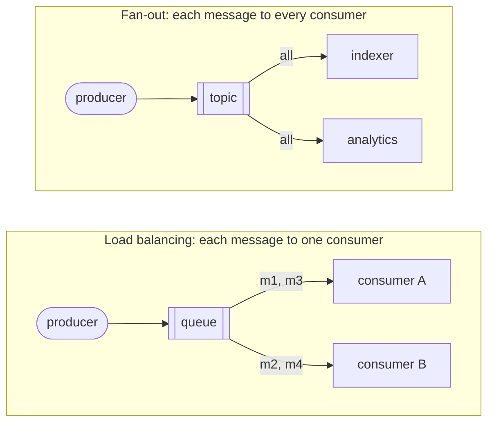
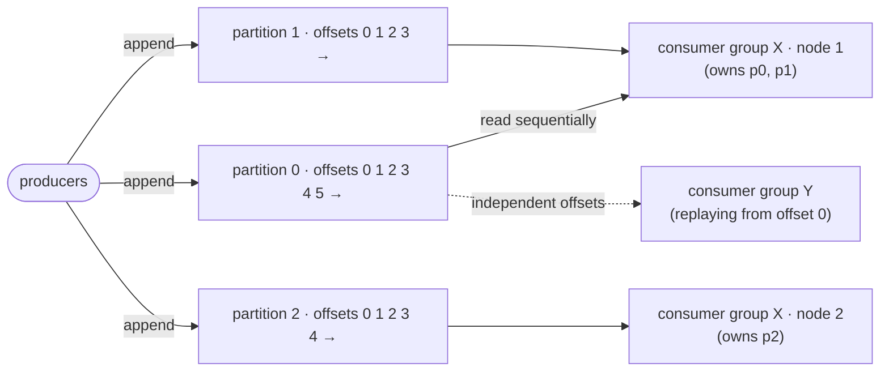
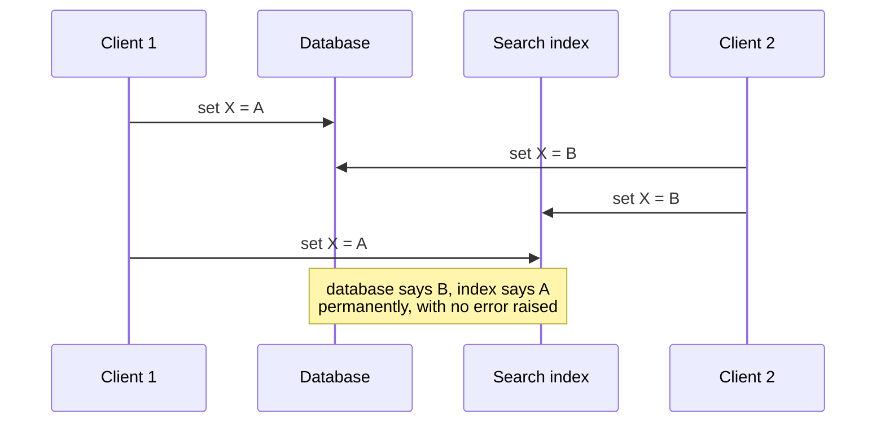

# Stream processing

> Real data is never "complete": users keep producing it. Stream processing is
> batch processing with the input left unbounded, run continuously. This
> chapter covers how events are carried (brokers and logs), the deep link
> between streams and databases, and how to process streams correctly despite
> time, joins and failures.

Batch jobs slice time artificially ("process yesterday"), so their output is a
day late. Shrink the slices to seconds, or drop them and process each **event**
as it happens, and you have stream processing. An **event** is a small,
immutable record of something that happened, with a timestamp: a page view, a
sensor reading, a database write. **Producers** emit events once, many
**consumers** read them, and related events are grouped into a **topic**.
Polling a database for new rows gets expensive as you poll more often, and
triggers are an afterthought, so consumers need to be **notified**.

## Transmitting event streams

Every messaging system answers two questions:

1. **What happens if producers outpace consumers?** It can **drop** messages,
   **buffer** them in a queue (and then: what happens when the queue outgrows
   memory?), or apply **backpressure** and block the producer, as Unix pipes
   and TCP do.
2. **What happens if nodes crash?** Durability costs disk writes and
   replication. Losing an occasional metric may be fine. Losing count events
   isn't, and mass loss can go unnoticed.

**Direct messaging** skips the intermediary: **UDP multicast** for market
feeds, **ZeroMQ** and nanomsg, **StatsD** over UDP (whose counters are
therefore approximate), and **webhooks**. These assume producer and consumer
are both online. An offline consumer misses messages, and a crashed producer
loses its retry buffer.

### Message brokers (AMQP/JMS style)

A **broker** is essentially a database optimized for message streams:
RabbitMQ, ActiveMQ, HornetQ, Qpid, TIBCO EMS, IBM MQ, Azure Service Bus, Google
Cloud Pub/Sub. Clients come and go, and durability is the broker's job.
Brokers usually **queue without limit**, so consumers are **asynchronous**.
Compared with databases, they **delete messages once delivered** (so they're
not storage), assume **short queues** (throughput drops when they spill to
disk), offer topic patterns instead of indexes, and **notify** you instead of
answering queries.

- The two patterns combine: several consumer **groups**, each receiving
  everything, with load balancing inside each group.
- **Acknowledgments and redelivery.** An unacknowledged message is redelivered
  to someone else. (If the ack was what got lost, it's processed twice, and
  avoiding that needs atomic commit.) **Load balancing plus redelivery
  reorders messages**: a consumer crashes on m3, so another consumer sees m4,
  then m3. Use a queue per consumer if order matters.

### Partitioned logs

Traditional brokers have a **transient** mindset: consuming a message is
**destructive**, and a new consumer only sees new messages, so you can't rerun
a consumer the way you rerun a batch job. A **log-based broker** combines
database-style durability with low-latency notification:

- **Kafka**, **Kinesis Streams** and Twitter's **DistributedLog** work like
  this. Append to a partition, read sequentially, wait at the end (like
  `tail -f`). Each message gets a monotonically increasing **offset**, which
  gives a **total order within a partition and none across partitions**.
  Partitioning plus replication delivers **millions of messages per second**
  even though everything is written to disk.
- **Fan-out is free**, because reading doesn't delete. **Load balancing
  assigns whole partitions** to group members. The downsides: parallelism is
  capped at the partition count, and a slow message causes **head-of-line
  blocking** in its partition. Use a log for high throughput, fast messages and
  ordering. Use JMS/AMQP for expensive, order-independent tasks.
- **Consumer offsets** replace per-message acks, which means less bookkeeping
  and more batching. This is just a replication **log sequence number**: the
  broker acts as leader and the consumer as follower. After a crash, a new
  consumer resumes from the last *recorded* offset, so messages may be
  processed twice.
- **Retention.** Old **segments** are deleted, which makes the log a huge
  on-disk **ring buffer**. The book's arithmetic: a 6 TB drive written at
  150 MB/s fills in about **11 hours**, and real deployments rarely write that
  fast, so **days or weeks** of history are typical. Throughput stays constant
  however long you retain data, unlike memory-first brokers that slow down
  when they spill.
- **Slow consumers** only hurt themselves. Alert on how far they lag. You can
  safely attach an experimental consumer to production, and a stopped
  consumer costs nothing but its stored offset.
- **Replay.** Consuming is read-only, so reset the offset to yesterday and
  reprocess into a new location as often as you like. That's batch-style
  experimentation with streams.

## Databases and streams

A **replication log is a stream of database writes**, and state machine
replication is "same events, same order, same state". The connection is
fundamental.

### Keeping systems in sync

An OLTP database, a cache, a search index and a warehouse each hold a copy of
the data. Periodic full dumps (ETL) are slow. **Dual writes** (the app writes
to the database, then the index) are broken:

On top of the **race**, one write can fail while the other succeeds, which is
an atomic commit problem. The underlying issue is that there are **two
leaders**. Make the index a **follower** of the database instead.

### Change data capture (CDC)

**CDC** extracts every change written to a database, in order, as a stream, so
derived systems are simply **consumers**. That turns one database into the
leader and everything else into followers. A **log-based broker** is the right
transport because it preserves order.

- **Implementations.** Triggers are fragile and slow. Parsing the replication
  log is sturdier, though schema changes are tricky. Examples: LinkedIn's
  **Databus**, Facebook's **Wormhole**, Yahoo's **Sherpa**, **Bottled Water**
  (PostgreSQL WAL decoding), **Maxwell** and **Debezium** (MySQL binlog),
  **Mongoriver** (the oplog), **GoldenGate** (Oracle), and **Kafka Connect**
  to integrate them.
- It's **asynchronous**, so slow consumers don't hold up the source. All the
  replication-lag issues from chapter 5 apply.
- **Initial snapshot.** You can't keep every change forever, so a new derived
  system starts from a **consistent snapshot tied to a log offset**.
- **Log compaction** removes that need. Keep only the latest record per key,
  with tombstones for deletes, so the log's size tracks the *current data*
  rather than the write history. A new consumer reads a **compacted topic**
  from offset 0 and gets a full copy of the database. Kafka supports this,
  which makes the broker usable as **durable storage**.
- **First-class change streams** were appearing: RethinkDB query
  subscriptions, Firebase and CouchDB change feeds, Meteor on the MongoDB
  oplog, and VoltDB's export streams.

### Event sourcing

This idea comes from **domain-driven design**. It looks like CDC but works at a
different level:

| | **Change data capture** | **Event sourcing** |
| --- | --- | --- |
| The app writes | A mutable database, as usual (it doesn't know CDC exists) | **Immutable events** to an append-only event log |
| Log content | Low-level row changes | **Application-level facts**: "student cancelled enrollment" |
| Rebuilding state | The latest event per key is enough, so **compaction works** | Needs the **full history** (events express intent, not state). Snapshots are only an optimization |

Recording *what the user did* rather than *its effect on tables* makes intent
clear and makes it easy to add side effects later ("offer the place to the
next person on the waiting list"). It resembles a **star schema's fact table**.
Event Store is a dedicated database for it, but any log or database works.

**Commands versus events.** A **command** is a request that may still fail
validation (is the seat free, is the username taken). Once accepted it becomes
an **event**, an immutable **fact**. A later cancellation is a new event.
Consumers **can't reject** events, so validate synchronously (a serializable
transaction that checks the command and publishes the event), or split it into
a *tentative* reservation event plus a later confirmation event.

### State, streams and immutability

Mutable state and an immutable log are **two sides of one coin**: **state is
the integral of the event stream over time, and the changelog is the derivative
of state.** Pat Helland's version: **the truth is the log, and the database is
a cache of a subset of it** (the latest value of each record).

- **Accountants have done this for centuries.** A ledger is append-only, and
  mistakes are fixed with **compensating** entries, never erasure. Immutability
  makes buggy-code damage **diagnosable and recoverable**, and it keeps
  information that deletion destroys (an item added to a cart and then removed
  is useful for analytics).
- **Several views from one log.** Druid ingests from Kafka, Pistachio uses Kafka
  as its commit log, and Kafka Connect sinks feed many stores. Build a new
  read view **next to** the old system instead of migrating the schema, then
  retire the old one. Separating the **write form** from the **read forms** is
  **CQRS**. The book calls it a fallacy that data must be written in the shape
  it's queried, and says it makes the normalization debate largely
  irrelevant: denormalize freely in views kept consistent by the log. (Twitter's
  timelines are exactly such a view.)
- **Concurrency.** The downside is that views are **asynchronous**, so
  read-your-writes needs either the view updated in the same transaction (same
  store, or 2PC) or the total-order trick from chapter 9. The upside: design
  each event as a **self-contained** user action, so it's **one atomic append**.
  If the log and the state are partitioned the same way, a single-threaded
  consumer per partition needs **no concurrency control**, because the log
  *is* the serial order.
- **Limits of immutability.** High-churn data (many updates and deletes on a
  small dataset) makes history huge, so compaction and GC become critical.
  **Privacy law** and leaked secrets can require *rewriting* history (Datomic's
  *excision*, Fossil's *shunning*). **Truly deleting is very hard**, with
  copies in storage engines, SSDs and immutable backups. In practice it's
  "make it harder to retrieve", but you still have to try.

## Processing streams

You can **write** events to storage (the streaming version of batch output),
**push** them to humans (alerts, dashboards), or **transform** streams into
streams. Operators look like batch jobs (read-only input, append-only output,
the same partitioning), but **a stream never ends**: no sort-merge joins, and
you can't restart a job that has been running for years from the beginning.

### What it's used for

- **Complex event processing (CEP)**, since the 1990s: regex-like **patterns
  over events** (Esper, InfoSphere Streams, Apama, StreamBase, SQLstream). It
  **reverses the database relationship**: queries are stored long-term and
  data flows past them.
- **Stream analytics**: rates, rolling averages, comparing with last week, over
  **windows**. Probabilistic structures (Bloom filters, **HyperLogLog**,
  percentile sketches) save memory, but **stream processing isn't inherently
  approximate**. Storm, Spark Streaming, Flink, Samza and Kafka Streams;
  hosted options are Cloud Dataflow and Azure Stream Analytics.
- **Maintaining materialized views**: caches, indexes, event-sourced state.
  This needs a window back to the **beginning of time** (plus compaction).
  Samza and Kafka Streams support it.
- **Search on streams**: stored queries matched against incoming documents, as
  in media monitoring or "alert me about new listings" (Elasticsearch's
  **percolator**, with the queries themselves indexed).
- **Not the same as actors or RPC.** Actors manage concurrency with ephemeral,
  one-to-one, possibly cyclic messages. Streams are durable, multi-subscriber,
  acyclic pipelines. (Storm's distributed RPC blurs the line.)

### Reasoning about time

Batch jobs use **timestamps inside the events**, which keeps them
deterministic. Many stream frameworks window by the **processing machine's
clock**. That's simple, and it breaks whenever there's lag: queues, network
faults, consumer restarts, **replaying** old events.

- **Event time ≠ processing time.** The book's analogy is the Star Wars films,
  released as IV, V, VI, then I, II, III, then VII: the episode number is the
  event time, and the order you watched them is the processing time. Messages
  also **reorder** across servers. A one-minute redeploy followed by a burst
  of backlog shows up as a **fake traffic spike** if you count by processing
  time.
- **Knowing when a window is done.** **Stragglers** always exist. Either
  **ignore** them (and track how many you drop) or **publish a correction**
  (and possibly retract the earlier output). Producer "no more events before
  *t*" markers help, but every producer has to be tracked.
- **Whose clock?** Offline mobile apps send events hours or days late, and
  device clocks lie. Log **three timestamps**: when the event occurred and when
  it was sent (both device clock), and when it was received (server clock).
  Receive minus send estimates the device's clock offset, which you apply to
  the occurrence time. Batch jobs have the same problem; streams just make it
  obvious.

| Window | Definition | Example |
| --- | --- | --- |
| **Tumbling** | Fixed length, no overlap. Every event is in exactly one | Round each timestamp down to the minute |
| **Hopping** | Fixed length, overlapping (window size ≠ hop) | 5-minute windows every 1 minute, built from 1-minute tumbles |
| **Sliding** | All events within an interval *of each other* | Events at 10:03:39 and 10:08:12 share a 5-minute window |
| **Session** | No fixed length. Ends after inactivity (say 30 min) | Sessionization for web analytics |

### Stream joins

| Join | Inputs | State the operator keeps | Example |
| --- | --- | --- | --- |
| **Stream–stream** (window join) | Two event streams | Recent events from both sides, indexed by key, for a window (say 1 hour) | Join searches with clicks by session ID to compute click-through. Also emit "**not clicked**" when the window expires. Embedding the search in the click event loses the unclicked searches |
| **Stream–table** (enrichment) | Events plus a database **changelog** (CDC) | A **local copy** of the table, kept current by the changelog: a window "back to the beginning of time" | Add user profile data to activity events, a streaming version of the broadcast hash join |
| **Table–table** (view maintenance) | Two changelogs | Both tables (such as follower lists) | Twitter timelines: keep `tweets ⋈ follows` materialized. New tweet → add it to every follower's timeline. Follow → add recent tweets |

**Time-dependence.** Which version of a profile (or a **tax rate**) should an
event join with? If ordering across streams isn't fixed, the join is
**nondeterministic**, and reruns can differ. Data warehouses call this a
**slowly changing dimension**: give each version its own ID and reference the
version, at the cost of keeping every version (so no compaction).

### Fault tolerance

Batch gets **exactly-once** semantics (better named **effectively-once**) by
retrying tasks and discarding partial output. A stream never finishes, so it
can't wait to publish. The options:

1. **Microbatching** (Spark Streaming): roughly **one-second** batches, which
   balances scheduling overhead against latency. It implies processing-time
   tumbling windows.
2. **Checkpointing** (Flink): **barriers** in the stream trigger rolling
   snapshots of operator state, and after a crash the job restarts from the
   last one.

Both only give exactly-once **inside the framework**. Once output escapes (a
database write, an email, an external topic), a retry repeats it. Two remedies:

- **Atomic commit, kept internal.** Make the outputs, state changes and the
  input **offset advance** happen all-or-nothing, inside the framework rather
  than across heterogeneous systems. Google Cloud Dataflow and VoltDB did this,
  and Kafka had it planned. Batching several messages per transaction spreads
  the cost.
- **Idempotence.** An operation with the same effect when applied twice. "Set
  key = value" is naturally idempotent, and increment isn't. You can make
  writes idempotent by **storing the Kafka offset** with the value and skipping
  updates already applied (Storm Trident does this). It requires replay in the
  same order, deterministic processing, no concurrent writers, and **fencing**
  during failover.

**Rebuilding state.** Remote state is slow to query per message. **Local state
plus replication** is better: Flink snapshots state to HDFS, Samza and Kafka
Streams send state changes to a **compacted Kafka topic**, and VoltDB
processes every message on several nodes. Short windows can simply be
**replayed**, and CDC-maintained tables rebuilt from the compacted log. The
right trade-off depends on whether your network is faster than your disk.

> **Since this edition:** Kafka shipped **idempotent producers and
> transactions** (2017), the planned feature mentioned above, giving
> exactly-once Kafka-to-Kafka processing. **Debezium** became the standard CDC
> tool, and the **transactional outbox** pattern (write an event row in the
> same transaction, then let CDC publish it) became the usual fix for dual
> writes. **Flink** emerged as the leading stateful stream processor, and
> streaming SQL and streaming databases (ksqlDB, Materialize, RisingWave) put
> the table–table join idea into products. GDPR (2018) made "really deleting"
> a legal requirement. **Crypto-shredding** (per-user keys you destroy) is a
> common answer for immutable logs.

## What to take away

- Use a log-based broker (Kafka) when order and replay matter, and a
  queue-style broker for independent, expensive tasks.
- Never dual-write to a database and an index. Make one system the source of
  truth and feed the others from its change stream (CDC, or an outbox).
- Store facts as immutable events and derive read views from them. You can
  rebuild, add views, and recover from bugs.
- Window by event time, plan for stragglers, and log the device, send and
  server timestamps from clients.
- "Exactly-once" only covers the framework. Make external side effects
  idempotent (store the offset with the write) or commit them atomically with
  the offset.

---

Previous: [Batch processing](./01-batch-processing.md) ·
Next: [The future of data systems](./03-future-of-data-systems.md)
