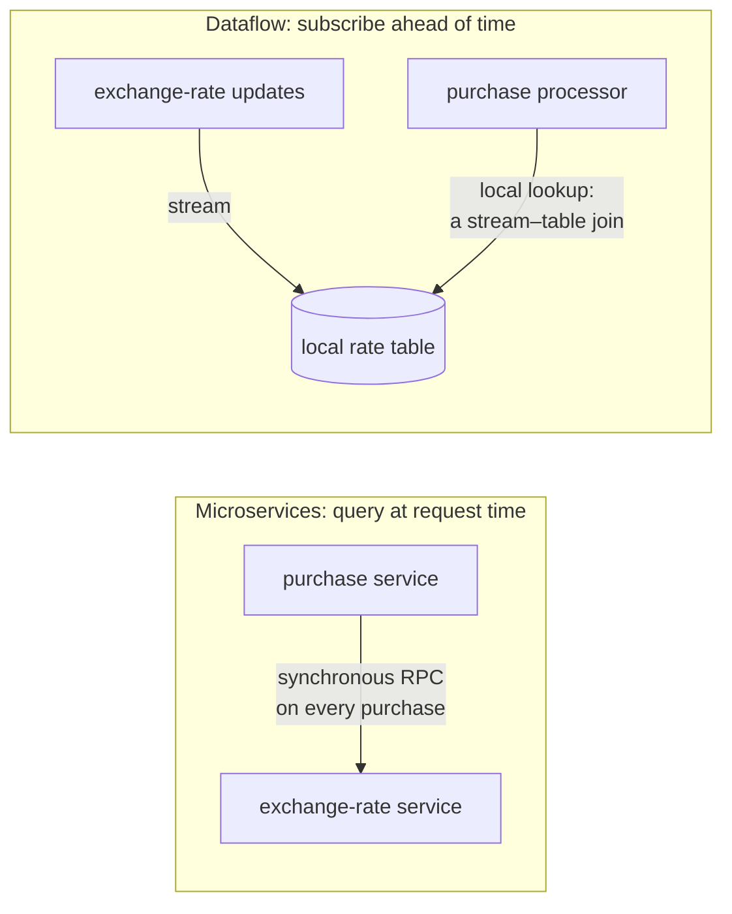
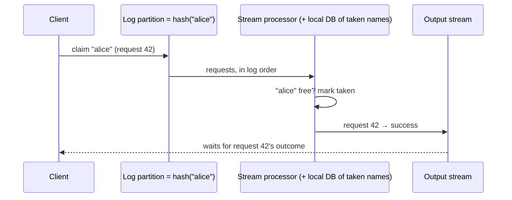

# The future of data systems

> The last chapter switches from describing to prescribing, and Kleppmann says
> so: it's written in the first person, as opinion. It pulls the book together
> into one design approach (derive everything from an ordered log of events,
> keep integrity end to end, verify, don't just trust) and ends with the
> ethics of collecting data about people.

## Data integration

**No tool is right for every use.** Each piece of software, even a
"general-purpose" database, is built for some usage pattern, and vendors
rarely tell you where theirs is weak. Real applications use data in many ways,
so you end up **combining specialized tools**: an OLTP database plus a search
index, plus a warehouse, caches, ML models and notifications. Kleppmann warns
against "99% of people only need X" claims, which describe the speaker's
experience more than the world.

### Reason about dataflow

Be explicit about **where data is written first and what is derived from
what**:

- Write to a **system of record**, capture its changes (CDC), and apply them
  to the index **in the same order**. If CDC is the *only* way the index gets
  updated, it can't drift from the source.
- Letting the app write to both brings back chapter 11's **dual-write race**.
- The principle is **one total order** for all input, via CDC or an
  event-sourcing log. Updates driven by a log can be **deterministic and
  idempotent**, so recovery is easy.

**Derived data versus distributed transactions.** Both aim for consistency, in
different ways:

| | Distributed transactions | Log-based derived data |
| --- | --- | --- |
| Ordering | Locks (2PL) | The log |
| Exactly once | Atomic commit | Deterministic retry + idempotence |
| Timing | Usually **linearizable** (read-your-writes) | **Asynchronous** by default |
| Kleppmann's view | XA has poor fault tolerance and performance, and a better protocol is unlikely to be adopted soon | **The most promising way to integrate systems**, provided we also give developers guidance on stronger guarantees, rather than just telling them to "suck it up" |

### The limits of total order

A single leader orders everything, until:

- throughput outgrows one machine, so you **partition**, and the order across
  partitions is undefined;
- you go **multi-datacenter**, with a leader per region;
- you use **microservices**, each with its own state;
- you have **offline-capable clients**.

Total order broadcast is consensus, and scaling consensus beyond one node's
throughput, or across regions, was an **open research problem**.

**Causality still matters.** Someone unfriends their ex, *then* posts a rant
to their remaining friends. If friendships and messages live in different
systems, the notification service may handle the message before the unfriend,
and the ex gets notified. (It's a time-dependent join.) There's no simple fix.
Starting points:

- **logical timestamps** (still need out-of-order handling);
- **logging what the user saw** as an event with an ID that later events
  reference;
- **conflict resolution** (which doesn't help with external side effects).

### Batch and stream together

The goal of data integration is **data in the right form in all the right
places**. Batch and stream processing are the tools, and they're converging:
Spark streams by **microbatching** on a batch engine, while Flink batches on a
streaming engine.

- **Functional at heart.** Deterministic pure functions, immutable inputs,
  append-only outputs, plus managed state for streams. Think of a pipeline as
  deriving one thing from another.
- **Asynchrony is the point.** It contains a fault in one place, whereas
  distributed transactions spread aborts everywhere. Even cross-partition
  secondary indexes scale best maintained asynchronously.
- **Reprocessing is how systems evolve.** Without it, schema evolution is
  limited to adding optional fields. With it, you can restructure data
  completely. The book's analogy is 19th-century railways converting to
  standard gauge (fixed in 1846) by laying a **third rail**, so both gauges
  could run during a migration that took years. (BART still runs a
  non-standard gauge.) Run **old and new views side by side**, move users
  over gradually, and each step can be reversed.

**The lambda architecture** (Nathan Marz) records immutable events, then runs a
fast, approximate **stream** layer (Storm) alongside a slower, exact **batch**
layer (Hadoop) and merges the outputs. Kleppmann credits it with popularizing
derived views and reprocessing, and lists its problems:

1. the same logic has to be maintained in **two frameworks** (Summingbird
   helps, but you still operate two systems);
2. **merging** the outputs is hard beyond simple windowed aggregates;
3. full reprocessing is expensive, so the batch layer goes incremental and
   picks up the same straggler and window problems it was meant to avoid.

**Unify instead**, with one engine that can **replay history** through the
same code, offers **exactly-once** semantics, and windows by **event time**.
Apache Beam's API runs on Flink or Cloud Dataflow. (This is often called the
*kappa* approach, though the book doesn't use that name.)

## Unbundling databases

Databases, Hadoop and operating systems all **store and process data**. Unix
gives a thin, low-level abstraction (files and pipes). Relational databases
give a high-level one (SQL and transactions) that hides disks, concurrency
and recovery. Kleppmann reads NoSQL as applying the Unix approach to
distributed OLTP, and tries to combine the two.

**Databases already contain dataflow.** `CREATE INDEX` scans a consistent
snapshot, sorts, writes the index, catches up on the backlog, and then keeps
it updated. That's the same process as **adding a follower** or **bootstrapping
CDC**. Seen this way, an organization's dataflow is **one big meta-database**:
batch, stream and ETL jobs act as its triggers, stored procedures and
view-maintenance routines, and each derived system is an index type, run by
different software and different teams.

Two ways to make the pieces cohere:

- **Federated databases (unify reads).** One query interface over many
  engines, also called a *polystore*. PostgreSQL's **foreign data wrappers**
  are an example. This is the relational tradition.
- **Unbundled databases (unify writes).** Reliably plug storage systems
  together through **CDC and event logs**, the Unix tradition of small tools
  joined by a uniform, low-level interface. Kleppmann considers this the
  harder and more important problem.

**Why logs rather than cross-system transactions:** there's no standard
transaction protocol across different groups' software, while **an ordered
log with idempotent consumers** is simple enough to implement anywhere. It
gives **loose coupling** in two ways:

1. **System level.** A slow or failed consumer just falls behind (the log
   buffers), and the fault stays contained. Synchronous transactions escalate
   local faults.
2. **Human level.** Teams build and run components independently, behind a
   well-defined interface.

**Unbundling isn't a reason to avoid databases.** Integrated products still
perform better and more predictably on their target workloads, and every extra
system has a learning curve and quirks. Building for scale you don't need is
premature optimization. **If one product does everything you need, use it.**
Unbundling is about *breadth* when no single product fits.

**What's missing** is an equivalent of the Unix shell for data systems.
Kleppmann wants to write something like `mysql | elasticsearch` and get the
unbundled equivalent of `CREATE INDEX`: snapshot, index, and stay in sync with
no custom code. He'd also like declarative cache and materialized-view
definitions, including recursive and graph queries, and points to early
research in **differential dataflow**.

## Designing applications around dataflow

He calls this "**database inside-out**", after his 2014 talk, and calls it a
design pattern rather than a new architecture. It borrows from dataflow
languages (Oz, Juttle), functional reactive programming (Elm), logic
programming (Bloom) and Jay Kreps's "unbundling". It also borrows from
**spreadsheets**: change a cell and every formula depending on it updates.
VisiCalc did that in 1979, and most data systems still don't.

- **Application code is a derivation function.** A secondary index is a
  standard one (pick a field, sort). A full-text index needs language
  detection, stemming and synonyms. An ML model is derived from training data
  by feature extraction. A cache depends on what the UI shows. Non-standard
  derivations need custom code, which databases host poorly.
- **Keep code and state apart.** Databases make bad deployment environments
  (dependencies, versioning, rolling upgrades, monitoring), while Kubernetes,
  YARN and Mesos do that job well. Stateless services plus a database is the
  norm (the book quotes the functional programmers' joke about the separation
  of *Church* and state). But a database used that way is a **passive shared
  variable**: you can only *poll* it, since you can't subscribe.
- **Dataflow means code reacts to state changes** by producing state changes
  elsewhere (as with triggers, index maintenance, actors and 1980s tuple
  spaces). It differs from job queues in two strict ways: **ordering
  matters** (redelivering brokers and dual writes are out), and **losing one
  message corrupts the view permanently**. Modern stream processors meet both
  requirements at scale, much more cheaply than distributed transactions.

**Stream processors versus microservices.** Both decouple teams. They differ in
how they communicate:

In the dataflow version, a network call becomes a local lookup: **faster, and
unaffected when the rate service goes down**. ("The fastest and most reliable
network request is no network request at all.") Both versions still have to
handle **time-dependence**: reprocessing old purchases needs the historical
rate.

## Observing derived state

- The **write path** is precomputed eagerly, whether or not anyone asks. The
  **read path** happens only on request (**eager versus lazy evaluation**).
  **The derived dataset is where they meet.**
- **Indexes, caches and materialized views move the boundary.** With no
  search index, the write path is free and reads are `grep`. Precomputing
  every possible query would be infinite work on the write path. A **cache of
  common queries** sits in between. That's the same trade-off as **Twitter's
  fan-out in chapter 1**, which the book notes brings it full circle after 500
  pages.
- **Stateful, offline-first clients.** Single-page and mobile apps keep a
  local database and sync in the background. **On-device state is a cache of
  server state, and the pixels are a materialized view.**
- **Push changes to clients** with server-sent events or WebSockets, extending
  the write path **to the user's screen**. Offline devices are just consumers
  that reconnect at their last **offset**. Elm and React/Flux/Redux already
  manage UI state as event streams, so the server could feed that pipeline
  directly. Chat and games already work this way. Everything else is held
  back by request/response assumptions in databases, libraries and protocols.
  Kleppmann asks designers to support **subscribing to changes**, not just
  querying.
- **Reads are events too.** Send read requests through the stream processor as
  events. A one-off query is a **stream–table join** that's immediately
  forgotten, and a subscription is a persistent one. **Logging reads**
  records *what the user saw* before deciding (the delivery estimate and stock
  shown before a purchase), which captures causality, at a storage cost that
  was still being researched.
- **Multi-partition queries** can use the stream infrastructure. Storm's
  distributed RPC computed **how many people saw a URL on Twitter** (the union
  of the followers of everyone who tweeted it), and fraud scoring joins
  several differently partitioned reputation databases. An MPP database is
  usually simpler. This is for workloads beyond off-the-shelf limits.

## Aiming for correctness

Stateless services recover by restarting, but **stateful systems remember
mistakes forever**. Transactions have been the correctness tool for about four
decades, but they're weaker than they seem (the isolation-level mess), being
abandoned for messier models, and hard to configure safely. **Jepsen** keeps
finding gaps between claimed and real guarantees. Serializability and atomic
commit work, but usually only within **one datacenter** and at limited scale.

### The end-to-end argument for databases

**Serializable transactions don't save you from application bugs**, which is
another argument for immutable data. A subtler case is duplicate execution:

- TCP removes duplicate *packets*, but only **within one connection**.
- Commit, then lose the connection before the acknowledgment arrives, then
  retry on a new connection, and a non-idempotent transfer (`balance + 11`,
  `balance - 11`) moves **$22 instead of $11**. Real banks don't work like the
  textbook example.
- 2PC removes duplicates between the app and the database, but **not between
  the user's phone and the app**. A POST times out on a weak signal, the user
  clicks "resubmit", and it's a brand-new request.

**Fix it end to end:** have the client generate an **operation ID** (a UUID in
a hidden form field, or a hash of the fields) and carry it all the way to the
database, where a **unique constraint on `request_id`** rejects the second
attempt. Uniqueness constraints hold even at weak isolation levels, unlike an
application-level check-then-insert. The `requests` table is effectively an
**event log**, and the balance updates could be derived from it downstream.

This is **Saltzer, Reed and Clark's end-to-end argument** (1984), paraphrased:
a function can only be implemented completely and correctly with the help of
the application at the endpoints, and lower layers can offer at most a
partial version as a performance optimization. It applies to **checksums**
(Ethernet, TCP and TLS don't catch bugs or disk corruption at the ends) and to
**encryption** (Wi-Fi passwords and TLS each protect only one hop). Low-level
reliability still helps, but **applications need end-to-end measures**.
Transactions collapse many failures into commit or abort, which is valuable,
but they're expensive across technologies, and hand-rolled replacements are
probably wrong. Kleppmann says we haven't found the right abstraction yet.

### Enforcing constraints

**Uniqueness needs consensus**: one leader per value, scaled by **partitioning
on the value** (hash of the username or the request ID). Asynchronous
multi-master replication can't enforce it. Rejecting violations immediately
requires synchronous coordination.

**In a log**, route every claim for the same value to the **same partition**,
and a single-threaded processor decides deterministically:

This scales with the number of partitions, and works for **any constraint**:
put anything that might conflict in one partition and validate it there.
Bayou did something similar in the 1990s.

**Multi-partition operations without atomic commit.** A transfer from A to B
touches three partitions: the request, A and B.

1. The client gives the request a **unique ID** and appends it, as **one
   message**, to a partition chosen by that ID. A single-object append is
   atomic everywhere.
2. A processor reads it and emits a **debit to A** and a **credit to B**, each
   carrying the request ID. After a crash it re-emits the same instructions
   deterministically.
3. Account processors **deduplicate by request ID** and apply them.

To prevent overdrafts, put a validating processor (partitioned by payer)
**before** step 1. The result is the same correctness as atomic commit:
every request is applied exactly once to both accounts.

### Timeliness versus integrity

Kleppmann proposes splitting "consistency" into two separate requirements:

| | **Timeliness** | **Integrity** |
| --- | --- | --- |
| Means | Users see an up-to-date state | No corruption: no lost, contradictory or false data, and derived views are correct |
| If violated | Temporary. Wait and retry ("**eventual consistency**") | Permanent. It needs checking and repair ("**perpetual inconsistency**") |
| Example | A card payment not on your statement yet: fine | Statement balance ≠ previous balance + transactions: disaster |

**In most applications integrity matters much more than timeliness.**
Transactions provide both at once. Dataflow systems **separate them**: there's
no timeliness unless you wait for the result, but strong integrity through
four mechanisms:

1. the write is **one atomic message**, as in event sourcing;
2. all other state is derived from it **deterministically**;
3. a **client-generated request ID** flows end to end, for idempotence;
4. messages are **immutable** and derived data can be **reprocessed**.

**Loosely interpreted constraints.** Many businesses already accept temporary
violations and **apologize**, because they need those processes anyway:

- two people get the same username or seat, so one receives an apology and a
  **compensating transaction**;
- **oversold stock** is handled with a restock, an apology and a discount,
  just as when a forklift destroys inventory;
- airlines and hotels **overbook on purpose**, and weather cancellations need
  the same handling;
- **overdrafts** are bounded by daily withdrawal limits and fees.

Whether an apology is cheap enough is a business decision. Check the
constraint **after** writing, but **before** anything irreversible.

**Coordination-avoiding systems** follow from this. Dataflow keeps integrity
without coordination, and loose constraints remove the need for timeliness,
so a system can run **multi-leader across datacenters** with no synchronous
cross-region coordination. Serializable transactions stay useful *within*
small scopes. XA isn't needed. Coordination still goes where an operation
can't be undone. Coordination doesn't remove apologies, it trades them:
fewer apologies for inconsistency, more for outages. Find the balance.

### Trust, but verify

System models are binary (this can happen, that can't), but **reality is
probabilistic**. Data rots on disk, corruption slips past TCP checksums, and
Kleppmann has seen crash reports explainable only by **memory bit-flips**.
**Rowhammer** can flip bits deliberately. Software is worse: he has seen MySQL
fail to maintain a uniqueness constraint and PostgreSQL's serializable level
allow write skew, and application code gets far less testing. Applications
also often skip foreign key and unique constraints. ACID consistency assumes
bug-free transactions.

- **Audit.** HDFS and S3 **continuously reread and compare replicas**,
  because they don't fully trust disks. **Test restoring your backups.**
- **Build a culture of verification.** ACID encouraged blind trust and no
  auditing. Then NoSQL weakened the guarantees, and the habit of blind trust
  became dangerous.
- **Design for auditability.** A multi-table mutation doesn't explain *why* it
  happened. A single immutable event plus **deterministic derivations** does.
  Hash the event log to detect tampering, **rerun derivations** to check
  derived state (or run a redundant one in parallel), and use the
  reproducibility for **time-travel debugging**.
- **Check end to end.** The more of the pipeline an integrity check covers,
  the more disks, networks and services it implicitly validates. Like
  automated tests, continuous checks let you **change things without fear**.
- **Tools.** Blockchains are distributed databases with mutually untrusting
  replicas that audit each other. Kleppmann is skeptical of their Byzantine
  fault tolerance and calls proof of work extraordinarily wasteful, but finds
  the **integrity checking** interesting. **Merkle trees** and **certificate
  transparency** could spread to ordinary data systems if they can be made to
  scale.

## Doing the right thing

Systems have intended *and* unintended consequences, and **many datasets are
about people**. Codes of conduct like the ACM's exist but are rarely applied.
**Technology isn't neutral in its use, and engineers share responsibility for
its consequences.**

- **Predictive analytics.** Predicting the weather is one thing. Predicting
  reoffending, loan default or insurance claims affects individuals directly.
  Institutions rationally say "no" when in doubt, so someone wrongly labeled
  risky can be shut out of jobs, travel, insurance, housing and finance (an
  "**algorithmic prison**"), without proof and with little chance of appeal.
- **Bias.** Models learn and **amplify** biased training data. Postcodes and
  IP addresses act as proxies for protected traits. The book quotes the jibe
  that machine learning is "**money laundering for bias**". Models
  extrapolate the past, and a better future takes **moral imagination**,
  which only humans have.
- **Accountability.** Who's responsible when an algorithm is wrong? A credit
  score summarizes *your* past behaviour. Predictive scoring asks how *people
  like you* behaved, which is stereotyping. Predictions are probabilistic
  (average life expectancy of 80 doesn't mean you'll die at 80), and wrong
  data is hard to contest. The same analytics can target help or target
  **predatory** products at vulnerable people.
- **Feedback loops.** Recommendation **echo chambers**. Credit scores used in
  hiring create a spiral: bad luck, missed payments, no job, worse score.
  Use **systems thinking**, including the people, and ask whether the system
  amplifies inequality.
- **Privacy and tracking.** When users explicitly store data, they're the
  customer. When their behaviour is tracked for advertisers, **the
  advertisers are**, and the honest word is **surveillance**. The book's
  thought experiment: replace *data* with *surveillance* ("our surveillance
  warehouse", "surveillance scientists"). We've built the biggest mass
  surveillance infrastructure ever, with an internet-connected microphone in
  most rooms. Sensor data can even reveal what you type.
- **Consent is not meaningful** when users can't understand what's collected
  and derived, when data reveals things about non-users, and when the
  relationship is one-sided with no negotiation. Opting out of a service that
  is "essential for basic social participation" is a privilege few can afford.
- **Privacy isn't secrecy. It's a decision right** about what to reveal to
  whom. Surveillance **transfers that right to the company**, which uses it
  for profit while managing users' *perception* of how intrusive it is.
- **Data as power and liability.** It's called "data exhaust" but is really
  the **core asset**. Data brokers trade it, governments demand or steal it,
  bankruptcies sell it, and breaches leak it. Critics call it a **toxic
  asset** or hazardous material. Consider **every possible future
  government**, because it's "poor civic hygiene" to build tools that could
  enable a police state.
- **The Industrial Revolution parallel.** Growth came with pollution and child
  labour until regulation fixed them. Bruce Schneier calls data the pollution
  problem of the information age, and privacy protection its environmental
  challenge.
- **Legislation and self-regulation.** The 1995 EU directive's "specified,
  explicit and legitimate purposes" clashes with Big Data's
  collect-everything ethos. Over-regulation could block real benefits (such
  as medical research). Kleppmann's prescription: treat users as **humans,
  not metrics**, educate them, **don't keep data forever**, and enforce access
  with **cryptography rather than policy**. Ubiquitous surveillance is not
  inevitable.

> **Since this edition:** much of this chapter has come to pass. **GDPR**
> (2018), the regulation the book says was being developed, enforces purpose
> limitation and the right to erasure. The **transactional outbox** plus CDC
> and **idempotency keys** (Stripe's API made them familiar) are the standard
> end-to-end patterns. Streaming databases and incremental view maintenance
> (Materialize, which grew out of differential dataflow, plus RisingWave and
> Flink SQL) are close to the `mysql | elasticsearch` wish. Local-first
> software and sync engines pursue the offline client as a replica. The ethics
> section reads less like speculation now that algorithmic accountability and
> AI regulation are mainstream policy debates.

## What to take away

- Pick one system of record per kind of data, derive everything else from its
  ordered change stream, and never dual-write.
- Give every user-initiated operation an ID at the client and enforce
  uniqueness on it in the database. That's the only real exactly-once.
- Separate timeliness from integrity. Most constraints can be checked after the
  write and fixed with an apology. Reserve coordination for what can't be
  undone.
- Verify continuously: reread data, test restores, rerun derivations, and
  check pipelines end to end.
- Collect only what you need, delete it when you're done, and remember that the
  rows are people.

---

Previous: [Stream processing](./02-stream-processing.md) ·
Next: [Overview](../README.md)
