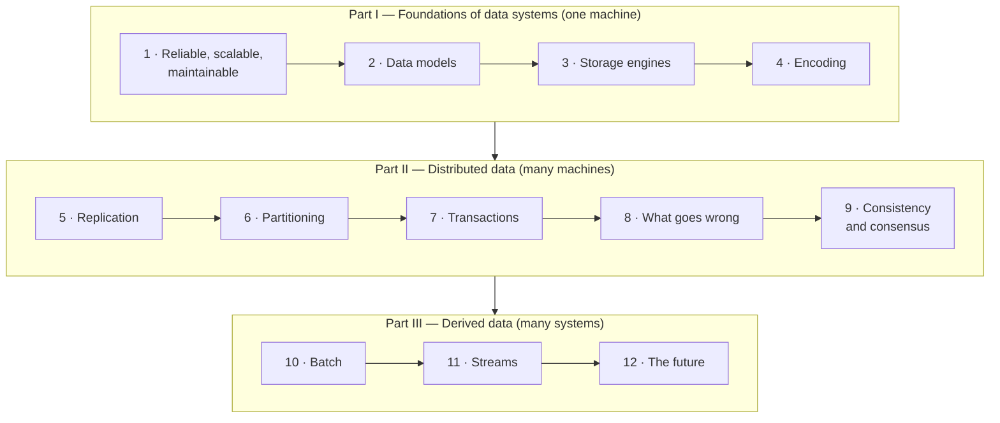

# Designing Data-Intensive Applications — Distilled

> Martin Kleppmann, *Designing Data-Intensive Applications* (O'Reilly, 2017),
> rewritten as a short book: every chapter's core ideas, in order, with
> diagrams, for an engineer who builds backends and wants to know what their
> databases, queues and caches are really promising.

## What this is

The original covers 12 chapters in three parts, from how a single database
lays out bytes on disk to how a whole organization's data flows between
systems. This is the same 12 chapters in the same order, at a fraction of the
length. It keeps the mechanisms, the trade-offs, the numbers that make them
concrete, and the book's vocabulary. It drops most code listings, worked
examples and the very extensive references, which are a big part of the
original's value.

It's a **distillation written in our own words**, not a copy. No passage of
the book is reproduced. The source was read chapter by chapter to check that
the definitions, lists, figures and attributions here are the author's. Terms
the book made common at work (write skew, fencing token, sloppy quorum,
derived data, unbundling the database) are kept as they are.

**Buy the book.** Its strength is the depth behind each claim: the diagrams of
race conditions, the hundreds of cited papers, and the careful hedging this
summary often compresses into one sentence.

## Who it is for

Someone who ships services against a database and a queue and has started
asking the questions the book answers:

- why a replica showed a user stale data;
- why a "transactional" database still double-booked a room;
- why the search index disagrees with the database;
- what "exactly once" actually means.

You should know SQL and HTTP. You don't need distributed-systems theory: the
book, and this summary, build it from scratch.

## Which edition, and what has changed since

This is the **1st edition (2017)**. Its principles have aged very well. Its
examples are of their time: Hadoop MapReduce, ZooKeeper everywhere, Riak and
Voldemort, SOAP still worth a paragraph. Where something has moved on, each
chapter ends with a short **"Since this edition"** note: Kafka's KRaft and
transactions, Raft's dominance, distributed SQL, GDPR, the outbox pattern,
lakehouses. Those notes are **our additions, not the book's**. A **second
edition**, co-written with Chris Riccomini, reworks the book for cloud-native
systems.

## The book's single idea

> There is no single right tool for data. Every storage engine, replication
> scheme, isolation level and processing model is a trade-off that is right in
> some circumstances. Once you can name the trade-offs, you can combine
> specialized systems safely, by deciding which one is the source of truth and
> deriving everything else from it.

## The shape of it

| | What it answers |
| --- | --- |
| [Part I — Foundations of data systems](./1-foundations/README.md) | What do reliable, scalable and maintainable actually mean? How do databases model, store and encode data? |
| [Part II — Distributed data](./2-distributed-data/README.md) | What happens when data lives on many machines: copies, shards, transactions, faults, and agreement? |
| [Part III — Derived data](./3-derived-data/README.md) | How do you keep many specialized systems in sync, with batch, streams and logs, and do it correctly and ethically? |

## How to read it

Straight through takes a few evenings, and later chapters lean on earlier
ones. If you have one hour, read these four, which change how you design
everyday systems the most:

1. [Transactions](./2-distributed-data/03-transactions.md): isolation levels and write skew.
2. [Replication](./2-distributed-data/01-replication.md): replication lag and what users actually see.
3. [Stream processing](./3-derived-data/02-stream-processing.md): CDC, event sourcing, and why dual writes break.
4. [The future of data systems](./3-derived-data/03-future-of-data-systems.md): end-to-end request IDs, and timeliness versus integrity.

## Where it sits in this knowledge base

- [System Design](../system-design/README.md): the building blocks (caching,
  queues, sharding, replication, CAP) as reference docs and case studies.
- [Distributed Systems](../distributed-systems/README.md): quorums, logical
  clocks, 2PC and Raft in more depth, with labs.
- [Computer Systems: A Programmer's Perspective — Distilled](../book-csapp/README.md):
  the single-machine layer underneath. Caches, virtual memory, `fsync` and
  sockets are what chapter 3's storage engines are built on.
