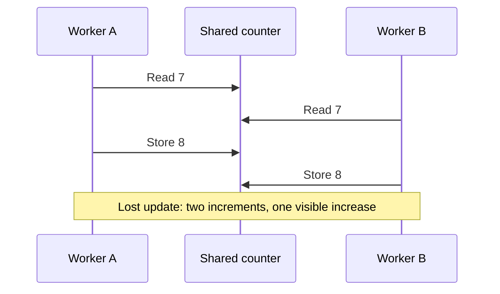

# The operating system makes promises

> A process, a pointer and a file look simple because the operating system hides the machinery. Learn the machinery to understand where those promises stop.

Source: chapters 1–2, *A Dialogue on the Book* and *Introduction to Operating Systems*, supplied PDF pages 22–41.

## Start with a running program

A processor fetches instructions, interprets them and executes their operations. A program reads and changes memory, branches and requests input or output. That description leaves out the hardest part: other programs want the same machine, some requests take much longer than an instruction, and a badly behaved program must not take everything down with it.

The **operating system**, or OS, manages those shared resources and exposes interfaces that are easier to use than the underlying hardware. You request a file by its name rather than calculating which disk sectors contain its bytes. You run a program without negotiating ownership of a processor with every other program.

The central technique is **virtualization**: present a usable abstraction of a physical resource, then implement it using the real shared resource. An abstraction does not remove scarcity. It changes where scarcity is managed. A service can have many worker processes while still being limited by its processor time and physical memory.

A **mechanism** supplies an ability; a **policy** chooses how to use it. Saving a process's registers and restoring another's is a mechanism. Selecting which ready process should run next is a scheduling policy. Keeping those questions separate makes it possible to change the scheduling goal without rebuilding the context-switch machinery.

## Virtualize the CPU

Imagine a command-line indexer and an interactive editor on a machine with one processor. Both can make progress because the OS runs one, saves its execution state, and runs the other. The indexer sees a continuing instruction stream even though its execution was interrupted. The editor benefits from getting processor time before the indexer finishes.

This is **time sharing**, not the creation of additional computing capacity. More runnable work means each program may wait longer. Switches themselves have a cost. Later chapters explain how hardware lets applications execute directly while preserving the OS's ability to regain control.

The decision about who runs next depends on the goal. A scheduler that minimizes average completion time is not automatically best for interactive response or predictable resource shares. A performance question is incomplete until it names its metric and workload.

## Virtualize memory

Each process uses a **virtual address space**. The hardware and OS translate its addresses into physical memory locations and enforce access permissions. A pointer is meaningful within that mapping; its numeric value alone does not identify a universally accessible RAM location.

For example, two isolated processes may both have a valid virtual address `0x4000`, yet store different values there because their mappings lead to different physical locations. Equal pointer values do not imply shared storage. Conversely, explicitly shared mappings can intentionally refer to the same physical memory.

The source demonstrates matching addresses across executions with address randomization disabled. That is a teaching setup, not a guarantee about pointer values in ordinary runs. The important result is isolation, not the appearance of identical addresses.

Memory virtualization also has costs: translation data occupies space, lookup work takes time, and a process may need data that is not currently resident in RAM. An address-space abstraction cannot make storage access as fast as a processor register.

## Coordinate concurrent work

A **thread** is an execution stream inside a process. Threads can share the same data, which makes cooperation cheap and incorrect interleavings possible. The problem exists even on one processor: a switch can happen between the steps of an operation.

Suppose a shared counter starts at seven. Two workers each intend to increment it once. In a simplified machine trace, both read seven, both compute eight, and both store eight. The intended final value is nine; the trace ends at eight. One source-level increment was not one indivisible machine operation.

That trace explains the conceptual bug; it is not a promise about the outcomes of unsynchronized C code. Modern C treats conflicting non-atomic accesses without synchronization as a data race and undefined behavior. `volatile` does not make a counter safe. Later chapters use locks, atomic operations and waiting protocols to establish the required coordination.

This clarification follows the [C11 committee draft, §5.1.2.4 and §6.7.3](https://www.open-std.org/jtc1/sc22/wg14/www/docs/n1570.pdf), rather than treating the source's instruction trace as a complete language-level model.

Concurrency involves both exclusive access and ordering. A parent may need to wait until a worker finishes; a consumer may need to sleep until a producer makes an item available. Correctness requires a protocol around shared state, not merely a hope that the scheduler usually runs things in the right order.

## Keep information across failures

**Persistence** means keeping information beyond the lifetime of a process or the loss of volatile memory. A file system supplies named files and directories above persistent devices. Unlike private process memory, files commonly form a shared namespace: one program writes a source file, another compiles it, and another executes the resulting program.

The familiar `open`, `write` and `close` operations hide allocation decisions, metadata changes and device requests. They do not eliminate those steps. A file's contents and the structures describing where those contents live must remain compatible after a crash.

For speed, a file system can buffer writes and combine them. That creates a gap between an operation completing for an application and its effects becoming durable on the device. A crash during a multi-block update introduces another problem: some changes may reach storage while others do not. Journaling and other recovery protocols constrain that gap; applications must still understand the durability guarantees of their interfaces.

## Choose the costs consciously

The source's design goals include useful abstractions, low time and space overhead, protection between programs and the OS, and reliability. Energy use, security and mobility can change the trade-offs for particular devices.

**Isolation** contains mistakes as well as attacks. If an editor corrupts its own heap, other processes should not lose their private memory. The privileged OS has a wider failure radius: many applications depend on it at once. Simplicity matters because a complex mechanism can become difficult to verify and recover.

There is no cost-free optimum. Aggressive batching can improve throughput while delaying durable completion. Frequent switches can help responsiveness while increasing overhead. Protecting memory requires hardware checks and OS-managed mappings. Evaluate the abstraction together with its resource costs and failure boundary.

## How these promises developed

Early systems offered reusable routines and ran batches under an operator's control. Once multiple programs shared a machine, an ordinary library call was not enough to protect devices and memory. **System calls** supplied controlled entry into privileged OS code; user-mode execution restricted what application instructions could do directly.

Multiprogramming improved utilization by running another job while one waited for I/O. That also made memory protection and safe handling of interrupts essential. UNIX combined a small C-based kernel with composable programs and pipes, making systems both useful and approachable to developers. Its descendants and related systems carried those ideas forward.

The source describes early personal-computer systems that lacked protection or depended on cooperative scheduling, then their adoption of older, stronger OS ideas. The lesson is not that newer hardware automatically means better system design. A forgotten isolation or preemption mechanism can recreate an old failure on a faster computer.

This book concentrates on CPU and memory virtualization, concurrency and persistence, with a short distributed-systems extension. It is not a comprehensive networking, graphics or security text. Use the [Operating Systems reference](../operating-systems/README.md) and [Computer Networks reference](../computer-networks/README.md) for adjacent subjects.

## What to take away

- Identify the abstraction, its implementation mechanism and its policy separately.
- Treat a pointer as an address within a process mapping, not a physical-memory identifier.
- Coordinate shared state explicitly; a source-level operation need not be atomic.
- Ask when a storage operation becomes durable, not just when it returns.
- Learn by running small programs and investigating their behavior; the source's exercises develop that skill.

---

Previous: [Book overview](./README.md) · Next: [Virtualizing the CPU](./1-cpu/README.md)
