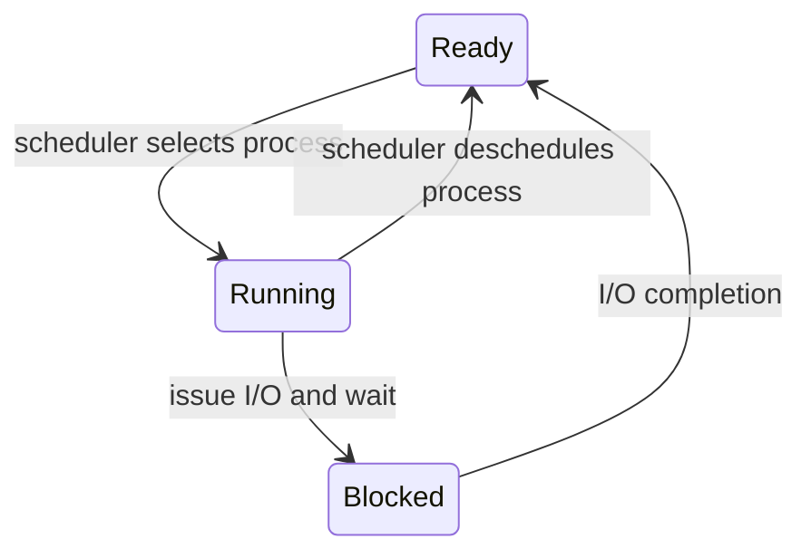

# A process is a program in motion

> CPU virtualization begins with something the kernel can stop, remember, and resume. A process is that unit of execution, not merely an executable file.

Source: Chapter 4, “The Abstraction: The Process,” PDF pp. 46–57; opening perspective from Chapter 3, “A Dialogue on Virtualization,” pp. 44–45.

## One processor, many apparent processors

An executable on disk contains instructions and initial data; a **process** is a running instance of that program. Two launches of the same editor produce two processes, each with its own execution state. The operating system makes a limited number of physical CPUs appear available to many such instances by **time sharing**: run one process, stop it, run another, and repeat.

The illusion is useful, but not free capacity. If several processes all need continuous computation, sharing slows their progress. If some are waiting for input or storage, their unused CPU time can serve others. This is the practical point of the opening virtualization dialogue: users need not manage the physical processor themselves, but the resource underneath remains finite. **Space sharing** is the counterpart: dividing a resource into portions, as when disk blocks belong to different files.

Two different responsibilities make this work. A **mechanism** answers how an operation happens, such as saving registers during a context switch. A **policy** answers which choice to make, such as selecting the next process. Keeping them separate allows a scheduling policy to change without redesigning the machinery that pauses execution.

## Inventory the machine state

To resume a process correctly, the kernel must preserve everything that matters to its execution. Its **address space** includes the instructions and data it can address. Its registers hold intermediate values; the **program counter** identifies the next instruction, while stack and frame pointers locate function-call state. Its I/O state includes resources such as open files.

For example, pause a file-conversion tool halfway through a loop. Remembering only the executable name cannot restore it: the kernel also needs its current loop state, memory contents, next instruction, and file resources. The executable describes what it can do; process state describes where this particular execution has reached.

## Expose a lifecycle API

An operating system needs interfaces for more than launching programs. Its process API must support creation, forced destruction, waiting for completion, miscellaneous controls such as suspension and resumption, and status queries. These operations let a shell start a converter, wait for its result, inspect its resource use, or stop it if it runs away.

Waiting and destruction solve different problems. Waiting coordinates with completion; destruction forces execution to end. Status is observational rather than a guarantee about what will happen next: a process reported as ready might be scheduled or blocked again before another process inspects it.

## Turn an executable into execution

Creation first arranges code and static data in the new address space. A simple loader copies everything eagerly; a modern system can load pieces lazily when execution needs them. Lazy loading avoids doing all loading work up front, but relies on memory-management mechanisms explained later.

The kernel also creates a stack for local variables, parameters, and return addresses, and initializes program arguments. It prepares a heap for dynamically allocated data and sets up I/O resources. UNIX conventionally supplies standard input, standard output, and standard error. Finally, control transfers to the program's entry path. The book describes this at the level of entering `main()`; the protected transfer mechanism comes in Chapter 6.

## Distinguish waiting from competing

A simplified process model has three states. **Running** means executing on a CPU. **Ready** means able to execute but not selected. **Blocked** means unable to execute until an event, commonly I/O completion, occurs.

This distinction explains why an idle-looking application need not be suffering CPU starvation. A process blocked on a disk cannot use a faster scheduling decision to complete that disk request. Meanwhile the kernel can run a ready process, overlapping CPU work with I/O. Completion moves the blocked process back to ready; it does not necessarily make it run immediately.

## Keep records beyond the running instant

The kernel maintains process records and collections of ready and blocked processes. A **process control block**, or PCB, holds information such as identity, state, saved register context, memory, parent, and open resources. Saving and restoring the register context lets execution continue rather than restart.

Real kernels have additional lifecycle states. A process under construction is not yet runnable. An exited UNIX child may remain a **zombie** until its parent collects its completion information with a waiting call. It is no longer doing work; the retained record communicates its exit status and permits final cleanup. See [process lifecycle](../../operating-systems/1-knowledge/processes-scheduling/process-lifecycle.md) for the broader operational view.

## What to take away

- Separate an executable's bytes from a process's live memory, registers, and resources.
- Diagnose ready and blocked processes differently: CPU competition and event waiting are not the same delay.
- Treat time sharing as allocation of finite capacity, not creation of extra computing power.
- Keep execution mechanisms separate from the policies that choose their use.
- Collect child completion information instead of leaving exited process records unclaimed.

---

Previous: [CPU virtualization](README.md) · Next: [The UNIX process API](05-process-api.md)
