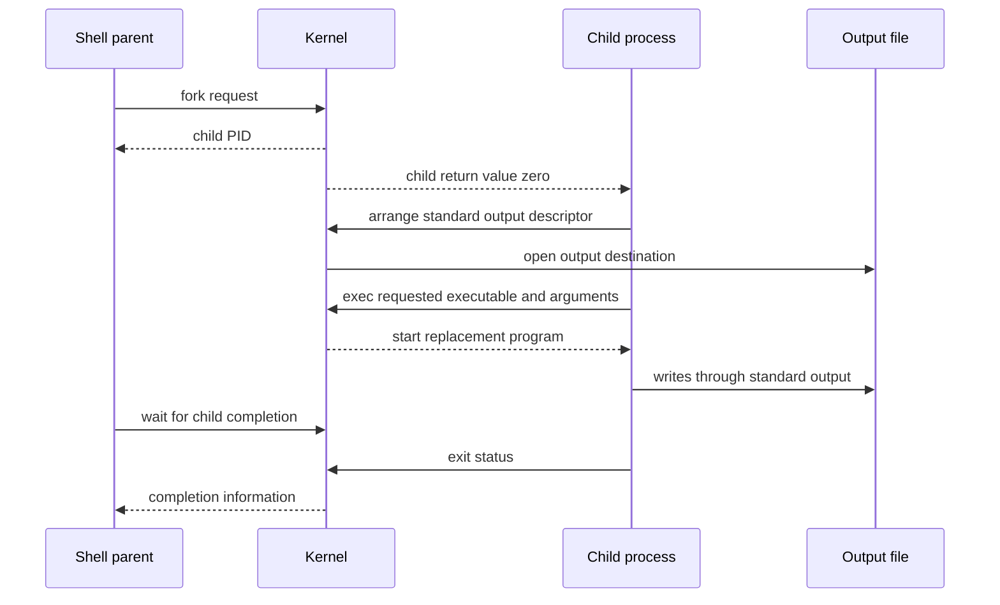

# The UNIX process API separates creation from execution

> `fork()`, `exec()`, and `wait()` form a small vocabulary for launching and coordinating programs. Their separation is what lets a shell compose programs without changing them.

Source: Chapter 5, “Interlude: Process API,” PDF pp. 58–68.

## Fork continues one execution in two processes

A process has a **process identifier**, or PID, which other interfaces use to refer to it. Calling `fork()` creates a child that is nearly a copy of the calling parent. The child does not start again at `main()`: both processes continue from the fork operation, with their own address spaces and execution state.

The return value tells them apart. The parent receives the child's PID, the child receives zero, and a negative result indicates failure to create the child. A launcher can therefore branch into parent-side supervision and child-side preparation immediately after one call.

For example, suppose a process sets a variable to 7 before forking. Both executions initially see 7, but later changes to their private variables are independent. Do not confuse this memory separation with separation of every inherited resource: the source's exercises explicitly ask readers to investigate an open file descriptor inherited across a fork.

After creation, scheduling determines which process runs next. A parent message following `fork()` need not precede the child's message merely because the parent existed first. The code supplies two possible executions, not an ordering rule. Even a single CPU can interleave them in either order.

## Wait expresses a real dependency

`wait()` lets a parent wait for a child's completion; `waitpid()` offers more control over which child it waits for. The parent can obtain completion information and allow the kernel to reclaim the child's retained exit record.

Imagine launching a data-generation worker and then announcing that its output is ready. Printing the announcement after `fork()` is insufficient: the child may not have run. Putting the announcement after a successful wait for that child establishes the necessary completion dependency. If the child finishes before the parent starts waiting, the completion can still be collected.

The book's small examples omit many error paths. Its own footnote warns against reading them as unconditional guarantees: waiting calls have documented return values and error conditions. The engineering lesson is to rely on a successfully established synchronization operation, not a lucky observed output order. A delay is not a substitute for waiting.

## Exec replaces the program, not the process

The `exec()` family loads a different executable into the calling process. Its code and static data replace the old program's; its heap and stack are reinitialized for the new execution. Arguments describe what the new program should do. This operation does **not** create another process: the child created by `fork()` becomes the requested program.

A successful exec never returns to the old callsite. If a launcher reaches the next statement, it must handle failure rather than assume the new executable finished. The variants differ in how arguments, executable lookup, and environment information are supplied; they implement the same basic replacement operation. The source contains an inconsistent enumeration of variants, so the important contract here is replacement and non-return on success, not a memorized count.

## The gap between fork and exec is useful

A shell is an ordinary user program. For a foreground command, it reads the command, forks a child, has the child exec the requested program, and waits for completion before displaying another prompt. Between fork and exec, the child can prepare its environment without altering the parent shell's execution.

For example, a report utility can always write to standard output. A shell redirects that output by changing the child's descriptor setup before exec, so the same utility can write to a terminal or a file without knowing which one it received. The source's minimal method closes standard output and opens a file: UNIX assigns the lowest available descriptor, making the newly opened destination take the vacated slot. This depends on the stated descriptor conditions and successful calls; it is not permission to ignore errors.

A **pipe** extends composition to two processes. The producer's output and the consumer's input connect to an in-kernel queue. A formatter can feed a compressor without either program implementing the other's job. The queue and descriptors provide communication; fork and exec provide separate executions. See [IPC](../../operating-systems/1-knowledge/processes-scheduling/ipc.md) for related communication mechanisms.

## Control and observe the result

`kill()` sends a signal; its name does not mean every use terminates the target. Signals provide external events and process-control actions. `ps` shows process information, while `top` offers a changing resource-use view. These complement the API: observation explains what launched processes are doing, while control changes their behavior.

Read the manual pages for the calls actually used, especially return values and failure conditions. The chapter's central design lesson is not that small examples are production launchers, but that a few well-separated operations support powerful composition.

## What to take away

- Branch on all fork outcomes, including failure; do not assume parent-first scheduling.
- Use completion synchronization rather than sleeps to order dependent work.
- Treat successful exec as replacement with no return to the old program.
- Configure the child's descriptors before exec to compose unchanged programs.
- Distinguish signals that request control actions from process observation tools.

---

Previous: [A process](04-process.md) · Next: [Limited direct execution](06-limited-direct-execution.md)
