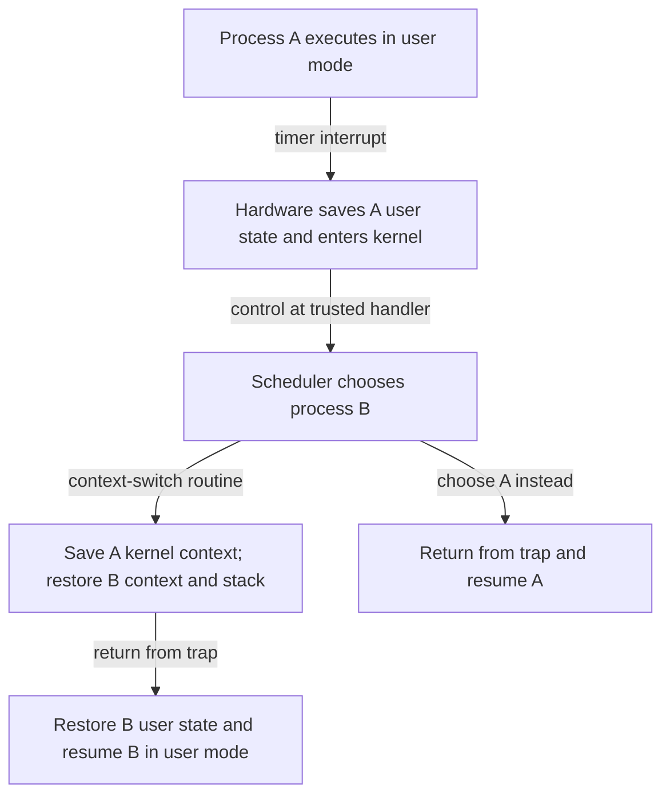

# Limited direct execution keeps the kernel in charge

> Programs should run at hardware speed without acquiring ownership of the machine. Protected entry paths and timer interrupts reconcile performance with control.

Source: Chapter 6, “Mechanism: Limited Direct Execution,” PDF pp. 69–82; resource-management perspective from Chapter 11, “Summary Dialogue on CPU Virtualization,” pp. 128–129.

## Direct execution needs limits

Interpreting every application instruction would put the operating system on the hot path of all computation. **Direct execution** instead runs application instructions on the CPU itself. The kernel creates the process, prepares memory and arguments, and transfers control to its execution.

Unrestricted direct execution has two problems. A process could access resources without permission, and it could keep the CPU indefinitely. **Limited direct execution**, or LDE, preserves the fast path while arranging hardware boundaries that the application cannot remove. The kernel need not supervise every arithmetic operation; it must supervise actions that affect protection and resource ownership.

## Privilege separates computation from authority

Hardware distinguishes **user mode**, where applications run with restrictions, from **kernel mode**, where the operating system can execute privileged operations. Direct disk access is a useful example: letting an application read arbitrary disk blocks would bypass a file system's permission checks. A protected system therefore requires the application to ask the kernel for a file operation instead.

A **system call** is that controlled request. A library wrapper places the call number and arguments in locations agreed with the kernel and performs a special trap instruction. The trap transfers control to kernel code and changes privilege. The kernel checks the request, performs permitted work, and uses a return-from-trap operation to resume user execution with reduced privilege.

This explains why `read()` looks like an ordinary C function call even though it can enter the kernel. The wrapper is a function; the protected transfer inside it is not an ordinary jump. Hardware and software also preserve enough caller state to resume correctly. The chapter's x86 example uses a per-process kernel stack; exact saved registers and entry conventions depend on the architecture.

## The application cannot choose an arbitrary kernel entry

A trap must not let its caller pick any privileged instruction address. Otherwise a process could jump into file-access code after the permission check. At boot, the kernel establishes a **trap table** identifying trusted handlers for system calls, device interrupts, and exceptions. Configuring that table is itself privileged.

A call number selects a service through a controlled entry path; it does not grant a caller arbitrary kernel control flow. The kernel can also arrange a new process's initial saved state and use a protected return to start it in user mode. On normal program termination, runtime code invokes an exit operation that transfers control back to the kernel for cleanup.

## Regain control without cooperation

A **cooperative** system depends on applications entering the kernel through system calls, explicit yielding, or faults. This can work while applications behave, but a computation stuck in a loop may never hand control back. The historical cooperative systems discussed in the chapter could require rebooting in that situation.

A **timer interrupt** removes that dependency. The kernel installs the timer's handler and starts the timer using privileged operations. When it fires, hardware interrupts the running process, preserves the necessary state, and enters the kernel. An application cannot defeat this arrangement merely by avoiding system calls. The interrupt gives the kernel a chance to schedule; it does not require changing the selected process every time.

## A context switch changes whose execution resumes

Once in the kernel, the scheduler decides whether to continue the current process or choose another. A **context switch** implements the latter choice by saving the current kernel execution context, restoring another process's context, and switching to its kernel stack. The eventual return-from-trap then restores that process's user execution rather than the interrupted one's.

There are two distinct state-preservation steps here: the hardware-assisted entry from user execution and the software switch between kernel contexts. Confusing them hides how a handler entered on behalf of one process can return on behalf of another. See [context switching](../../operating-systems/1-knowledge/processes-scheduling/context-switching.md) for the broader cost model.

## Protect the kernel's own execution too

An interrupt can arrive during a system call or another handler. The kernel therefore has concurrency problems of its own. Temporarily disabling interrupts can protect some local execution, but long disabled periods damage interrupt handling. Locks protect shared kernel data, particularly with multiple processors; their correctness and performance require the concurrency techniques covered later.

System-call and context-switch costs should be measured, not borrowed from the book's historical processor timings. Repeated operations help amortize timer measurement limits. A pipe-based ping-pong between two processes on the same CPU can expose switching costs, but includes communication work as well. Without same-CPU placement, the measurement may involve parallel execution rather than the intended stop-and-resume sequence.

The closing dialogue's lesson is defensive resource management: efficient application execution is compatible with distrust of buggy or malicious behavior, provided protection is established before the kernel gives up the CPU. Hands-on tracing of entry, saving, switching, and return makes that contract more concrete than memorizing instruction names.

## What to take away

- Keep normal application computation direct, but mediate privileged resource operations.
- Distinguish a trusted trap entry from an unrestricted jump into kernel code.
- Use hardware preemption to retain control over processes that never yield.
- Separate trap-state preservation from the context switch that selects whose state resumes.
- Measure switching on the intended CPU arrangement and include indirect overheads in interpretation.

---

Previous: [The UNIX process API](05-process-api.md) · Next: [Scheduling objectives](07-scheduling.md)
