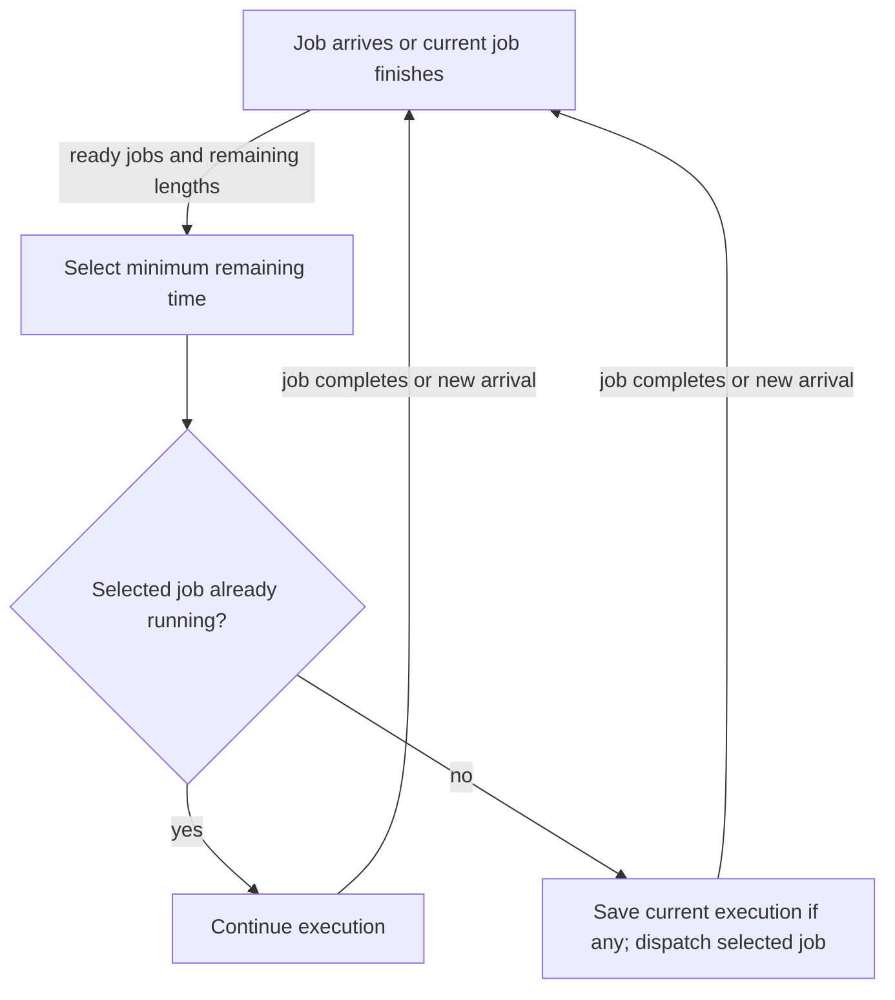

# Scheduling starts with the objective and the workload

> A scheduler cannot be judged independently of what its jobs do and which delay matters. Shortest-job policies and time slicing solve different problems.

Source: Chapter 7, “Scheduling: Introduction,” PDF pp. 83–94; pragmatic policy perspective from Chapter 11, “Summary Dialogue on CPU Virtualization,” pp. 128–129.

## Make assumptions visible

The scheduler is the policy that selects a ready process; context switching is the mechanism that carries out its choice. To compare policies, begin with a workload model. The chapter initially assumes equal job lengths, simultaneous arrival, execution to completion once started, CPU-only work, and known run times. It then removes these assumptions in order.

These are teaching assumptions, not descriptions of a general-purpose computer. In particular, knowing how long every job will run gives the scheduler information it normally cannot possess. A policy that wins under that assumption may be unusable without a prediction mechanism.

Define the metric before ranking policies. **Turnaround time** is completion time minus arrival time: how long the whole job takes from submission to finish. **Fairness** concerns allocation among competing jobs. Improving the average completion delay may entail giving unequal service, so fairness and performance can conflict.

## FIFO is simple until lengths differ

**First In, First Out**, or FIFO, also called **First Come, First Served**, runs jobs in arrival order. With equal-length jobs arriving together, it is a simple reasonable baseline. Once lengths differ, short jobs can queue behind a long one: the **convoy effect**.

Consider an original example with three simultaneous jobs requiring 24, 3, and 3 time units. If FIFO places the long job first, completion times are 24, 27, and 30; average turnaround is 27. The two small requests spend most of their lifetime waiting for unrelated work. No amount of optimization inside those small requests removes the queueing cause.

## SJF favors short completion paths

**Shortest Job First**, or SJF, runs the shortest available job to completion, then selects another. For the example above, short-first completion times are 3, 6, and 30, giving average turnaround 13. SJF minimizes average turnaround under the chapter's simultaneous-arrival, known-length assumptions.

It is non-preemptive. Suppose a long job has already started when a short one arrives. SJF does not stop the running job, so the new short request can still suffer a convoy. Knowing a better choice is not enough when the policy forbids acting on it until completion.

## STCF revisits the choice on arrival

**Shortest Time-to-Completion First**, or STCF, also called preemptive SJF, chooses the ready job with the smallest remaining execution time. A newly arrived short request can preempt a long-running one; the long one resumes later.

This improves turnaround under the relaxed arrival model while retaining knowledge of job lengths. It does not guarantee every ready job an early start. A job can remain behind others even though a user is waiting for its first visible progress.

## Response time changes the answer

The chapter defines **response time** as first scheduled time minus arrival time. This is a scheduling metric, not the complete response latency of a network request or a graphical action. It focuses on when a job first gets CPU service.

**Round Robin**, or RR, runs each ready job for a **time slice**, also called a **quantum**, then rotates to the next. Three equal jobs given a one-unit quantum can begin at times 0, 1, and 2 rather than waiting for predecessors to finish. Equal short-term sharing improves initial service, but spreads completion out: each job waits while others take their turns.

The quantum is a trade-off. Short quanta reduce waiting for a turn but incur switches more frequently. Long quanta amortize switching but approach FIFO-like response behavior. Costs include not only register operations but disruption of useful cache, translation, and prediction state. The source models quanta as multiples of its periodic timer interval; this is a model of the mechanism, not a universal rule for every timer implementation.

## I/O creates another scheduling boundary

A running job that requests blocking I/O cannot use the CPU until completion. Schedule another ready job during the wait, then decide how to treat the returning job when the device interrupt makes it ready again.

For example, a parser may alternate brief computation with storage reads while a batch calculation uses uninterrupted CPU time. Treating each parser CPU burst as a short scheduling unit can run the parser promptly, then use its I/O wait for batch work. This **overlap** keeps independent resources busy. Treating the parser's entire lifetime as one uninterrupted CPU demand misses the opportunity.

## The missing oracle remains

Real kernels usually do not know future burst lengths. The next chapter uses observed behavior to approximate short-job preference while retaining responsiveness. Neither prediction nor a different metric abolishes trade-offs. The closing CPU dialogue recommends pragmatic policy design rather than searching for a universally best scheduler: choose which failures must be avoided and judge against that workload.

See [CPU scheduling](../../operating-systems/1-knowledge/processes-scheduling/cpu-scheduling.md) for related operational concepts.

## What to take away

- State arrivals, burst lengths, I/O behavior, and available information before comparing schedulers.
- Separate turnaround from first-service response time; improving one can worsen the other.
- Recognize convoys as queueing problems, not slow execution of the waiting jobs.
- Tune round-robin quanta against both switch overhead and acceptable waiting time.
- Exploit blocked intervals to overlap CPU work with I/O instead of leaving the CPU idle.

---

Previous: [Limited direct execution](06-limited-direct-execution.md) · Next: [Multi-level feedback queues](08-mlfq.md)
