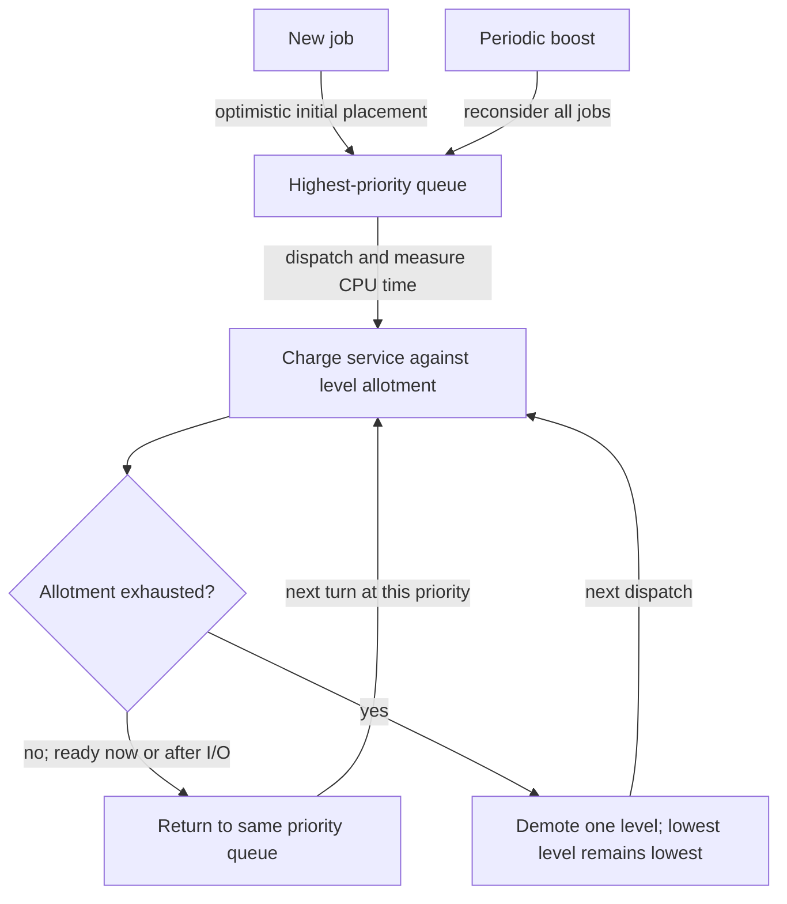

# Multi-level feedback queues learn from CPU use

> MLFQ gives a new job the benefit of the doubt, then revises its priority from observed execution. Good accounting and periodic reconsideration make that prediction usable.

Source: Chapter 8, “Scheduling: The Multi-Level Feedback Queue,” PDF pp. 95–106; scheduler-gaming and policy trade-off perspective from Chapter 11, pp. 128–129.

## Predict rather than demand future knowledge

**Multi-Level Feedback Queue**, or MLFQ, aims for short-job-like turnaround and interactive responsiveness without knowing job lengths. It maintains several ready queues with different priorities. A ready job belongs to one queue; higher-priority jobs run before lower-priority jobs, and jobs of equal priority share service with round robin.

The feedback is observed CPU behavior. Brief computation followed by waiting often indicates interactive work; sustained CPU use suggests a long-running computation. The scheduler adjusts priority rather than assigning each job a fixed lifelong rank. This is a prediction, not a statement about the program's intrinsic importance. A process can change phases, and behavior that looked informative can mislead the policy.

## The first attempt discovers long jobs

Initially place every new job in the highest queue. In the first version, consuming a whole time slice demotes it, while yielding before the slice ends preserves its priority.

Imagine a background renderer arriving alongside a quick configuration check. Both start high. The check may finish after a little CPU time; the renderer keeps consuming slices and descends through the queues. A newly arriving short task can then run ahead of the renderer. This approximates shortest-job preference by testing an optimistic assumption: perhaps the new job will finish soon.

An I/O-heavy task often gives up the CPU early, retaining high priority in this initial design. A terminal application can therefore handle input promptly while a background calculation runs during its waits. High priority does not mean the application consumes much total CPU; it means that when ready, it is considered first.

## Three failures expose the weakness

First, enough high-priority work can consume all service, causing **starvation** of lower queues. Second, a CPU-heavy process can **game the scheduler** by issuing an unnecessary I/O just before each slice expires. If yielding erases its history, it repeatedly appears interactive and stays high. Third, a process demoted during a computation phase may later become interactive, but the policy has no way to recognize that change.

These are not cosmetic problems. They reveal that an inference mechanism must account for adversarial behavior and stale evidence, not just representative examples. The closing CPU dialogue highlights gaming precisely because a resource manager's allocation rules can influence how applications choose to behave.

## Boost priorities to revisit stale conclusions

Periodically move all jobs back to the top queue. This **priority boost** lets long-running jobs compete with other high-priority jobs again, and gives a formerly CPU-bound process a chance to demonstrate a new interactive phase.

The boost period, usually denoted S in the chapter, is a policy parameter. A very long period leaves jobs waiting too long and adapts slowly to phase changes. A very short period repeatedly puts CPU-heavy work beside interactive tasks, weakening the intended preference. Boosting provides opportunities for progress under the model; it does not create unlimited service or eliminate overload.

## Count cumulative service, not uninterrupted slices

Replace the initial yielding rule with cumulative accounting. Each queue level gives a job a CPU-time **allotment**. Once the job consumes that allotment, demote it regardless of how many times it yielded along the way. A quantum determines one turn; an allotment determines how much total service a job receives before changing level.

For an original example, suppose a level allows 12 units of CPU use. A job that runs four times for 3 units has spent the same budget as one that runs once for 12. Waiting between bursts must not reset that total. This removes the specific attack in which a nearly full slice followed by a trivial I/O buys permanent high priority.

The complete model therefore has five rules: prefer higher priorities; round-robin within a priority; start new jobs at the top; demote after cumulative allotment exhaustion; periodically boost all jobs. The old rule about forgetting service on yielding is obsolete, not an additional option in this corrected policy.

## Tune the model to actual workloads

Queue count, per-level quantum and allotment, and boost period all matter. Short high-priority quanta favor quick turns among interactive work. Longer low-priority quanta amortize switching for CPU-bound jobs. There is no workload-independent set of correct constants.

The chapter's Solaris time-sharing tables and older FreeBSD decay-usage formulas illustrate different implementations of the same general idea. Usage decay can weaken old evidence without a simultaneous global reset. These examples are historical implementations, not promises about today's kernels. Some schedulers reserve priorities for kernel work and accept user advice such as `nice`; advice influences decisions without replacing kernel control.

MLFQ is thus a useful combination of historical inference, time slicing, and explicit reconsideration. It should be evaluated with mixed workloads, phase changes, and attempts to exploit its accounting—not only a single long job descending neatly through queues.

## What to take away

- Separate one-turn quantum from cumulative per-level allotment.
- Preserve consumed service across voluntary yielding to prevent the chapter's gaming attack.
- Reconsider old classifications so CPU-bound phases do not permanently define a process.
- Test overload, phase changes, and starvation alongside interactive responsiveness.
- Treat historical scheduler parameters as examples, not universal tuning recommendations.

---

Previous: [Scheduling objectives](07-scheduling.md) · Next: [Proportional sharing](09-proportional-share.md)
