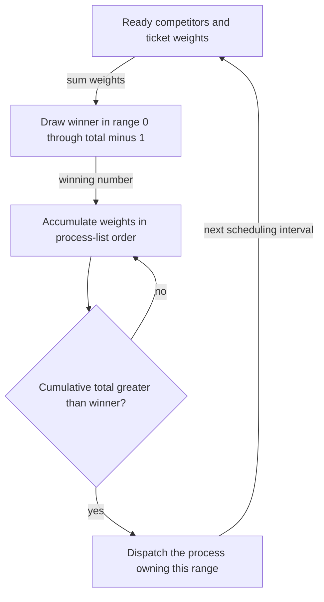

# Proportional sharing makes allocation explicit

> Instead of guessing which process deserves to finish first, a fair-share scheduler gives competitors assigned portions of the CPU. Lottery and stride scheduling implement that goal differently.

Source: Chapter 9, “Scheduling: Proportional Share,” PDF pp. 107–116.

## Tickets describe a share, not a completion promise

A **proportional-share**, or **fair-share**, scheduler targets an allocation of CPU service rather than minimizing turnaround or first-service delay. **Tickets** represent the relative shares. If two competing jobs hold 6 and 2 tickets, their intended allocations are three quarters and one quarter of the available service while both compete.

Tickets are weights, not reservations for particular moments. Adding another competitor changes the denominator. Nor does receiving a share guarantee completion by a deadline: the job's required computation and other waits remain relevant. Allocation policy and execution demand are separate pieces of the problem.

**Lottery scheduling** chooses the next process by drawing a random winning ticket each scheduling interval. Give each process a range of ticket numbers; the process owning the selected number runs. Repeated draws make long-run allocations tend toward the desired proportions, but a short sequence can be noticeably unequal. A process with tickets can lose several draws in a row.

Randomness keeps the mechanism simple and avoids maintaining a running service-history counter for every process. It does not eliminate bad individual outcomes. In this policy, proportionality is probabilistic rather than a deterministic guarantee for a finite window.

## Change ticket ownership carefully

The chapter develops three ticket mechanisms, each solving a different allocation problem.

**Ticket currency** lets a user divide its own assigned share in a local unit. Suppose two tenants each own 60 global tickets. One splits a local budget of 300 evenly between two jobs; each converts to 30 global tickets. The other's single job receives its entire local budget and converts to 60. Choosing larger local numbers cannot inflate the tenant's global share.

**Ticket transfer** temporarily gives another process the caller's tickets. A client waiting for a service can transfer its tickets to the server doing work on its behalf, then recover them after completion. This aligns allocation with the execution that is actually advancing the client's request.

**Ticket inflation** lets a process temporarily increase or decrease its tickets. It is useful only within an appropriate trust arrangement: arbitrary self-inflation among mutually distrusting competitors would let a greedy process claim most of the CPU. A lightweight mechanism does not supply the missing authorization policy.

## Implement the lottery with cumulative ranges

A simple implementation needs process ticket counts, their total, a process list, and a suitable random-number generator. Draw an integer from zero through total minus one, then walk the list accumulating ticket counts. The first cumulative total strictly greater than the winning number identifies the owner.

For example, weights 4, 1, and 3 correspond to cumulative boundaries 4, 5, and 8. A draw of 5 belongs to the third process, not the second: zero-based tickets make the second range contain only number 4. Endpoint mistakes bias the allocation or create an unowned result.

Putting large-ticket holders near the list's front can reduce average traversal work without changing probabilities. This is an efficiency choice, not a new fairness policy.

## Observe fairness over the right interval

The source compares equal-length, equal-ticket jobs using a completion ratio: earlier completion time divided by later completion time. It calls this an unfairness metric, though values closer to one indicate more similar completion times. Do not confuse this specific experiment with a universal measure of resource fairness.

Short jobs finish after relatively few draws, so random differences can dominate the result. Longer competitions give observed allocation more opportunity to approach the intended shares. A small observed sample therefore cannot establish that the ticket ratio was implemented incorrectly, but neither can a correct probability model justify claiming a strict short-window allocation guarantee.

## Stride replaces random draws with accounting

**Stride scheduling** is a deterministic alternative. Assign each job a stride inversely proportional to its tickets, using a common numerator. Maintain a **pass** value for each process. Select the lowest pass, run it, add its stride to its pass, and return it to the eligible collection.

Using weights 6 and 2 with numerator 60 gives strides 10 and 30. The higher-weight job advances its pass more slowly per turn and therefore receives more turns. The policy tracks progress relative to competitors rather than hoping random draws produce the ratio soon enough.

That precision adds state-management complications. If an arriving job starts with pass zero while established jobs have large pass values, it can monopolize service while catching up. Lottery scheduling needs to add its tickets to the total but has no per-process historical pass to initialize. The chapter identifies this trade-off without supplying a complete dynamic-arrival stride algorithm.

## Shares still need a policy

Neither mechanism answers how many tickets an arbitrary browser, editor, or background worker should receive. Assignment remains a policy problem, and interaction with I/O complicates general-purpose use. Explicitly managed environments, such as allocating host capacity among virtual machines, make shares easier to specify.

The chapter's adoption discussion belongs to its historical context. Its enduring lesson is the mechanism-policy separation: representing and enforcing weights does not decide what a fair entitlement should be.

## What to take away

- Specify whether proportionality is expected over time or required in a bounded window.
- Preserve global entitlement when offering local ticket currencies.
- Restrict self-inflation to trusted arrangements; weights are resource authority.
- Check random range endpoints and cumulative comparisons carefully.
- Account for arrivals when using stride; zero is not automatically a safe initial pass.

---

Previous: [Multi-level feedback queues](08-mlfq.md) · Next: [Multiprocessor scheduling](10-multiprocessor-scheduling.md)
