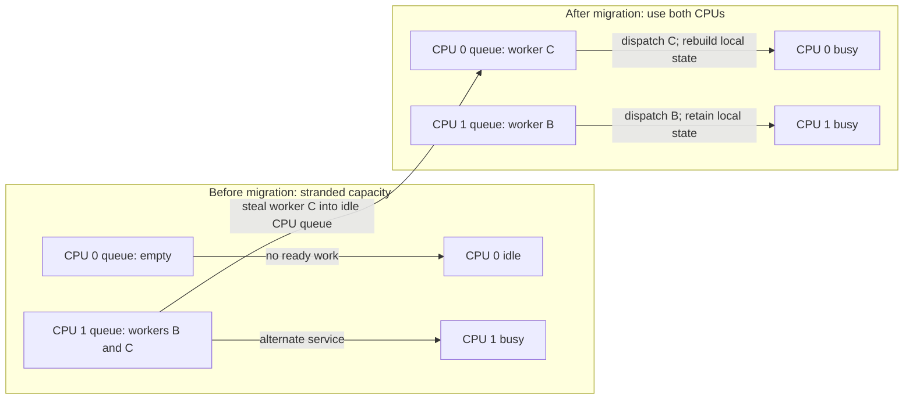

# Multiprocessor scheduling balances work against locality

> Multiple CPUs turn scheduling into a placement problem as well as an ordering problem. Shared queues, local queues, and migration trade coordination cost against useful cache state.

Source: Chapter 10, “Multiprocessor Scheduling (Advanced),” PDF pp. 117–127; closing policy perspective from Chapter 11, pp. 128–129.

## More cores do not parallelize a sequential program

A single execution that uses one CPU does not automatically become faster when the machine gains more cores. Parallel application work, often expressed through threads, is needed to use multiple processors simultaneously. The kernel must then decide not only which work runs next, but where it runs. This advanced chapter is easier to revisit after the concurrency part.

Placement interacts with hardware caches. A cache holds fast-access copies of memory data. **Temporal locality** means recently used data is likely to be reused; **spatial locality** means nearby addresses are likely to be used together. Repeatedly updating a loop variable benefits from the former; scanning adjacent array entries benefits from the latter.

## Coherence preserves shared data, not compound operations

With private caches on multiple CPUs, different processors can hold copies of the same location. If one processor modifies its cached copy, another must not later consume an obsolete value as though the write never happened. **Cache coherence** is the hardware problem of coordinating those copies.

The chapter sketches **bus snooping**: caches observe relevant traffic and invalidate or update their copies when another processor changes data. Write-back caches complicate the protocol because a dirty value need not already be in main memory. This is a conceptual overview, not a complete description of a modern coherence implementation.

Coherence does not make a multi-step software operation atomic. If two CPUs both read a queue's head before either advances it, both can claim the same item. A linked-list removal can even attempt to free the same node twice. The queue needs appropriate synchronization around its update, such as a lock; coherent memory alone does not protect its invariant.

Locks provide correctness but can serialize access. A scheduler that forces every processor through the same protected data structure may spend increasing time contending instead of dispatching work. The kernel is a concurrent program too, not an exception to these rules.

## Cache affinity values previous placement

A process leaves useful instructions, data, and address-translation information in the processor's caches and TLB. **Cache affinity** means preferring to resume it on the same CPU when beneficial. Migration remains correct on the coherent system described here, but the new processor may need to rebuild useful local state.

For example, repeatedly moving a worker that operates on a small hot data set can replace cheap cache reuse with repeated refills. Affinity is a performance preference, not a prohibition against migration. Leaving a processor idle while another has a large ready backlog can cost more than warming the worker's state elsewhere.

## One shared queue simplifies selection

**Single-queue multiprocessor scheduling**, or SQMS, keeps ready jobs in a common queue. Multiple processors select work from it, adapting a single-CPU scheduling policy to choose several simultaneous executions. A shared view makes distributing ready work straightforward.

Its weaknesses are coordination and affinity. Concurrent access needs synchronization, and a central lock becomes a bottleneck as contention grows. Naively selecting the next job can also bounce processes among CPUs. Affinity-aware selection can keep most jobs near previous placements while moving others, but that adds policy complexity to an initially simple queue.

## Local queues distribute coordination

**Multi-queue multiprocessor scheduling**, or MQMS, gives processors separate queues, commonly one per CPU. Arrival placement can choose a queue using a heuristic such as its apparent load. Each queue then schedules largely independently, reducing central contention and naturally preserving affinity.

The cost is **load imbalance**. If a four-core machine starts with one long job on each core, but three jobs soon finish, those cores become idle even if another local queue still contains several ready workers. A less extreme imbalance gives a solitary job much more service than jobs sharing another queue.

## Migration repairs imbalance at a cost

Move ready jobs between CPUs to redistribute service. One migration can fix an empty queue beside a queue with two workers. With three equal continuously ready jobs on two CPUs, however, a static placement necessarily gives one queue more jobs. Repeated migration can distribute that unequal opportunity over time rather than permanently favoring one worker.

**Work stealing** is one approach: a lightly loaded processor occasionally examines another queue and takes work when the difference warrants it. Looking too often reintroduces synchronization and cache overhead; looking too rarely leaves capacity stranded. Balancing frequency and migration thresholds are therefore workload-sensitive policy choices.

## Historical implementations show different priorities

The source contrasts Linux's historical O(1), CFS, and BFS schedulers. In that comparison, O(1) and CFS use multiple queues, while BFS uses one. O(1) emphasizes changing priorities and interactivity; CFS follows deterministic proportional sharing; BFS is described through a virtual-deadline proportional-share scheme. This is the supplied edition's historical comparison, not a claim about current Linux defaults or a complete specification of any algorithm.

The closing dialogue supplies the durable conclusion: competing objectives do not imply one universally correct scheduler. Evaluate scalability, locality, load distribution, and responsiveness together. A small policy change can produce a large workload-dependent effect. See [threads](../../operating-systems/1-knowledge/processes-scheduling/threads.md) before revisiting the concurrency requirements.

## What to take away

- Do not expect added cores to speed up an unchanged sequential execution.
- Protect shared queue operations; coherence is not mutual exclusion.
- Preserve useful placement when possible, but compare locality cost with idle-capacity cost.
- Measure contention for shared queues and imbalance for local queues separately.
- Tune migration and stealing against actual workloads rather than assuming aggressive balancing is free.

---

Previous: [Proportional sharing](09-proportional-share.md) · Next: [Memory virtualization](../2-memory/README.md)
