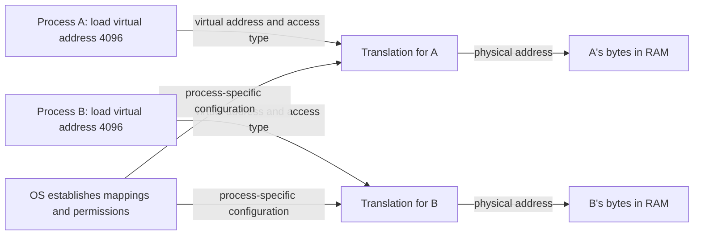

# Address spaces: a private view of shared memory

> Virtual memory gives each process a useful picture of memory without handing it control of the machine's physical RAM.

Source: Chapter 13, *The Abstraction: Address Spaces*, PDF pages 132–140; opening dialogue, Chapter 12, pages 130–131.

## From one program to many

An early computer could put its operating-system routines in one part of physical memory and let a single program use the remainder. There was little difference between the addresses a program generated and the machine's actual layout. This made memory management simple, but left an expensive processor idle whenever the program waited for input or output.

**Multiprogramming** keeps several processes available so another can run during an I/O wait. **Time sharing** adds frequent switches to make a shared machine interactive. Both create a memory problem: how can each process keep its state while other processes execute?

One possible answer is to write an entire process's memory to disk whenever switching away from it and reload the next process's memory. That preserves state but makes switching depend on moving large amounts of data. Saving processor registers is relatively cheap; repeatedly copying all of RAM to slow storage is not. Keeping several processes resident is the practical alternative.

For example, an editor can retain its document in memory while a compiler runs and a terminal waits for keystrokes. The CPU scheduler chooses which executes, but their memory must survive those choices. Once programs coexist, an accidental store from the compiler must not corrupt the editor or the kernel.

## The abstraction a process receives

An **address space** is a running program's view of memory: the locations containing its instructions and data. The chapter introduces three important regions:

- **Code** holds the program's instructions.
- **Stack** holds function-call state, local variables, and related information whose lifetime follows calls.
- **Heap** holds dynamically allocated objects whose lifetimes the application manages.

Static data also belongs to the address space; the three-region picture is a teaching model, not an exhaustive executable layout. A request handler might execute instructions in code, keep a temporary counter on its stack, and allocate a response buffer on the heap so another routine can retain it.

A conventional single-threaded layout puts code and heap near the low-address end and the stack near the high-address end, leaving unused space between them. The heap can grow toward higher addresses and the stack toward lower addresses. These directions describe numerical addresses, not where an illustration places the top of its page. The arrangement is a convention, and multiple thread stacks make the picture more complicated.

Unused virtual space does not necessarily represent wasted physical RAM. The abstraction describes what the process can name; later mechanisms determine which parts actually occupy memory.

## Virtual addresses are not physical addresses

The central lesson of the opening dialogue is that addresses generated by user programs are **virtual addresses**. Printing a pointer reveals a location in that process's view, not the physical chip location holding its bytes. Another process may print the same pointer value while referring to different data.

Suppose two processes each load from virtual address 4096. Process A's data might reside at one physical location and process B's at another. The OS establishes the mappings, and hardware applies them during instruction fetches, loads, and stores. An instruction fetch is a memory access too; translating only explicit data accesses would leave the illusion incomplete.

The picture explains why equal pointer values are not evidence of shared memory. Sharing requires deliberately arranged mappings, not merely equal virtual numbers.

## Three goals, not one illusion

**Transparency** means an ordinary program need not implement the machinery of memory virtualization. It behaves as though its private address space were the relevant memory. Here transparency means hiding the implementation, not exposing it.

**Efficiency** has both time and space dimensions. Translation happens constantly, so software intervention on every reference would be expensive. Hardware assistance keeps the common path fast. Meanwhile, the metadata recording mappings must not consume an unreasonable portion of memory.

**Protection** restricts what each process can access and shields the OS itself. It supports **isolation**: one process's memory error should not damage another process's state. Isolation does not make a faulty process correct; it limits the consequences of its failure.

These goals pull in different directions. A simple mapping can be fast but waste space. A compact mapping structure can require more work to traverse. Flexible layouts must still enforce permissions. The remaining chapters develop mechanisms and policies that negotiate those costs rather than treating virtual memory as a magical expansion of RAM.

Related: [virtual memory](../../operating-systems/1-knowledge/memory/virtual-memory.md).

## What to take away

- Treat a printed user-space pointer as virtual, scoped to an address space.
- Include instruction fetches when reasoning about memory translation.
- Separate the program's layout from its physical placement.
- Evaluate memory virtualization for transparency, time/space efficiency, and protection.

---

Previous: [Memory virtualization](README.md) · Next: [Memory allocation API](14-memory-api.md)
