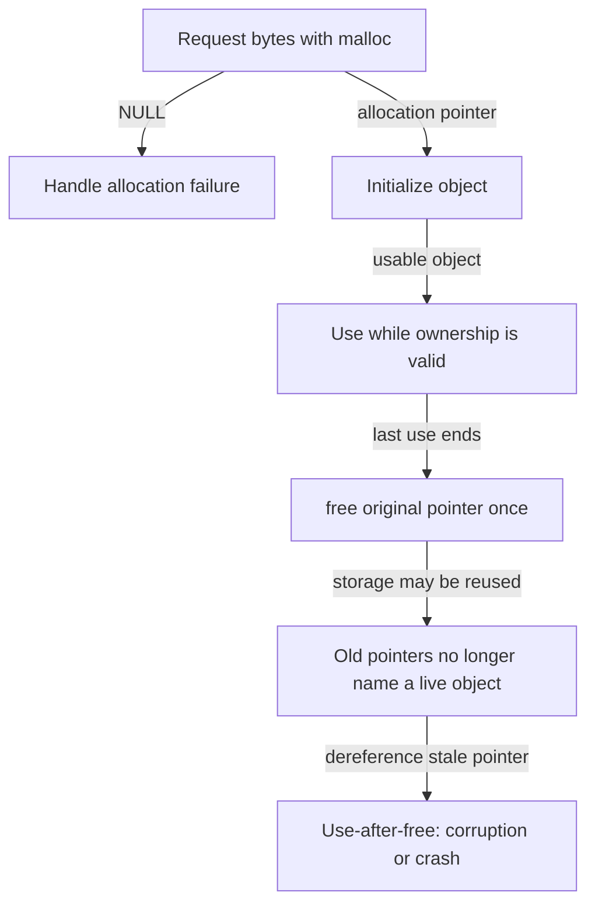

# Memory allocation: bytes, ownership, and lifetime

> Allocating space is a small API operation. Keeping its size, initialization, and lifetime correct is the real engineering work.

Source: Chapter 14, *Interlude: Memory API*, PDF pages 141–151.

## Automatic and explicit allocation

C exposes two important allocation lifetimes. **Stack memory** is managed automatically as functions enter and return. A local variable is convenient temporary storage, but returning a pointer to a local object does not extend that object's lifetime. **Heap memory** is explicitly allocated and released, allowing an object to outlive the function that created it.

These categories describe the object's storage, not every pointer that names it. In `int *p = malloc(sizeof *p);`, a local pointer variable can live on the stack while the integer it points to lives on the heap. Confusing the two encourages incorrect lifetime reasoning: returning `p` may be appropriate, while returning the address of an ordinary local integer is not.

For example, a parser might keep its current character index in a local variable but return a heap-allocated parse result to its caller. The caller then needs a clear responsibility for releasing the result.

## Request enough space

`malloc(size)` requests a number of bytes and returns a pointer on success or `NULL` on failure. Include `<stdlib.h>` so the compiler has the correct declarations. In C, its `void *` result can be assigned to an object pointer without an explicit cast.

Derive allocation sizes from the object rather than a guessed constant. An allocation for six integers can use `6 * sizeof *p` when `p` is an integer pointer. `sizeof(p)` instead measures the pointer itself; it does not recover the length of a dynamically allocated array. The compiler can determine the size of a declared array where its type retains that information, but a pointer alone carries no such length.

Strings need space for their terminating zero byte. Copying the string `"draft"` requires its character count plus one byte, not just the visible characters. Allocation size and initialized contents are separate concerns: `malloc()` does not promise freshly zeroed storage.

## Release the allocation, not a nearby address

`free(ptr)` returns an allocation to the allocator. The caller does not supply its size; the library tracks that information. Pass the allocation's original pointer, not an interior pointer, a stack address, or an arbitrary number.

The important boundary is the last legitimate use, not a particular syntactic scope. If a queue still holds the object, freeing it when the producer function returns is too early.

## The recurring failures

The chapter's error taxonomy is useful when reviewing code:

**Missing allocation** leaves a pointer without valid backing storage. A copying function does not create its destination simply because it receives a destination pointer.

**Insufficient allocation** causes a buffer overflow. A one-byte string terminator overflow can appear harmless on one run and corrupt neighboring state on another. The allocator's rounding does not make an out-of-bounds application access correct.

**Missing initialization** reads unknown contents from a correctly allocated region. A lucky zero value is not a contract.

**Missing release** creates a memory leak. This matters especially in long-running services and kernels. Garbage collection does not remove the problem of retaining references to objects that are no longer useful; reachable but unnecessary data can still accumulate.

**Premature release** leaves dangling pointers. A subsequent allocation can reuse the same storage, so a stale write can damage an unrelated live object.

**Repeated release**, or double free, and **invalid release** violate the allocator's rules and have undefined behavior. Neither has a dependable failure mode.

Compilation and a successful run are weak evidence for memory correctness. Debuggers help locate a crashing instruction, while tools such as Valgrind can expose invalid accesses, uninitialized reads, and leaks that never produce an obvious crash. The practical lesson of the exercises is to use both kinds of evidence rather than equating a visible failure with the complete bug set.

## The library and the OS manage different layers

`malloc()` and `free()` are library calls, not necessarily system calls on each invocation. The allocator distributes space within a process's virtual address space. When it needs more backing space, it uses OS interfaces. Historically, `brk()` changes the end of the heap, and `sbrk()` adjusts it by an increment. Applications should not manipulate that boundary behind their allocator's back. Anonymous `mmap()` regions provide another source of memory.

Process exit lets the OS reclaim the process's memory even if the application neglected individual frees. That does not excuse leaking during a server's lifetime: the OS cannot reclaim live process pages merely because particular heap objects are forgotten.

`calloc()` allocates zeroed storage. `realloc()` changes an allocation's size and may move it, so callers must use the resulting allocation pointer rather than assume its old location survives. These routines change mechanics; they do not eliminate ownership responsibilities.

## What to take away

- Derive byte counts from object types and reserve string terminators.
- Give every heap object an explicit owner and a last-use rule.
- Distinguish allocation from initialization and release from process exit.
- Use memory-checking tools even when the program appears to work.

---

Previous: [Address spaces](13-address-spaces.md) · Next: [Address translation](15-address-translation.md)
