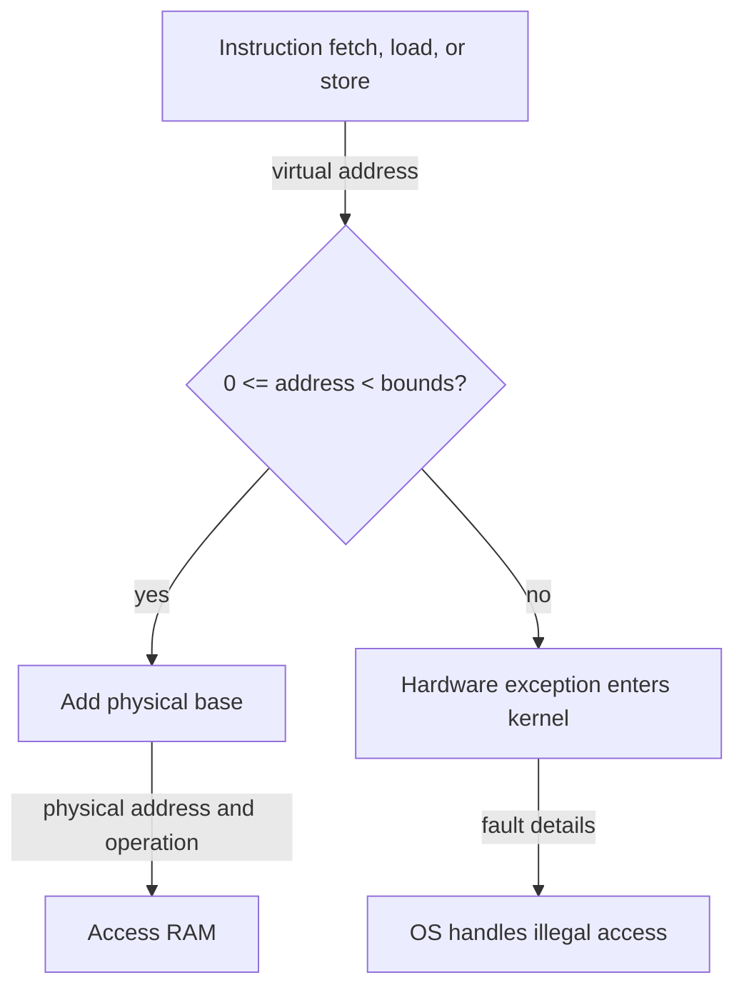

# Address translation: relocate without losing control

> Hardware can redirect every memory reference cheaply, while the OS decides which redirects are permitted.

Source: Chapter 15, *Mechanism: Address Translation*, PDF pages 152–165.

## Extend limited direct execution to memory

CPU virtualization lets user code run directly until an event requires OS intervention. Memory virtualization follows the same strategy: the OS configures translation hardware, then the hardware checks and redirects references without calling the kernel for every access.

**Address translation** converts a virtual address generated by a process into the physical address where its bytes reside. It applies to instruction fetches as well as explicit loads and stores. A counter increment may involve fetching several instructions, loading the counter, and storing it again. Every one of those memory references needs the correct address-space interpretation.

This is **interposition** at a well-defined interface. The program requests memory at a virtual location; an intervening mechanism supplies the corresponding physical location. The application does not need rewriting whenever its physical placement changes.

To make the first mechanism simple, assume an entire address space occupies one contiguous physical region, is smaller than RAM, and has the same fixed size as every other process's address space. These are teaching assumptions, not realistic requirements for a complete VM system.

## Base and bounds

**Dynamic relocation**, also called **base and bounds**, adds two hardware registers per CPU. The base identifies the physical beginning of the running process's memory. The bounds register specifies the permitted size in the model used here.

For a valid virtual address:

`physical address = base + virtual address`

The hardware must first establish that the virtual address lies within the allowed range. For a byte-addressed region of size `bounds`, the legal offsets are zero through `bounds - 1`. An offset equal to the size is outside the region.

For an original example, let a process have an 8 KiB address space placed at physical address 40 KiB. Its virtual address 2048 translates to physical address 42 KiB. Virtual address 9000 is outside its 8192-byte region and must fault rather than become a reference to someone else's data.

Some machines encode the bound as the physical end address instead. They add the base and then check the physical result. The representation differs, but the purpose remains confinement to the process's allocated region.

Static relocation is a contrasting software approach: a loader rewrites addresses in an executable before running it. That can relocate known references, but does not stop a running program from manufacturing an arbitrary address. It also makes later relocation difficult. Dynamic relocation provides ongoing checking, not merely an initial layout adjustment.

## What the hardware must enforce

The **memory-management unit**, or MMU, is the processor machinery performing translation. Base and bounds add little logic: an addition and a range check. Their simplicity helps keep the ordinary reference path fast.

The registers must be privileged. If a user process could change its own base, it could point at the kernel or another process. The CPU therefore needs user and kernel modes, privileged instructions to configure translation state, and exceptions for attempted violations.

The hardware must also know where exception handlers reside. The OS installs these handler entry points through privileged operations. On an illegal reference, the processor stops normal user execution and transfers control to the appropriate handler, preserving the kernel's ability to decide what happens next. Terminating the offending process is a common response.

Translation and protection are inseparable here. Adding a base without enforcing bounds would relocate a process but would not isolate it.

## Where the OS participates

At process creation, the OS finds a free fixed-size physical slot, loads the process there, and records its base and bounds. A **free list** tracks unused memory ranges or slots. At process termination, the OS returns the allocated space and removes associated process state.

At a context switch, the CPU's single register pair must change to describe the newly running process. The OS saves the old values in its per-process state and restores the new values before returning to user execution. Forgetting this step would make a perfectly ordinary pointer refer to the previous process's memory.

The OS can even move a stopped process: deschedule it, copy its region to a new physical location, and update its saved base. When execution resumes, its virtual addresses are unchanged. Moving the bytes is expensive, but no application pointer repair is needed because translation preserves their virtual meanings.

## The limitation: reserve the whole picture

A contiguous allocation includes the unused gap between heap and stack. That unused space occupies physical RAM despite doing no useful work. This is **internal fragmentation**: waste inside an allocated unit.

The mechanism is fast and protective, but not flexible enough for a large sparse address space. Reserving a whole region also constrains growth and placement. The next step preserves the cheap translation idea while giving different logical regions independent physical locations.

Related: [kernel and user space](../../operating-systems/1-knowledge/fundamentals/kernel-user-space.md).

## What to take away

- Translate instruction fetches and data references alike.
- Check offsets before allowing accesses; relocation alone is not protection.
- Treat translation registers as privileged per-process context.
- Look for physical waste inside a reserved virtual-address-space image.

---

Previous: [Memory allocation API](14-memory-api.md) · Next: [Segmentation](16-segmentation.md)
