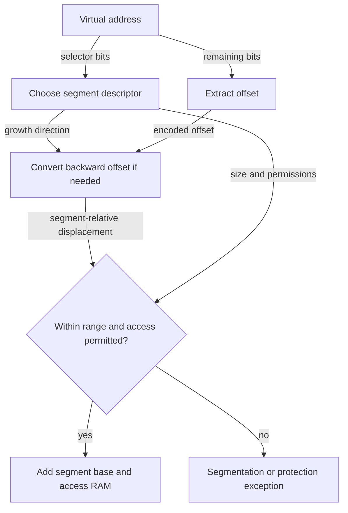

# Segmentation: allocate the regions a program uses

> Separate relocation for code, heap, and stack removes one kind of waste, but variable-sized physical allocations introduce another.

Source: Chapter 16, *Segmentation*, PDF pages 166–177.

## Generalize base and bounds

A single base/bounds pair allocates physical memory for an entire address-space image, including the unused middle. **Segmentation** gives each logical region its own base and bounds. A **segment** is a contiguous virtual region of a particular length. Code, heap, and stack can now occupy different physical locations while preserving their virtual locations.

A process with a modest heap and stack no longer needs physical backing for the whole gap separating them. This supports a **sparse address space**, one with large unused regions. Segmentation does not require every segment to be adjacent to the others in physical memory, though each segment still needs its own contiguous allocation.

For example, a utility's code can occupy one free region of RAM, its heap another, and its stack a third. The physical order need not match their virtual order.

## Select a segment, then compute its offset

The hardware must determine which segment a virtual address names. An **explicit** scheme reserves high address bits as a segment selector. The remaining bits specify an offset. With two selector bits, the address space can name four segment regions; a design using only code, heap, and stack may leave one unused.

The translation uses the offset within the chosen segment, not the entire virtual address:

`physical address = segment base + segment offset`

Suppose a heap begins virtually at 8192 and physically at 50000. Virtual address 8292 is 100 bytes into that heap and translates to physical address 50100. Adding 8292 directly to the heap's base would be wrong because it would count the virtual segment starting position twice.

The offset must fit the segment's size. Access to the unused tail of a segment-selected region still faults even though its selector is meaningful.

An **implicit** scheme instead infers the segment from how the reference is formed. An instruction fetch can select code; an address based on the stack pointer can select stack; other references can select heap. This shifts some interpretation from address bits to instruction behavior.

## Growing backward

A stack commonly grows toward lower numerical addresses. A descriptor therefore needs growth-direction information as well as base and size. For a backward-growing segment, an offset encoded near the top of its selector region must become a negative displacement from the segment's endpoint.

For instance, let a selector region span 8 KiB and the encoded within-region offset be 7 KiB. Subtracting the region's maximum size yields a displacement of -1 KiB. Add that displacement to the stack's physical base/end to find the desired byte. The bounds check must use the permitted backward-growing range, rather than the forward segment's ordinary nonnegative offset interpretation.

The diagram separates three questions: which region, which byte within it, and whether the operation is legal.

## Share safely, or describe more regions

Adding read/write/execute permissions enables controlled sharing. Two processes can map the same physical code segment read-only and executable, while retaining private writable heaps and stacks. A write to shared read-only code must trap; merely mapping both processes to the same bytes without protection would sacrifice isolation.

**Coarse-grained segmentation** uses a few large logical regions. **Fine-grained segmentation** permits many smaller regions and therefore needs a segment table, typically in memory, rather than a handful of registers. The smaller regions can describe program structure more precisely, but demand more metadata and machinery. The source discusses early systems whose compilers and runtime organization were built around this more segmented view.

## The OS inherits external fragmentation

Context switches now save and restore multiple segment descriptors. More importantly, the OS must allocate variable-sized physical regions and accommodate growth.

After allocations and frees, available RAM can be split into holes. A 12 KiB request cannot use three separated 5 KiB holes despite 15 KiB being free. This is **external fragmentation**: enough total free space exists, but no single contiguous region satisfies the request.

**Compaction** can stop processes, copy their segments together, and update segment bases to create one large hole. Translation makes the move invisible to application pointers, but the copying consumes CPU time and memory bandwidth. Allocation policies such as best fit and first fit can reduce fragmentation without eliminating its underlying cause.

Segmentation also assumes that logical regions match usage well. A single huge heap with scattered live data still needs backing for the segment as a whole. Avoiding the empty stack/heap gap is useful, but does not solve arbitrary sparsity inside a segment. Fixed-size paging will address both this flexibility limitation and variable-sized physical allocation.

Related: [segmentation and fragmentation](../../operating-systems/1-knowledge/memory/segmentation-fragmentation.md).

## What to take away

- Translate segment-relative offsets, not raw virtual addresses.
- Account explicitly for backward-growing regions and access permissions.
- Use read-only mappings when sharing immutable code.
- Distinguish unused bytes inside allocations from separated free holes outside them.

---

Previous: [Address translation](15-address-translation.md) · Next: [Free-space management](17-free-space.md)
