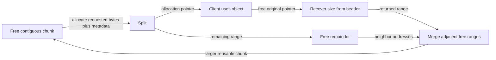

# Free-space management: make useful holes

> Variable-sized allocation is a balance between search cost, metadata, and the shape of the space left behind.

Source: Chapter 17, *Free-Space Management*, PDF pages 178–194.

## Why total free bytes are not enough

A user-space allocator manages heap objects; a segmented OS manages physical regions. Both face **external fragmentation** when requests have variable sizes. Two separate 24-byte holes cannot satisfy a contiguous 40-byte request. Conversely, handing out more space than requested creates **internal fragmentation** inside the allocation.

The chapter assumes a `malloc()`/`free()` interface, a contiguous managed region, and objects that cannot move after allocation. That last constraint matters: arbitrary C pointers may exist in variables, objects, or registers, so the allocator cannot repair every reference after moving an object. Unlike an OS moving a segment behind virtual translation, a conventional heap allocator cannot simply compact live allocations.

A **free list** records available chunks. The name does not require a linked-list implementation; it denotes the tracking structure. Its correctness and organization determine which space allocation policy can find.

## Split, coalesce, and remember sizes

**Splitting** takes a sufficiently large free chunk, returns part of it, and retains the remainder. Ignoring metadata for a moment, serving a 12-byte request from a 32-byte hole leaves a 20-byte hole.

**Coalescing** joins physically adjacent free chunks. If that 12-byte object is later returned, merging it with the neighboring 20-byte remainder restores a 32-byte chunk. Simply storing two list entries would make a larger request fail unnecessarily. Coalescing depends on adjacency of addresses, not adjacency of list nodes in an arbitrary ordering.

Since `free()` receives no size, an allocator commonly stores a **header** immediately before the returned payload. It can contain the size and integrity information. Recovering the header from the payload pointer tells the allocator how much storage to return. A request for N usable bytes therefore requires room for N plus metadata, with any additional layout requirements also consuming space.

The free-list nodes themselves can live inside free chunks. An allocator cannot recursively call its own `malloc()` every time it needs a bookkeeping node. Free space can store a size and next pointer; allocated space can instead store its allocation header. Metadata changes role as ownership changes.

If no chunk fits, a fixed-size allocator fails. A growable allocator can request more virtual space from the OS and add it to its managed pool. That is a separate mechanism from choosing among existing holes.

## Four basic selection policies

**Best fit** chooses the smallest available chunk large enough for the request. It tries to avoid consuming unnecessarily large holes, but a naive implementation searches the whole list and can leave tiny remnants.

**Worst fit** chooses the largest hole, hoping its remainder will remain useful. It also needs an exhaustive naive search. The source reports poor fragmentation and overhead in studies rather than presenting its appealing intuition as evidence of success.

**First fit** stops at the first sufficient chunk. Its search can be cheaper, but repeated allocations can leave small holes near the search's starting point. List ordering matters: address order helps locate neighboring chunks for coalescing and can improve fragmentation behavior.

**Next fit** resumes from where the previous search ended, spreading searches through the list instead of repeatedly starting at its head. It avoids requiring a full search on every allocation, although it offers no universal protection against fragmentation.

For an original policy example, consider holes of 16, 64, and 40 bytes and a 24-byte request, ignoring headers. Best fit selects 40; worst fit selects 64; first fit also selects 64 in this ordering but reaches its decision without inspecting the final hole. Equal choices do not imply equal costs.

No policy is best for every arbitrary allocation/free stream. Evaluate both placement outcomes and time spent finding them.

## Specialize or simplify the structure

**Segregated lists** maintain dedicated pools for frequently requested sizes. An application allocating many identically sized records can avoid a general search on its common path. The tradeoff is distributing memory among specialized and general pools.

The **slab allocator**, associated in this chapter with Jeff Bonwick's Solaris work, uses object caches supplied with larger slabs from a general allocator. Entire unused slabs can return to the general pool. Keeping objects initialized also avoids repeated expensive construction and destruction, not merely search overhead.

**Binary buddy allocation** repeatedly halves power-of-two regions until the next split would be too small. An original 9 KiB request therefore needs a 16 KiB block, introducing internal waste. On free, a block merges with its free buddy, then possibly with the next-level buddy. Related addresses differ in a level-specific bit, making buddy identification and recursive coalescing simple.

More advanced allocators use trees to reduce search cost and designs suited to concurrent multiprocessor workloads. The lesson is not to implement every technique: choose based on observed sizes, lifetimes, contention, and acceptable memory overhead.

Related: [allocator project](../../operating-systems/3-practice/project-allocator.md).

## What to take away

- Track contiguous usable space, not just a total free-byte count.
- Include metadata when sizing allocations and returned regions.
- Coalesce adjacent freed ranges before blaming a selection policy.
- Measure request patterns before adopting size-specific pools or complex searches.

---

Previous: [Segmentation](16-segmentation.md) · Next: [Paging](18-paging.md)
