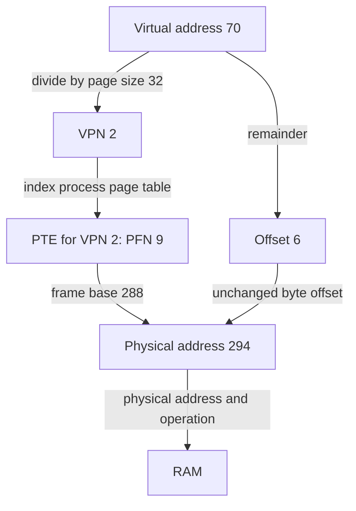

# Paging: fixed-size placement, flexible address spaces

> Pages remove the need for large contiguous physical allocations, but their mappings create costs of their own.

Source: Chapter 18, *Paging: Introduction*, PDF pages 195–208.

## Replace segments with pages

**Paging** divides a virtual address space into fixed-size **pages** and physical memory into equally sized **page frames**. Any virtual page can occupy any available frame. A process's adjacent virtual pages therefore need not be adjacent in RAM.

This removes the external-fragmentation problem of variable-sized physical segments. To place several pages, the OS can take several individual free frames rather than find one large contiguous region. It also avoids assuming that all useful data fits neatly into a growing heap and a backward-growing stack. Sparse regions can have backing only where pages are actually allocated.

Paging is not free of all waste: a partially used page can still have internal fragmentation. Nor does this initial chapter yet solve how to run with pages absent from RAM. It first establishes the mapping mechanism.

## Split the address and preserve the offset

A **virtual page number**, or VPN, identifies the virtual page. The **offset** identifies the byte within it. For power-of-two page sizes, the low address bits form the offset and the remaining high bits form the VPN.

A **page table** records VPN-to-physical-frame-number mappings, generally one table per process. The **physical frame number**, PFN, is also sometimes called the physical page number. Translation replaces the VPN with the PFN and leaves the offset unchanged.

For an original small example, use 32-byte pages. Virtual address 70 is VPN 2, offset 6. If that process's page table maps VPN 2 to PFN 9, the physical address is `9 * 32 + 6 = 294`. The byte remains six positions into the selected frame.

This indirection explains both flexibility and isolation. A different process can map its VPN 2 elsewhere. Two processes can also deliberately share a frame if their mappings and permissions allow it.

## Where the mapping information lives

A simple **linear page table** is an array indexed by VPN. Its convenience becomes expensive for large address spaces.

With a 32-bit byte-addressed space and 4 KiB pages, the offset needs 12 bits and the VPN needs 20. There are `2^20` potential virtual pages. At four bytes per **page-table entry**, or PTE, the linear table needs 4 MiB per process, regardless of how many entries are useful. A hundred such tables consume 400 MiB.

These are the chapter's illustrative sizes, not universal hardware constants. The underlying calculation is what matters: address-space size divided by page size, multiplied by entry size. Large tables cannot reasonably live entirely in a few dedicated processor registers; they reside in memory managed by the OS.

## Entries record legality as well as location

A PTE contains more than a PFN. The conceptual **valid bit** says whether the page belongs to the process's allocated virtual space. Marking unused pages invalid allows sparse address spaces without allocating frames for their gaps. An access to an invalid page traps to the OS.

**Protection bits** specify permitted operations such as reading, writing, or executing. A valid mapping can still prohibit a store. A **present bit** distinguishes a page resident in RAM from one stored elsewhere. **Dirty** or modified information records changes that may need writing back. A **reference** or accessed bit records use and later helps choose eviction victims.

Exact hardware fields differ. The chapter's x86 example includes present, read/write, user/supervisor, accessed, dirty, and caching-related bits. Do not assume every architecture implements separate fields corresponding exactly to the teaching model's valid/present distinction. Keep the conceptual questions separate: does the address belong to the process, is it resident, and is this operation allowed?

## The hidden reference before each reference

With a linear table in physical memory, a page-table-base register identifies its beginning. The PTE address is:

`PTE address = table base + VPN * entry size`

The hardware first reads that entry, checks validity and permissions, then constructs the physical address and performs the requested access. Without a translation cache, every instruction fetch, load, and store therefore needs an additional memory reference for its translation.

Consider a loop implemented with three instruction fetches and one explicit data access per iteration. Even though two instructions only manipulate registers, fetching them still needs translation. In this simplified uncached model, four program references cause four additional page-table references. Counting only the loop's data access badly understates the cost.

This chapter ends with two unresolved problems: mappings occupy too much space, and reading them repeatedly takes too much time. The next chapters address time with a translation cache and space with better mapping data structures. Paging's placement simplicity remains valuable, but only a complete design makes it practical.

Related: [paging](../../operating-systems/1-knowledge/memory/paging.md).

## What to take away

- Separate page number from within-page offset in every translation.
- Calculate table size from potential mappings, not resident memory alone.
- Distinguish address validity, permissions, and residency.
- Count translation traffic for instruction fetches as well as data accesses.

---

Previous: [Free-space management](17-free-space.md) · Next: [TLBs](19-tlbs.md)
