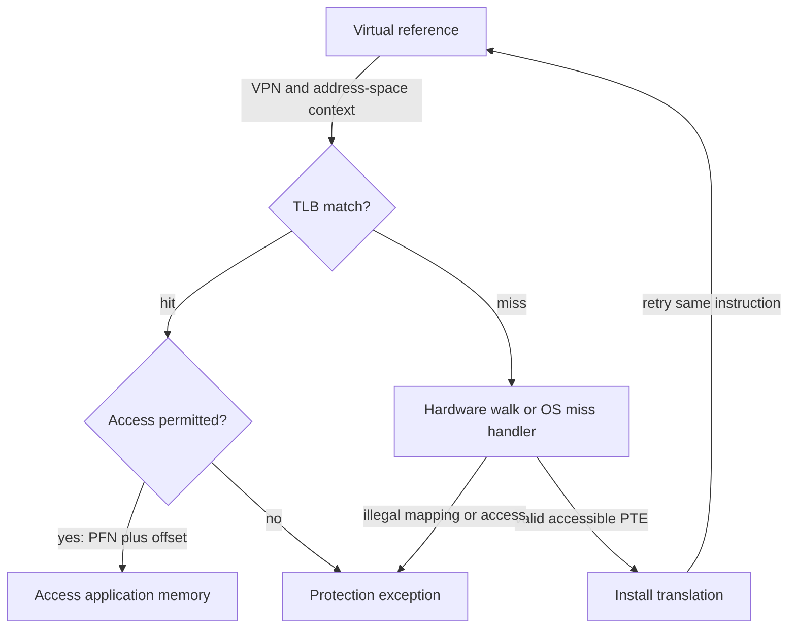

# TLBs: cache translations, not application bytes

> A small translation cache makes paging's common path cheap. Its misses can explain slow memory access even when data is cached.

Source: Chapter 19, *Paging: Faster Translations (TLBs)*, PDF pages 209–225; closing dialogue, Chapter 24, pages 277–279.

## The fast and slow paths

A **translation-lookaside buffer**, or TLB, is an on-chip cache of virtual-to-physical address translations in the MMU. It is not a cache of the program's data. On a reference, hardware extracts the VPN and looks for its translation. A **TLB hit** supplies the PFN and permissions without a page-table lookup. Hardware checks the operation and combines the PFN with the unchanged offset.

A **TLB miss** requires consulting the page table. If the mapping is usable, the system installs it in the TLB and retries the instruction. The retry can hit and complete normally. A missing cached translation is not evidence that the page itself is missing from RAM.

## Locality makes a small cache useful

**Spatial locality** means nearby addresses are accessed close together. A scan through densely stored records can reuse one page translation for many successive elements. For an original simplified example, eight aligned four-byte integers occupy one 32-byte page. Starting with an empty TLB, and ignoring code and other data accesses, the first integer access misses and the next seven hit: seven hits in eight accesses.

**Temporal locality** means a recently accessed location is accessed again soon. Repeating that scan can produce only hits if its translation remains cached. These are tendencies of workloads, not guarantees. A randomized walk through many separately allocated pages behaves differently from a dense array even if both examine the same number of bytes.

The cache must be small enough to search quickly. Increasing capacity is not a costless response to misses; hardware area, access latency, and physical implementation constrain it.

## Who handles misses?

A **hardware-managed TLB** uses a hardware page-table walk. The processor must know the table's location and format. The source's x86 example uses a hardware-defined multilevel table and the CR3 register.

A **software-managed TLB** raises an exception, and an OS handler finds the mapping and uses privileged instructions to install it. The source's MIPS and SPARC examples illustrate this arrangement. It gives the OS freedom to choose page-table data structures and simplifies the hardware's miss path.

The handler must resume the instruction that faulted, not skip past it as a system-call return commonly does. It must also avoid an infinite series of misses while trying to service the original miss. Untranslated handler memory or reserved **wired** TLB entries can keep the handler's own code and data accessible.

These are architectural choices, not a modern-versus-obsolete ranking. The source explains their historical relationship to RISC/CISC design, while also noting that processor implementation techniques converged; instruction-set labels alone do not predict performance.

## Entries need identity and protection

A fully associative TLB can place a translation in any entry and search entries in parallel. Entries contain VPN, PFN, a cache-entry valid bit, permissions, and potentially other fields. A **TLB valid bit** means an entry contains a usable cached translation; it is not the page table's statement that a virtual page is allocated.

Context switching introduces ambiguity. Process A's VPN 7 and process B's VPN 7 may map to different frames. One solution is to flush the TLB before running B. That preserves correctness but loses useful cached translations and forces warm-up misses.

An **address-space identifier**, ASID, tags entries so the lookup matches both VPN and address space. The OS changes the active ASID at a switch. Different tagged entries can coexist; deliberate page sharing can also map distinct virtual addresses to the same PFN. The source's MIPS example adds a global flag that bypasses ASID matching for globally shared mappings and privileged probe/read/write operations for software management.

When the cache fills, replacement may use LRU or random choice. Repeatedly looping over one more page than fits can make LRU miss on every access. A simple random policy can avoid this deterministic worst case, though it does not predict useful entries.

## Coverage and credible measurement

**TLB coverage** is the amount of memory represented by cached page translations. More entries or larger pages increase it. Large randomly accessed structures, such as database structures, can exceed coverage despite having acceptable data-cache behavior.

The closing dialogue reinforces that distinction: a good VM mental model explains unexpected latency that a data-cache-only model misses. Translation can also delay access to a physically indexed cache; virtual indexing introduces its own design complications.

A practical measurement touches one location per page repeatedly and varies the number of pages, looking for changes in per-access cost. Preserve the loop against compiler elimination, pin execution to a CPU to avoid mixing TLB histories, and initialize memory before timing so first-touch work is not mistaken for translation cost. The source's measured timing values describe its particular experiment, not a promise about today's machines.

## What to take away

- Distinguish TLB misses from data-cache misses and page faults.
- Favor locality in pages, not merely a small byte count.
- Include address-space identity when reasoning about cached translations.
- Control compiler optimization, CPU migration, and first-touch costs in measurements.

---

Previous: [Paging](18-paging.md) · Next: [Smaller page tables](20-smaller-page-tables.md)
