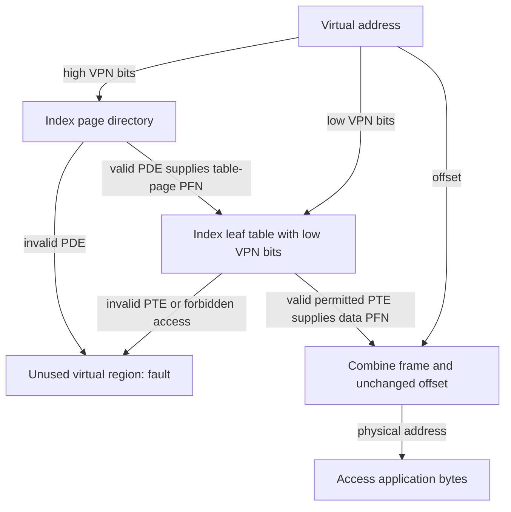

# Smaller page tables: pay only for useful mappings

> Translation structures trade memory footprint against lookup work. The TLB keeps their complexity off the common path.

Source: Chapter 20, *Paging: Smaller Tables*, PDF pages 226–240.

## Begin with the space problem

A linear table reserves an entry for every possible virtual page, including enormous unused regions. In the chapter's 32-bit example, 4 KiB pages and four-byte entries require 4 MiB per process. Reducing this overhead requires changing either the number of pages represented or the structure representing them.

**Bigger pages** reduce the number of mappings. Increasing the example's page size to 16 KiB gives an 18-bit VPN and a 14-bit offset, reducing its linear table to 1 MiB. The cost is more **internal fragmentation** when allocations use only part of a page.

Architectures can support several page sizes, using larger pages for selected regions. Their important benefit is often relieving TLB pressure rather than saving table space: one entry then covers more data. However, mixed page sizes make the VM manager more complicated. An application-facing interface requesting large pages can make some placement decisions explicit instead of requiring the OS to infer everything transparently.

## A hybrid of paging and segments

A hybrid keeps separate page tables for logical regions such as code, heap, and stack. Each segment's base points to its page table rather than directly to application bytes; its bounds describe how many entries the table contains. Segment bits choose the table, and the within-segment VPN indexes it.

For example, a small heap and a small stack can use short tables without reserving entries for the whole virtual gap between them. Context switches replace the segment table bases and limits with those of the next process.

This still assumes that segment boundaries fit usage well. A huge sparse heap can retain many useless entries. Moreover, variable-length tables themselves need variable-sized physical allocations, reintroducing external fragmentation for metadata even though application data uses fixed-size pages.

## Build a sparse tree

A **multilevel page table** divides a linear table into page-sized pieces and allocates only pieces containing useful mappings. A **page directory** records which pieces exist and where they reside. Its **page-directory entries**, PDEs, describe table pages, while leaf PTEs describe application pages.

A valid PDE means the next-level structure exists and has useful mappings. It does not imply every PTE in that structure is valid. An invalid PDE can represent an entire unused virtual region without allocating a page full of invalid leaf entries.

For an original small example, consider a 4 KiB virtual address space with 64-byte pages and four-byte entries. There are 64 virtual pages, so a linear table takes 256 bytes, or four table pages. Each table page holds 16 entries. A directory needs four entries. If only the first 16 virtual pages contain allocations, one leaf-table page plus the directory suffices; the other three leaf pages are absent.

## Walk the indices, not the whole table

The VPN splits into an index for each tree level. The hardware starts at the directory base and reads the chosen PDE. Its PFN identifies the next table page. The next VPN bits select an entry within that page, yielding either another table-page address or the final data frame.

The byte address of a leaf entry is the table page's frame base plus its index multiplied by entry size. After checking that entry, combine the final PFN with the original offset. Confusing an intermediate PFN with an application-data PFN skips a level and accesses metadata as though it were the requested data.

When a directory itself no longer fits one page, add another level. Determine the branching factor from page size divided by entry size. The source's deeper example uses 512-byte pages and four-byte entries, giving 128 entries per table page and seven index bits per level. A 21-bit VPN can therefore divide across three seven-bit indices, followed by its nine-bit offset.

The gain is compact metadata for sparse layouts and easy allocation of page-sized table pieces. Indirection also lets those pieces occupy noncontiguous physical frames.

The costs are extra dependent lookups and more complicated management. A two-level walk requires two translation-structure reads instead of a linear table's one in the simplified model. On a **TLB hit**, neither walk occurs: the cached final translation is enough. Thus the space-saving penalty mainly changes the miss path, not every reference.

## Other representations and pageable metadata

An **inverted page table** instead keeps an entry per physical frame for the whole system. Entries identify the process and virtual page using each frame. Space then scales with physical memory, not every process's potential virtual range. Looking up a mapping requires search; hashing can avoid a costly linear scan.

Finally, some systems store user page tables in kernel virtual memory, allowing table pages themselves to be swapped out. That further reduces resident metadata but complicates translation, since locating a mapping can require translating the page containing it. The VAX/VMS chapter shows the arrangement in context.

Page tables are data structures, not an obligation to use arrays. Choose their shape for actual address-space sparsity, available RAM, miss frequency, and hardware constraints.

## What to take away

- Calculate table branching factors before splitting VPN bits.
- Distinguish intermediate table-frame pointers from final data mappings.
- Compare miss-path costs while remembering that TLB hits bypass the walk.
- Avoid complexity that saves metadata your workload never meaningfully consumes.

---

Previous: [TLBs](19-tlbs.md) · Next: [Swapping mechanisms](21-swapping-mechanisms.md)
