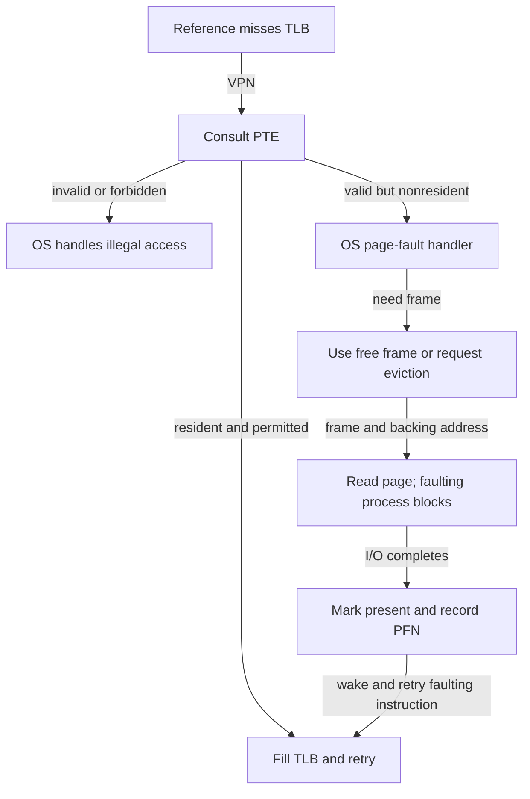

# Beyond RAM: the page-fault path

> Slow storage extends what virtual memory can hold, but a transparent address space can hide a very nontransparent latency.

Source: Chapter 21, *Beyond Physical Memory: Mechanisms*, PDF pages 241–249.

## Add capacity below memory

Until now, the model has assumed every process's needed pages fit in physical memory. Supporting larger address spaces and many concurrent processes requires somewhere to keep pages that are not currently needed. This introduces a larger, slower level in the memory hierarchy.

The chapter uses a disk, while explicitly noting that an SSD can serve the same role. The important relationship is capacity and speed: backing storage can hold more than RAM, but retrieving a page costs much more than an ordinary memory access.

This avoids **memory overlays**, where programmers manually arrange to load code or data before using it. The application continues to use ordinary virtual addresses; the OS arranges residency. For example, a process can retain a large collection of infrequently used records without keeping every record's page in RAM at once. The illusion does not make all those records equally cheap to access.

## Swap is a backing location, not an address space

**Swap space** is storage reserved for pages moved out of RAM. The OS reads and writes it in page-sized units and records each page's storage location. Capacity is finite; adding backing storage does not provide unlimited memory.

Not every nonresident page must live in swap. Executable code already has a file-backed copy. A clean code page can be discarded from RAM and later reloaded from the executable, avoiding an unnecessary swap write. This distinction between a frame and the source from which its contents can be recovered becomes important when considering eviction costs.

The teaching model adds a **present bit** to each mapping. A page can be valid for the process yet not present in RAM. That is different from an invalid virtual address. Validity answers whether the process is entitled to that page; presence answers whether its bytes are currently resident.

## A TLB miss is not yet a page fault

On a TLB hit, the cached translation and permissions enable an ordinary memory reference. On a miss, the hardware or software consults the page table. Three outcomes must stay distinct:

1. A valid, permitted, resident mapping can be installed in the TLB and retried.
2. A valid, permitted, nonresident mapping requires the OS to obtain its contents.
3. An invalid address or forbidden operation causes a protection-related exception, not a request to page in arbitrary bytes.

Accessing a legitimate nonresident page raises the **page fault** examined here. The term can also refer more broadly to page-related exceptions on real systems, so a report of faults alone does not tell you their cause.

The diagram explains why a single source-level load can cause a long wait without being an erroneous program operation.

## The OS services the fault

Even with a hardware-managed TLB, the OS handles the page fault. It knows storage locations, I/O interfaces, allocation policy, and process state; implementing all that in a page-table walker would greatly complicate the hardware. The slow storage transfer also dominates much of the software overhead.

The handler determines where the missing page resides, potentially using a nonresident PTE's fields to encode its backing address. It finds a free physical frame, or arranges to reclaim one. It then issues a read and blocks the faulting process while the transfer completes. Other ready processes can run during the wait, overlapping CPU work with storage I/O.

Once the data arrives, the OS records the new PFN, marks the page present, and resumes the interrupted instruction. It may install the translation immediately or allow a subsequent TLB miss to do so. Either way, the operation eventually retries with resident data and a usable translation. Skipping the faulting instruction would lose the requested load, store, or fetch.

## Keep free frames ready

A naive implementation waits until no frames remain, then evicts a page on the fault path. Real systems often replenish free memory proactively.

A **low watermark** triggers a background **page daemon** when too few free frames remain. It reclaims pages until the **high watermark** is reached, then sleeps. If a fault finds no frame, it can notify this worker and wait for reclaimed space rather than independently performing all replacement work.

Batching creates useful opportunities. The daemon can cluster several dirty-page writes into larger storage operations; for disks, this reduces positioning overhead relative to many small independent transfers. Moving work into the background also changes when applications encounter the cost, although it cannot eliminate capacity pressure or the need to preserve modified data.

The replacement **mechanism** makes eviction and reloading possible. The replacement **policy** decides which pages to remove. A poor choice can repeatedly evict data needed moments later, turning transparent virtual memory into a storage-bound workload. That is the next chapter's concern.

## What to take away

- Separate invalid, nonresident, and merely uncached mappings.
- Trace a fault through frame allocation, blocking I/O, metadata update, and retry.
- Remember that file-backed clean pages need not be written to swap.
- Treat free-frame watermarks and batching as latency-management mechanisms, not extra capacity.

---

Previous: [Smaller page tables](20-smaller-page-tables.md) · Next: [Replacement policies](22-replacement-policies.md)
