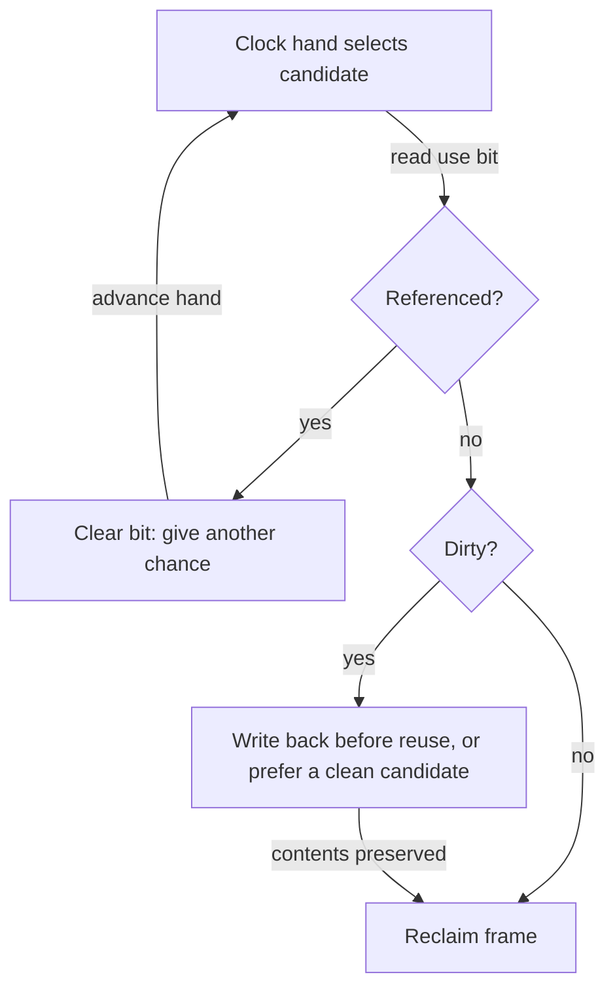

# Page replacement: choose what memory should remember

> A replacement policy predicts future usefulness from incomplete information. Even good predictions cannot rescue a working set that is far too large.

Source: Chapter 22, *Beyond Physical Memory: Policies*, PDF pages 250–267.

## RAM as a cache

Physical memory holds a subset of virtual pages and therefore acts as a cache. A **replacement policy** chooses what to evict when space is needed. Its goal is fewer expensive misses, not simply an aesthetically tidy list of frames.

The chapter's simplified **average memory access time**, AMAT, is:

`AMAT = hit probability * memory access time + miss probability * disk access time`

This treats the disk term as the miss cost and abstracts away other details. With the source's illustrative 100 ns memory access and 10 ms disk access, a 90% hit rate still gives about 1 ms average access time. Those values belong to the book's example, not a universal hardware benchmark. The lesson is robust: a small fraction of very costly misses can dominate the average.

Miss categories clarify what a policy can improve. **Compulsory** misses occur on initial references. **Capacity** misses arise when the cache cannot retain everything needed. Hardware **conflict** misses arise from restricted placement; they do not arise in the chapter's fully associative OS page-placement model.

## Compare against the unattainable ideal

Belady's **optimal**, or MIN, policy evicts the page whose next access is farthest in the future. That produces the fewest misses for a known trace. A real general-purpose OS cannot know the future, but a trace simulator can use optimal as a reference point.

For an original example, suppose resident pages are A, B, and C, and future references begin B, A, D, C. When another page must enter immediately, optimal chooses C because its next use is latest. A practical policy instead needs observable history or simpler rules.

An observed hit rate means more when compared with the optimum for the same trace and capacity. A policy nearly matching optimal may not justify additional complexity; a large gap suggests exploitable workload structure.

## Simple rules and their failures

**FIFO** evicts the page that entered memory earliest. Its bookkeeping changes on insertion and eviction rather than every access. It is easy to implement, but a frequently used page can still be oldest and therefore be discarded.

FIFO can exhibit **Belady's anomaly**: adding capacity can increase misses for some traces. **LRU** avoids this because of its **stack property**: for the same reference history, the contents at capacity N are included in those at N+1. FIFO and random replacement do not provide that guarantee.

**Random** replacement chooses a victim without estimating usefulness. Its outcome varies across trials. It can be worse than a locality-aware policy, but avoids some deterministic traps in which a repeated pattern defeats the same eviction decision forever.

## Use history, but test the workload

**Least-recently used**, LRU, discards the page not accessed for the longest time. **Least-frequently used**, LFU, discards the least frequently accessed page. Their opposites, MRU and MFU, also exist but usually oppose the locality found in ordinary workloads.

Temporal locality makes recent use a useful predictor; spatial locality makes neighboring references plausible. Neither is a law. The chapter compares three revealing workload shapes:

- With no locality, realistic FIFO, random, and LRU policies offer similar results; capacity dominates.
- With a hot subset receiving most references, LRU tends to retain useful pages better than policies ignoring history.
- In a repeated sequential loop just larger than the cache, LRU and FIFO can miss on every access. The oldest page is exactly the one needed soonest on the next cycle.

For example, repeatedly reading four pages with only three slots defeats ordinary LRU after warm-up: each newly requested page has just been evicted. Random can preserve a page across the loop by chance. A claim that LRU is simply best misses the actual dependency on reference patterns.

## Approximate LRU with clock

Exact LRU needs history updates on every memory access or equivalent hardware accounting. Recording timestamps still leaves potentially expensive victim searches over many pages.

A hardware **reference/use bit** gives a cheaper approximation. Hardware sets it on access; the OS clears it. **Clock** arranges candidate pages in a circular sequence. The hand gives referenced pages another chance by clearing their bits and advancing. A page encountered with a clear bit becomes an eviction candidate.

A **dirty bit** changes the cost calculation. Clean pages with recoverable backing can be reclaimed without an additional write, while modified pages need their contents preserved. A clock variant can prefer unreferenced clean pages before unreferenced dirty ones. Recency alone is not the whole objective.

## Policies beyond victim selection

**Demand paging** loads pages when referenced. **Prefetching** loads predicted future pages early, helping only when predictions justify bandwidth and memory consumption. **Clustering** groups pending writes into more efficient transfers.

**Thrashing** occurs when active memory demands overwhelm RAM and processes repeatedly page in and out. Their **working sets** are the pages they actively use. **Admission control** reduces the running set so remaining working sets can fit. The source also describes some Linux versions' out-of-memory killing as a blunt capacity-relief approach, not a universally benign policy.

Scan-resistant policies, including the source's ARC example, address LRU's vulnerability to scans. Nevertheless, sustained excessive paging often needs less concurrent work or more RAM rather than an increasingly clever victim selector.

Related: [page replacement](../../operating-systems/1-knowledge/memory/page-replacement.md).

## What to take away

- Compare policies on the same traces, capacities, and miss costs.
- Test sequential loops and scans, not only hot-set workloads.
- Account for tracking overhead and dirty-page writeback when evaluating victims.
- Address working-set overload with capacity or admission decisions.

---

Previous: [Swapping mechanisms](21-swapping-mechanisms.md) · Next: [VAX/VMS integration](23-vax-vms.md)
