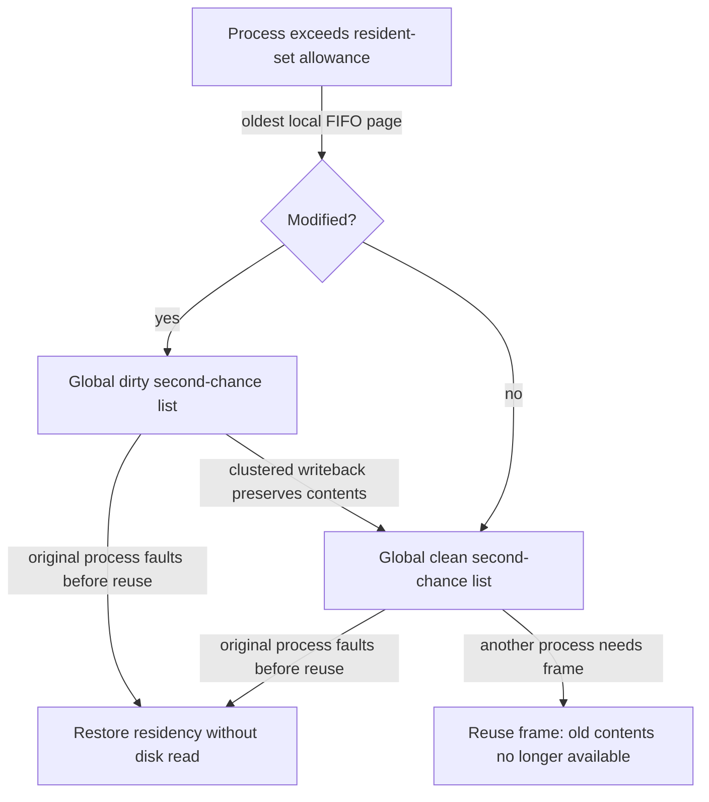

# VAX/VMS: assemble a complete virtual memory system

> A real VM manager combines translation, protection, replacement, and laziness—and adapts when hardware does not provide the ideal primitives.

Source: Chapter 23, *The VAX/VMS Virtual Memory System*, PDF pages 268–276; closing dialogue, Chapter 24, pages 277–279.

## Design for an imperfect machine family

VAX/VMS illustrates how the earlier mechanisms fit together. VMS had to work across inexpensive and powerful implementations of the VAX architecture. This **curse of generality** means that a design serving many environments may fit none especially well unless its mechanisms and policies accommodate differing resources.

The case is historical, not a specification of current kernels. Its lasting value is the engineering response to constraints: small pages produced excessive metadata and inefficient transfers, while missing reference bits complicated replacement. Software supplied ways around those limitations.

## Page tables inside virtual memory

VAX provides a 32-bit virtual address space with 512-byte pages: a nine-bit offset and a 23-bit VPN. The high two VPN bits select regions. The lower half is process space, split into P0 for user code/heap and P1 for stack. System space occupies the upper half, only part of which is used.

VMS combines paging and segmentation. Separate P0 and P1 tables avoid allocating entries for the large unused virtual gap between heap and stack. Region base registers point to tables; bounds describe their sizes.

The small page size still makes tables large. VMS therefore stores user page tables in **kernel virtual memory**, allowing their pages to be swapped out under pressure. The system-space page table itself lives in physical memory.

On an uncached translation, finding a user PTE can require first translating the kernel virtual address of the table page through the system table, then reading the user PTE, then accessing the actual application page. Hardware-managed TLBs usually bypass this elaborate path by caching the final mapping. Indirection saves resident memory but raises the cost and complexity of a miss.

## Address-space layout supports protection and debugging

The virtual zero page is inaccessible so null-pointer references trap rather than silently corrupt useful data. This is deliberate address-space design, not a guarantee that every memory mistake faults immediately.

Kernel code and data are mapped into each process's address space. Context switches change the P0/P1 configuration but retain the common system-space mapping. This lets the kernel work with both its own structures and user pointers during system calls, while also giving it virtual memory for pageable metadata.

Mapping kernel memory does not grant user-mode access. Page protection specifies the required privilege level; forbidden user accesses trap. The arrangement is a historical design choice whose convenience and protection must be understood together, rather than generalized into an assertion about every modern address-space layout.

## Replacement without a reference bit

The VAX PTE provides validity, protection, modification, OS-reserved information, and a PFN—but no hardware reference bit. VMS also needs to stop a memory-hungry process from monopolizing RAM.

Its **segmented FIFO** policy limits the number of pages a process retains in its resident set. Each process keeps a FIFO list. Exceeding its resident-set allowance removes the oldest page from that list, but removal does not immediately destroy the page's RAM contents.

Instead, the page joins a global clean-page list or dirty-page list. These provide a second chance. If the original process accesses it before its frame is reused, the OS can reclaim the still-resident contents without reading storage. If another process needs a frame, it can reuse one from the clean list. Larger second-chance pools let this approach behave more like a recency-aware policy while requiring no hardware use bit.

**Clustering** batches dirty pages into larger storage writes, compensating for inefficient small-page transfers. Once preserved, their frames can become clean reuse candidates.

The chapter also describes a separate technique from Berkeley work: emulate reference information with protection. Temporarily make a legitimately accessible page inaccessible while retaining its real permissions. Its next access traps, letting the OS record use and restore access. Too frequent sampling costs excessive traps; too infrequent sampling makes nearly everything appear referenced.

## Delay work until it matters

**Demand zeroing** defers allocating and clearing a physical frame for a new virtual page until first access. An OS-marked inaccessible entry identifies the pending work. On the first reference, the handler obtains a frame, zeroes it, maps it, and retries. Zeroing prevents disclosure of a previous owner's data. If the process never touches the page, the work never happens.

**Copy-on-write**, COW, initially maps the same physical page into two address spaces read-only. A writer traps; the OS recognizes COW, allocates a private frame, copies the data, updates that writer's mapping, and retries. Readers can continue sharing the original page.

This is particularly useful for `fork()` followed by `exec()`: eager copying would move a whole address space that the child then replaces. COW preserves the semantics of private copies without doing every copy immediately.

The closing dialogue's lesson is to retain an operational model, not a glossary. Trace a reference through translation caching, table lookup, permissions, residency, and possible fault work. That model explains both surprising performance and how lazy mechanisms preserve correct behavior while avoiding unnecessary work.

## What to take away

- Read architectural constraints before judging a VM policy in isolation.
- Distinguish removal from a resident set from immediate destruction of RAM contents.
- Recognize legitimate faults used for demand zeroing, COW, or usage sampling.
- Trace the complete reference path when diagnosing unexpected memory latency.

---

Previous: [Replacement policies](22-replacement-policies.md) · Next: [Concurrency](../3-concurrency/README.md)
