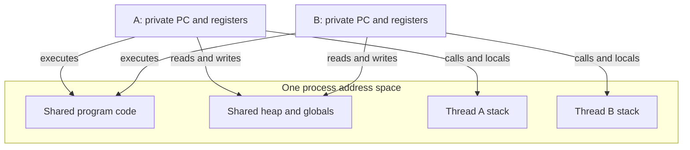
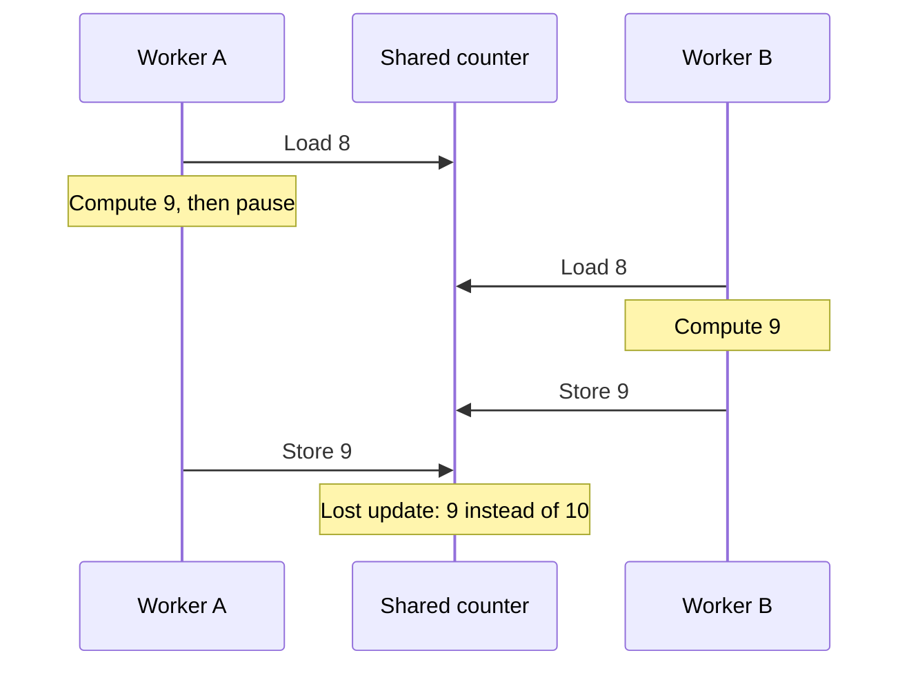

# Threads: shared memory, independent execution

> Threads let a process pursue several activities at once. Their shared address space makes cooperation cheap, but also makes incorrect interleavings possible.

Source: Chapter 26, *Concurrency: An Introduction*, PDF pages 284–298; opening perspective from Chapter 25, *A Dialogue on Concurrency*, pages 282–283.

## A process can have several execution points

A **thread** is an independently scheduled execution stream inside a process. Each thread has its own program counter and register state. Threads in the same process share the address space: they can reach the same program code, heap objects, and global variables.

A context switch saves the outgoing thread's execution state and restores the incoming thread's state using thread control blocks. Within one process, this does not require changing the address space or page table.

Each thread also needs its own stack for function calls, parameters, return addresses, and local variables. Imagine a document processor with one thread parsing an input and another building an index. Both can use the same heap-resident document, but their active function calls occupy different stacks. Multiple stacks complicate the simple picture of one heap and one stack growing toward each other; deeply recursive threads still need sufficient stack space.

Separate stacks are not separate protected address spaces. The source's thread-local description explains where ordinary locals live, not process-style isolation. Sharing a reference makes its lifetime and access protocol important.

## Creation does not establish execution order

Creating a thread resembles starting a function call that proceeds independently of its caller. The new thread may run before the creator resumes, or remain ready until later. Creating worker A before worker B does not guarantee that A prints, computes, or finishes first.

A **join** waits for a particular thread to finish. If a coordinator launches two independent indexing jobs, joining both before reporting completion establishes that both jobs are done. It does not establish their relative execution order. Joining a worker that has already completed can return without waiting.

This distinction is a useful first discipline: write down the ordering you require, then identify the operation that actually enforces it. Source order in the creator is not a substitute for synchronization with the created thread.

## Shared updates expose uncontrolled scheduling

Suppose two workers each increment a shared completed-jobs counter. At the machine-instruction level, an ordinary increment can involve loading memory into a register, adding to that register, and storing it back. The registers belong to the individual threads; the memory location is shared.

If the counter starts at 8, both workers can load 8 before either stores. Each computes 9, and both write 9. Two completed jobs have produced only one recorded increment; the intended result was 10. A timer interrupt on one CPU is enough to create this interleaving. Parallel execution on different CPUs creates the same problem without requiring that particular interrupt.

This is the book's pedagogical machine-instruction model, not a guarantee about the outcomes of an unsynchronized C program. Conflicting cross-thread accesses, at least one non-atomic and without the required happens-before ordering, create a C data race and undefined behavior. `volatile` does not provide atomicity or synchronization; see [C11 draft N1570, §5.1.2.4 and §6.7.3](https://www.open-std.org/jtc1/sc22/wg14/www/docs/n1570.pdf).

A **race condition** makes the outcome depend on the timing of interacting execution streams. The book calls the resulting variability **indeterminate**: different legal schedules can produce different results. A **critical section** accesses shared state whose operation must be protected against interfering concurrent access. **Mutual exclusion** permits only one thread at a time inside the protected section.

The opening dialogue frames the central trade-off: serializing everything may make access correct while throwing away useful concurrency. The aim is coordinated access, not an indiscriminate single-file queue through the whole application.

## Atomicity is the building block, not the whole solution

An **atomic** operation appears indivisible to other execution streams: they cannot observe a partly completed operation. A hardware-supported atomic memory update could solve the simple counter example. It would be unreasonable, however, to demand a special processor instruction for every application operation, such as restructuring an index tree.

Instead, a small set of hardware primitives, combined with operating-system support, lets libraries construct synchronization operations. Locks can make a larger critical section behave atomically with respect to other users of the same locking protocol. This does not mean the CPU cannot interrupt the owner; it means another cooperating thread cannot enter the protected section while the owner is paused.

Mutual exclusion is also not enough when a thread must wait for progress elsewhere. A coordinator waiting for a worker, or a process waiting for completed disk I/O, needs a sleeping-and-waking protocol. The following chapters separate these two needs: protect shared state, and wait until shared state permits an action.

The OS itself needs both. Its process lists, page tables, allocation metadata, and file-system structures can be accessed along interrupted or concurrent execution paths. These are not merely application-level concerns. For the broader abstraction, see [processes and threads](../../operating-systems/1-knowledge/fundamentals/process-vs-thread.md).

## What to take away

- Distinguish per-thread execution state and stacks from the process's shared address space.
- Never infer worker execution order from thread creation order; use an explicit ordering operation.
- Expand shared updates into load, compute, and store steps when looking for lost updates.
- Identify both mutual-exclusion requirements and waiting requirements before choosing primitives.

---

Previous: [Concurrency](./README.md) · Next: [The thread API](27-thread-api.md)
