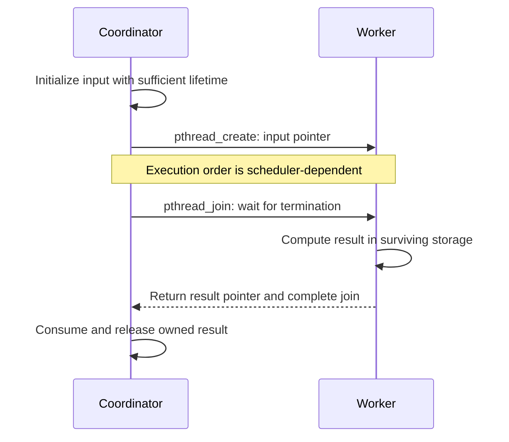

# The thread API: creation, ownership, and coordination

> A small set of POSIX calls covers most thread interactions. The difficult part is preserving object lifetimes and synchronization invariants around those calls.

Source: Chapter 27, *Interlude: Thread API*, PDF pages 299–309.

## Start an independent function invocation

The POSIX entry point is `pthread_create(&thread, attributes, start, argument)`. Its arguments describe the thread handle to initialize, optional attributes, the function to execute, and the argument to pass to that function. Passing `NULL` for attributes requests the defaults; explicit attributes can configure properties such as stack size or scheduling priority.

The start function has the shape `void *start(void *argument)`. A `void *` lets the interface carry a pointer to application-defined data rather than prescribing one argument type. If an image-processing worker needs a source image and a crop rectangle, package them into one structure, pass its address, and unpack it in the worker. The interface's flexibility does not establish ownership or guarantee how long that structure remains alive.

The new execution stream has its own stack and shares the existing process address space. It can begin promptly, so initialize the input before creation and keep it alive until the worker no longer needs it. A creator's stack-allocated argument can be appropriate when that stack frame remains alive through a join; merely handing its address to another thread does not extend its lifetime.

## Join retrieves completion and an optional result

`pthread_join(thread, &result)` waits for the named thread to terminate and can retrieve the pointer it returns. The output parameter is a `void **`: join must write a pointer into the caller's result variable. Passing `NULL` discards the result while still waiting for completion.

For example, a worker can return a heap-allocated summary. After joining, the coordinator can inspect that summary and release it under the application's ownership convention. Never return the address of a worker's local variable: its stack frame disappears when the function returns. Returning a pointer does not preserve the pointed-to object.

Launching a worker and immediately joining it, without overlapping any useful work, often buys nothing over a normal function call. Parallel task-oriented programs usually launch several workers before joining. Long-lived servers can instead keep workers alive to process requests indefinitely; the source explains why such programs need not use join as their normal request-completion mechanism.

## Mutex calls bracket the shared invariant

`pthread_mutex_lock(&mutex)` returns successfully only after acquiring the mutex. If another thread owns it, acquisition waits. `pthread_mutex_unlock(&mutex)` releases it; in the ordinary ownership pattern, the acquiring thread is responsible for release.

Initialize every mutex before use, either with `PTHREAD_MUTEX_INITIALIZER` or with `pthread_mutex_init(&mutex, NULL)` for default attributes. The chapter also identifies the corresponding destruction operation, `pthread_mutex_destroy()`, for the end of the object's usable lifetime.

Check return codes. The book's capitalized wrappers turn failures into immediate program termination for teaching examples. That is a policy, not a property of POSIX: software that cannot exit must handle a failed operation appropriately. Silently continuing after failed acquisition can leave a supposedly protected operation unprotected.

`pthread_mutex_trylock()` attempts acquisition without waiting for an already-held lock. `pthread_mutex_timedlock()` limits waiting using an absolute timeout. These are specialized tools, not replacements for a sound locking protocol; later deadlock examples explain when failed acquisition and rollback are useful. Consult the interface's documented return values rather than assuming a generic negative failure convention.

## Condition variables wait for state, not just a message

Initialize a condition variable with `PTHREAD_COND_INITIALIZER` or `pthread_cond_init()`, with `pthread_cond_destroy()` for its eventual cleanup. Associate it with a mutex protecting the predicate of interest.

A typical consumer locks the mutex, then loops while `ready` is false, calling `pthread_cond_wait(&changed, &mutex)`. Wait atomically releases the held mutex and enters the waiting protocol; before returning, it acquires the mutex again. The producer locks the same mutex, changes `ready`, signals `changed`, and unlocks.

The lock prevents a state change from slipping into an unprotected gap between checking and waiting. The predicate records a change that happens before any waiter exists. The `while` loop handles a wakeup after the state has changed again, as well as a spurious wakeup. A signal is a reason to check, not proof that proceeding is safe.

Holding the associated mutex while changing the predicate and signaling is the chapter's simple recommended protocol. Holding it when calling wait is required by wait's semantics. Do not replace this protocol with an ordinary shared flag and a busy loop: that wastes CPU time and invites synchronization mistakes. See [locks and semaphores](../../operating-systems/1-knowledge/concurrency/locks-semaphores.md) for the surrounding vocabulary.

## Build and read the actual interface contract

Include `<pthread.h>` and use the toolchain's thread-support option; the chapter's GCC examples use `-pthread`. Successful compilation does not establish correct coordination. Keep interactions few and familiar, initialize synchronization objects, check failures, and use the manual pages for API details rather than extrapolating from a teaching sketch.

## What to take away

- Design argument and result ownership before creating a thread; join does not repair dangling pointers.
- Initialize synchronization objects and handle return codes before relying on their guarantees.
- Check predicates in a loop under their mutex, and let condition-variable wait perform the release-and-wait transition.
- Create threads to overlap useful work, not simply to replace a sequential function call.

---

Previous: [Threads](26-threads.md) · Next: [Building locks](28-locks.md)
