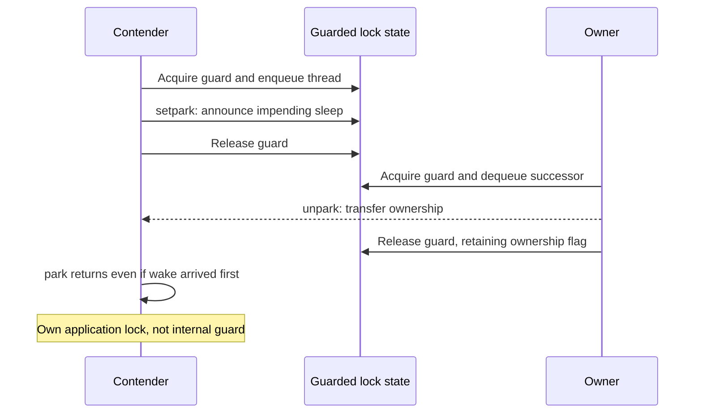

# Building locks: atomic acquisition and safe waiting

> A lock needs more than a shared flag. Hardware makes acquisition indivisible; the OS helps contending threads wait without wasting a processor or losing a wakeup.

Source: Chapter 28, *Locks*, PDF pages 310–332.

## What the interface promises

A lock is available or owned. Successful `lock()` gives the caller exclusive entry to the protected critical section; a competing call cannot complete until it acquires ownership. The owner releases ownership with `unlock()`. All code touching the protected invariant must follow the same protocol.

POSIX calls these objects mutexes. One lock around all shared state is coarse-grained; separate locks for independent structures are finer-grained and can permit more concurrency. Neither arrangement is automatically better.

Evaluate a lock along the chapter's three axes: **mutual exclusion**, **fairness**, and **performance**. Correctness asks whether two owners can coexist. Fairness asks whether a contender can starve. Performance includes the uncontended path, contention on one CPU, and contention across CPUs. A result from one case does not settle the others.

## Interrupt control is a limited solution

On one CPU, disabling interrupts prevents interruption of a kernel critical section in this model. General application locking cannot rely on it: the privilege requires trust, other CPUs still run, prolonged masking interferes with device interrupts, and masking has costs. The source confines it to controlled OS contexts.

Historical Dekker and Peterson algorithms use loads and stores with strong ordering assumptions. The chapter warns that their presented forms fail under modern relaxed memory behavior; they are coordination lessons, not ready-to-use mutexes.

## The test and the claim must be one operation

A naïve flag lock first checks that the flag is clear and then sets it. Both contenders can finish the check before either performs the set. Spinning around the check does not repair this race.

**Test-and-set**, or atomic exchange, writes a new value and returns the previous one as one indivisible operation. Exchanging 1 into a flag initially equal to 0 both claims ownership and reports success. A contender receiving 1 knows the lock was already held and retries until an exchange receives 0.

This spin lock supplies exclusion but not fairness. On one CPU, a waiter wastes cycles while the owner is not running; the scheduler must eventually run that owner. Across CPUs, spinning can suit a short section whose owner runs elsewhere. Long waits or excessive runnable threads weaken that argument.

Other hardware primitives express related atomic transitions:

- **Compare-and-swap** updates a location only if it still matches an expected value. Chapter 28's pseudocode returns the observed old value; success-returning APIs use a different convention.
- **Load-linked/store-conditional** reads a location, then conditionally stores if the intervening activity permits it. In the source's simplified model, an intervening write makes the conditional store fail. A lock retries until it can change an observed free flag to held.
- **Fetch-and-add** increments a value and returns its old value atomically. A ticket lock gives each contender a distinct ticket and admits the ticket equal to the shared `turn`; release advances `turn`.

Tickets prevent later arrivals from repeatedly winning ahead of a waiting ticket holder, assuming owners release and the scheduler makes progress. They do not remove spinning or make an unscheduled owner finish sooner.

## Yielding reduces waste but leaves chance in charge

`yield()` moves an unsuccessful contender from running to ready. With one owner and waiter on one CPU, it helps the owner finish. Many contenders still incur repeated context switches, and scheduler-dependent acquisition does not prevent starvation.

## Queued sleeping requires a complete wakeup protocol

The Solaris-style example combines a brief spin-held **guard**, an ownership flag, and a queue of waiters. The guard protects the lock's internal metadata, not the application critical section. A contender that finds the lock held queues itself, releases the guard, and parks. Release either clears the ownership flag when the queue is empty or passes ownership directly to a chosen waiter.

During direct handoff, the ownership flag remains held. Clearing it would let a new arrival steal the lock from the awakened successor. Parking while still holding the guard is also wrong: the releasing owner needs that guard to perform the wakeup.

There is another trap. After queue insertion and guard release, the owner might unpark the contender before it actually parks. Without a remembered wakeup, the contender could then sleep indefinitely. The corrected sequence arms the wait with `setpark()` **before** releasing the guard. An unpark arriving afterward makes the following park return rather than lose the wakeup.

Linux's futex interface provides a related safeguard: `futex_wait(address, expected)` sleeps only if the memory value still equals the expected value at the kernel's checked transition. If unlocking changed it, the caller does not sleep on that stale observation. `futex_wake()` wakes a waiter; the enclosing mutex protocol determines acquisition.

The source's historical glibc example combines an atomic uncontended fast path with waiter tracking and futex support. Its exact layout is not a promise about every present library.

## Combine spinning and sleeping when the workload warrants it

A **two-phase lock** spins briefly, then sleeps if acquisition fails. Short waits may cost less than sleeping and waking; long waits leave the CPU free. Hardware, section duration, thread count, and scheduling decide whether it helps. Prefer an established library mutex unless synchronization implementation is itself the task.

For adjacent material, see [interrupts and traps](../../operating-systems/1-knowledge/fundamentals/interrupts-and-traps.md).

## What to take away

- Assess exclusion, starvation, and cost separately; a correct spin lock can still be a poor choice.
- Require an atomic claim operation, not a separate check and store.
- Close the check-to-sleep gap with a defined kernel waiting protocol.
- Distinguish waking a contender from transferring ownership, and preserve the protocol's internal guard discipline.

---

Previous: [The thread API](27-thread-api.md) · Next: [Concurrent data structures](29-concurrent-data-structures.md)
