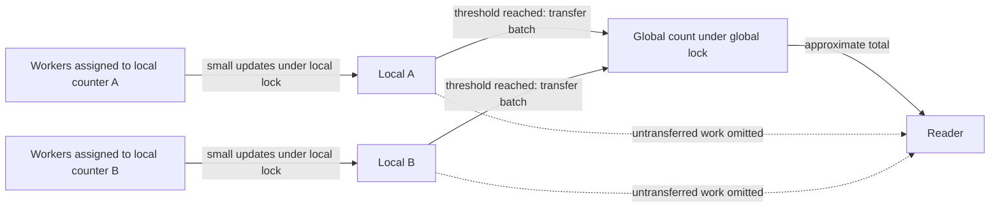

# Concurrent data structures: protect less, measure more

> Adding a lock can make a structure correct. Making it scale requires understanding which operations actually interfere and what extra coordination costs.

Source: Chapter 29, *Lock-based Concurrent Data Structures*, PDF pages 333–345.

## A precise counter is a useful baseline

A counter offers a small interface: increment, decrement, and read. Adding one mutex and acquiring it in every operation produces a straightforward thread-safe counter. Reads participate too: the interface should expose a coordinated value, not an unprotected observation that bypasses the update protocol.

This is the same broad organization used by a **monitor**: shared state is accessed through operations whose execution is mutually exclusive, with acquisition and release attached to entry and exit. A monitor is not another name for a condition variable, and its automatic mutual exclusion does not determine the semantics of its waiting and signaling operations.

The baseline serializes even tiny updates from otherwise independent workers. The chapter's measurements show contention overwhelming the operation's apparent simplicity; they are results for its machine and workload, not a universal mutex cost.

**Perfect scaling**, in this benchmark model, lets additional processors each perform the same amount of work without increasing completion time. Shared coordination can prevent that. Still, start with the simple counter: if the application is fast enough, complexity buys nothing useful.

## Sloppy counters trade freshness for fewer global updates

The source calls its scalable alternative a **sloppy counter**. One logical count is represented by local counters associated with CPUs and a global counter. Each local counter has a lock, and the global counter has another. Ordinary updates acquire only the local lock. Once a local value reaches threshold `S`, its owner transfers that accumulated amount to the global value under the global lock, then resets the local value.

For telemetry, workers can accumulate request completions locally. A larger threshold reduces global transfers but omits more recent work from global-only reads. A smaller threshold gives fresher reads with more contention.

The source gives a conservative lag bound of the number of CPUs multiplied by `S` for this positive-update model, not arbitrary counter operations. Its sample implementation maps a thread identifier to a local counter; partitioning does not eliminate contention between threads sharing that counter.

An exact snapshot can acquire all relevant locks in a defined order and include local values, reintroducing broad coordination. Approximate totals may suit telemetry but not accounting that must enforce a strict limit.

## Linked lists: simplify the failure paths

A single list lock can protect both insertion and lookup. A first implementation may acquire it before allocating a node. If allocation fails, that path must release the lock before returning; missing the release leaves later operations stuck.

The chapter improves the arrangement by allocating and initializing a private node before locking, assuming the allocator itself is thread-safe. Only linking the node into the shared list needs the list lock. Lookup uses one exit path after releasing the lock rather than duplicating unlock calls across found and not-found returns.

For example, prepare a cache-key record privately, then lock to update the shared head. This keeps allocation failure outside the critical section. Before moving other preparation, check whether it really is private.

**Hand-over-hand locking**, also called **lock coupling**, attaches a lock to each node. During traversal, acquire the next node's lock before releasing the current one's. That overlap prevents a gap in the traversal's protection. It permits multiple traversals to advance at different positions, but acquiring and releasing a lock at every node can cost more than the concurrency saves. The source's lesson is to compare implementations, not assume finer granularity is faster.

## Queues can separate their two ends

The Michael–Scott queue sketch uses a head lock for dequeue and a tail lock for enqueue. A dummy node separates the representation of the front from the data-bearing node removed next. Enqueue prepares a new node and links it at the tail; dequeue advances the head and retires the old dummy.

This lets enqueue and dequeue overlap. Treat it as a mechanism sketch, not a complete production implementation or memory-publication specification. It returns failure when empty rather than providing bounded capacity or sleeping consumers; the following chapters add waiting protocols.

## Hash tables partition naturally by bucket

The final example is a fixed-size hash table made from the concurrent linked lists. A key selects one bucket, and that bucket's list lock protects the operation. Lookups or insertions into different buckets can proceed independently, without the per-node locking traffic of a coupled list.

Imagine two workers updating unrelated cache keys that hash into different buckets. Their independence is preserved; keys in the same bucket still contend. The chapter intentionally leaves resizing outside this design. Do not assume the existing bucket locks alone make changing the entire table safe.

The sequence stays consistent: establish correctness, identify a bottleneck, then partition or shorten protected work. The historical big-kernel-lock discussion applies that sequence at OS scale. See [scalability](../../system-design/1-knowledge/fundamentals/scalability.md) for the wider performance question.

## What to take away

- Start with one lock and a clear operation contract; optimize only a demonstrated bottleneck.
- Make counter freshness an explicit API decision before batching updates.
- Move genuinely private preparation outside critical sections and consolidate release paths.
- Partition along independent state, while measuring the coordination overhead added by finer locks.

---

Previous: [Building locks](28-locks.md) · Next: [Condition variables](30-condition-variables.md)
