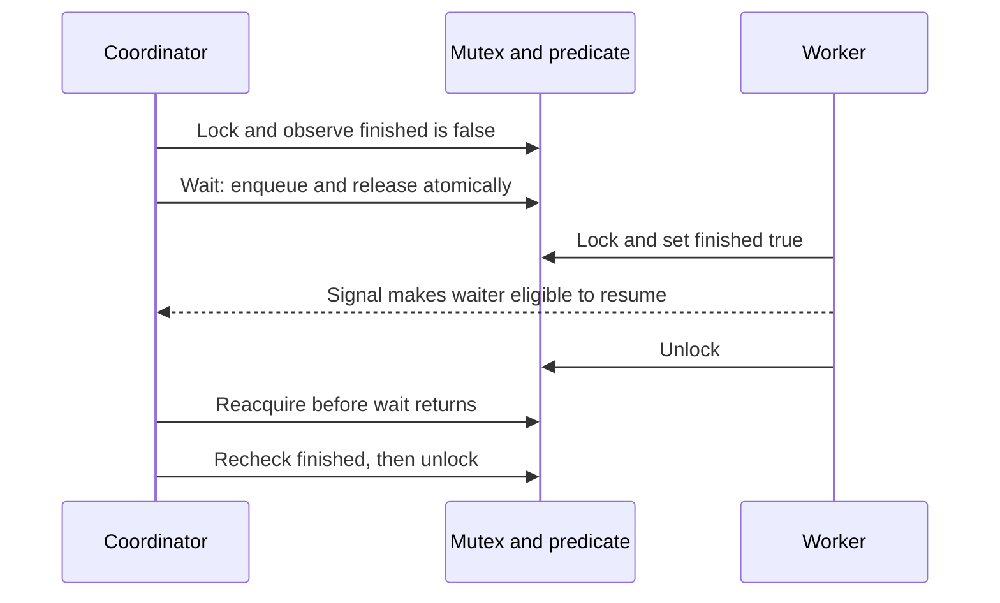
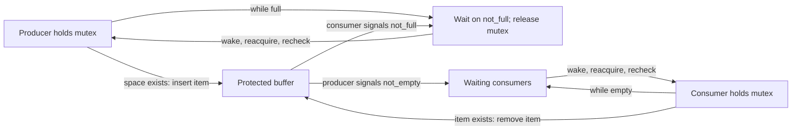

# Condition variables: wait on a predicate, not a notification

> A condition variable lets a thread sleep until shared state may permit progress. Correctness comes from the state predicate, its mutex, and the atomic transition into waiting.

Source: Chapter 30, *Condition Variables*, PDF pages 346–360.

## Why a lock is not enough

A lock excludes interfering access, but does not say when an operation is meaningful. A coordinator needs a worker's result; a consumer needs an item to remove. Ordinary flag polling wastes cycles and does not replace synchronization.

A **condition variable** is a waiting queue associated with changes in program state. `pthread_cond_wait(&condition, &mutex)` enters that queue while atomically releasing the mutex. When the call eventually returns, it has reacquired the mutex. `pthread_cond_signal(&condition)` wakes a waiter, if one exists. A condition variable does not store an application-level truth value, and a signal sent when nobody is waiting does not become a saved notification.

## A completion predicate remembers an early finish

For a worker-completion protocol, keep a `finished` predicate protected by a mutex. The coordinator locks, then calls wait while `finished` is false. The worker locks the same mutex, changes `finished` to true, signals, and unlocks. The coordinator checks again before proceeding.

If the coordinator arrives first, it sleeps until the worker wakes it. If the worker finishes first, the signal may wake nobody, but the predicate lets the coordinator skip waiting. Removing that predicate breaks the second case.

Removing the mutex creates another failure: the coordinator can observe false, pause, then miss a worker's update and signal before going to sleep. Separate unlock and sleep operations would expose that same gap even if the original predicate check was protected. Atomic release-and-wait closes it.

Wait requires the associated mutex to be held. The chapter recommends holding that mutex while modifying the predicate and signaling as the simplest general discipline; signaling without it is not categorically forbidden by the API. Distinguish that recommendation from wait's actual precondition.

## A bounded buffer needs both exclusion and eligibility

In the **producer/consumer**, or **bounded-buffer**, problem, producers create items and consumers remove them from a capacity-limited shared buffer. A request dispatcher feeding worker threads is an example. Producers must not overwrite a full buffer; consumers must not read an empty one. A mutex protects the buffer state, while condition variables handle those eligibility conditions.

The chapter starts with one slot. One condition variable and an `if` before wait work for one producer and consumer, but another consumer breaks the assumption: the producer signals A, consumer B removes the item before A reacquires the mutex, and A tries to consume an empty buffer.

That is **Mesa semantics**: signaling makes a waiter eligible to run, rather than immediately transferring execution and a guaranteed predicate to it. The signaler may continue, and other threads may run before the waiter obtains the mutex. **Hoare semantics** instead hands monitor execution immediately to the signaled waiter, providing a stronger guarantee at that transfer. Do not mix the two models when reasoning about a program. POSIX-style code in this chapter follows the Mesa approach.

Replace `if` with `while`. The awakened consumer reacquires the mutex, sees the now-empty buffer, and waits again. Rechecking also handles spurious wakeups. Neither a real signal nor a spurious one authorizes skipping the predicate.

## Correct wakeup routing is a separate requirement

A loop handles stale predicates but not incorrect routing. With one condition variable, a consumer freeing space may wake another consumer, which rechecks and sleeps. The producer capable of filling the buffer remains asleep; eventually everybody can wait despite an enabled operation.

Use separate queues: `not_empty` for consumers and `not_full` for producers. Producers wait while full and signal `not_empty` after inserting. Consumers wait while empty and signal `not_full` after removing. Both predicates and the buffer remain protected by the same mutex.

The general buffer adds insertion and removal positions advanced modulo capacity, plus a count. Producers wait at full capacity; consumers wait at zero. The mutex still serializes buffer updates. More slots allow batches between waits and overlap outside the critical section, not simultaneous protected updates.

## Covering conditions deliberately wake broadly

Sometimes waiters have different predicates. Imagine a memory pool with no free space: one thread requests 80 bytes and another requests 16. Returning 32 bytes enables only the smaller request. An arbitrary signal can wake the larger requester, which rechecks and sleeps, leaving the enabled smaller requester asleep.

A **covering condition** uses a notification broad enough to cover all potentially enabled waiters. `pthread_cond_broadcast()` wakes all current waiters, each of which checks its own predicate under the mutex. This is straightforward but can generate unnecessary wakeups and contention. If separate queues can direct signals accurately, they may be preferable. Changing every signal into a broadcast can hide a routing mistake rather than explain it.

Related operational vocabulary appears in [message queues](../../system-design/1-knowledge/building-blocks/message-queues.md), though inter-thread predicates and service-level message delivery are different contracts.

## What to take away

- Store the condition in shared state; the condition variable itself does not remember an early signal.
- Hold the predicate's mutex and wait in a loop; rely on wait's atomic release-and-wait transition.
- Separate producer and consumer wait queues so notifications reach a thread capable of progress.
- Use broadcast when heterogeneous predicates genuinely require broad notification, accepting its extra work.

---

Previous: [Concurrent data structures](29-concurrent-data-structures.md) · Next: [Semaphores](31-semaphores.md)
